# Tidal Studio · aprende música con tu maestro

[English](README.md) · **Español** · [Web](https://vsalesa.github.io/tidal-studio/) · [Roadmap (inglés)](ROADMAP.md)

Plataforma para **aprender música y [TidalCycles](https://tidalcycles.org) a la vez**, creando tu propia canción
en vivo con un profesor de IA ("Maestro") que te acompaña en cada paso, aunque no sepas nada de música ni de programación.

**Web: [vsalesa.github.io/tidal-studio](https://vsalesa.github.io/tidal-studio/)** (presentación, capturas y cómo instalarlo; pulsa ES para verla en español).

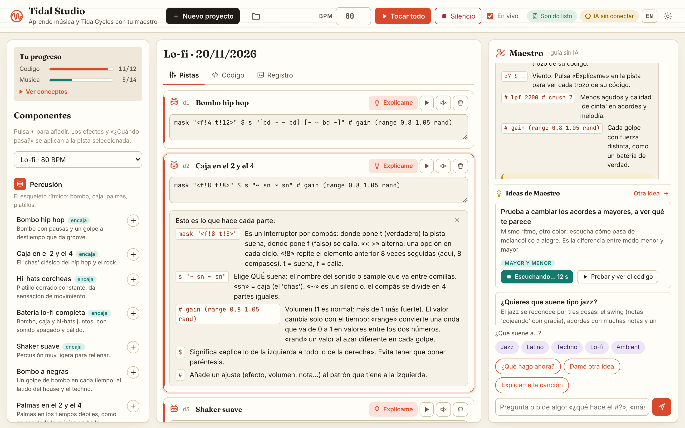

**Contenido:** [Empezar una canción](#empezar-una-canción) · [Cursos por género](#cursos-por-género) · [Maestro, tu profesor](#maestro-tu-profesor) · [Opciones de Maestro](#escucha-las-opciones-de-maestro-y-elige-una) ·
[Ayuda con tu código](#ayuda-con-tu-código-y-paleta-de-código) · [Bloques y resaltado en directo](#vista-de-bloques-y-resaltado-en-directo) ·
[Controles en el chat](#controles-y-tarjetas-en-el-chat) · [Mezcla](#pestaña-mezcla) · [Línea de tiempo](#línea-de-tiempo-cuándo-suena-cada-sonido) · [Arreglo](#arreglo) ·
[Deshacer y chat ordenado](#deshacer-historial-y-un-chat-ordenado) · [Instrumentos](#instrumentos) · [Biblioteca de samples](#biblioteca-de-samples) ·
[Skills y plugins](#skills-y-plugins) · [Cómo decide Maestro](#cómo-decide-maestro-y-su-razonamiento) ·
[Detección de IA y Diagnóstico](#conecta-tu-ia-con-detección-automática-y-diagnóstico) · [App nativa](#una-app-de-verdad-en-tu-ordenador) · [Tutorial](#tutorial-interactivo) · [Guardar y compartir](#guardar-exportar-y-compartir) ·
[Instalación](#instalación-una-sola-vez)

## Qué puedes hacer

### Empezar una canción

**Nuevo proyecto en blanco, con wizard o con lluvia de ideas.** Tu proyecto actual se guarda solo en Mis proyectos.

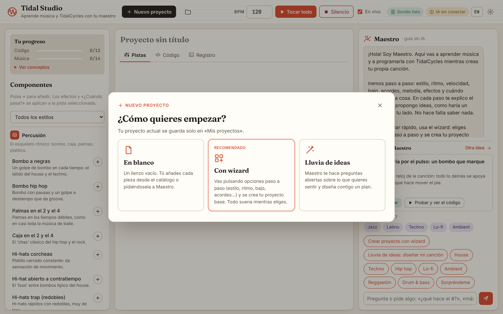

En el **wizard** eliges estilo, tempo, ritmo, bajo, acordes, melodía, textura, efectos y estructura pulsando opciones (las
recomendadas para tu estilo vienen marcadas «encaja») y lo oyes en vivo mientras eliges. Termina con un resumen donde
cada línea de código está explicada.

| 1. Estilo | 2. Tempo |
|---|---|
|  |  |
| **3. Ritmo (hasta 3 capas)** | **4. Bajo, acordes, melodía y textura** |
|  |  |
| **5. Efectos** | **6. Estructura en el tiempo** |
|  | 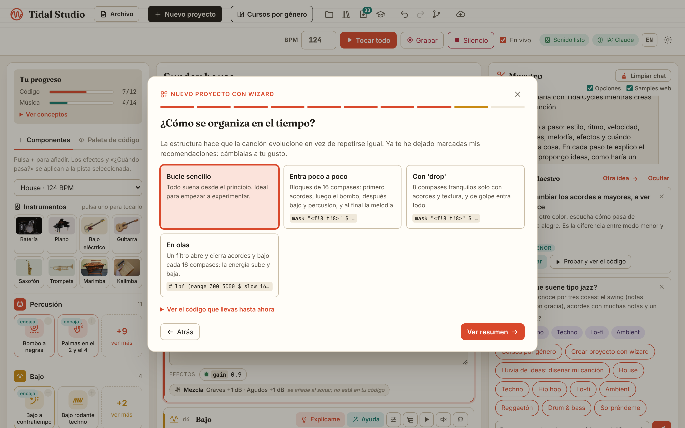 |
| **7. Resumen con todo el código explicado** | |
|  | |

La **lluvia de ideas** te hace preguntas abiertas (¿qué quieres sentir?, ¿qué lugar imaginas?, ¿cómo cambia la
energía?…) con ejemplos para pulsar, y al final te da el **plan de tu canción**: estilo, tempo, partes y cambios concretos
para probar.

| Preguntas con ejemplos | El plan de tu canción |
|---|---|
|  |  |

### Cursos por género

**Construye una canción desde cero.** Once cursos (merengue, salsa, cumbia, reggaeton, bossa nova, jazz, funk, house,
techno, drum & bass, lo-fi), cada uno una clase de producción completa: el ritmo característico (güira y tambora, clave y
tumbao, dembow, two-step…), luego bajo, armonía, melodía, arreglo y mezcla. Cada paso añade pistas que ya suenan bien,
Maestro explica el *porqué* musical y el código trozo a trozo, y te propone un reto. Lista completa y fuentes en
[docs/COURSES.md](docs/COURSES.md).

| Elige un género | Cada paso: por qué suena así, el código y Maestro explicándolo |
|---|---|
|  |  |
| **Paso de arreglo: intro, merengue y mambo** | **Paso de mezcla y curso completado** |
|  |  |

### Maestro, tu profesor

- **Maestro te guía** paso a paso: estilo, ritmo, velocidad, bajo, acordes, melodía, efectos y cuándo cambia cada cosa.
- **Te explica el código**: botón «Explícame» en cada pista y «Explícame todo el código»; cada cambio llega con su
  explicación trozo a trozo y, a veces, un pequeño **reto** para que edites tú.
- **Te sugiere ideas como un productor**: «Yo le añadiría palmas en el 2 y el 4… pruébalo a ver qué te parece».
  Cada idea enseña un concepto musical (backbeat, contraste, pregunta y respuesta, mayor y menor…). Pulsas **Probar**,
  escuchas y decides: **Me lo quedo** o **Deshacer**.
- **Pre-escucha**: botón «Escuchar» en cada idea o receta: suena unos compases y vuelve sola a tu versión.
- **Recetas de estilo**: «¿Quieres que suene tipo jazz?» (también latino, techno, lo-fi, ambient). Transforma tu canción y
  te enseña **cómo lo ha hecho**: el código de antes y de después con lo nuevo resaltado y explicado.


### Escucha las opciones de Maestro y elige una

Pide algo creativo a Maestro («añade un bajo», «más oscuro», «más energía», «sorpréndeme») y, como en una lluvia de
ideas con un productor, no cambia tu canción sin más: te propone **3 o 4 opciones distintas hechas para tu petición y tu
canción**, cada una con un título, la idea musical que enseña y su código. Si tu petición es muy vaga, primero te hace
**una** pregunta con respuestas para pulsar.

- **Escuchar** hace sonar una opción **en directo sobre tu canción**, todo el tiempo que quieras. Pulsa Escuchar en otra
  (o las teclas **1-4**) y cambia al instante; **A/B** salta entre las dos últimas que has oído; **Parar** (o **Esc**)
  vuelve a tu versión.
- **Ver el código** enseña qué cambiaría cada opción, antes y después.
- **Elegir esta** la añade a tu canción y te explica cómo ha cambiado el código; las demás se descartan.
  **Deshacer la elección** recupera las opciones.
- **Otras opciones**, **Afinar…** («la B pero más suave») o **Ninguna** piden otras nuevas a Maestro.

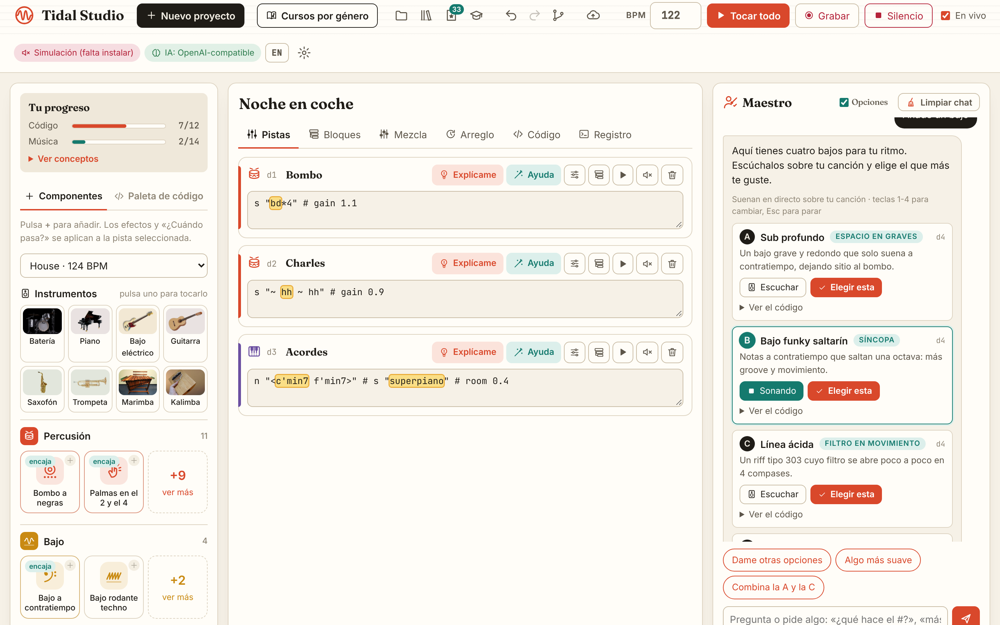

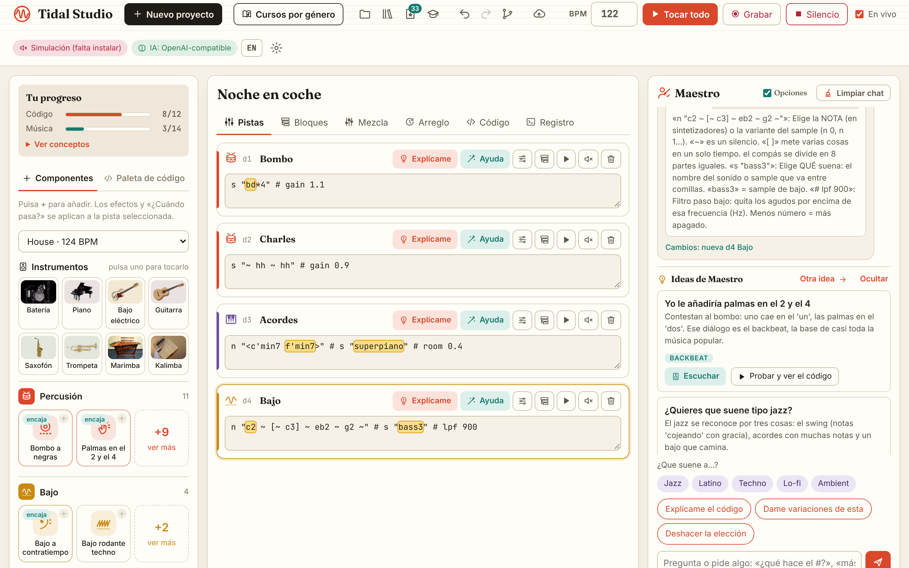

Funciona con todos los proveedores de IA, y también sin IA (escribe «dame opciones» y las crea con sus propias ideas y
recetas de estilo). Apágalo con el interruptor **Opciones** arriba del chat si prefieres que Maestro aplique los cambios
directamente.

### Ayuda con tu código y paleta de código

**Ayuda**: ¿has editado una pista y da error o no suena como querías? Pulsa **Ayuda** (se abre sola si Tidal da error).
Elige qué querías (no suena, más fuerte, más lento, más oscuro…) o cuéntalo, y Maestro encuentra el problema (falta el
`$`, comillas o paréntesis sin cerrar, sonidos o efectos mal escritos, cosas que la dejan en silencio), te propone el
arreglo con el antes y el después, te deja **Escuchar** antes de aplicarlo y puede **volver a la versión que funcionaba**.

**Paleta de código**: 39 bloques de Tidal organizados por lo que quieres conseguir (ritmo, sonido, notas y armonía,
efectos, tiempo y estructura, azar) y por nivel (primeros pasos, intermedio, avanzado). Pulsas uno y se aplica a la pista
seleccionada; Maestro te enseña y explica el cambio, y puedes deshacerlo.

| Ayuda: Maestro encuentra el problema y propone el arreglo | Paleta de código por objetivo y nivel |
|---|---|
|  |  |

**Los errores antiguos se van**: el error de una pista se borra solo en cuanto esa pista (o «Tocar todo») suena sin
errores, y con él la ayuda que Maestro abrió por ese error. Si cambias el código después de un error, el error se pone gris
y avisa de que es de una versión anterior; la × del recuadro lo borra cuando quieras.


### Vista de bloques y resaltado en directo

**Vista de bloques**: tu canción en bloques visuales anidados. Cada pista muestra lo que la transforma (antes del `$`),
lo que suena (cada paso del ciclo es una casilla, con grupos `[ ]`, alternancias `< >`, silencios `~` y repeticiones `*`)
y sus ajustes (`#`). Pulsas cualquier bloque y un **tooltip** te dice qué hace y te deja **editarlo ahí mismo**: cambiar
un paso (silencio, ×2, partir, a veces, añadir, borrar), la mini-notación, el valor de un ajuste con un deslizador, los
números de una transformación (`every 4 (fast 2)`), añadir ajustes o transformaciones, o cambiar el tempo. Suena al editar.

| Tu canción en bloques anidados | Pulsa un bloque: tooltip para editarlo |
|---|---|
|  |  |

**Enciende y apaga cada efecto**: cada efecto (`# room`, `# delay`, `# lpf`, `# crush`…) tiene su propio interruptor, por
pista, en la vista de Bloques, debajo del código de cada pista en Pistas y en la tarjeta configuradora de Maestro. Al
apagarlo deja de sonar solo ese efecto y se guarda su valor, así que al encenderlo vuelve tal cual. En el código queda
como comentario de Haskell, `{- # room 0.4 -}`, que Tidal ignora; suena al momento (con En vivo activado) y Deshacer lo
recupera.

| Bloques: un interruptor por efecto | Pistas: la fila de efectos bajo el código |
|---|---|
|  |  |

**Ver lo que suena**: mientras suena la música se ilumina, paso a paso, el trozo del código de cada pista que está
sonando, en las vistas Pistas, Bloques y Código (como en Strudel). SuperDirt avisa a la app de cada nota que toca.

| En la vista Pistas | En la vista Bloques |
|---|---|
| 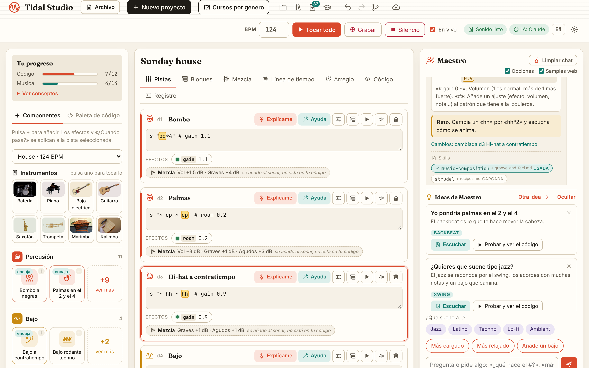 |  |
| **En la pestaña Código** | |
|  | |

### Controles y tarjetas en el chat

**Controles en el chat (agentic UI)**: Maestro pone deslizadores, control de tempo, selector de sonido y un secuenciador
por pasos dentro de sus mensajes. Al moverlos se escribe el código Tidal en directo, así ves qué palabra cambia. Usa el
botón de deslizadores de cada pista, el botón «Ajustar con controles» o pídeselo. Hay más: `every` (hacer algo cada N
ciclos), azar (`degradeBy`, `sometimesBy`), swing, ritmos euclídeos (`bd(3,8)`), filtro en movimiento
(`# lpf (range … $ slow n sine)`), escala y octava, acordes y una **mesa de mezcla** con volumen, panorama y silencio de
todas las pistas a la vez. Cada uno enseña el código que escribe.

**Tarjeta configuradora**: pide a Maestro «una tarjeta del bajo» (o pulsa el botón de tarjeta en una pista, un bloque o
un canal de la mesa) y aparece en el chat una tarjeta con **todos los valores** de ese elemento: lo que suena, las
transformaciones y sus números, cada ajuste `#`, y el volumen y ecualizador de la pista. La «tarjeta de la canción» tiene
tempo, master y el volumen de cada pista. Las tarjetas trabajan siempre sobre la versión **actual** de la canción y se
actualizan solas cuando cambias algo en otro sitio.

| Controles en el chat | Tarjeta configuradora del bajo |
|---|---|
| 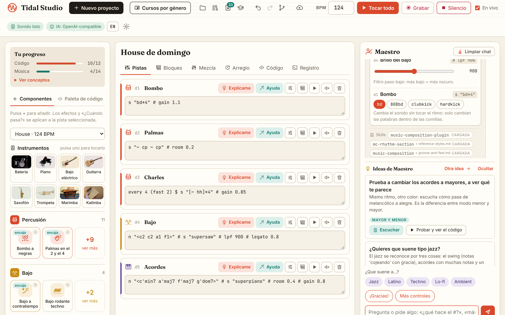 |  |

### Pestaña Mezcla

Mesa con fader de volumen (dB) y **ecualizador** de 3 bandas (graves 200 Hz, medios 1 kHz, agudos 4 kHz) en cada pista,
silencio y solo, y un canal **Master** para toda la canción. No toca el código de tus pistas: al sonar añade `# amp` y
`# eqlow / eqmid / eqhigh` (lo verás como una línea `-- mezcla` en la pestaña Código).


Para que no te pierdas, cada pista con mezcla enseña una etiqueta **Mezcla** en **Pistas** y en **Bloques** (por
ejemplo «Mezcla · Graves −3 dB», y Master o Solo cuando aplican). Te recuerda que eso se añade al sonar y no está en su
código; púlsala para ir a la tira de esa pista en la pestaña Mezcla. Los valores negativos se escriben entre paréntesis,
`# eqlow (-3)`, porque Tidal lee `eqlow -3` como una resta.


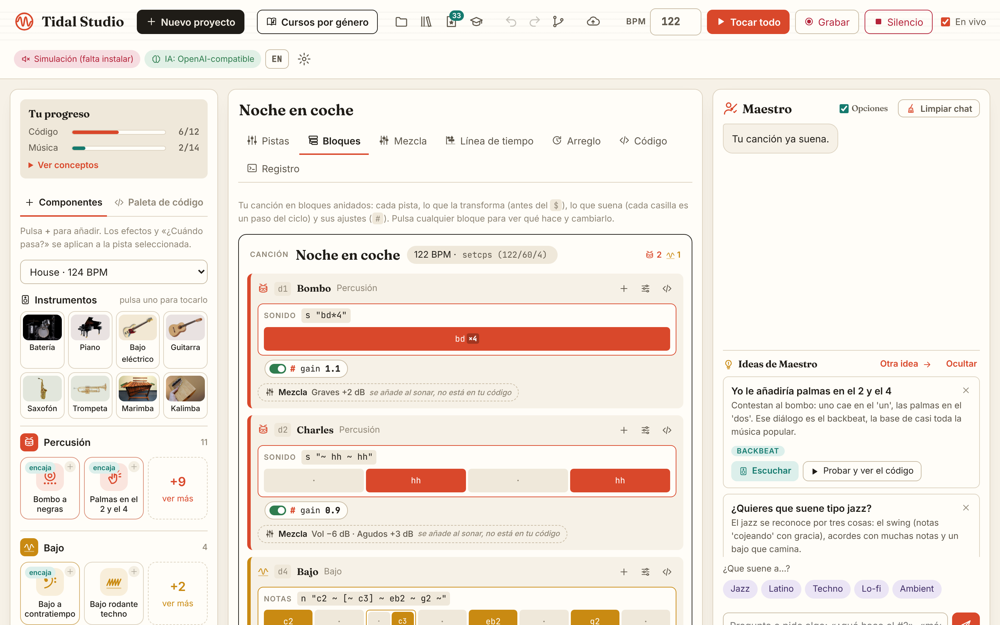

### Línea de tiempo: cuándo suena cada sonido

Tidal te dice *cada cuánto* pasan las cosas (`"bd*2 [~ sn]"`, `every 4 (fast 2)`, `(3,8)`…), y eso cuesta imaginarlo.
La pestaña **Línea de tiempo** dibuja *dónde* cae cada golpe: el tiempo va de izquierda a derecha (cada columna grande
es un ciclo, un compás de 4 tiempos, con líneas para los tiempos y las semicorcheas), una fila por sonido y, en las
pistas melódicas, una fila por nota, como un piano roll. Cada bloque es un golpe y su largo es lo que dura.

- **Exacta, la calcula el propio Tidal.** El estudio le pide a TidalCycles (`queryArc`, en un GHCi aparte que no suena)
  las notas de cada pista, así que los polímetros, `euclid`, `every`, `off`, `jux`, las máscaras del arreglo… se dibujan
  tal y como van a sonar. Las pistas llevan la etiqueta **Tidal**. Sin motor usa una calculadora aproximada en el
  navegador (etiqueta **≈ aprox.**).
- **Cada golpe apunta a su código.** Pasa el ratón por un bloque y se ilumina el trozo del código que lo produce (en el
  código de la pista y en una ficha con el compás y el tiempo en que cae y cuánto dura), y también los demás golpes de
  ese mismo trozo. Pasa el ratón por un trozo del código y verás todos sus golpes. Pulsa para fijarlo, y **Ir a este
  trozo en Pistas** lo selecciona para que lo cambies.
- **El azar** (`sometimes`, `?`, `degradeBy`…) se marca: los dados de Tidal son fijos en cada ciclo, así que lo que ves
  es lo que sonará en esos compases.
- Elige de 1 a 16 ciclos, haz zoom, avanza compás a compás y activa **Seguir lo que suena**: mientras toca, una línea
  avanza y los golpes que suenan se encienden.

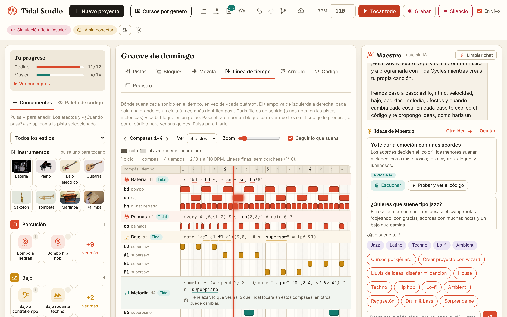


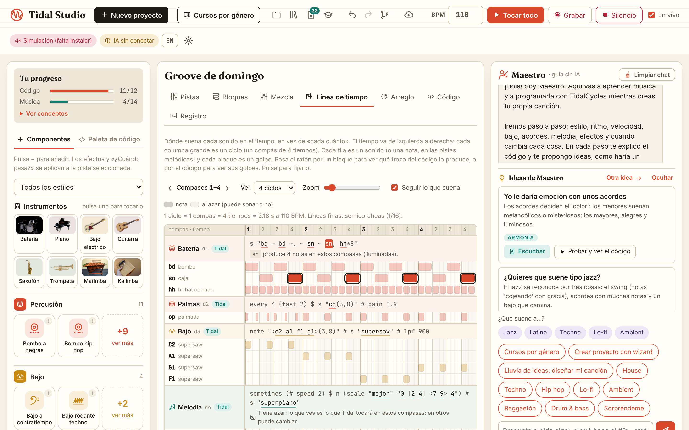

### Arreglo

La pestaña Arreglo muestra todas las pistas a lo largo de 8, 16 o 32 compases. Pinta en qué compases suena cada pista
(escribe `mask "<…>"`) o parte de un preset: entrar por capas, drop, break, pregunta y respuesta.

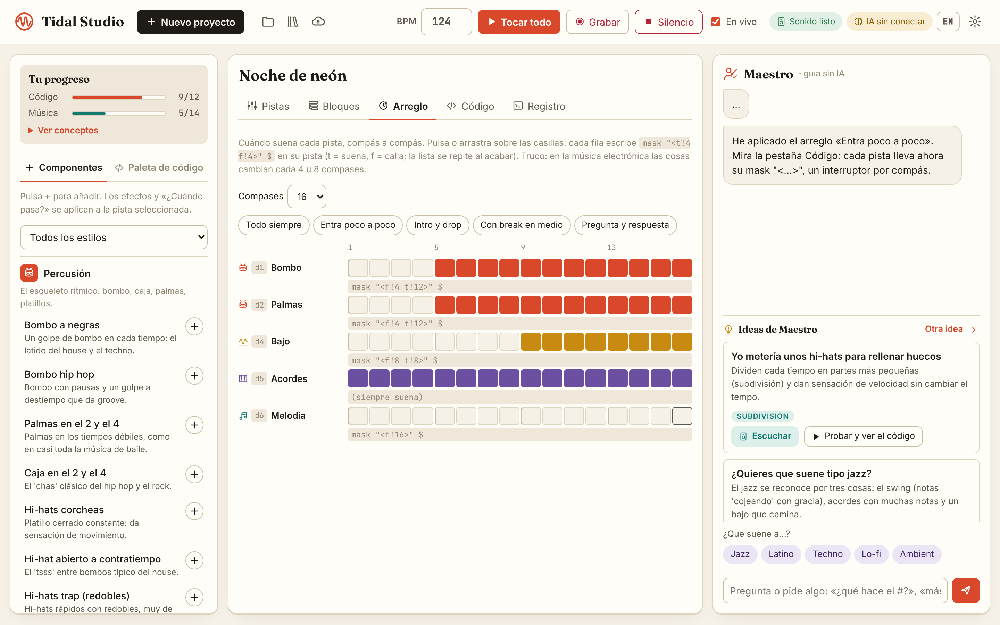

### Deshacer, historial y un chat ordenado

**Deshacer, rehacer e historial (rollback)**: cada cambio de la canción queda guardado. Botones deshacer/rehacer
(Ctrl/Cmd+Z, Ctrl/Cmd+Shift+Z) y un **Historial** para volver a cualquier versión anterior.


**Un chat ordenado**: el botón «Limpiar chat» (arriba a la derecha del panel de Maestro) vacía la conversación sin tocar
tu canción, y el botón «Recuperar el chat» la devuelve. «Ocultar» pliega las ideas de Maestro para dejar más sitio al chat
(el navegador recuerda tu elección; «Mostrar» las vuelve a enseñar).

| «Ocultar» las ideas de Maestro para tener más chat | «Limpiar chat»: la canción se queda y el chat puede volver |
|---|---|
|  |  |

**Descarta las ideas que no te gusten**: la × de cada idea de Maestro la quita. El navegador lo recuerda (también al
recargar), su hueco lo ocupa la siguiente idea y Maestro sabe cuáles has descartado para no volver a proponerlas, ni otras
casi iguales. «Recuperarlas» lo deshace.


### Instrumentos

**Fotos reales de instrumentos** (con licencia libre, de Wikimedia Commons, ver [CREDITS.md](CREDITS.md)): una batería en
la que pulsas cada pieza (bd, sn, hh, ho, toms, crash, aro) para oírla y aprender su nombre en Tidal, eliges sus pasos y
la añades; piano, bajo, guitarra, saxo, trompeta, marimba y kalimba con un teclado en pantalla que escribe tu melodía como
código. Cada componente del catálogo tiene además su propio icono.

| Batería: pulsa una pieza y aprende su nombre | Instrumentos con teclado |
|---|---|
|  |  |

### Biblioteca de samples

Sonidos por tipo (bombos, cajas, platos, percusión, breaks, bajos, melódicos, pads, voces, FX, sintes). Escúchalos,
úsalos en una pista nueva o ponlos en la pista seleccionada manteniendo el ritmo. Sube tus archivos (WAV, AIFF, FLAC, OGG)
o **busca en Freesound** (clave API gratuita) filtrando por licencia; lo descargado queda listo para Tidal y los créditos
de los sonidos CC BY se apuntan en `samples/CREDITS.md`. La pestaña **Packs** explora packs de la comunidad en GitHub
(unas 70 cajas de ritmos, Uzu drumkit, VCSL, un piano de cola, SP-12, mridangam, o cualquier `github:usuario/repo` con un
`strudel.json`): escucha, instala un sonido o una caja de ritmos entera. **Los packs instalados y los sonidos de Freesound
se cargan en SuperDirt al momento**, sin reiniciar el motor. En tus samples ves la **forma de onda**, arrastras para elegir
un trozo, lo escuchas y lo usas (`# begin … # end …`). Maestro conoce tu biblioteca y puede usarla.

| Sonidos incluidos por tipo | Packs online: cajas de ritmos enteras |
|---|---|
|  |  |
| **Buscar en Freesound por licencia** | **Forma de onda y recorte** |
| 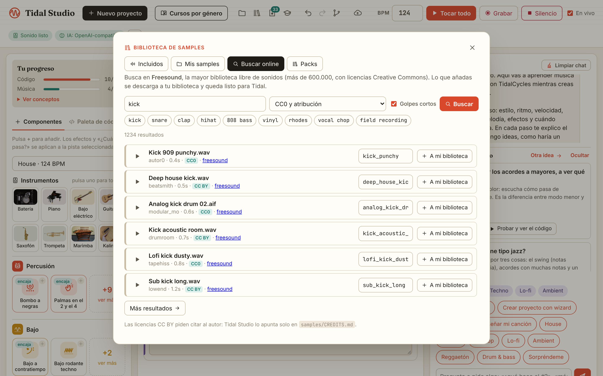 |  |

### Skills y plugins

Maestro carga **skills** de música (`SKILL.md`, el mismo formato que las Agent Skills de Claude) y debajo de cada
respuesta muestra cuáles cargó y cuáles usó. Instala más skills, o **plugins y marketplaces de Claude Code** enteros,
pegando un enlace de GitHub en el panel de Skills: sus skills se suman a las de Maestro y sus comandos funcionan en el chat
como `/nombre`. Detalles en [Skills](#skills) y [Plugins](#plugins) más abajo.

| Debajo de cada respuesta: qué skills se cargaron y cuáles se usaron | El panel de Skills: activar, cargar siempre, ver, instalar |
|---|---|
| 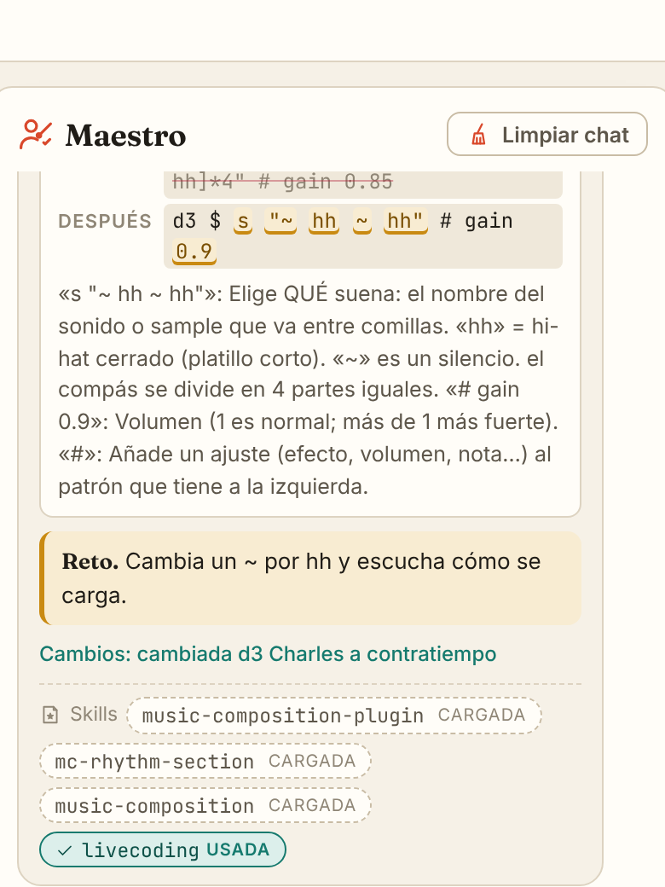 | 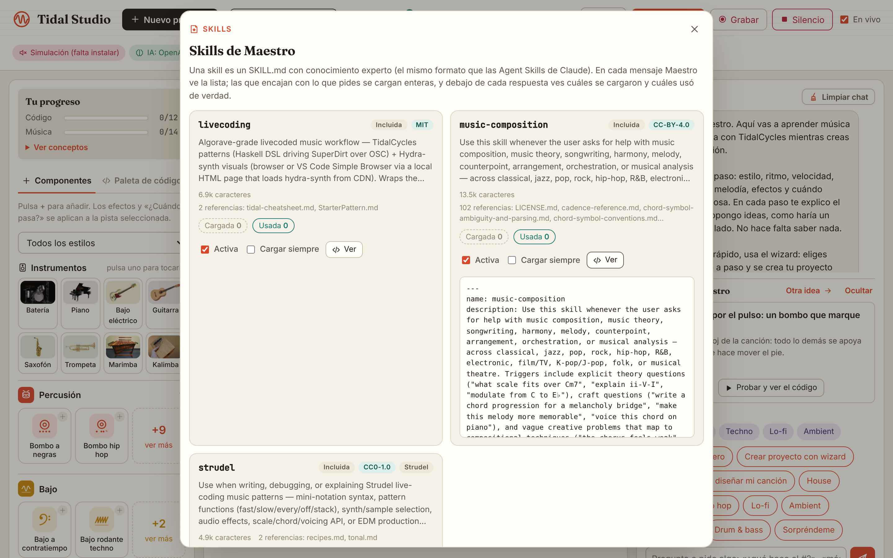 |
| **Plugins: un plugin de Claude Code entero desde un enlace de GitHub** | |
| 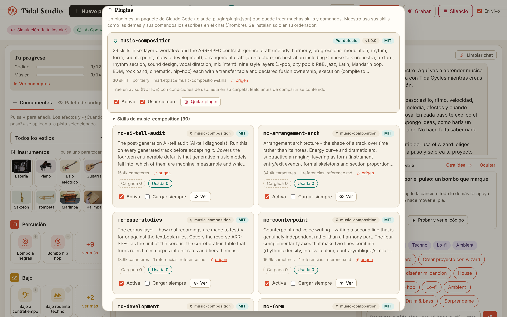 | |

### Cómo decide Maestro, y su razonamiento

Cada respuesta que se ha apoyado en una skill empieza con **Cómo lo he decidido**: una fila por decisión musical
(estilo, ritmo, tempo, bajo, armonía, melodía, instrumentos, efectos, mezcla, estructura) con la skill que consultó,
la regla o el consejo que sacó de ella y lo que hizo con él (pista, valor, código). Solo pueden salir skills cuyo
contenido se cargó de verdad para ese mensaje, así que no puede inventarse una regla a partir del nombre. Pulsa una
skill para abrirla.

Mientras sale **Maestro está pensando…**, una línea gris muy tenue, **Pensando**, enseña qué está haciendo, como en un
harness de programación: lee tu canción, qué skills ha elegido y por qué, a quién pregunta y el razonamiento de Claude
según llega. Púlsala para desplegarla; después de la respuesta se queda debajo del mensaje como **Razonamiento**. Con
clave de API de Anthropic usa el thinking adaptativo en modo resumido; con tu suscripción de Claude lee la salida
`stream-json` del comando `claude`; los modelos compatibles con OpenAI enseñan su `reasoning_content` si lo devuelven.
Los proveedores que no comparten su razonamiento solo muestran los pasos.

| Cómo lo he decidido | Razonamiento |
|---|---|
|  |  |

### Conecta tu IA, con detección automática y Diagnóstico

En **Ajustes** eliges un endpoint compatible con OpenAI, una clave de API de Anthropic o **Claude con tu suscripción**. Con
tu suscripción, el estudio encuentra el comando `claude` que usa tu terminal y te enseña lo que ha detectado: ruta,
versión, si tienes la sesión iniciada, modelo por defecto, endpoint y clave de API. **Automática** elige la conexión
adecuada por ti (tu plan si tienes sesión iniciada; si no, lo mismo que tu terminal). Si Maestro no responde, pulsa
**Diagnóstico**: revisa paso a paso el entorno de tu terminal, el comando `claude`, la sesión, el modo de conexión, el
modelo y una prueba real, te dice cómo arreglar lo que falla, y **Probar modelos** prueba cada modelo para que pulses
**Usar** en uno que funcione. **Copiar informe** te da un resumen en texto con las claves ocultas. Detalles en
[Configurar la IA](#configurar-la-ia).

| Detectado en este ordenador | Diagnóstico y Probar modelos |
|---|---|
|  | 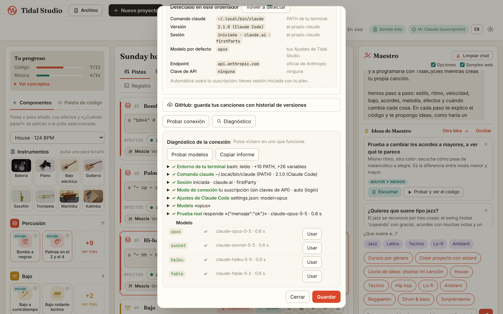 |

### Una app de verdad en tu ordenador

Tidal Studio se instala como **app nativa** con todo dentro (TidalCycles, SuperCollider, los sonidos, Python): se abre en
su propia ventana, sin Terminal, arranca el motor de sonido en segundo plano y lo para al cerrarla. Descarga el
instalador para tu sistema (versión 0.4.0; las nuevas aparecen en la [última versión](https://github.com/vsalesa/tidal-studio/releases/latest)):

| Sistema | Descarga | Después |
|---|---|---|
| **Mac** (Apple Silicon) | [TidalStudio-0.4.0-macOS-AppleSilicon.pkg](https://github.com/vsalesa/tidal-studio/releases/download/v0.4.0/TidalStudio-0.4.0-macOS-AppleSilicon.pkg) | [Pasos en Mac](#lo-más-fácil-el-instalador-para-mac-con-todo-dentro) |
| **Windows** 10/11 (x64) | [TidalStudio-0.4.0-Windows-x64-Setup.exe](https://github.com/vsalesa/tidal-studio/releases/download/v0.4.0/TidalStudio-0.4.0-Windows-x64-Setup.exe) | [Pasos en Windows](#windows-el-instalador-con-todo-dentro) |
| **Linux** (Ubuntu 22.04+, Debian 12+) | [tidal-studio_0.4.0_amd64.deb](https://github.com/vsalesa/tidal-studio/releases/download/v0.4.0/tidal-studio_0.4.0_amd64.deb) | [Pasos en Linux](#linux-ubuntu-2204-debian-12-el-paquete-deb) |

### Tutorial interactivo

La primera vez que abres el estudio, Maestro te enseña todo en 22 pasos cortos (tocar la batería, añadir pistas, efectos,
controles en el chat, ideas, recetas, bloques, arreglo, código, biblioteca…). Cada paso espera a que lo hagas, y puedes
repetirlo desde el botón del birrete.

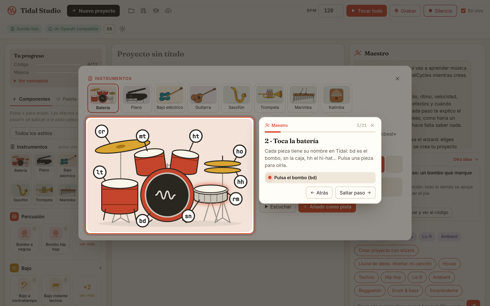

### Guardar, exportar y compartir

- **GitHub**: guarda cada versión de tu canción como un commit en un repositorio tuyo (`song.tidal`, `song.json`,
  `README.md`), mira el historial y abre cualquier versión antigua desde Mis proyectos → GitHub.
- **Exportar**: descarga la canción como archivo `.tidal`, copia un **enlace para compartir** (toda la canción va en la
  URL; al abrirlo se carga como proyecto nuevo) o **graba** lo que suena a un WAV en `recordings/` con el botón de grabar.
- **Mis proyectos**: tus canciones se guardan solas y puedes abrirlas o borrarlas desde la carpeta.


### Y además

- **Tu progreso**: conceptos de código y de música que ya has usado.
- **Componentes para añadir** y **código siempre visible y editable**.
- **Español e inglés**: cambia con el botón EN/ES de la barra superior. Maestro responde en el idioma elegido.
- **Cualquier IA**: endpoint compatible con OpenAI (OpenAI, OpenRouter, Groq, DeepSeek, Mistral, Ollama, LM Studio…)
  o Claude (Anthropic). Sin IA también funciona: guía con botones, explicaciones e ideas locales.
- **macOS, Windows y Linux**: el instalador detecta tu sistema.

## Instalación (una sola vez)

### Lo más fácil: el instalador para Mac con todo dentro

Descarga `TidalStudio-…-macOS-AppleSilicon.pkg` de la
[última versión](https://github.com/vsalesa/tidal-studio/releases/latest) y haz doble clic. Lleva todo dentro
(TidalCycles con su propio Haskell, SuperCollider, SuperDirt y sus sonidos, Python) y **no descarga nada** al instalar.
Después abre **Tidal Studio** desde Aplicaciones.

Tidal Studio es una app de Mac de verdad: se abre en su propia ventana (con su icono en el Dock y su barra de menús),
arranca SuperCollider, SuperDirt y Tidal en segundo plano **sin ninguna ventana de Terminal**, y los para todos al salir
(⌘Q o cerrando la ventana). Si algo falla, te enseña el registro, que también está en
`~/Library/Logs/Tidal Studio/studio.log`. **Visualización → Abrir en el navegador** abre el mismo estudio en tu navegador.

Aún no está firmado por Apple, así que la primera vez macOS lo bloquea: ve a
**Ajustes del Sistema → Privacidad y seguridad**, pulsa **Abrir igualmente** y vuelve a abrir el `.pkg`.
Instala el motor en `/Users/Shared/TidalStudio` (unos 3 GB) y no toca el SuperCollider, Haskell o Python que ya tengas.
Cómo se construye: [packaging/README.md](packaging/README.md).

### Windows: el instalador con todo dentro

Descarga `TidalStudio-…-Windows-x64-Setup.exe` de la
[última versión](https://github.com/vsalesa/tidal-studio/releases/latest) y ejecútalo. También lleva todo dentro y se
instala en `C:\TidalStudio`. Abre **Tidal Studio** desde el menú Inicio o el escritorio: el estudio se abre en su propia
ventana (Microsoft Edge en modo app, sin pestañas ni barra de direcciones) y **sin consola**, y al cerrar esa ventana
se paran SuperCollider y Tidal. Aún no está firmado, así que SmartScreen puede decir «Windows protegió su PC»: pulsa
**Más información → Ejecutar de todas formas**. Registro: `%LOCALAPPDATA%\Tidal Studio\logs\studio.log`.

### Linux (Ubuntu 22.04+, Debian 12+): el paquete .deb

Descarga `tidal-studio_…_amd64.deb` de la [última versión](https://github.com/vsalesa/tidal-studio/releases/latest) e
instálalo con `sudo apt install ./tidal-studio_*_amd64.deb` (apt instala también el SuperCollider de tu distribución).
Abre **Tidal Studio** desde el menú de aplicaciones: se abre en su propia ventana GTK y al cerrarla se para todo. Con
PipeWire, instala `pipewire-jack` para que SuperCollider suene. Registro: `~/.local/share/tidal-studio/logs/studio.log`.

### Desde la carpeta del código (Windows, Linux o Mac)

Descarga o clona esta carpeta y:

| Sistema | Qué hacer |
|---|---|
| **Windows 10/11** | Doble clic en `install.bat` |
| **macOS** | Abre Terminal en la carpeta y ejecuta `./install.sh` |
| **Linux** (Debian/Ubuntu, Fedora, Arch, openSUSE) | `./install.sh` |

El instalador habla español o inglés según el idioma de tu sistema (puedes forzarlo con `./install.sh --lang es` o
`install.ps1 -Lang es`). Pone, si faltan: Python 3, Git, SuperCollider, SuperDirt (sonidos), Haskell (vía ghcup) y TidalCycles.
Tarda 15–40 minutos la primera vez (descarga ~1 GB). Puedes ejecutarlo otra vez sin miedo: se salta lo que ya está.

## Uso

| Sistema | Abrir el estudio |
|---|---|
| Windows | Doble clic en `start.bat` |
| macOS / Linux | `./start.sh` |

Se abre el navegador en <http://localhost:8765>. Después:

1. Pulsa **Nuevo proyecto** y elige en blanco, con wizard o lluvia de ideas.
2. Si quieres, abre los **Ajustes** (rueda dentada) y conecta tu IA; sin ella funciona la guía con botones.
3. Habla con **Maestro** a la derecha, o añade componentes desde la izquierda.
4. Mira y edita el código en la pestaña **Código** (`Ctrl+Enter` aplica).
5. **Silencio** para parar todo al instante.

### Configurar la IA

| Servicio | URL base | Modelo de ejemplo |
|---|---|---|
| OpenAI | `https://api.openai.com/v1` | `gpt-4o-mini` |
| OpenRouter | `https://openrouter.ai/api/v1` | `openai/gpt-4o-mini` |
| Groq | `https://api.groq.com/openai/v1` | `llama-3.3-70b-versatile` |
| Ollama (local, gratis) | `http://localhost:11434/v1` | `llama3.1` |
| LM Studio (local, gratis) | `http://localhost:1234/v1` | el que tengas cargado |
| Claude (clave API de Anthropic) | — | `claude-opus-5-5` |
| **Claude con tu suscripción** (Claude Code, Pro/Max) | — | el de tu plan |

**¿Sin clave de API? Usa tu suscripción de Claude:** instala [Claude Code](https://claude.com/claude-code), ejecuta `claude`
una vez en una terminal e inicia sesión con tu plan Pro o Max, y elige «Claude con tu suscripción» en Ajustes. Maestro habla
con Claude a través del comando `claude` de tu ordenador. Cuenta en los límites de uso de tu plan y responde algo más
lento que la API (unos 10–20 s).

Las claves se guardan solo en `config.json`, en tu ordenador (no se sube a git). También puedes usar las variables
de entorno `OPENAI_API_KEY` o `ANTHROPIC_API_KEY`.

Si no conecta, abre **Ajustes → Diagnóstico** ([qué revisa](#conecta-tu-ia-con-detección-automática-y-diagnóstico)).

### Skills

Maestro puede cargar **skills** (carpetas con un `SKILL.md`, el mismo formato que las Agent Skills de Claude). Vienen tres
skills de música con licencia abierta (live coding con Tidal, recetas de Strudel y composición musical en general); con el botón de skills de la barra superior puedes activarlas o desactivarlas,
marcar una como «Cargar siempre», leerla o instalar otra pegando su enlace de GitHub. Debajo de cada respuesta de Maestro
ves qué skills se cargaron para ese mensaje y cuáles usó de verdad. Detalles y fuentes: [skills/README.md](skills/README.md).


### Plugins

El mismo cuadro instala también **plugins de Claude Code** (un repositorio con `.claude-plugin/plugin.json`) y
**marketplaces** (`.claude-plugin/marketplace.json`, con varios plugins: eliges cuáles). Pega el enlace del repositorio,
por ejemplo `https://github.com/jtydhr88/music-composition-skills`. Tidal Studio lo descarga con `git` (o con el
`.tar.gz` de GitHub si no tienes git), copia **solo archivos de texto** en `my-plugins/<plugin>/` en tu ordenador
(nunca en este repositorio) y además:

- sus **skills** las usa Maestro como las demás (salen agrupadas bajo el plugin en el panel);
- sus **comandos** (`commands/*.md`) se escriben en el chat de Maestro: `/nombre` o `/plugin:nombre`, con argumentos;
- agentes, hooks y servidores MCP/LSP son para Claude Code: se listan pero no se usan.

Cada plugin se puede desactivar (desaparecen sus skills y comandos) o quitar. Mira su licencia y su `NOTICE` antes de
compartir su contenido.

**Viene por defecto: composición musical.** La primera vez que Tidal Studio arranca con internet descarga
[vsalesa/music-composition-skills](https://github.com/vsalesa/music-composition-skills) (la traducción al inglés del
plugin de composición de jtydhr88, 30 skills, MIT) en `my-plugins/`. Está marcado **Usar siempre**: Maestro carga su
skill principal `music-composition` en cada mensaje y siempre reserva un hueco para la skill suya que mejor encaje
(armonía, jazz, groove, forma…). Se descarga en vez de ir dentro del instalador porque sus referencias citan libros con
copyright (ver su `NOTICE`). Si lo quitas, no vuelve; desmarca «Usar siempre» para que sea un plugin normal.

### Samples

Tus sonidos viven en `samples/<nombre>/` (cada carpeta es un sonido de Tidal: `s "nombre"`, `s "nombre:1"` para el segundo
archivo). SuperDirt los carga al arrancar y los recarga cuando añades o borras algo. Para Freesound, pide una clave API
gratuita en [freesound.org/apiv2/apply](https://freesound.org/apiv2/apply) y pégala en la biblioteca (pestaña Buscar
online). Tidal Studio descarga la vista previa OGG de alta calidad de Freesound, que SuperCollider lee directamente.

Cajas de ritmos opcionales: `git clone https://github.com/geikha/tidal-drum-machines samples/packs/tidal-drum-machines`
(se cargan solas en el siguiente arranque).

### GitHub

Abre ⚙ Ajustes → GitHub. Crea un **token fine-grained** en GitHub (Settings → Developer settings → Personal access tokens)
con acceso al repositorio de tus canciones y el permiso **Contents: Read and write**. Escribe el repositorio como
`usuario/nombre`; si aún no existe, «Crear repositorio privado» lo crea (para eso el token necesita permiso para crear
repositorios). Después usa el botón de la nube de la barra superior para guardar una versión con un mensaje. El token se
guarda solo en `config.json`.

## Cómo funciona

[](docs/diagrams/architecture.es.svg)

Fuente del diagrama: [docs/diagrams/architecture.es.puml](docs/diagrams/architecture.es.puml) (PlantUML), renderizado a [SVG](docs/diagrams/architecture.es.svg) y PNG con `docs/diagrams/render.sh`.

- `server/app.py`: servidor local (solo biblioteca estándar de Python, sin `pip install`). Escucha solo en `127.0.0.1`.
- `server/engine.py`: busca y arranca `sclang` (con `supercollider/start_superdirt.scd`) y `ghci` (con `tidal/BootTidal.hs`).
  Si falta algo, trabaja en **modo simulación**: la interfaz funciona pero no suena.
- `server/assistant.py`: las instrucciones de "Maestro" y la lectura de sus respuestas (JSON con mensaje, opciones y cambios de pistas).
- `web/catalog.js`: el catálogo de componentes. Añadir uno nuevo es añadir un objeto a la lista.
- `web/explain.js`: explicador local del código (sin IA). `web/suggest.js`: ideas de productor sin IA y conceptos del progreso.
- `web/builder.js`: wizard de proyecto base. `web/wizard.js`: preguntas de la lluvia de ideas y plan sin IA. `web/flavors.js`: recetas de estilo (jazz, latino, techno, lo-fi, ambient).
- `web/doctor.js`: revisión y arreglos sin IA del panel Ayuda (`/api/fix` con IA). `web/palette.js`: bloques de la paleta.
- `web/timeline.js` + `server/timeline.py` + `tidal/Timeline.ghci`: la pestaña Línea de tiempo. El servidor le pregunta a Tidal (`queryArc`) en su propio GHCi; `web/tpat.js` es la calculadora aproximada del navegador que se usa sin motor.
- `web/i18n.js`: cambio de idioma. `web/icons.js`: iconos propios en SVG. `web/style.css`: tema claro «Partitura».

Cada pista es un `dN` de Tidal (d1…d12) con su propio canal de efectos (orbit).

## Problemas frecuentes

- **No suena nada**: mira la pestaña **Registro**. Ejecuta `python3 server/app.py --check` para ver qué falta.
- **Linux sin sonido**: SuperCollider usa JACK. Con PipeWire se arranca solo con `pw-jack`; si usas JACK clásico, arráncalo antes.
- **macOS pide permiso de micrófono** a SuperCollider: acéptalo (lo necesita para abrir el audio).
- **Windows: "Haskell se está terminando de instalar en otra ventana"**: espera a que acabe y vuelve a ejecutar `install.bat`.
- **Maestro no responde con Claude**: abre **Ajustes → Diagnóstico**. Te dice qué paso falla (no encuentra el comando,
  sin sesión iniciada, modelo no aceptado…) y cómo arreglarlo; **Probar modelos** enseña qué modelos funcionan.
- **Puerto ocupado**: `./start.sh --port 9000`.

## Opciones del servidor

```
python3 server/app.py [--port 8765] [--no-browser] [--no-engine] [--check]
```
