# Tidal Studio · aprende música con tu maestro

[English](README.md) · **Español** · [Web](https://vsalesa.github.io/tidal-studio/) · [Roadmap (inglés)](ROADMAP.md)

Plataforma para **aprender música y [TidalCycles](https://tidalcycles.org) a la vez**, creando tu propia canción
en vivo con un profesor de IA ("Maestro") que te acompaña en cada paso, aunque no sepas nada de música ni de programación.

**Web: [vsalesa.github.io/tidal-studio](https://vsalesa.github.io/tidal-studio/)** (presentación, capturas y cómo instalarlo; pulsa ES para verla en español).

**Última versión: 0.14.0** · [descárgala para Mac, Windows o Linux](#una-app-de-verdad-en-tu-ordenador) · [novedades](#novedades-versión-a-versión) · [todas las versiones](https://github.com/vsalesa/tidal-studio/releases)


**Contenido:** [Empezar una canción](#empezar-una-canción) · [Cursos por género](#cursos-por-género) · [Maestro, tu profesor](#maestro-tu-profesor) · [Opciones de Maestro](#escucha-las-opciones-de-maestro-y-elige-una) ·
[Ayuda con tu código](#ayuda-con-tu-código-y-paleta-de-código) · [Bloques y resaltado en directo](#vista-de-bloques-y-resaltado-en-directo) ·
[Controles en el chat](#controles-y-tarjetas-en-el-chat) · [Mezcla](#pestaña-mezcla) · [Línea de tiempo](#línea-de-tiempo-cuándo-suena-cada-sonido) · [Arreglo](#arreglo) ·
[Deshacer y chat ordenado](#deshacer-historial-y-un-chat-ordenado) · [Instrumentos](#instrumentos) · [Una sola librería](#una-sola-librería-para-todos-los-sonidos) · [Cambiar un sonido](#cambiar-un-sonido-seleccionando-su-nombre) · [Biblioteca de samples](#biblioteca-de-samples) · [Maestro descarga sonidos](#maestro-descarga-los-sonidos-que-necesita) · [Loops largos](#loops-largos-una-biblioteca-que-sabe-qué-hacer-con-ellos) ·
[Skills y plugins](#skills-y-plugins) · [Cómo decide Maestro](#cómo-decide-maestro-y-su-razonamiento) ·
[Detección de IA y Diagnóstico](#conecta-tu-ia-con-detección-automática-y-diagnóstico) · [App nativa](#una-app-de-verdad-en-tu-ordenador) · [Tutorial](#tutorial-interactivo) · [Abrir y guardar archivos](#abrir-y-guardar-archivos-de-tidal) · [Canciones en pestañas](#varias-canciones-abiertas-a-la-vez-en-pestañas) · [Importar una canción](#importar-una-canción-como-punto-de-partida) · [Generar desde mi MIDI](#genera-desde-tu-midi-en-cualquier-estilo) · [MIDI de ida y vuelta](#tu-teclado-en-los-dos-sentidos-la-canción-suena-en-tu-piano) · [Audio que se recupera](#enchufar-y-desenchufar-el-audio-se-recupera) · [Guardar y compartir](#guardar-exportar-y-compartir) ·
[Novedades](#novedades-versión-a-versión) · [Instalación](#instalación-una-sola-vez)

## Qué puedes hacer

### Empezar una canción

**Nuevo proyecto en blanco, con wizard o con lluvia de ideas.** Tu proyecto actual se guarda solo en Mis proyectos.


En el **wizard** eliges estilo, tempo, ritmo, bajo, acordes, melodía, textura, efectos y estructura pulsando opciones (las
recomendadas para tu estilo vienen marcadas «encaja») y lo oyes en vivo mientras eliges. Termina con un resumen donde
cada línea de código está explicada.

| 1. Estilo | 2. Tempo |
|---|---|
| 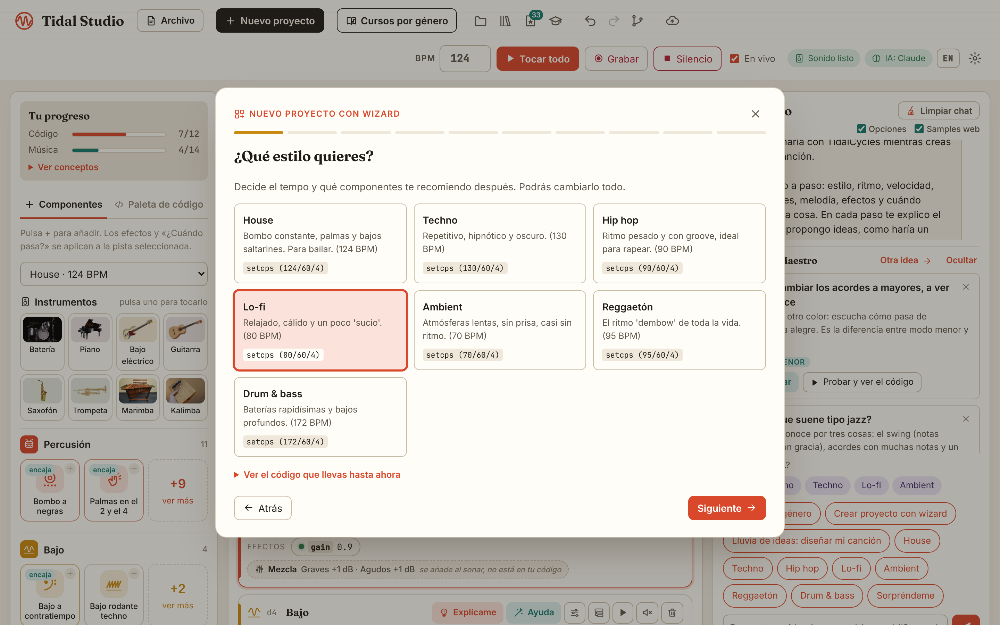 | 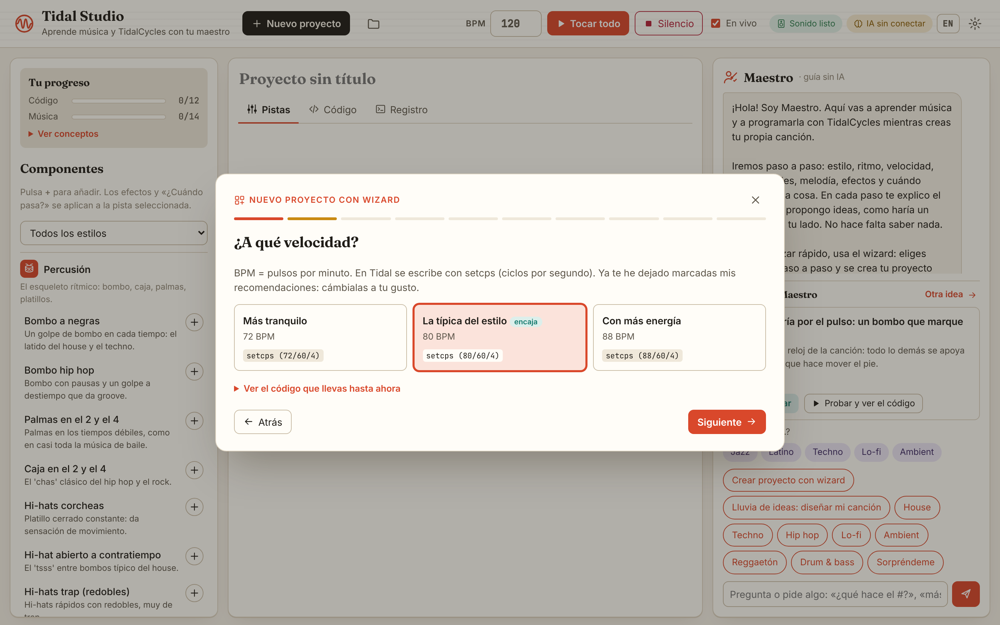 |
| **3. Ritmo (hasta 3 capas)** | **4. Bajo, acordes, melodía y textura** |
|  |  |
| **5. Efectos** | **6. Estructura en el tiempo** |
| 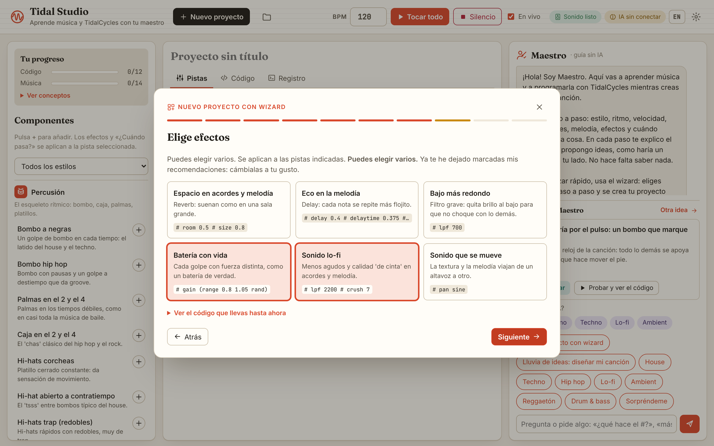 |  |
| **7. Resumen con todo el código explicado** | |
|  | |

La **lluvia de ideas** te hace preguntas abiertas (¿qué quieres sentir?, ¿qué lugar imaginas?, ¿cómo cambia la
energía?…) con ejemplos para pulsar, y al final te da el **plan de tu canción**: estilo, tempo, partes y cambios concretos
para probar.

| Preguntas con ejemplos | El plan de tu canción |
|---|---|
|  |  |

### Cursos por género

**Construye una canción desde cero.** Once cursos (merengue, salsa, cumbia, reggaeton, bossa nova, jazz, funk, house,
techno, drum & bass, lo-fi), cada uno una clase de producción completa: el ritmo característico (güira y tambora, clave y
tumbao, dembow, two-step…), luego bajo, armonía, melodía, arreglo y mezcla. Cada paso añade pistas que ya suenan bien,
Maestro explica el *porqué* musical y el código trozo a trozo, y te propone un reto. Lista completa y fuentes en
[docs/COURSES.md](docs/COURSES.md).

| Elige un género | Cada paso: por qué suena así, el código y Maestro explicándolo |
|---|---|
|  |  |
| **Paso de arreglo: intro, merengue y mambo** | **Paso de mezcla y curso completado** |
|  | 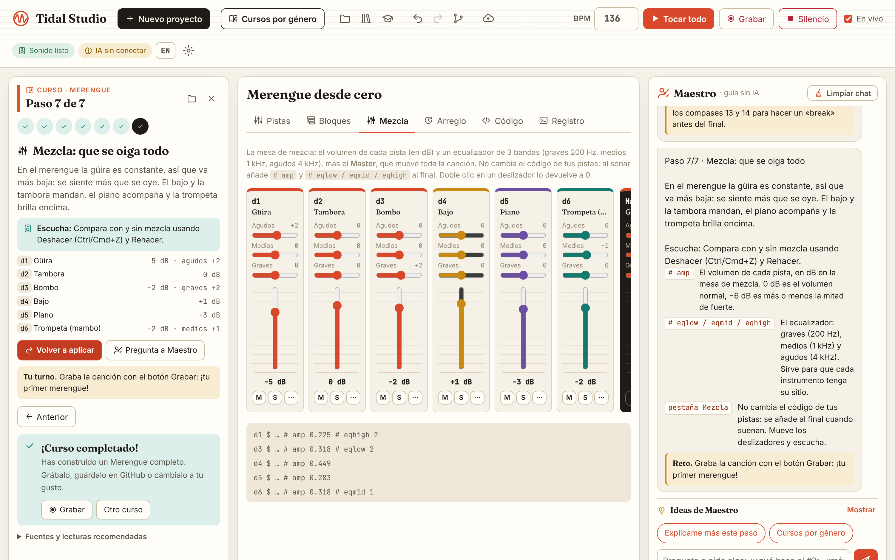 |

**Cursos latinos que siguen tu plugin de composición.** Merengue, salsa, cumbia, reggaeton y bossa nova siguen las skills
de estilos latinos del [plugin music-composition](https://github.com/vsalesa/music-composition-skills): cada curso dice
qué tradición toca (por ejemplo, salsa dura de Nueva York de los 70 sobre clave de son 2-3), cada paso muestra «Lo que
dice la skill» y Maestro carga esa skill cuando le preguntas por el paso. Las partes las tocan instrumentos reales de la
biblioteca (güiro, congas, bongós, claves, contrabajo, trombones, acordeón, guitarra de nailon, flauta…), que se
descargan solos al empezar el curso.

| Cada curso latino dice su tradición y su skill | La tradición y el artista de referencia, antes del primer paso |
|---|---|
| 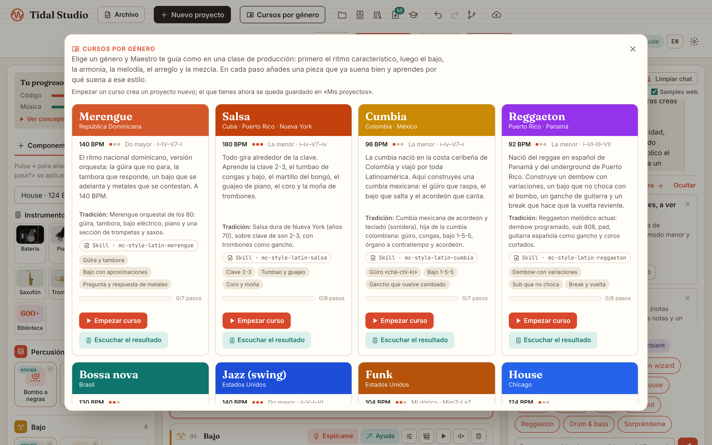 | 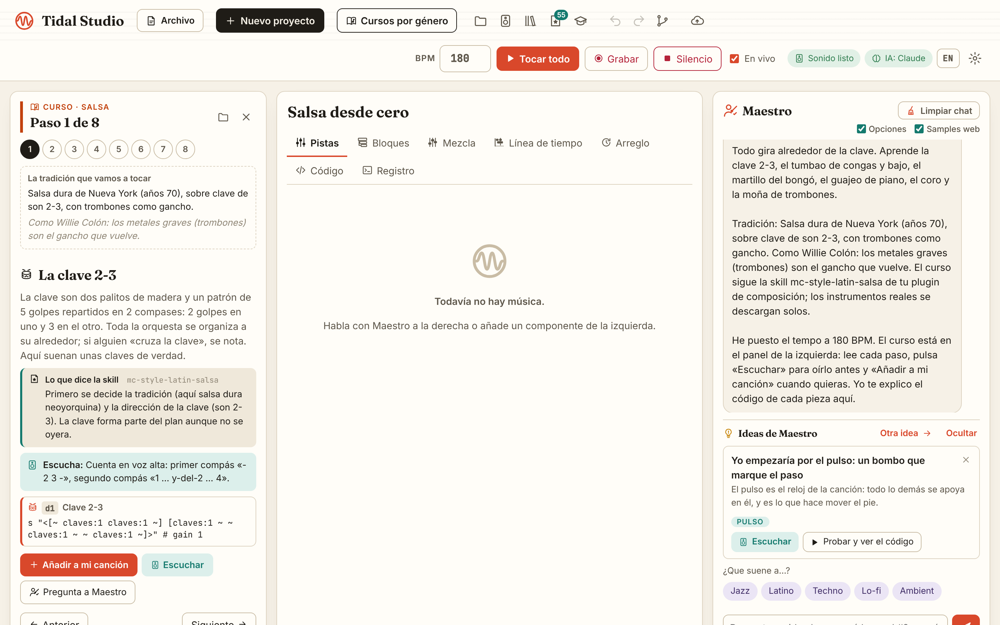 |
| **«Lo que dice la skill» en cada paso, con instrumentos reales** | |
| 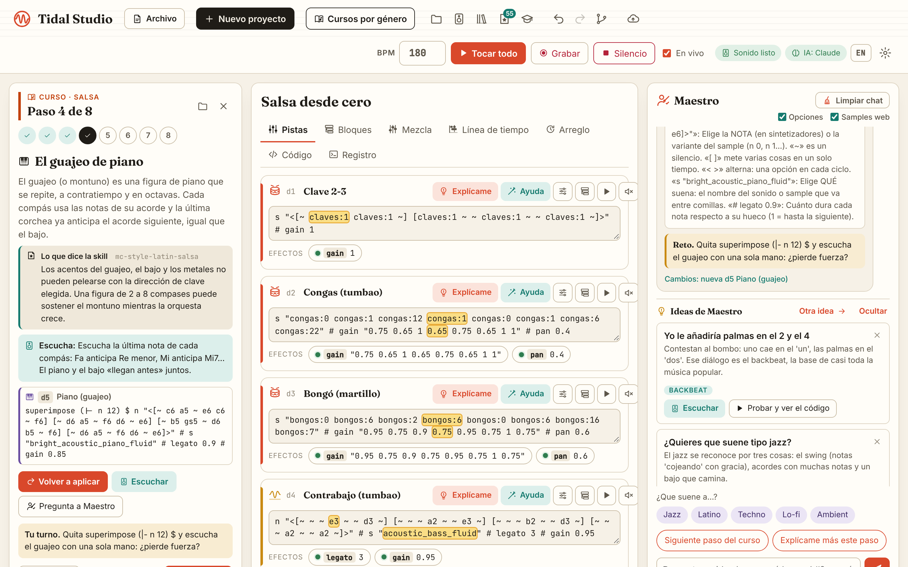 | |

**Escucha a un baterista real tocar el estilo.** Nueve cursos (merengue, salsa, reggaeton, bossa nova, jazz, funk, house,
drum & bass y lo-fi) traen una interpretación real en MIDI del [Groove MIDI Dataset](https://magenta.tensorflow.org/datasets/groove)
(Google Magenta, CC BY 4.0): bateristas profesionales grabados tocando merengue dominicano, reggaeton, bossa nova, songo
cubano, swing, funk, disco, breakbeat y hip hop. La primera vez que pulsas **Escuchar**, el estudio descarga el paquete de
MIDI (3 MB) y convierte cuatro compases en pistas de Tidal que conservan lo que lo hace humano: la fuerza de cada golpe
(`# gain`) y lo que se adelanta o se atrasa (`# nudge`, en segundos), con rejilla de tresillos para el swing. El baterista
del merengue toca el bloque de madera y las congas del curso, y el del reggaeton un bombo 808. Cada curso explica qué
escuchar, y **Añadirlo a mi canción** pone al baterista en las pistas d9 a d12 para que silencies las tuyas y compares. El
curso de reggaeton ahora acentúa el charles y adelanta el dembow como lo hace este baterista. Cumbia y techno aún no tienen
MIDI con licencia libre, así que siguen con sus patrones escritos.

| Los cursos con baterista real lo indican | Qué escuchar, con Escuchar y Añadirlo a mi canción |
|---|---|
| 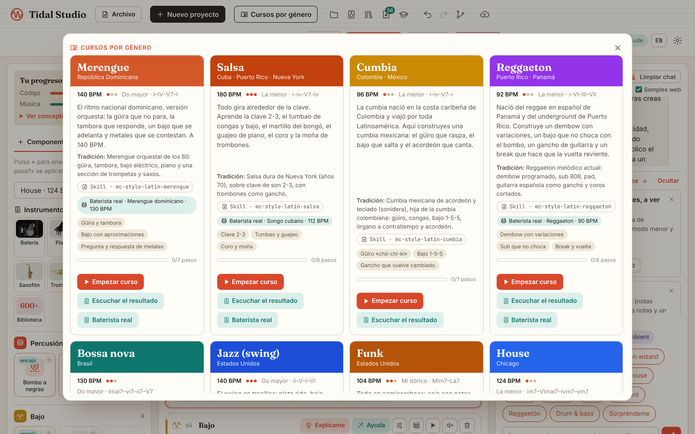 | 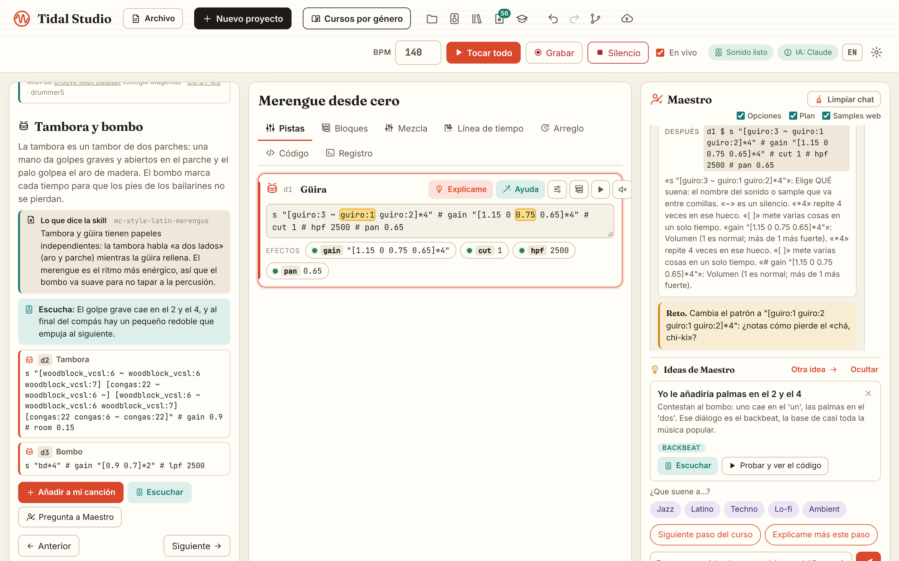 |
| **El baterista en tu canción: la fuerza y el tiempo de cada golpe, en código** | |
| 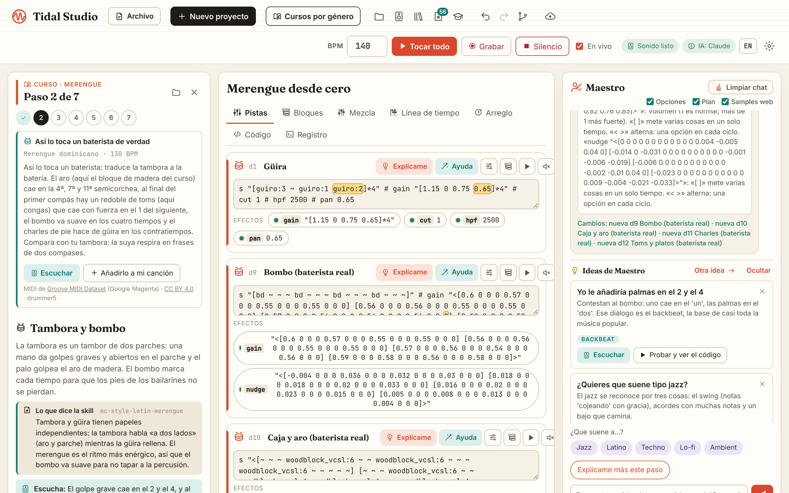 | |

**Estilos aprendidos de canciones reales, no solo de reglas escritas.** Con reglas de estilo escritas los cursos latinos no
acababan de sonar bien, así que ahora el estudio también aprende de música real. `tools/learn_style.py` ha medido 31
canciones latinas en MIDI (3 merengues, 7 salsas, 9 cumbias y 12 bossas nova, del Lakh MIDI Dataset y de PDMX) en una
rejilla de 16 semicorcheas por compás: cuándo tocan el bajo, el piano, la guitarra y los metales, qué nota del acorde
elige el bajo en cada sitio, qué hace cada percusión y qué progresiones se repiten. Solo se guarda esa estadística
(`server/data/style_profiles.json`). No se copia ni se incluye ninguna canción. Maestro lee el perfil del género del curso
(o del estilo de tu proyecto), así sus partes siguen cómo se tocan las canciones de verdad. El curso de merengue se ha
reescrito con los datos: el bajo toca en el 1, el «y» del 2, el 3, el 4 y el «y» del 4, el piano no para de tocar
corcheas con semicorcheas de enganche, y el grave de la tambora cae en el «y» del 2 y del 4. Los bajos de salsa, cumbia
y bossa ya coincidían con lo que hacen las canciones. Para enseñarle un género con tus MIDI:
`python3 tools/learn_style.py merengue ~/mis-midi/merengue/`.

**Tu propio ejemplo.** Cada curso tiene **Cargar mi MIDI de ejemplo**: carga una canción del estilo que sea tuya o que hayas
comprado, escucha cuatro compases con todos sus instrumentos, y Maestro compara cada paso con ella.

| Tu ejemplo en el curso, junto al baterista real | |
|---|---|
| 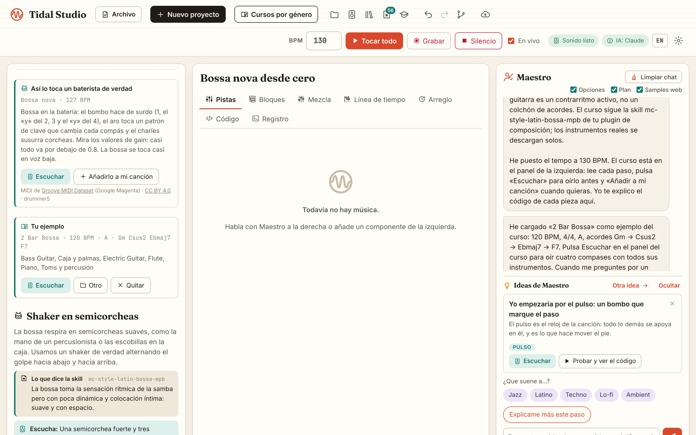 | |

### Maestro, tu profesor

- **Maestro te guía** paso a paso: estilo, ritmo, velocidad, bajo, acordes, melodía, efectos y cuándo cambia cada cosa.
- **Te explica el código**: botón «Explícame» en cada pista y «Explícame todo el código»; cada cambio llega con su
  explicación trozo a trozo y, a veces, un pequeño **reto** para que edites tú.
- **Te sugiere ideas como un productor**: «Yo le añadiría palmas en el 2 y el 4… pruébalo a ver qué te parece».
  Cada idea enseña un concepto musical (backbeat, contraste, pregunta y respuesta, mayor y menor…). Pulsas **Probar**,
  escuchas y decides: **Me lo quedo** o **Deshacer**.
- **Pre-escucha**: botón «Escuchar» en cada idea o receta: suena unos compases y vuelve sola a tu versión.
- **Recetas de estilo**: «¿Quieres que suene tipo jazz?» (también latino, techno, lo-fi, ambient). Transforma tu canción y
  te enseña **cómo lo ha hecho**: el código de antes y de después con lo nuevo resaltado y explicado.

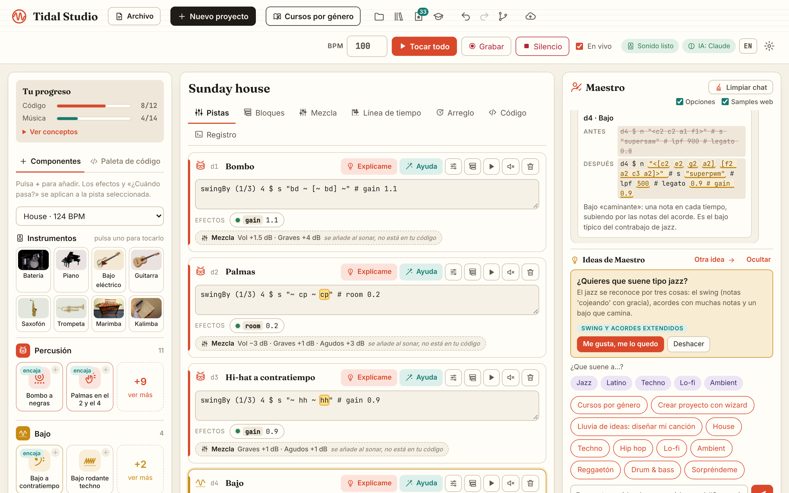

### Escucha las opciones de Maestro y elige una

Pide algo creativo a Maestro («añade un bajo», «más oscuro», «más energía», «sorpréndeme») y, como en una lluvia de
ideas con un productor, no cambia tu canción sin más: te propone **3 o 4 opciones distintas hechas para tu petición y tu
canción**, cada una con un título, la idea musical que enseña y su código. Si tu petición es muy vaga, primero te hace
**una** pregunta con respuestas para pulsar.

- **Escuchar** hace sonar una opción **en directo sobre tu canción**, todo el tiempo que quieras. Pulsa Escuchar en otra
  (o las teclas **1-4**) y cambia al instante; **A/B** salta entre las dos últimas que has oído; **Parar** (o **Esc**)
  vuelve a tu versión.
- **Ver el código** enseña qué cambiaría cada opción, antes y después.
- **Elegir esta** la añade a tu canción y te explica cómo ha cambiado el código; las demás se descartan.
  **Deshacer la elección** recupera las opciones.
- **Otras opciones**, **Afinar…** («la B pero más suave») o **Ninguna** piden otras nuevas a Maestro.


Funciona con todos los proveedores de IA, y también sin IA (escribe «dame opciones» y las crea con sus propias ideas y
recetas de estilo). Apágalo con el interruptor **Opciones** arriba del chat si prefieres que Maestro aplique los cambios
directamente.

### Peticiones grandes: Maestro hace un plan y va paso a paso

Pide algo grande («hazme una canción de salsa entera con piano, bajo y trompetas», «convierte la canción en jazz») y
Maestro trabaja como en una lluvia de ideas con un productor: en lugar de componerlo todo de golpe, primero **diseña un
plan de 3 a 6 pasos** (ritmo, bajo, armonía, melodía, efectos, estructura) y **te lo enseña antes de tocar tu
canción**. Si le falta algo importante (estilo, ambiente…) te hace antes una pregunta.

- **Revisa el plan**: quita los pasos que no quieras (×) o pulsa **Cambiar el plan…** («añade un puente, sin trompeta»)
  y te manda otro. **Todo de golpe** se salta el plan.
- **Empezar** hace todos los pasos seguidos; **Paso a paso** se para después de cada uno para que lo escuches y
  **Sigas** cuando quieras. Cada paso se aplica a tu canción, se explica como cualquier otra respuesta y **se guarda en
  cuanto termina**.
- Mientras el plan avanza, una barra arriba del chat te dice por dónde va (2/5, el paso en el que está).

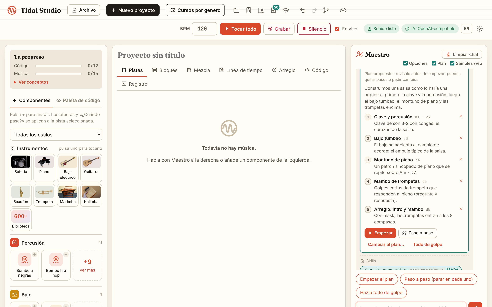

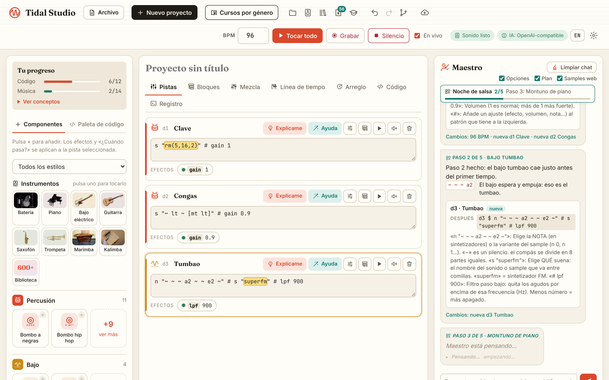

**Ya no se pierde trabajo cuando la IA tarda demasiado.** Si un paso da timeout, los pasos hechos siguen en tu canción
(aunque cierres el estudio) y el plan se pausa en ese paso: **Reintentar el paso 3** repite solo ese, o **Saltar**.
Y si una petición normal es demasiado grande y da timeout, Maestro te ofrece **Hazlo por pasos** para convertirla en un
plan.

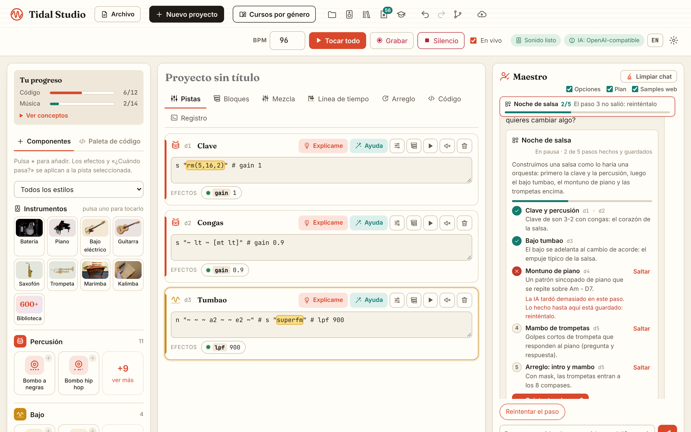

Y respuestas más rápidas:

- La IA solo se corta cuando lleva 5 minutos **sin mandar nada** (`"ai_timeout"` en `config.json`), no mientras sigue
  pensando o escribiendo una respuesta larga (antes, Claude con tu suscripción se cortaba a los 3 minutos).
- **Maestro guarda en caché lo que ya ha cargado o encontrado**: sus instrucciones y las skills del plan son idénticas
  en cada paso, así que Claude (con clave o con tu suscripción) y los proveedores compatibles con OpenAI las reutilizan
  de su caché de prompts en lugar de procesarlas otra vez; el panel de Razonamiento lo dice («Reutilizo N tokens…»).
  Las skills no se releen del disco en cada mensaje, y las búsquedas de sonidos en internet (índices de packs,
  resultados de Freesound, tamaños de archivo) se guardan en la carpeta `cache/` un día o una semana, así un paso o una
  sesión posterior no vuelve a buscar.

Apágalo con el interruptor **Plan** arriba del chat. Los cursos por género no usan planes: ya van paso a paso.

**Cancela lo que has enviado.** ¿Te lo has pensado mejor o tarda demasiado? Mientras Maestro piensa, pulsa **Cancelar**
en su mensaje, el botón de enviar (se convierte en un cuadrado) o **Esc**. La llamada a la IA se corta al momento (con
Claude con tu suscripción, se cierra el proceso `claude`), no se aplica ni se descarga nada y tu mensaje vuelve a la caja
para que lo cambies. Si cancelas un paso de un plan, el plan se pausa con todos los pasos hechos guardados.

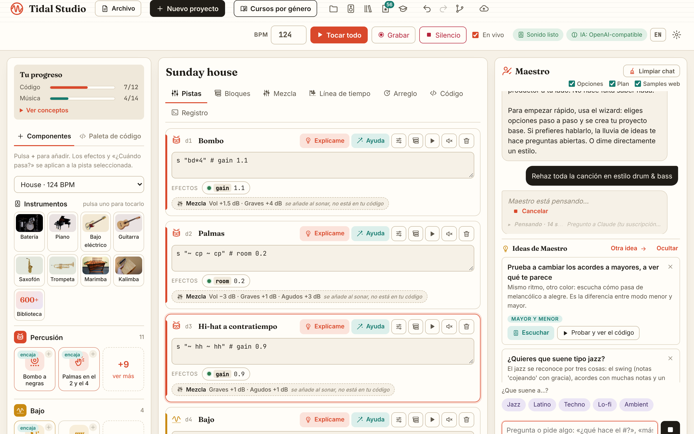

### Ayuda con tu código y paleta de código

**Ayuda**: ¿has editado una pista y da error o no suena como querías? Pulsa **Ayuda** (se abre sola si Tidal da error).
Elige qué querías (no suena, más fuerte, más lento, más oscuro…) o cuéntalo, y Maestro encuentra el problema (falta el
`$`, comillas o paréntesis sin cerrar, sonidos o efectos mal escritos, cosas que la dejan en silencio), te propone el
arreglo con el antes y el después, te deja **Escuchar** antes de aplicarlo y puede **volver a la versión que funcionaba**.

**Paleta de código**: 39 bloques de Tidal organizados por lo que quieres conseguir (ritmo, sonido, notas y armonía,
efectos, tiempo y estructura, azar) y por nivel (primeros pasos, intermedio, avanzado). Pulsas uno y se aplica a la pista
seleccionada; Maestro te enseña y explica el cambio, y puedes deshacerlo.

| Ayuda: Maestro encuentra el problema y propone el arreglo | Paleta de código por objetivo y nivel |
|---|---|
| 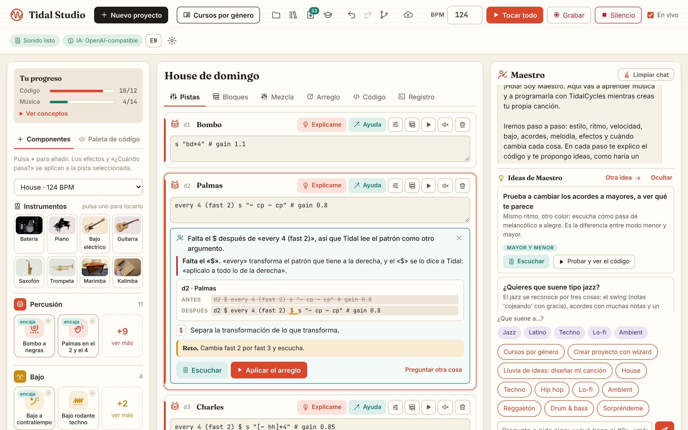 | 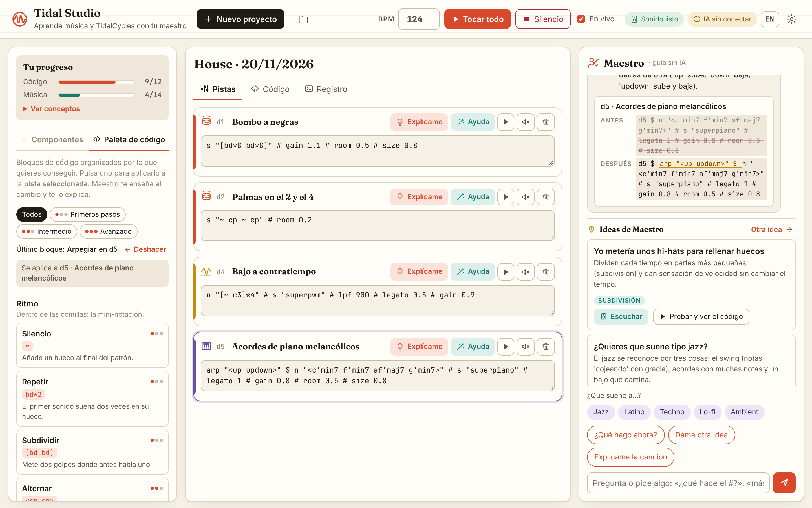 |

**Los errores antiguos se van**: el error de una pista se borra solo en cuanto esa pista (o «Tocar todo») suena sin
errores, y con él la ayuda que Maestro abrió por ese error. Si cambias el código después de un error, el error se pone gris
y avisa de que es de una versión anterior; la × del recuadro lo borra cuando quieras.

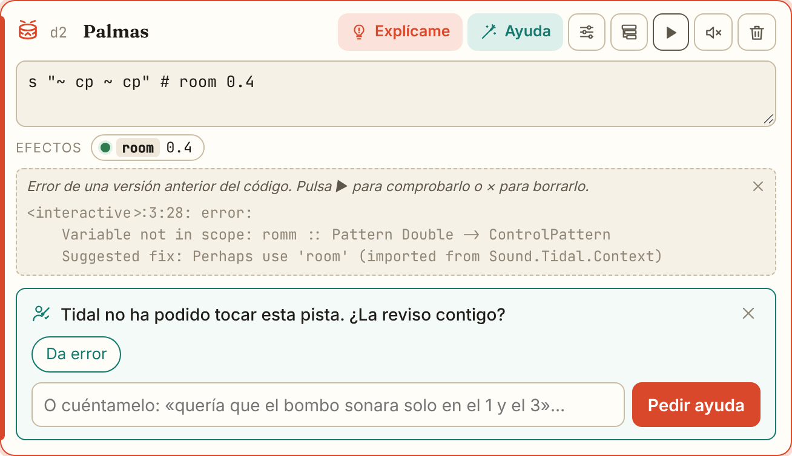

### Vista de bloques y resaltado en directo

**Vista de bloques**: tu canción en bloques visuales anidados. Cada pista muestra lo que la transforma (antes del `$`),
lo que suena (cada paso del ciclo es una casilla, con grupos `[ ]`, alternancias `< >`, silencios `~` y repeticiones `*`)
y sus ajustes (`#`). Pulsas cualquier bloque y un **tooltip** te dice qué hace y te deja **editarlo ahí mismo**: cambiar
un paso (silencio, ×2, partir, a veces, añadir, borrar), la mini-notación, el valor de un ajuste con un deslizador, los
números de una transformación (`every 4 (fast 2)`), añadir ajustes o transformaciones, o cambiar el tempo. Suena al editar.

| Tu canción en bloques anidados | Pulsa un bloque: tooltip para editarlo |
|---|---|
|  |  |

**Enciende y apaga cada efecto**: cada efecto (`# room`, `# delay`, `# lpf`, `# crush`…) tiene su propio interruptor, por
pista, en la vista de Bloques, debajo del código de cada pista en Pistas y en la tarjeta configuradora de Maestro. Al
apagarlo deja de sonar solo ese efecto y se guarda su valor, así que al encenderlo vuelve tal cual. En el código queda
como comentario de Haskell, `{- # room 0.4 -}`, que Tidal ignora; suena al momento (con En vivo activado) y Deshacer lo
recupera.

| Bloques: un interruptor por efecto | Pistas: la fila de efectos bajo el código |
|---|---|
| 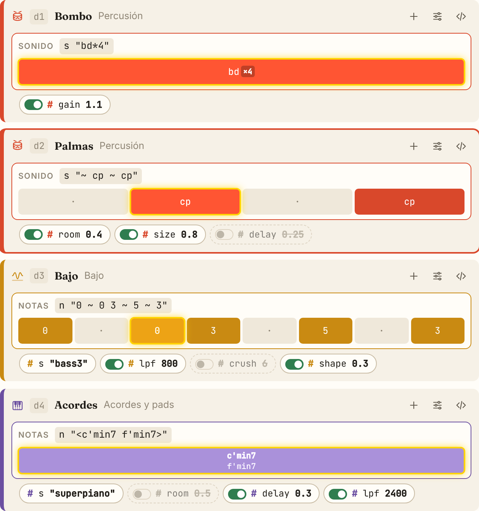 | 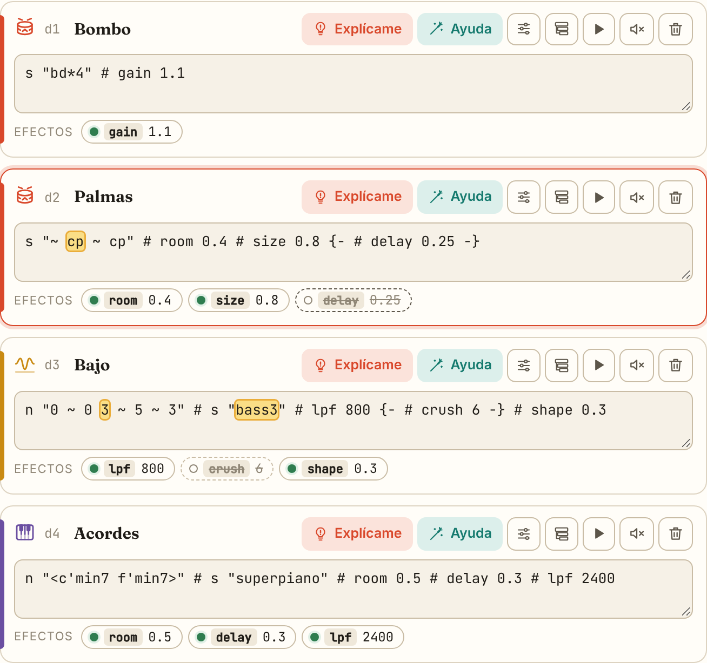 |

**Ver lo que suena**: mientras suena la música se ilumina, paso a paso, el trozo del código de cada pista que está
sonando, en las vistas Pistas, Bloques y Código (como en Strudel). SuperDirt avisa a la app de cada nota que toca.

| En la vista Pistas | En la vista Bloques |
|---|---|
|  | 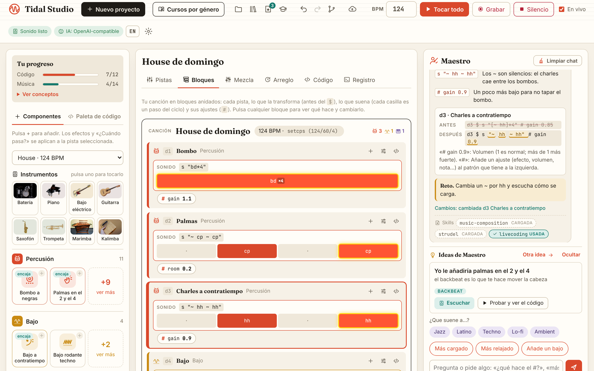 |
| **En la pestaña Código** | |
| 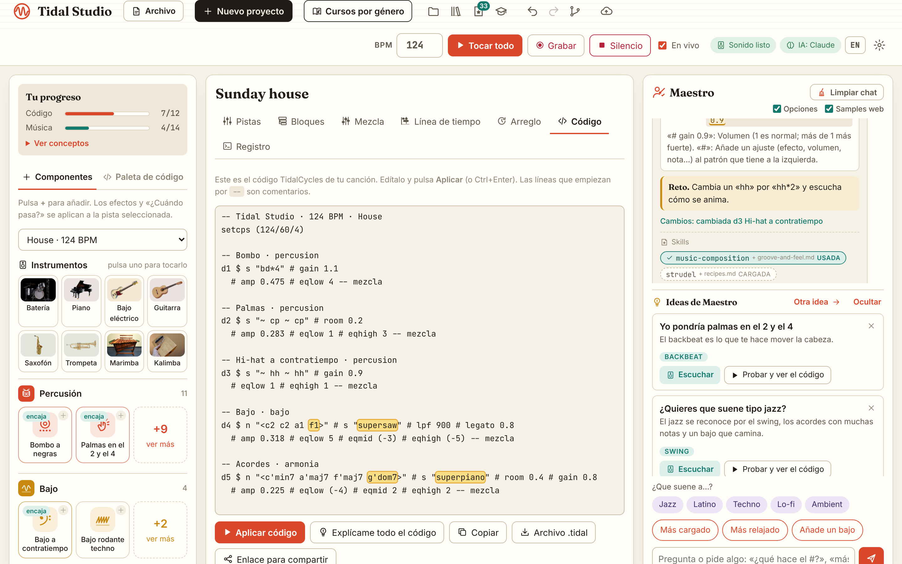 | |

### Controles y tarjetas en el chat

**Controles en el chat (agentic UI)**: Maestro pone deslizadores, control de tempo, selector de sonido y un secuenciador
por pasos dentro de sus mensajes. Al moverlos se escribe el código Tidal en directo, así ves qué palabra cambia. Usa el
botón de deslizadores de cada pista, el botón «Ajustar con controles» o pídeselo. Hay más: `every` (hacer algo cada N
ciclos), azar (`degradeBy`, `sometimesBy`), swing, ritmos euclídeos (`bd(3,8)`), filtro en movimiento
(`# lpf (range … $ slow n sine)`), escala y octava, acordes y una **mesa de mezcla** con volumen, panorama y silencio de
todas las pistas a la vez. Cada uno enseña el código que escribe.

**Tarjeta configuradora**: pide a Maestro «una tarjeta del bajo» (o pulsa el botón de tarjeta en una pista, un bloque o
un canal de la mesa) y aparece en el chat una tarjeta con **todos los valores** de ese elemento: lo que suena, las
transformaciones y sus números, cada ajuste `#`, y el volumen y ecualizador de la pista. La «tarjeta de la canción» tiene
tempo, master y el volumen de cada pista. Las tarjetas trabajan siempre sobre la versión **actual** de la canción y se
actualizan solas cuando cambias algo en otro sitio.

| Controles en el chat | Tarjeta configuradora del bajo |
|---|---|
|  | 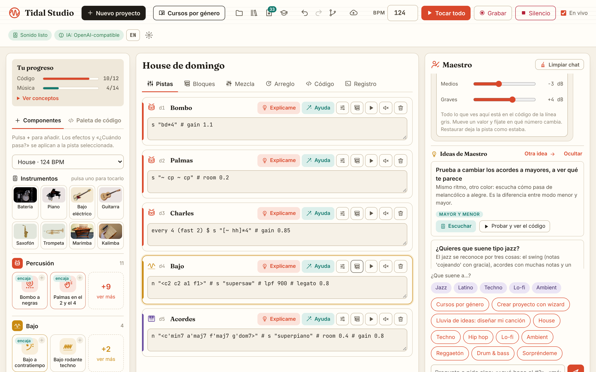 |

### Pestaña Mezcla

Mesa con fader de volumen (dB) y **ecualizador** de 3 bandas (graves 200 Hz, medios 1 kHz, agudos 4 kHz) en cada pista,
silencio y solo, y un canal **Master** para toda la canción. No toca el código de tus pistas: al sonar añade `# amp` y
`# eqlow / eqmid / eqhigh` (lo verás como una línea `-- mezcla` en la pestaña Código).


Para que no te pierdas, cada pista con mezcla enseña una etiqueta **Mezcla** en **Pistas** y en **Bloques** (por
ejemplo «Mezcla · Graves −3 dB», y Master o Solo cuando aplican). Te recuerda que eso se añade al sonar y no está en su
código; púlsala para ir a la tira de esa pista en la pestaña Mezcla. Los valores negativos se escriben entre paréntesis,
`# eqlow (-3)`, porque Tidal lee `eqlow -3` como una resta.

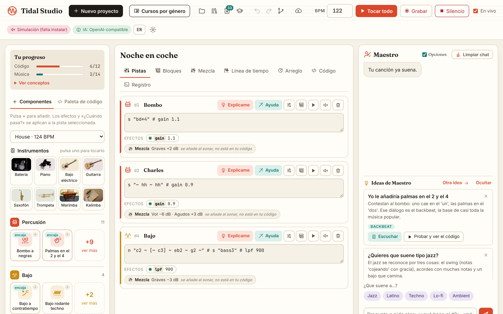


### Línea de tiempo: cuándo suena cada sonido

Tidal te dice *cada cuánto* pasan las cosas (`"bd*2 [~ sn]"`, `every 4 (fast 2)`, `(3,8)`…), y eso cuesta imaginarlo.
La pestaña **Línea de tiempo** dibuja *dónde* cae cada golpe: el tiempo va de izquierda a derecha (cada columna grande
es un ciclo, un compás de 4 tiempos, con líneas para los tiempos y las semicorcheas), una fila por sonido y, en las
pistas melódicas, una fila por nota, como un piano roll. Cada bloque es un golpe y su largo es lo que dura.

- **Exacta, la calcula el propio Tidal.** El estudio le pide a TidalCycles (`queryArc`, en un GHCi aparte que no suena)
  las notas de cada pista, así que los polímetros, `euclid`, `every`, `off`, `jux`, las máscaras del arreglo… se dibujan
  tal y como van a sonar. Las pistas llevan la etiqueta **Tidal**. Sin motor usa una calculadora aproximada en el
  navegador (etiqueta **≈ aprox.**).
- **Cada golpe apunta a su código.** Pasa el ratón por un bloque y se ilumina el trozo del código que lo produce (en el
  código de la pista y en una ficha con el compás y el tiempo en que cae y cuánto dura), y también los demás golpes de
  ese mismo trozo. Pasa el ratón por un trozo del código y verás todos sus golpes. Pulsa para fijarlo, y **Ir a este
  trozo en Pistas** lo selecciona para que lo cambies.
- **El azar** (`sometimes`, `?`, `degradeBy`…) se marca: los dados de Tidal son fijos en cada ciclo, así que lo que ves
  es lo que sonará en esos compases.
- Elige de 1 a 16 ciclos, haz zoom, avanza compás a compás y activa **Seguir lo que suena**: mientras toca, una línea
  avanza y los golpes que suenan se encienden.


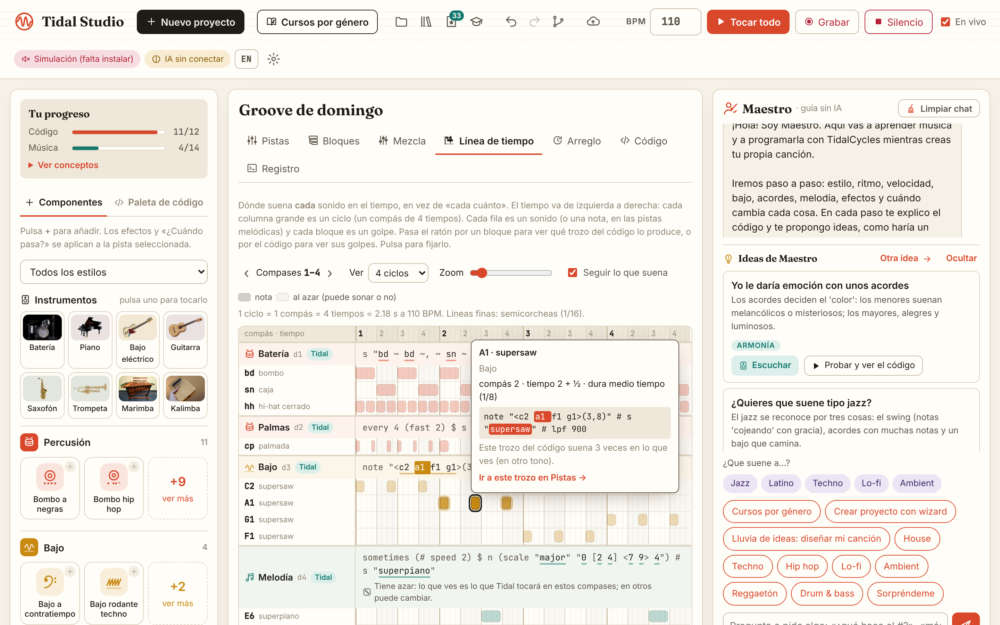


### Arreglo

La pestaña Arreglo muestra todas las pistas a lo largo de 8, 16 o 32 compases. Pinta en qué compases suena cada pista
(escribe `mask "<…>"`) o parte de un preset: entrar por capas, drop, break, pregunta y respuesta.


### Deshacer, historial y un chat ordenado

**Deshacer, rehacer e historial (rollback)**: cada cambio de la canción queda guardado. Botones deshacer/rehacer
(Ctrl/Cmd+Z, Ctrl/Cmd+Shift+Z) y un **Historial** para volver a cualquier versión anterior.

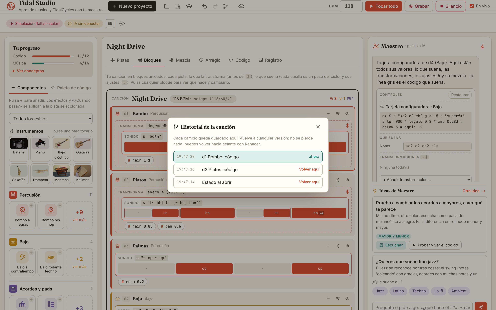

**Un chat ordenado**: el botón «Limpiar chat» (arriba a la derecha del panel de Maestro) vacía la conversación sin tocar
tu canción, y el botón «Recuperar el chat» la devuelve. «Ocultar» pliega las ideas de Maestro para dejar más sitio al chat
(el navegador recuerda tu elección; «Mostrar» las vuelve a enseñar).

| «Ocultar» las ideas de Maestro para tener más chat | «Limpiar chat»: la canción se queda y el chat puede volver |
|---|---|
| 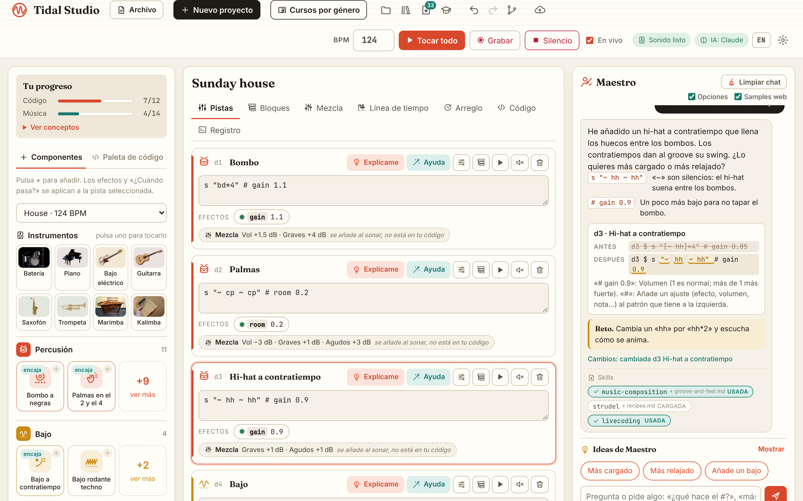 | 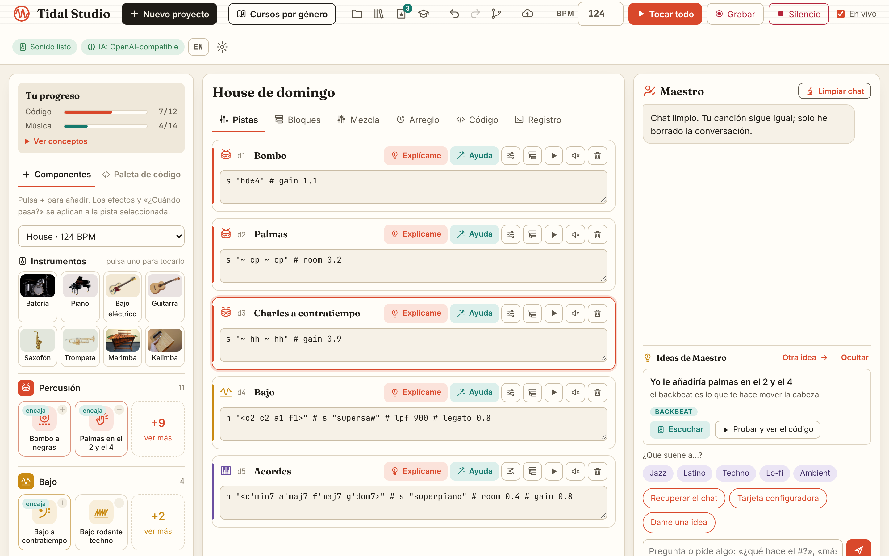 |

**Descarta las ideas que no te gusten**: la × de cada idea de Maestro la quita. El navegador lo recuerda (también al
recargar), su hueco lo ocupa la siguiente idea y Maestro sabe cuáles has descartado para no volver a proponerlas, ni otras
casi iguales. «Recuperarlas» lo deshace.

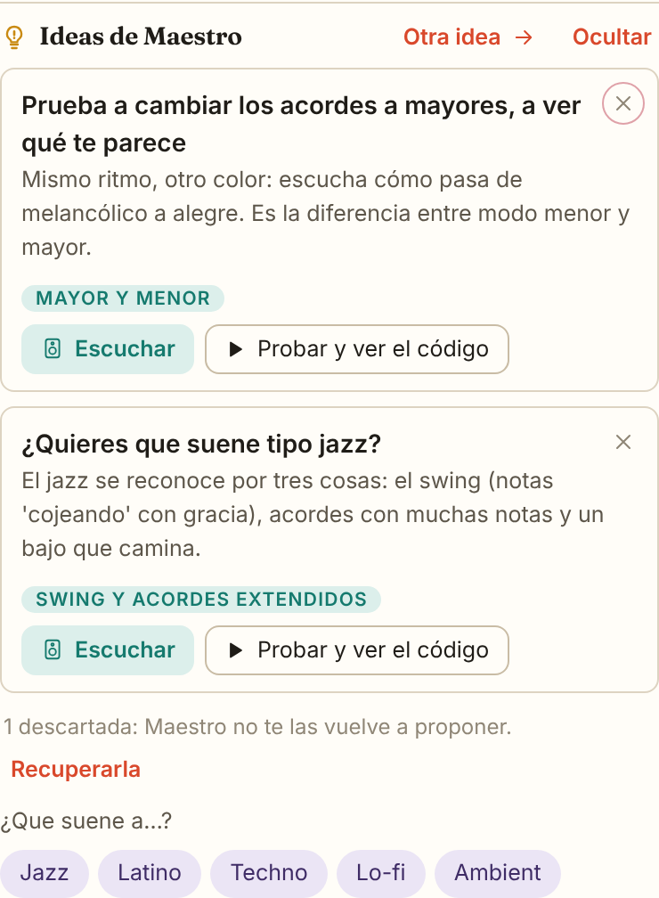

### Instrumentos

**Fotos reales de instrumentos** (con licencia libre, de Wikimedia Commons, ver [CREDITS.md](CREDITS.md)): una batería en
la que pulsas cada pieza (bd, sn, hh, ho, toms, crash, aro) para oírla y aprender su nombre en Tidal, eliges sus pasos y
la añades; piano, bajo, guitarra, saxo, trompeta, marimba y kalimba con un teclado en pantalla que escribe tu melodía como
código. Cada componente del catálogo tiene además su propio icono.

| Batería: pulsa una pieza y aprende su nombre | Instrumentos con teclado |
|---|---|
|  | 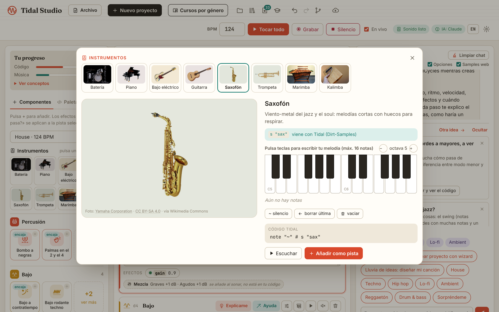 |

### Biblioteca de instrumentos: más de 600 instrumentos concretos

Como GarageBand, pero para Tidal: un clavecín, un contrabajo en pizzicato, un Steinway B, una celesta, un sitar, un
theremin, un órgano de iglesia, un koto… **634 instrumentos concretos** en 21 categorías (pianos, teclados, órganos,
música antigua, láminas, guitarras, bajos, cuerdas, metales, maderas, voces, del mundo, percusión, synths
solistas/pads/bajos/teclados/efectos, motores de synth, efectos de sonido y los tuyos). Ábrela con el botón del altavoz
de arriba o con la tarjeta **600+ Biblioteca**. Busca en español o en inglés, filtra por descargados o por fuente, y pulsa
cualquier tarjeta para **escuchar las grabaciones de verdad** antes de descargar nada. Cada instrumento pesa unos pocos MB
y solo se descarga cuando lo pides.

Elige una versión (el mismo instrumento de distintos juegos de sonidos, o articulaciones como arco y pizzicato), toca el
teclado para escribir una melodía y pulsa **Añadir como pista**: tienes el código de Tidal
(`n "c5 e5 g5" # s "harpsichord_fluid"`) y se toca con notas igual que un synth, porque cada nota usa la grabación real
más cercana. Las grabaciones vienen solo de juegos con licencia libre: VSCO 2 Community Edition y VCSL (CC0), el piano
de cola Salamander (CC BY) y los juegos General MIDI FluidR3, MusyngKite y FatBoy (CC BY / CC BY-SA). Los créditos se
escriben en `samples/CREDITS.md` al descargar.

| Por categorías: escúchalo y añádelo | Busca con tus palabras |
|---|---|
| 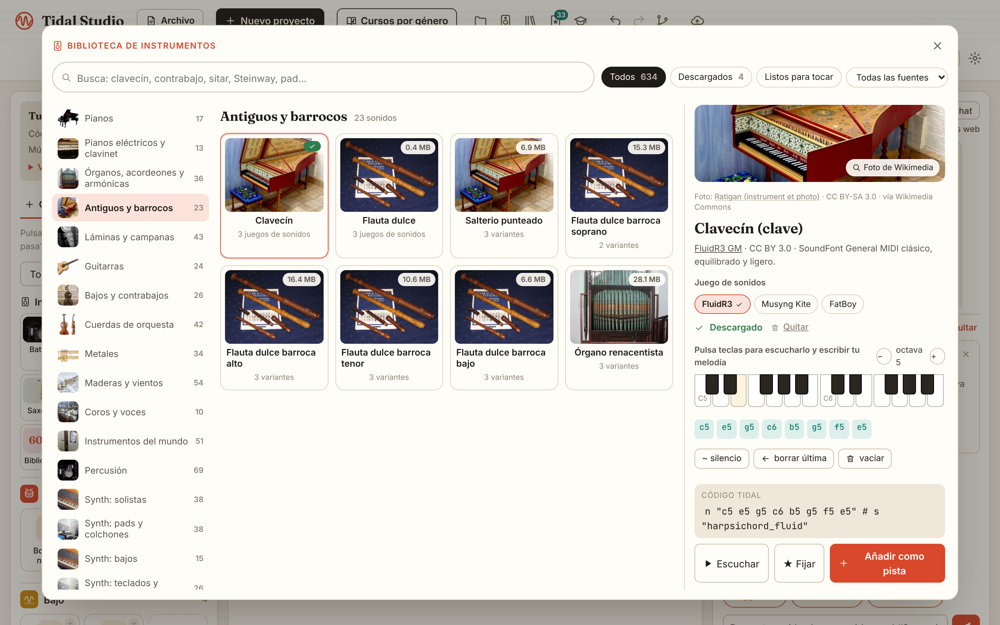 | 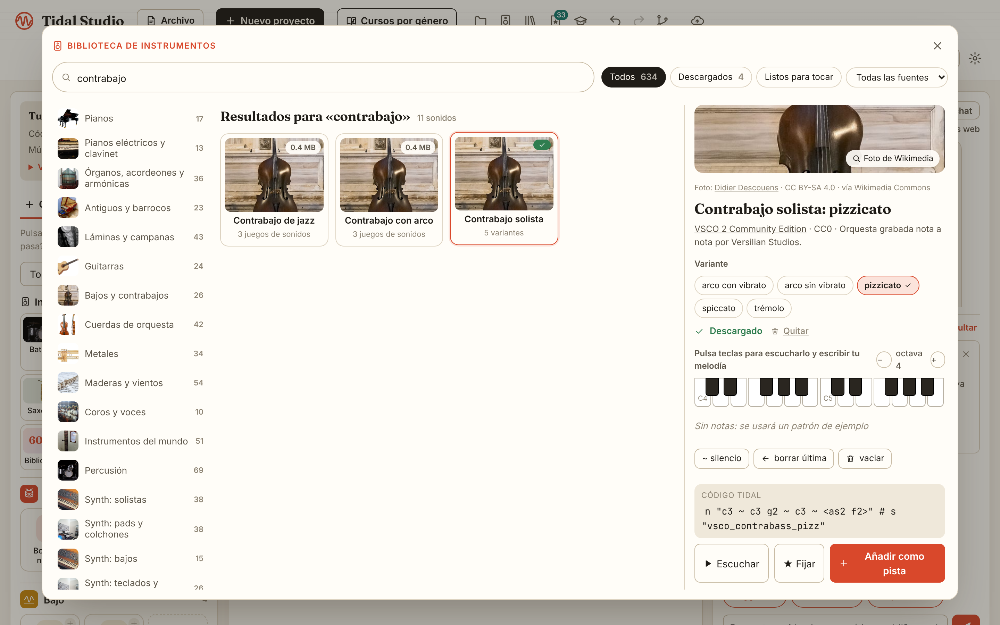 |

**Tus propios instrumentos.** Arrastra un **SoundFont (.sf2)** y elige qué sonidos importar (las notas sostenidas se
desenrollan para que duren), un **.zip con un SFZ**, una carpeta de **grabaciones con la nota en el nombre**
(`Violin_C4.wav`, `060.wav`) o **un solo sonido** afinado desde la nota que elijas. Aparecen en **Mis instrumentos** y
también se tocan con notas.

**Motores de synth.** Además de 15 synths nuevos incluidos (Rhodes, órgano, cuerdas, pad, metales, coro, Juno, acid,
wobble…), la página **Motores de synth** instala plugins gratuitos con un botón: **sc3-plugins**, **Mi-UGens**
(Plaits, Braids y Rings de Mutable Instruments: 16 + 16 + 6 modelos en la biblioteca) y **VSTPlugin**, con el que
SuperDirt toca **Surge XT** (sus sonidos de fábrica aparecen en la biblioteca) y **Vital**. Tidal tiene los parámetros
que necesitan: `d1 $ n "c e g" # s "plaits" # engine 5 # timbre 0.3 # harm 0.5 # morph 0.6`.

| Añade los tuyos: SoundFont, SFZ, grabaciones | Motores de synth con un botón |
|---|---|
| 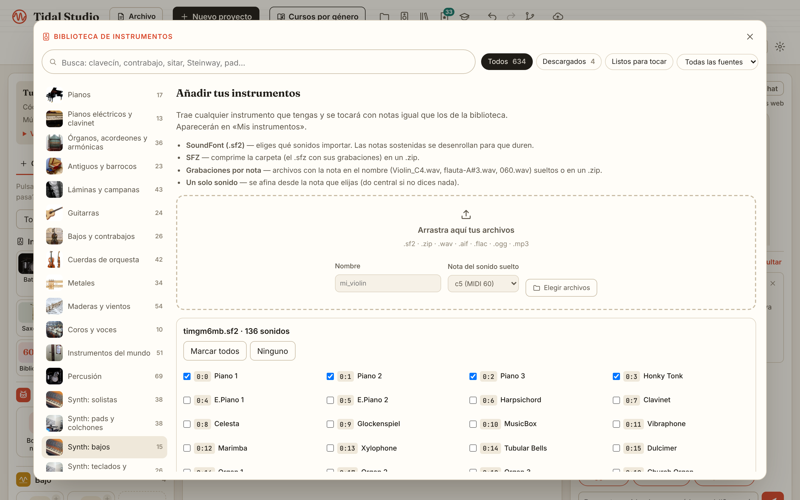 | 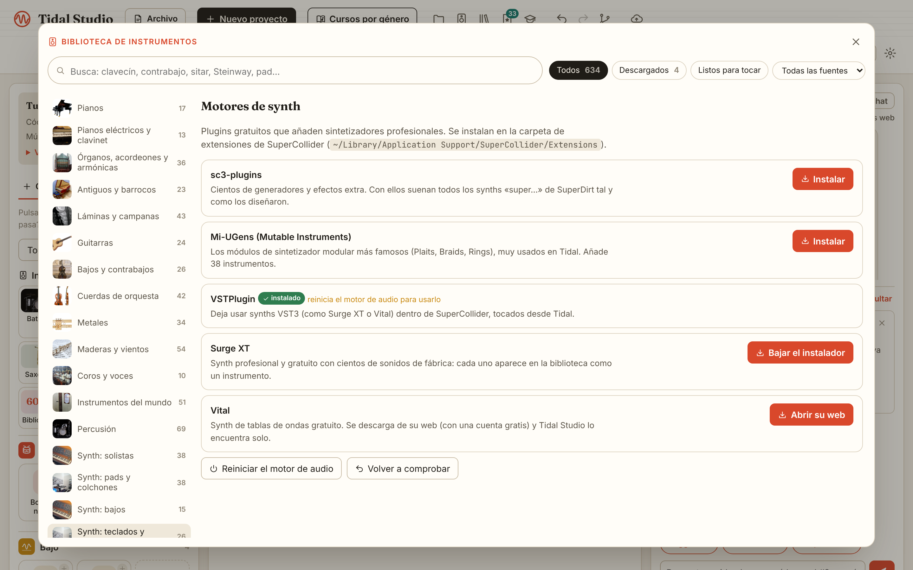 |

**Una foto para cada instrumento, y fíjalo como componente.** Cada instrumento muestra una foto real de Wikimedia
Commons. Pulsa **Foto de Wikimedia** para buscar otra en Commons: solo salen fotos con licencia libre (CC0, dominio
público, CC BY, CC BY-SA) y la que elijas se guarda con su autor y licencia, que siempre se muestran debajo. Pulsa
**★ Fijar** y el instrumento se convierte en una tarjeta de la fila de instrumentos del estudio, junto al piano y la
batería, lista para abrirla con un clic.

| Elige una foto de Wikimedia Commons | Fijado como tarjeta en el estudio |
|---|---|
| 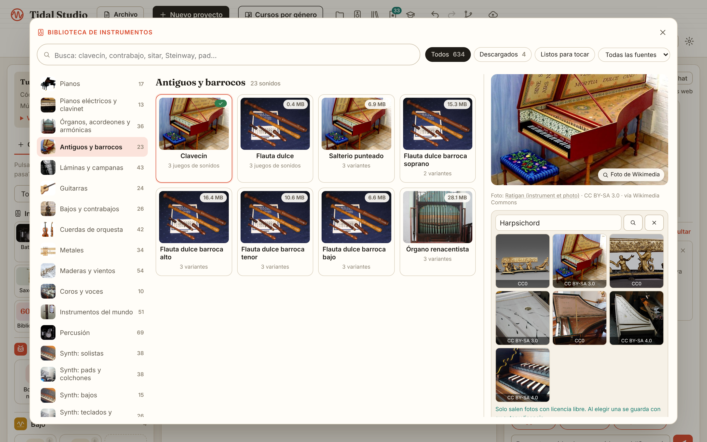 | 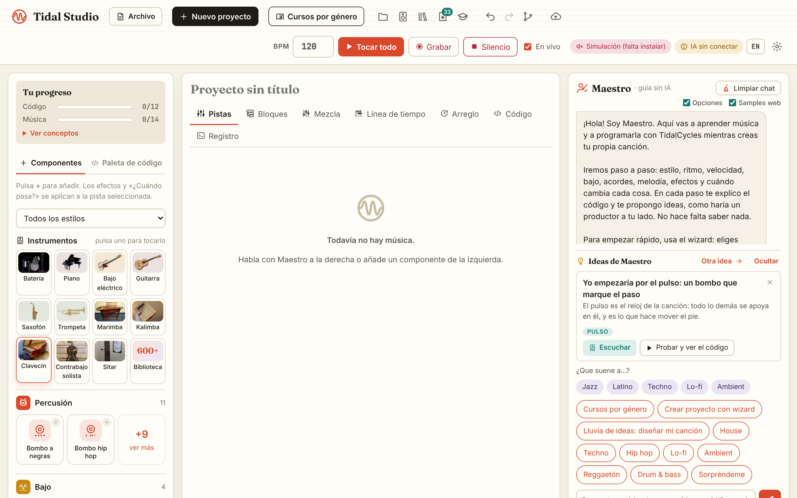 |

**Maestro también los conoce.** Pide «un clavecín en los acordes» o «un contrabajo en pizzicato» y Maestro usa el
instrumento exacto de la biblioteca. Si es pequeño lo descarga al momento; si es grande, te pregunta antes.

### Una sola librería para todos los sonidos

Ya no hay diferencia entre los sonidos que trae Tidal Studio y los que has descargado: **todo está en una sola Librería**
(la abren los botones de los libros y del altavoz de arriba). Dirt-Samples, los sintes de SuperDirt, los más de 600
instrumentos de la biblioteca, lo que has subido, Freesound, los packs, lo que descargó Maestro, tus loops largos e
incluso tu teclado MIDI salen en la misma lista, con el mismo buscador (en español o inglés, con o sin tildes: «organo»
encuentra todos los órganos) y los mismos botones: **escuchar**, **descargar** (un clic, con su tamaño) y **añadir** a tu
canción. Filtra por tipo (golpes, instrumentos, sintes, loops, motores), por familia o por lo que está listo, por
descargar o es tuyo. De dónde viene es solo una etiqueta pequeña. Si un sonido tuyo se llama igual que uno incluido,
suena el tuyo y la Librería lo avisa. Los archivos siguen donde estaban; solo cambia cómo los ves.

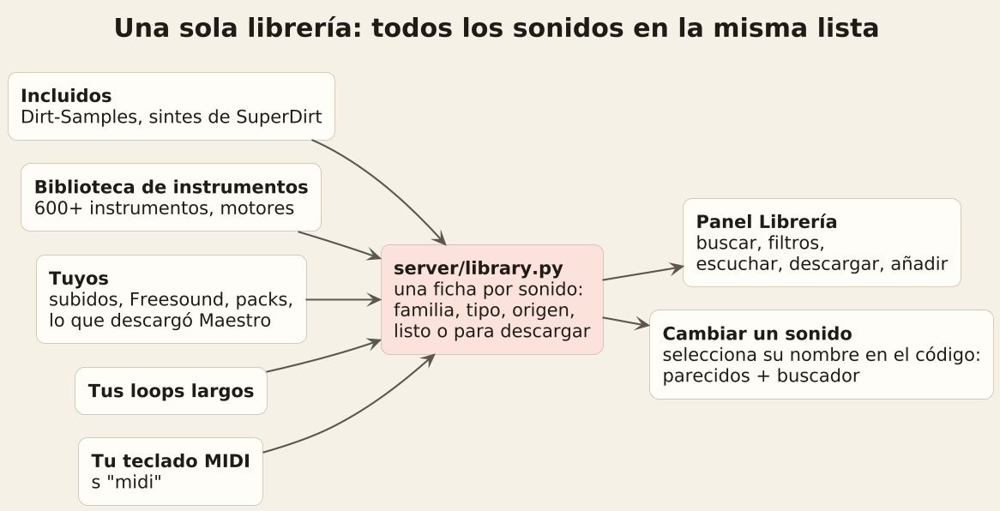

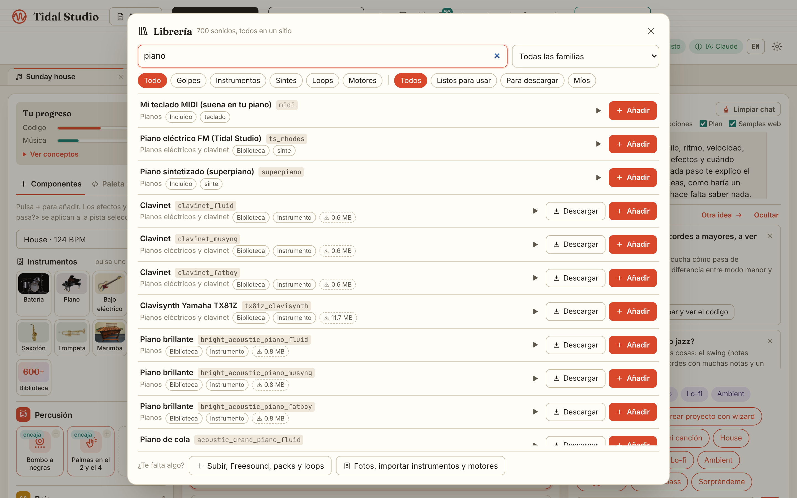

### Cambiar un sonido seleccionando su nombre

Haz doble clic (o selecciona) el nombre de un sonido en tu código, como `superpiano` o `bd`, en una pista o en la
pestaña Código. Aparece una tarjeta: **«Cambiar superpiano por…»**, con sonidos parecidos de tu librería (misma familia,
mismo papel, etiquetas y registro parecidos): primero los que ya tienes y luego los que se bajan en un clic. Si ninguno
te convence, **busca**. Pulsa ▶ para escuchar cada opción y elige: **solo aquí**, **en esta pista** o **en toda la
canción**. Si hace falta descargarlo, se descarga primero, y **Deshacer** lo devuelve como estaba. Los números de muestra
como `bd:3` se quedan al cambiar un golpe por otro, y la tarjeta avisa cuando un golpe pasa a ser un instrumento afinado
(o al revés). **Más ideas de Maestro** le pide a tu IA tres alternativas y por qué.

| Sonidos parecidos, primero los que tienes | O busca en toda la librería |
|---|---|
| 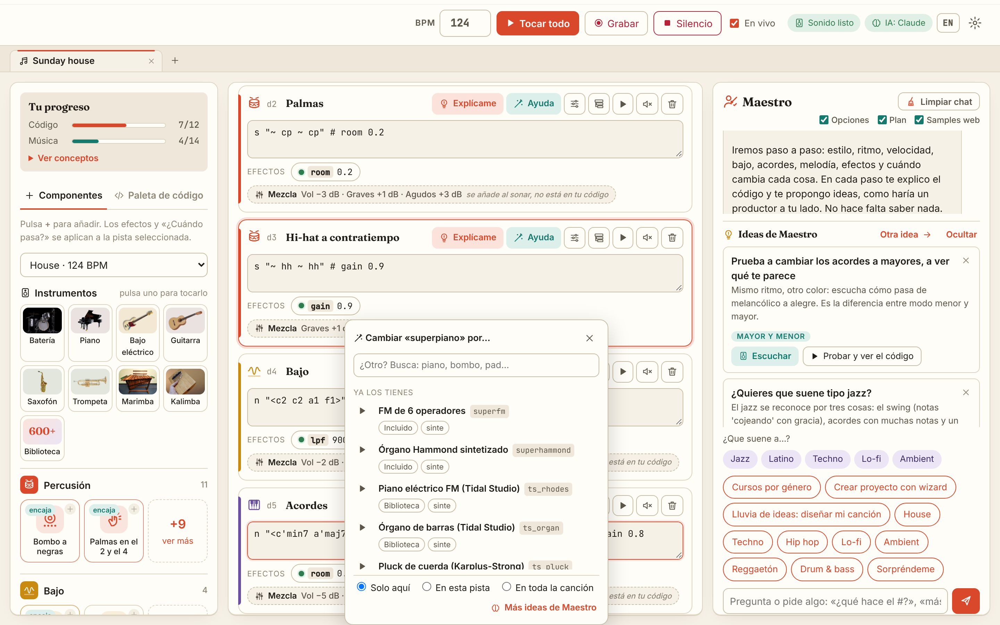 | 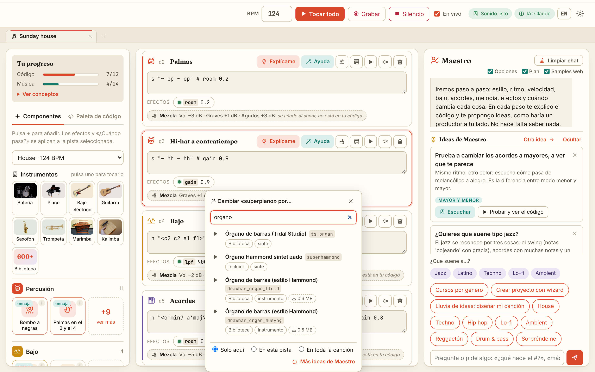 |

### Biblioteca de samples

Sonidos por tipo (bombos, cajas, platos, percusión, breaks, bajos, melódicos, pads, voces, FX, sintes). Escúchalos,
úsalos en una pista nueva o ponlos en la pista seleccionada manteniendo el ritmo. Sube tus archivos (WAV, AIFF, FLAC, OGG)
o **busca en Freesound** (clave API gratuita) filtrando por licencia; lo descargado queda listo para Tidal y los créditos
de los sonidos CC BY se apuntan en `samples/CREDITS.md`. La pestaña **Packs** explora packs de la comunidad en GitHub
(unas 70 cajas de ritmos, Uzu drumkit, VCSL, un piano de cola, SP-12, mridangam, o cualquier `github:usuario/repo` con un
`strudel.json`): escucha, instala un sonido o una caja de ritmos entera. **Los packs instalados y los sonidos de Freesound
se cargan en SuperDirt al momento**, sin reiniciar el motor. En tus samples ves la **forma de onda**, arrastras para elegir
un trozo, lo escuchas y lo usas (`# begin … # end …`). Maestro conoce tu biblioteca y puede usarla.

| Sonidos incluidos por tipo | Packs online: cajas de ritmos enteras |
|---|---|
| 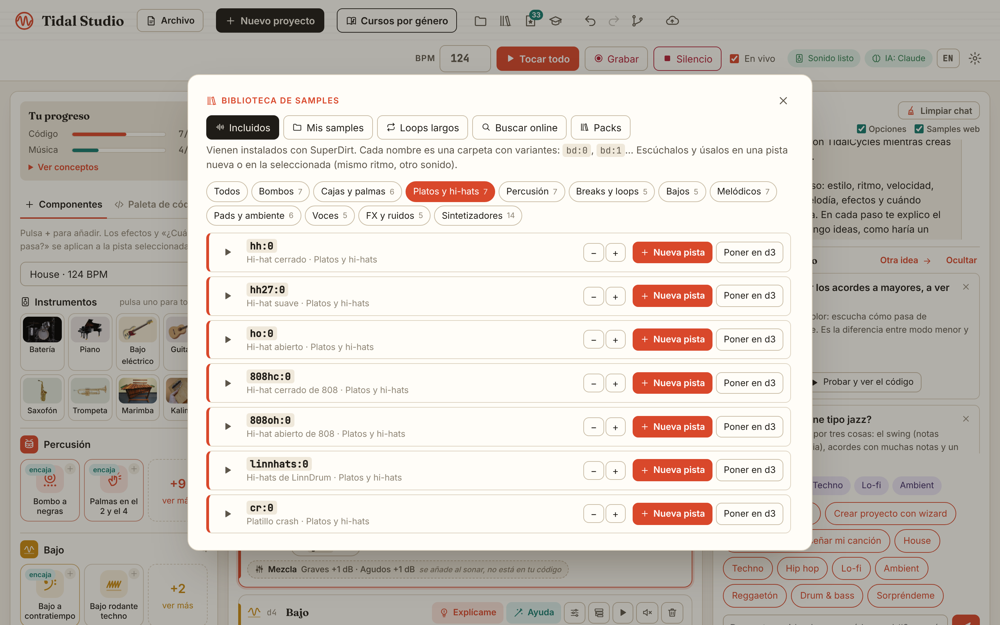 |  |
| **Buscar en Freesound por licencia** | **Forma de onda y recorte** |
|  |  |

### Maestro descarga los sonidos que necesita

Si tu canción sonaría mejor con algo que aún no tienes (un cencerro de verdad, crujido de vinilo, una marimba, un piano
de cola…), **Maestro lo busca en internet él solo**. Solo elige sonidos con licencia libre: packs de la comunidad (VCSL
CC0, Uzu drumkit de dominio público, piano Salamander CC BY, mridangam CC BY-SA, sin clave) y, si has puesto una clave
gratuita, Freesound (CC0 y CC BY). Descarga el sonido, apunta los créditos en `samples/CREDITS.md`, lo carga en SuperDirt
y lo usa en el código, todo antes de que te llegue la respuesta. En el chat ves qué ha descargado: su nombre en Tidal, de
dónde viene, la licencia, un botón **Escuchar** y **Otro sonido** para cambiarlo por el siguiente resultado.

Los paquetes grandes (muchos archivos o varios MB, como un piano entero) no se bajan sin preguntarte: pulsa
**Descargar** o contesta «descárgalo». Si no aparece nada con licencia libre, Maestro usa un sonido parecido que ya
tienes para que la canción siga sonando. Funciona con cualquier proveedor de IA (va dentro de la respuesta de Maestro, no
depende de una IA concreta) y también en las opciones para escuchar. Se apaga con **Samples web**, encima del chat. Sin IA,
escribe «descarga un sample de marimba».

| Descargado y ya sonando | Paquete grande: Maestro pregunta antes |
|---|---|
| 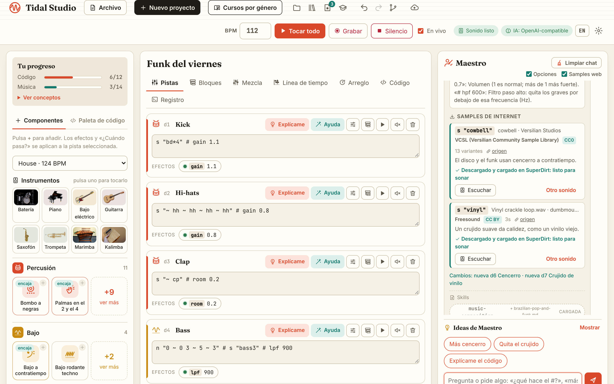 | 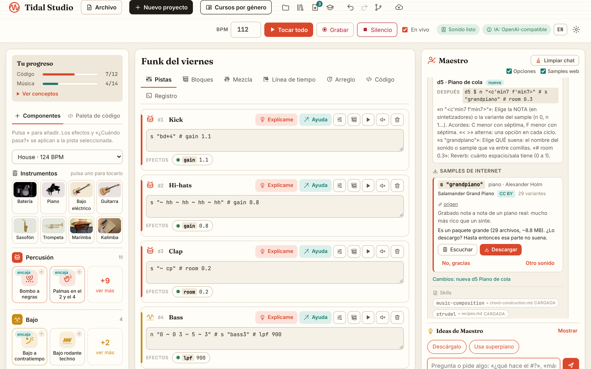 |

### Loops largos: una biblioteca que sabe qué hacer con ellos

Los loops completos que descargas (una base de reggaetón de 4 compases, un bajo, un riff de piano) no son golpes: en Tidal
hay que estirarlos a tu tempo o se desfasan y se pisan. Abre la biblioteca en **Loops largos** y **suelta tus loops en
cualquier parte del estudio**: archivos sueltos, **carpetas enteras** o un **.zip** con un pack (WAV, AIFF, FLAC, OGG,
MP3), con barra de progreso. Cada loop pasa a ser un sonido, se carga en SuperDirt al momento y se **analiza**: tempo (del
nombre del archivo, «95BPM», o escuchando los golpes), número de compases, tonalidad (si es melódico), tipo (batería,
bajo, melodía, acordes, voz, textura) y dónde cae cada golpe (bombo, caja o platos). Si algo sale mal detectado, corriges
a mano el BPM, los compases, la tonalidad o el tipo.

Cada loop enseña su forma de onda, sus etiquetas y cómo encaja en tu canción («ya va a tu tempo», «+6% de velocidad,
+0.9 semitonos» o «a medio tempo»), ordenados por cercanía a tu tempo. **Escuchar** lo toca en el navegador al tempo de tu
canción. **Añadir como pista** escribe el código correcto, y las tijeras abren cuatro formas de usarlo, cada una explicada:

- **Al tempo**: `loopAt 4 $ chop 32 $ s "dembow" # cut 1`. `loopAt` hace que dure justo 4 ciclos (compases) de tu
  canción, `chop` lo mantiene sincronizado aunque empieces a mitad y `# cut 1` evita que una vuelta se pise con la siguiente.
- **Variaciones** para no repetir: `splice 16 "<[0 1 … 15]!2 [… [12 12] [13 13] …] […]>"` toca dos veces el original,
  luego un relleno y una versión con trozos cambiados.
- **Un trozo**: eliges compases y sale `# begin 0.25 # end 0.5`.
- **Trozos**: pulsas los trozos (con color según lo que tienen: bombo, caja, platos) para oírlos y montar tu propio orden.

**Maestro conoce tus loops** con su tempo, compases, tonalidad y golpes, y recibe el código listo. Si alguna vez escribe
un loop «a pelo» (`s "dembow"`), el estudio le añade `loopAt` y `# cut 1`. Cuando descarga un loop de internet lo pide al
tempo (y la tonalidad) de tu canción, lo analiza en cuanto llega y lo ajusta al tempo. «Buscar loops en mi biblioteca»
analiza los sonidos largos que ya tenías. Sin ffmpeg, los MP3/OGG los decodifica el navegador para el análisis.

| Suelta loops: archivos, carpetas o un zip | Variaciones para no repetir |
|---|---|
| 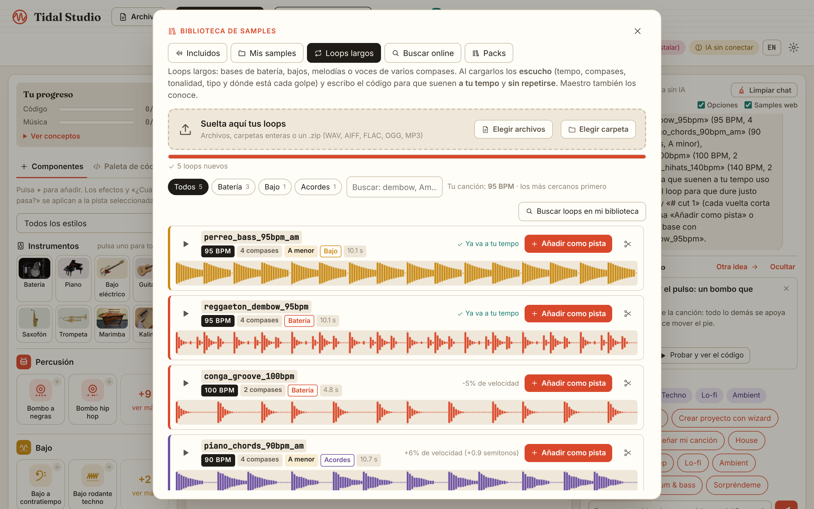 | 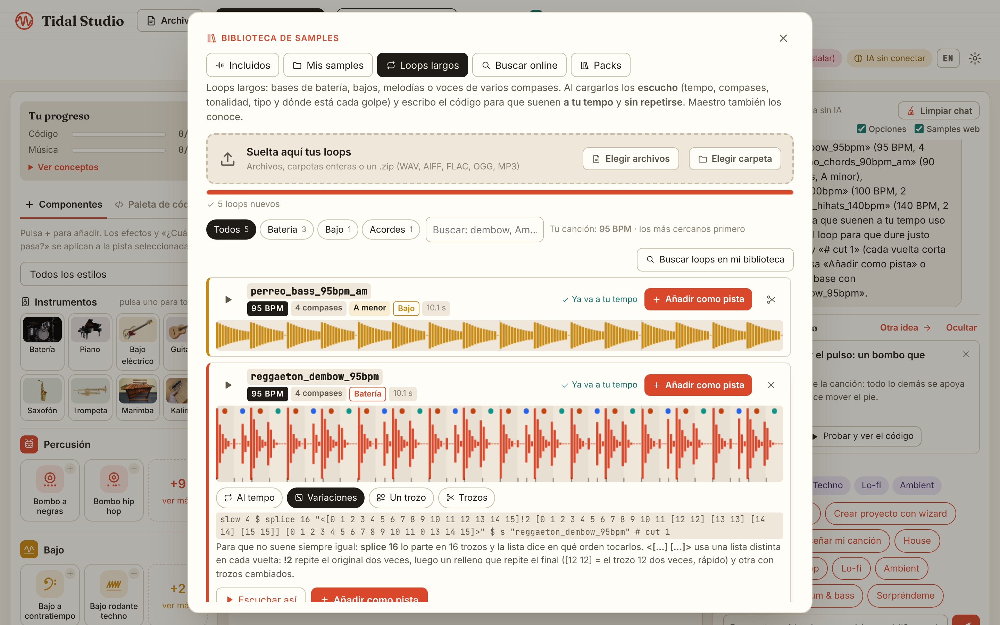 |
| **Monta tu propio orden con los trozos** | **En la canción, a tu tempo** |
| 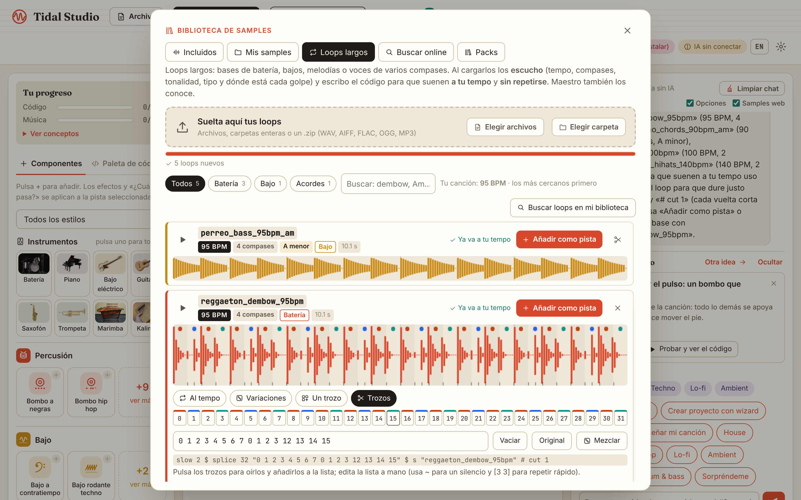 | 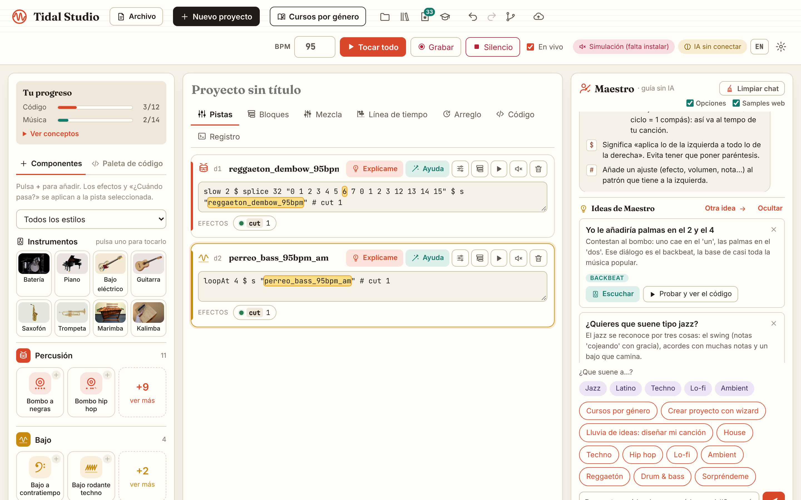 |

### Skills y plugins

Maestro carga **skills** de música (`SKILL.md`, el mismo formato que las Agent Skills de Claude) y debajo de cada
respuesta muestra cuáles cargó y cuáles usó. Instala más skills, o **plugins y marketplaces de Claude Code** enteros,
pegando un enlace de GitHub en el panel de Skills: sus skills se suman a las de Maestro y sus comandos funcionan en el chat
como `/nombre`. Detalles en [Skills](#skills) y [Plugins](#plugins) más abajo.

| Debajo de cada respuesta: qué skills se cargaron y cuáles se usaron | El panel de Skills: activar, cargar siempre, ver, instalar |
|---|---|
|  |  |
| **Plugins: un plugin de Claude Code entero desde un enlace de GitHub** | |
|  | |

### Cómo decide Maestro, y su razonamiento

Cada respuesta que se ha apoyado en una skill empieza con **Cómo lo he decidido**: una fila por decisión musical
(estilo, ritmo, tempo, bajo, armonía, melodía, instrumentos, efectos, mezcla, estructura) con la skill que consultó,
la regla o el consejo que sacó de ella y lo que hizo con él (pista, valor, código). Solo pueden salir skills cuyo
contenido se cargó de verdad para ese mensaje, así que no puede inventarse una regla a partir del nombre. Pulsa una
skill para abrirla.

Mientras sale **Maestro está pensando…**, una línea gris muy tenue, **Pensando**, enseña qué está haciendo, como en un
harness de programación: lee tu canción, qué skills ha elegido y por qué, a quién pregunta y el razonamiento de Claude
según llega. Púlsala para desplegarla; después de la respuesta se queda debajo del mensaje como **Razonamiento**. Con
clave de API de Anthropic usa el thinking adaptativo en modo resumido; con tu suscripción de Claude lee la salida
`stream-json` del comando `claude`; los modelos compatibles con OpenAI enseñan su `reasoning_content` si lo devuelven.
Los proveedores que no comparten su razonamiento solo muestran los pasos.

| Cómo lo he decidido | Razonamiento |
|---|---|
| 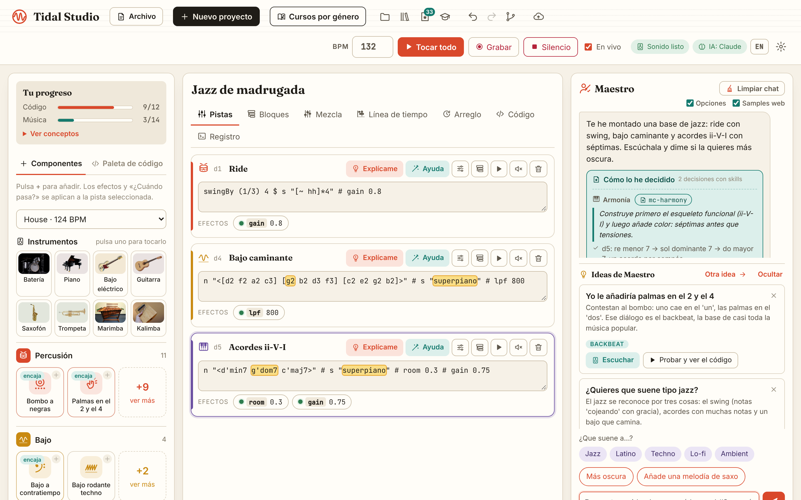 | 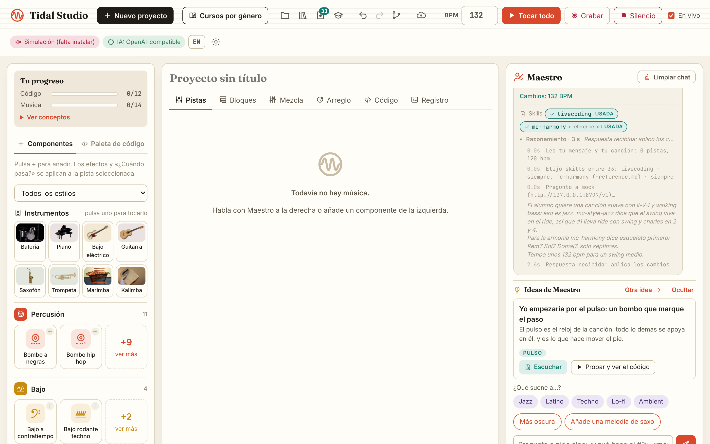 |

### Conecta tu IA, con detección automática y Diagnóstico

En **Ajustes** eliges un endpoint compatible con OpenAI, una clave de API de Anthropic o **Claude con tu suscripción**. Con
tu suscripción, el estudio encuentra el comando `claude` que usa tu terminal y te enseña lo que ha detectado: ruta,
versión, si tienes la sesión iniciada, modelo por defecto, endpoint y clave de API. **Automática** elige la conexión
adecuada por ti (tu plan si tienes sesión iniciada; si no, lo mismo que tu terminal). Si Maestro no responde, pulsa
**Diagnóstico**: revisa paso a paso el entorno de tu terminal, el comando `claude`, la sesión, el modo de conexión, el
modelo y una prueba real, te dice cómo arreglar lo que falla, y **Probar modelos** prueba cada modelo para que pulses
**Usar** en uno que funcione. **Copiar informe** te da un resumen en texto con las claves ocultas. Detalles en
[Configurar la IA](#configurar-la-ia).

| Detectado en este ordenador | Diagnóstico y Probar modelos |
|---|---|
|  |  |

### Una app de verdad en tu ordenador

Tidal Studio se instala como **app nativa** con todo dentro (TidalCycles, SuperCollider, los sonidos, Python): se abre en
su propia ventana, sin Terminal, arranca el motor de sonido en segundo plano y lo para al cerrarla. Descarga el
instalador para tu sistema (versión 0.14.0; las nuevas aparecen en la [última versión](https://github.com/vsalesa/tidal-studio/releases/latest)):

| Sistema | Descarga | Después |
|---|---|---|
| **Mac** (Apple Silicon) | [TidalStudio-0.14.0-macOS-AppleSilicon.pkg](https://github.com/vsalesa/tidal-studio/releases/download/v0.14.0/TidalStudio-0.14.0-macOS-AppleSilicon.pkg) | [Pasos en Mac](#lo-más-fácil-el-instalador-para-mac-con-todo-dentro) |
| **Windows** 10/11 (x64) | [TidalStudio-0.14.0-Windows-x64-Setup.exe](https://github.com/vsalesa/tidal-studio/releases/download/v0.14.0/TidalStudio-0.14.0-Windows-x64-Setup.exe) | [Pasos en Windows](#windows-el-instalador-con-todo-dentro) |
| **Linux** (Ubuntu 22.04+, Debian 12+) | [tidal-studio_0.14.0_amd64.deb](https://github.com/vsalesa/tidal-studio/releases/download/v0.14.0/tidal-studio_0.14.0_amd64.deb) | [Pasos en Linux](#linux-ubuntu-2204-debian-12-el-paquete-deb) |

### Tidal Studio se actualiza solo

Cuando sale una versión nueva, la app te avisa: al arrancar y cada 12 horas mira las
[versiones en GitHub](https://github.com/vsalesa/tidal-studio/releases) y te enseña una tarjeta con las novedades.
**Actualizar ahora** descarga el instalador de tu ordenador (el `.pkg` de Apple Silicon en el Mac, `Setup.exe` en
Windows, el `.deb` en Linux) con barra de progreso y lo comprueba con el SHA-256 que publica GitHub. **Instalar y
reiniciar** cierra Tidal Studio, ejecuta el instalador (el Mac te pide tu contraseña y Windows, permiso) y abre la
versión nueva. Tus canciones, samples, plugins y ajustes no se tocan. **Más tarde** esconde la tarjeta hasta mañana y
**Saltar esta versión**, hasta la siguiente.

| Hay una versión nueva | Descargando, con progreso |
|---|---|
|  |  |

| Lista: un clic la instala y vuelve a abrir | Ajustes › Actualizaciones |
|---|---|
|  |  |

En **Ajustes › Actualizaciones** ves tu versión, puedes **Buscar actualizaciones** a mano (en el Mac también desde el
menú **Tidal Studio › Buscar actualizaciones…**) y desmarcar **Buscar versiones nuevas sola** para que no mire nunca
por su cuenta. Si usas Tidal Studio desde la carpeta del código, solo te avisa de la versión nueva: actualiza con
`git pull`.

### Tutorial interactivo

La primera vez que abres el estudio, Maestro te enseña todo en 22 pasos cortos (tocar la batería, añadir pistas, efectos,
controles en el chat, ideas, recetas, bloques, arreglo, código, biblioteca…). Cada paso espera a que lo hagas, y puedes
repetirlo desde el botón del birrete.


### Abrir y guardar archivos de Tidal

El menú **Archivo** abre y guarda archivos normales de TidalCycles (`.tidal`, `.hs`) estén donde estén en tu ordenador,
así puedes llevar canciones de Tidal Studio a cualquier editor de Tidal (Pulsar, VS Code, Vim…) y al revés.

- **Abrir…** (`Ctrl/⌘+O`) lee el archivo y convierte cada `d1 $ …` … `d12 $ …` y cada `p "nombre" $ …` en una pista. Un
  comentario corto justo encima de un patrón se usa como nombre de la pista, `setcps` se convierte en el BPM y los
  patrones dentro de un bloque `do` también se separan en pistas. Lo que no es una pista (definiciones con `let`,
  `once`, imports, comentarios de bloque…) se guarda **intacto** en la tarjeta **Código extra**, encima de las pistas,
  y se evalúa antes que ellas al pulsar Tocar todo. Las líneas `hush` se quitan (aquí eso lo hace el botón Silencio).
- **Guardar** (`Ctrl/⌘+S`) y **Guardar como…** (`Ctrl/⌘+Shift+S`) escriben un `.tidal` limpio que suena en cualquier
  editor de Tidal: la mezcla va como líneas `# amp … # eqlow …`, las pistas silenciadas van comentadas y una línea de
  comentario (`-- tidal-studio: {…}`) recuerda el nombre, el tipo de cada pista, el solo y el master, para que al
  volver a abrirlo no se pierda nada.
- **Archivos recientes**, un indicador de **guardado / cambios sin guardar** encima del nombre de la canción (y un
  punto en el botón Archivo) y un aviso **¿Guardar los cambios?** antes de cerrar un archivo con cambios.
- Usa los diálogos de tu sistema: los paneles nativos en la app de Mac, el diálogo de archivos de Windows y
  zenity/kdialog en Linux. En un navegador normal usa el selector de archivos del navegador, o te deja escribir la
  ruta donde guardar.

| Menú Archivo con recientes | ¿Cambios sin guardar? |
|---|---|
|  |  |


### Varias canciones abiertas a la vez, en pestañas

Cada canción que abres tiene **su propia pestaña**, como en un navegador o un editor de código, así puedes tener abiertos
a la vez un trabajo a medias, un `.tidal` de tu disco y una versión de GitHub, y saltar de una a otra.

- **Todo se abre en una pestaña nueva**: Archivo → **Abrir archivo…** (de tu disco), **Abrir desde GitHub…**, un archivo
  reciente, **Mis proyectos**, **Nuevo proyecto**, un curso por género o una canción importada. Tu canción actual sigue
  abierta en su pestaña. Si abres algo que ya está abierto (el mismo archivo, la misma canción de GitHub), te lleva a su
  pestaña.
- **Cada pestaña guarda su canción**: pistas, código, Bloques, Mezcla, arreglo, el chat de Maestro, el historial para
  deshacer y el archivo al que pertenece. Solo suena la pestaña de delante: al cambiar se para la canción anterior y,
  con En vivo activado, suena la nueva.
- **Cierra** una pestaña con su **×** (o con el botón central del ratón, o Archivo → **Cerrar archivo / Cerrar
  pestaña**). Si su archivo tiene cambios sin guardar, la pestaña muestra un punto y antes pregunta **Guardar / No
  guardar / Cancelar**. La canción sigue en Mis proyectos, así que cerrar una pestaña nunca pierde trabajo.
- El icono de cada pestaña dice dónde vive la canción: una hoja si es un archivo de tu disco, una nube si es de GitHub,
  una nota si está guardada en este navegador. Pasa el ratón por una pestaña para ver su ruta completa. El **+** del
  final empieza una canción nueva.
- Atajos: `Alt+1…9` salta a una pestaña y `Ctrl+Alt+←/→` a la anterior o la siguiente. En la app de Mac, `⌘T` pestaña
  nueva, `⌘W` cerrar pestaña y `⌘⇧[` / `⌘⇧]` para moverte entre pestañas.
- Las pestañas abiertas vuelven la próxima vez que abras el estudio.


| Menú Archivo: abrir del disco o de GitHub, cerrar el archivo | Cerrar una pestaña con cambios sin guardar |
|---|---|
|  |  |

### Importar una canción como punto de partida

**Nuevo proyecto → Desde una canción** (o **Archivo → Importar canción**) coge una canción que te guste y la convierte
en la base de una canción **nueva** tuya.

- **MIDI (`.mid`)**, rápido y exacto: cada pista MIDI se convierte en una pista de Tidal. La batería (canal 10 de
  General MIDI) se separa en bombo, caja y palmas, platillos y toms; bajo, acordes y melodía pasan a patrones
  `note "…" # s "…"` con nombres de nota (`a3`, `[f5,a5,c6]`). Las notas se cuadran a la rejilla más sencilla que
  encaja, para que el código se lea bien (`s "bd*2"`, `s "[~ sn]*2"`), y cada compás es un ciclo (`<compás1 compás2 …>`).
- **La receta de la canción**: tempo, compás, tonalidad, progresión de acordes con grados (`i bVI bIII bVII`), groove
  (recto o con swing, cuántos bombos) y estructura (bloques de 4 compases que se repiten: `A B A B`). Pulsa una parte de
  la estructura, o elige el compás de inicio y de 1 a 16 compases, para cargar otro trozo.
- **Crear una canción nueva inspirada en esta**: Maestro recibe la receta con la orden de *transformar, no copiar*:
  conserva el tempo, el groove, el tipo de progresión y la energía, escribe una melodía nueva, cambia acordes,
  instrumentos o tonalidad y te explica qué ha tomado prestado y qué ha cambiado. Sin IA te da una lista de pasos para
  hacerla tuya. **Estudiarla tal cual** solo carga las pistas para que pulses Explícame en cada una.
- **Audio (mp3, wav, flac, ogg, m4a, aiff)**, aproximado: la primera vez ofrece instalar herramientas libres que
  funcionan sin internet (~1-2 GB, en `~/.tidal-studio/audio-tools`). Primero separa batería, bajo, voz y el resto,
  luego **basic-pitch** (Spotify) pasa cada parte a notas y **librosa** encuentra el pulso. El resultado se cuadra a los
  compases y los acordes se escriben con nombres de acorde de Tidal (`a4'minor f4'major`). Es un esqueleto para estudiar
  y reinventar, no una copia exacta.
- **Dos separadores; eliges en cada canción:**
  - **Calidad: MSST** ([Music-Source-Separation-Training](https://github.com/ZFTurbo/Music-Source-Separation-Training)
    de ZFTurbo, MIT) con su modelo **SCNet XL** para batería, voz y el resto, y Demucs para el bajo. El modelo (214 MB)
    se descarga la primera vez que lo usas. Recomendado en Apple Silicon (va por la GPU con MPS) y en ordenadores con
    tarjeta NVIDIA.
  - **Rápido: Demucs** (Meta) para todo. Recomendado en ordenadores sin tarjeta gráfica, donde MSST tarda unas 6 veces
    lo que dura la canción.
  - Si MSST falla en tu ordenador, usa Demucs él solo. Si ya tenías instaladas las herramientas de audio, Tidal Studio te ofrece actualizarlas.

  Cómo lo elegimos: con 8 canciones del conjunto de prueba de MUSDB18 (SDR mediano en dB, más es mejor), SCNet XL separó
  mejor que Demucs la batería (9,0 frente a 6,8), la voz (11,9 frente a 9,5) y el resto (5,5 frente a 4,8), pero peor el
  bajo (6,2 frente a 8,8). Por eso el bajo sale de Demucs. BS-RoFormer puntuó un poco más (media 8,5 frente a 8,1), pero
  su modelo pesa 527 MB y es un 40 % más lento.

  | Elige el separador | Separando con MSST |
  |---|---|
  |  |  |
- Todo se queda en tu ordenador. Si la canción no es tuya, úsala para estudiar y publica lo que crees, no la copia.

| La receta de la canción y sus pistas | Desde un mp3 o wav |
|---|---|
|  |  |


### Genera desde tu MIDI, en cualquier estilo

**Nuevo proyecto → Generar desde mi MIDI** (o **Archivo → Generar desde mi MIDI**) coge un MIDI tuyo, se queda con las
partes que elijas y escribe el resto en el estilo que quieras. Funciona sin conexión y sin IA, y luego Maestro puede variarlo.

1. **Sube tu MIDI** (expórtalo desde GarageBand, Logic, MuseScore o Ableton) y elige los compases (1-16).
2. **Elige un estilo**: merengue, salsa, cumbia, reggaeton, bossa nova, jazz, funk, house, techno, drum & bass o lo-fi.
3. **Elige qué te quedas**: tu **melodía** (nota por nota, con un instrumento del estilo), tus **acordes** (tocados como
   los toca el estilo, con séptimas en jazz, bossa, funk, house y lo-fi), tu **bajo**, tu **batería** y tu **tempo**.
   Lo que tu MIDI no tiene en ese trozo sale en gris.
4. **Generar**: la batería sale del curso de género, el bajo y el acompañamiento usan los ritmos medidos en canciones
   reales tocados sobre tus acordes (el bajo del merengue salta raíz-quinta y se acerca al acorde siguiente, el de la
   salsa hace el tumbao y se adelanta al acorde siguiente…), y si no te quedas tu melodía, la nueva se escribe como
   pregunta y respuesta: el compás 1 pregunta, el 2 contesta, el 3 repite la pregunta sobre su acorde y el 4 cierra.
   Si no te quedas tus acordes, usa la progresión típica del estilo en tu tonalidad (en la relativa menor o mayor
   cuando el estilo lo pide).
5. Cada pista dice de dónde sale (**de tu MIDI**, **del estilo**, **nuevo**) y por qué. **Escucha**, prueba **Otra
   versión** (otra melodía y otra variación del patrón) o **Cambiar estilo**, y **Usar esta versión** cuando te guste.
   Maestro te cuenta qué ha hecho con cada pista y te ofrece **Conviértela en una canción entera** (intro, estrofa,
   estribillo, puente y final con un plan) o **Generar otra versión**.

En los cursos por género, **Hacer mi MIDI Merengue** (o el estilo del curso) hace lo mismo con tu MIDI de ejemplo.
El resultado de importar una canción también tiene **Generar en un estilo…**.

| 1. Sube tu MIDI | 2. Estilo y qué te quedas |
|---|---|
|  |  |
| **3. Tu versión, pista a pista** | **4. En el estudio, con Maestro** |
|  |  |
| **Desde un curso de género** | |
|  | |

### Toca tu teclado MIDI: suena y se convierte en código de Tidal

Enchufa tu piano o teclado MIDI (USB; uno «class compliant» con cable USB-B a USB-C no necesita drivers) y pulsa
**Teclado MIDI** en la barra de arriba. Se abre un panel abajo del estudio:

- **Suena al momento** con el sonido que elijas (superpiano, Rhodes, órgano, pads, sintes, los instrumentos que has
  fijado en la biblioteca o cualquier sonido que ya use tu canción). SuperCollider escucha el teclado y toca cada nota
  por SuperDirt, así que funciona también en la app de Mac. Elige el **teclado**, el **canal**, la **octava** (− / +,
  o Z y X) y quita **Que suene** si tu piano ya suena por sí mismo.
- **¿Sin teclado a mano?** Pulsa las teclas de la pantalla o toca con las del ordenador (A W S E D F T G Y H U J K = do a do).
- **Grabar**: con cuenta atrás y metrónomo o, si tu canción está sonando, desde su siguiente compás y a su tempo, para
  que lo que tocas encaje. **Mientras tocas, el código de Tidal se va escribiendo** debajo del teclado.
- **Parar y traducir**: tu toma se convierte en pistas de Tidal, una por mano (**Mano izquierda** y **Mano derecha**,
  o todo en una pista), cuadradas a la rejilla más sencilla que encaja (negras, corcheas, semicorcheas o tresillos;
  puedes cambiarla, y el BPM), con la tonalidad y los acordes que ha encontrado. El pedal de sustain alarga las notas
  como en un piano de verdad.
- **Convertir lo que acabo de tocar**: no hace falta haber pulsado Grabar. Coge tu última frase.
- Después: **Escuchar**, **Añadir a mi canción**, **Pregúntale a Maestro** (añade las pistas y Maestro te explica lo
  que has tocado, en música y en código, y te propone cómo seguir), **Generar en un estilo…** (tu toma pasa a
  [Genera desde tu MIDI](#genera-desde-tu-midi-en-cualquier-estilo)), **Canción nueva con esto** o descárgala en **.mid**.

¿Todavía sin piano? `python3 tools/virtual_midi.py` toca una frase con un teclado virtual (con `--fake-song` simula
además una canción sonando, y con `--port` crea un puerto MIDI virtual de verdad, con `pip install mido python-rtmidi`).

| 1. Tu teclado, en directo | 2. Grabando, el código mientras tocas |
|---|---|
|  |  |
| **3. Traducido a Tidal, mano a mano** | **4. Maestro te lo explica y propone cómo seguir** |
|  |  |

### Tu teclado en los dos sentidos: la canción suena en tu piano

El MIDI ahora va y vuelve. En el panel del teclado MIDI, abre **Enviar a mi teclado** y elige la **salida** (tu piano),
el **canal** y, si quieres, el **sonido del teclado** (piano, piano eléctrico, órgano, cuerdas… de la lista General
MIDI). Después:

- **Pulsa una pista** para que suene con el sonido de tu teclado (su código pasa a `# s "midi" # midichan 0`); púlsala
  otra vez para volver al sonido del estudio. Maestro también conoce `s "midi"`.
- **Reloj y start/stop**: el arpegiador, la batería o el secuenciador de tu teclado siguen el tempo de la canción
  (24 pulsos por negra), arrancan con **Tocar todo** y paran con **Silencio**.
- **Silencio** manda además *All Notes Off*, así nada se queda sonando en tu piano. Si oyes cada nota dos veces,
  desactiva *Local Control* en tu teclado.


### Enchufar y desenchufar: el audio se recupera

Enchufar un teclado, unos auriculares o una tarjeta de sonido USB podía dejar el estudio mudo. Ahora:

- El teclado **se detecta solo** al enchufarlo (se mira cada 2 s) y te avisa; al desenchufarlo, **se sueltan las notas y
  el pedal que tenías pisados** y la grabación no las alarga.
- Desactivar **Que suene**, o cambiar de teclado o de canal, corta lo que estaba sonando.
- Tu teclado suena en **su propio canal de SuperDirt**, así ya no le cambia la reverb ni el delay a `d12`.
- En Mac el motor **ya no abre ninguna entrada de audio** (Tidal Studio no graba del micrófono), que era la causa
  habitual de «Mismatched sample rates» cuando macOS cambiaba la entrada a un aparato nuevo.
- Si cambian las salidas de sonido o el motor de audio se para, una barra ofrece **Reconectar audio**, con la **salida**
  que quieras (se recuerda). Solo se reinicia SuperCollider: Tidal conserva tu canción y vuelve a sonar sola.


### Guardar, exportar y compartir

- **GitHub**: guarda cada versión de tu canción como un commit en un repositorio tuyo (`song.tidal`, `song.json`,
  `README.md`), mira el historial y abre cualquier versión antigua desde Mis proyectos → GitHub.
- **Exportar**: descarga la canción como archivo `.tidal`, copia un **enlace para compartir** (toda la canción va en la
  URL; al abrirlo se carga como proyecto nuevo) o **graba** lo que suena a un WAV en `recordings/` con el botón de grabar.
- **Mis proyectos**: tus canciones se guardan solas y puedes abrirlas o borrarlas desde la carpeta.


### Tus canciones en GitHub: ruta remota, subir varias a la vez y crear las nuevas allí

- **Una canción abierta desde GitHub enseña dónde vive en GitHub**, `usuario/repo/songs/nombre`, en su pestaña y encima
  del título, nunca una ruta de tu ordenador, aunque también tengas un `.tidal` con el mismo nombre. Si ese archivo
  está abierto, sigue en su propia pestaña. `Ctrl+S` / `⌘S` en una canción de GitHub guarda una versión nueva en GitHub.


- **Ajustes → GitHub** tiene dos cosas nuevas: «Crear las canciones nuevas directamente en GitHub» y «Subir canciones
  desde mi ordenador…».


- **Subir canciones desde mi ordenador**: eliges una carpeta, marcas los `.tidal` / `.hs` que quieras y los subes todos
  de una vez. Cada archivo pasa a ser una canción en `songs/<nombre>/` con su propio commit (con su código extra, `let`
  y definiciones). Si el repositorio ya tiene una canción con ese nombre, se sube como `<nombre>-2`, así no se pisa nada.


- **Eliminar los archivos locales después de subirlos**: un archivo solo se quita cuando GitHub ha confirmado la subida
  *y* la canción leída de vuelta desde GitHub es idéntica, y solo si no lo has tocado mientras tanto. Va a la Papelera,
  así que puedes recuperarlo. Una pestaña que tenía ese archivo abierto pasa a ser la canción de GitHub.


- **Crear las canciones nuevas directamente en GitHub**: con esta casilla marcada, cada canción nueva, empieces como
  empieces (en blanco, asistente, lluvia de ideas, un curso, un MIDI o un audio…), se crea en tu repositorio en cuanto
  tiene su primera pista.


### Bloquea lo que te gusta: Maestro no puede cambiarlo

Debajo de cada pista, el botón del candado abre una fila de opciones: bloquea la **pista entera** o solo una parte:
**Ritmo**, **Notas**, **Sonido**, **Efectos** o **Mezcla**. El candado junto al BPM bloquea el tempo. Maestro, las
ideas, las opciones y los cursos no pueden cambiar lo bloqueado: la app revisa cada propuesta antes de aplicarla, y el
servidor quita lo que toca una pista bloqueada entera o el BPM antes de que lo veas. Tú sí puedes editarlo todo a mano:
el candado protege tu decisión de los cambios automáticos, no de ti. Si la canción cambió mientras Maestro pensaba, su
propuesta llega como opción en vez de aplicarse.


### A/B a ciegas: tu oído es el juez

En la tarjeta de opciones de Maestro, pulsa **A ciegas**: se esconden los nombres y el código, las opciones se barajan
como X, Y, Z y votas solo con el oído (teclas 1-4 para cambiar, y un motivo si quieres). Luego Maestro te dice cuál era.
Cada voto, cada opción que eliges y cada elección que deshaces se guarda **en tu ordenador** (código y contexto, nunca
audio). El botón de la oreja de la barra superior abre **Escucha**: tus contadores, la **línea base** (nota del 1 al 5
por género y qué le falta, para medir si cada versión suena mejor) y **Exportar JSONL**, un dataset limpio para entrenar
algún día un modelo propio.


### Monitor RAG: mira qué capa respondió

Maestro ahora trabaja por capas, de la más barata a la más cara: **reglas locales** (respuestas con tus propios datos
sin IA, como «¿qué canciones mías usan supersaw?»), el **índice de canciones** (una copia de solo lectura en SQLite de
tus canciones guardadas, con búsqueda de texto), **tu biblioteca**, **skills**, el **LLM** solo para lo creativo o
ambiguo, y la **validación** (candados). El botón del monitor de la barra superior las dibuja como un diagrama en vivo:
cada petición ilumina su recorrido con el tiempo, los aciertos, los tokens y la caché de cada capa, y el porcentaje de
peticiones resueltas sin LLM. Pulsa una capa para ver qué hace y su detalle. Debajo, **Límites del enrutador** ajusta
los tokens máximos, las opciones como mucho, las pistas de tus canciones que se usan como contexto, la confianza que
necesita una respuesta local, el tiempo de corte de la IA y qué capas están activas, sin tocar `config.json`.


La canción sigue en tu navegador (y en tus `.tidal` o en GitHub): el índice es solo una copia, que se rehace a partir de
tus canciones, en `maestro-data/` junto a la app.

### Y además

- **Tu progreso**: conceptos de código y de música que ya has usado.
- **Componentes para añadir** y **código siempre visible y editable**.
- **Español e inglés**: cambia con el botón EN/ES de la barra superior. Maestro responde en el idioma elegido.
- **Cualquier IA**: endpoint compatible con OpenAI (OpenAI, OpenRouter, Groq, DeepSeek, Mistral, Ollama, LM Studio…)
  o Claude (Anthropic). Sin IA también funciona: guía con botones, explicaciones e ideas locales.
- **macOS, Windows y Linux**: el instalador detecta tu sistema.

## Novedades, versión a versión

Cada versión tiene sus instaladores para Mac, Windows y Linux en la [página de versiones](https://github.com/vsalesa/tidal-studio/releases).

| Versión | Novedades |
|---|---|
| **0.14.0** | Maestro v2, primer paso: [bloquea](#bloquea-lo-que-te-gusta-maestro-no-puede-cambiarlo) una pista entera o solo su ritmo, notas, sonido, efectos o mezcla, y el BPM; [A/B a ciegas](#ab-a-ciegas-tu-oído-es-el-juez) con cada voto guardado como dataset exportable, más notas de línea base por género; y un [monitor RAG en vivo](#monitor-rag-mira-qué-capa-respondió) de las capas de Maestro con límites configurables, respuestas locales sin IA y un índice SQLite de solo lectura de tus canciones. |
| **0.13.1** | [Tus canciones en GitHub](#tus-canciones-en-github-ruta-remota-subir-varias-a-la-vez-y-crear-las-nuevas-allí): una canción abierta desde GitHub enseña su ruta en GitHub, nunca una local; sube muchos `.tidal` a la vez desde Ajustes, con la opción de eliminar las copias locales (a la Papelera, solo tras comprobar la subida); y una casilla para crear cada canción nueva directamente en GitHub. |
| **0.13.0** | [MIDI de ida y vuelta](#tu-teclado-en-los-dos-sentidos-la-canción-suena-en-tu-piano): las pistas suenan en tu teclado, reloj y start/stop, sonido del teclado, All Notes Off. [Audio que se recupera](#enchufar-y-desenchufar-el-audio-se-recupera): teclados detectados al enchufarlos, notas soltadas al quitarlos, Reconectar audio con tu salida, sin entrada de audio en Mac. [Una sola librería](#una-sola-librería-para-todos-los-sonidos): incluidos y descargados en una lista. [Cambiar un sonido](#cambiar-un-sonido-seleccionando-su-nombre) seleccionando su nombre: parecidos, buscador y escuchar antes. |
| **0.12.1** | Arreglo: guardar canciones en un repositorio de [GitHub](#github) recién creado vacío (sin README) ya no falla con «409: el repositorio está vacío»; el campo del repositorio también acepta la URL de GitHub pegada. |
| **0.12.0** | [Toca tu teclado MIDI](#toca-tu-teclado-midi-suena-y-se-convierte-en-código-de-tidal): tu piano USB suena con cualquier instrumento y lo que tocas se convierte en pistas de Tidal (mano izquierda y derecha), grabado a compás con tu canción; Maestro te lo explica y te propone cómo seguir. |
| **0.11.0** | [Tidal Studio se actualiza solo](#tidal-studio-se-actualiza-solo): te avisa de las versiones nuevas, descarga y comprueba el instalador de tu ordenador y lo instala con un clic. |
| **0.10.0** | [Plan paso a paso](#peticiones-grandes-maestro-hace-un-plan-y-va-paso-a-paso): en las peticiones grandes Maestro te enseña antes un plan y lo hace paso a paso, guardando cada paso, así un timeout ya no pierde trabajo; un botón Cancelar (o Esc) detiene lo que has enviado; la IA solo se corta si se queda callada, y Maestro guarda en caché sus instrucciones, skills y búsquedas de sonidos. [Genera desde tu MIDI](#genera-desde-tu-midi-en-cualquier-estilo) en 11 estilos, quedándote con tu melodía, acordes, bajo o batería. [Canciones en pestañas](#varias-canciones-abiertas-a-la-vez-en-pestañas), abriendo y cerrando `.tidal` de tu disco además de GitHub. [Cursos por género](#cursos-por-género) con un baterista real para escuchar en nueve estilos y estilos latinos aprendidos de canciones reales. La [importación de audio](#importar-una-canción-como-punto-de-partida) separa los instrumentos con MSST (SCNet XL) y el bajo con Demucs. [Maestro ve lo que descargas](#maestro-descarga-los-sonidos-que-necesita) al momento: tu biblioteca se lee del disco en cada mensaje. |
| **0.9.1** | [Ruta de Tidal Studio](#plugins): Maestro carga en cada mensaje `mc-tidal-studio`, la ruta de skills de tu plugin de composición hecha para esta app, más la skill de género que mejor encaje. |
| **0.9.0** | [Biblioteca de instrumentos](#biblioteca-de-instrumentos-más-de-600-instrumentos-concretos): más de 600 instrumentos concretos con fotos, escucha previa y tus propios SoundFonts, motores de synth nuevos (Mi-UGens, Surge XT, Vital), cursos latinos que siguen tu plugin de composición con instrumentos reales, y plugins que se actualizan solos. |
| **0.8.0** | [Biblioteca de loops largos](#loops-largos-una-biblioteca-que-sabe-qué-hacer-con-ellos): arrastra loops, carpetas o un zip; detecta tempo, compases, tonalidad y golpes y te da código que encaja con tu canción, con variaciones. |
| **0.7.0** | [Importar una canción](#importar-una-canción-como-punto-de-partida) (MIDI, o audio con herramientas opcionales) como punto de partida de otra nueva. |
| **0.6.0** | [Maestro descarga los sonidos que necesita](#maestro-descarga-los-sonidos-que-necesita) de packs libres y de Freesound. |
| **0.5.0** | [Abrir y guardar archivos de Tidal](#abrir-y-guardar-archivos-de-tidal): menú Archivo para cualquier `.tidal` / `.hs`, con diálogos nativos. |
| **0.4.1** | [Cada pista muestra su mezcla](#pestaña-mezcla) (volumen y ecualización) en Pistas y Bloques. |
| **0.4.0** | [Escucha las opciones de Maestro y elige una](#escucha-las-opciones-de-maestro-y-elige-una), la [Línea de tiempo](#línea-de-tiempo-cuándo-suena-cada-sonido), [efectos on/off](#vista-de-bloques-y-resaltado-en-directo) y errores viejos que se borran solos. |
| **0.3.0** | [Una app de verdad](#una-app-de-verdad-en-tu-ordenador) para Mac, Windows y Linux; [detección de IA y Diagnóstico](#conecta-tu-ia-con-detección-automática-y-diagnóstico); [cómo decide Maestro y su razonamiento](#cómo-decide-maestro-y-su-razonamiento); [plugins](#skills-y-plugins). |
| **0.2.0 y anteriores** | Wizard, lluvia de ideas, cursos por género, Bloques, Mezcla, instrumentos, biblioteca de samples, skills, versiones en GitHub y el tutorial. |

## Instalación (una sola vez)

### Lo más fácil: el instalador para Mac con todo dentro

Descarga `TidalStudio-…-macOS-AppleSilicon.pkg` de la
[última versión](https://github.com/vsalesa/tidal-studio/releases/latest) y haz doble clic. Lleva todo dentro
(TidalCycles con su propio Haskell, SuperCollider, SuperDirt y sus sonidos, Python) y **no descarga nada** al instalar.
Después abre **Tidal Studio** desde Aplicaciones.

Tidal Studio es una app de Mac de verdad: se abre en su propia ventana (con su icono en el Dock y su barra de menús),
arranca SuperCollider, SuperDirt y Tidal en segundo plano **sin ninguna ventana de Terminal**, y los para todos al salir
(⌘Q o cerrando la ventana). Si algo falla, te enseña el registro, que también está en
`~/Library/Logs/Tidal Studio/studio.log`. **Visualización → Abrir en el navegador** abre el mismo estudio en tu navegador.

Aún no está firmado por Apple, así que la primera vez macOS lo bloquea: ve a
**Ajustes del Sistema → Privacidad y seguridad**, pulsa **Abrir igualmente** y vuelve a abrir el `.pkg`.
Instala el motor en `/Users/Shared/TidalStudio` (unos 3 GB) y no toca el SuperCollider, Haskell o Python que ya tengas.
Cómo se construye: [packaging/README.md](packaging/README.md).

### Windows: el instalador con todo dentro

Descarga `TidalStudio-…-Windows-x64-Setup.exe` de la
[última versión](https://github.com/vsalesa/tidal-studio/releases/latest) y ejecútalo. También lleva todo dentro y se
instala en `C:\TidalStudio`. Abre **Tidal Studio** desde el menú Inicio o el escritorio: el estudio se abre en su propia
ventana (Microsoft Edge en modo app, sin pestañas ni barra de direcciones) y **sin consola**, y al cerrar esa ventana
se paran SuperCollider y Tidal. Aún no está firmado, así que SmartScreen puede decir «Windows protegió su PC»: pulsa
**Más información → Ejecutar de todas formas**. Registro: `%LOCALAPPDATA%\Tidal Studio\logs\studio.log`.

### Linux (Ubuntu 22.04+, Debian 12+): el paquete .deb

Descarga `tidal-studio_…_amd64.deb` de la [última versión](https://github.com/vsalesa/tidal-studio/releases/latest) e
instálalo con `sudo apt install ./tidal-studio_*_amd64.deb` (apt instala también el SuperCollider de tu distribución).
Abre **Tidal Studio** desde el menú de aplicaciones: se abre en su propia ventana GTK y al cerrarla se para todo. Con
PipeWire, instala `pipewire-jack` para que SuperCollider suene. Registro: `~/.local/share/tidal-studio/logs/studio.log`.

### Desde la carpeta del código (Windows, Linux o Mac)

Descarga o clona esta carpeta y:

| Sistema | Qué hacer |
|---|---|
| **Windows 10/11** | Doble clic en `install.bat` |
| **macOS** | Abre Terminal en la carpeta y ejecuta `./install.sh` |
| **Linux** (Debian/Ubuntu, Fedora, Arch, openSUSE) | `./install.sh` |

El instalador habla español o inglés según el idioma de tu sistema (puedes forzarlo con `./install.sh --lang es` o
`install.ps1 -Lang es`). Pone, si faltan: Python 3, Git, SuperCollider, SuperDirt (sonidos), Haskell (vía ghcup) y TidalCycles.
Tarda 15–40 minutos la primera vez (descarga ~1 GB). Puedes ejecutarlo otra vez sin miedo: se salta lo que ya está.

## Uso

| Sistema | Abrir el estudio |
|---|---|
| Windows | Doble clic en `start.bat` |
| macOS / Linux | `./start.sh` |

Se abre el navegador en <http://localhost:8765>. Después:

1. Pulsa **Nuevo proyecto** y elige en blanco, con wizard o lluvia de ideas.
2. Si quieres, abre los **Ajustes** (rueda dentada) y conecta tu IA; sin ella funciona la guía con botones.
3. Habla con **Maestro** a la derecha, o añade componentes desde la izquierda.
4. Mira y edita el código en la pestaña **Código** (`Ctrl+Enter` aplica).
5. **Silencio** para parar todo al instante.

### Configurar la IA

| Servicio | URL base | Modelo de ejemplo |
|---|---|---|
| OpenAI | `https://api.openai.com/v1` | `gpt-4o-mini` |
| OpenRouter | `https://openrouter.ai/api/v1` | `openai/gpt-4o-mini` |
| Groq | `https://api.groq.com/openai/v1` | `llama-3.3-70b-versatile` |
| Ollama (local, gratis) | `http://localhost:11434/v1` | `llama3.1` |
| LM Studio (local, gratis) | `http://localhost:1234/v1` | el que tengas cargado |
| Claude (clave API de Anthropic) | — | `claude-opus-5-5` |
| **Claude con tu suscripción** (Claude Code, Pro/Max) | — | el de tu plan |

**¿Sin clave de API? Usa tu suscripción de Claude:** instala [Claude Code](https://claude.com/claude-code), ejecuta `claude`
una vez en una terminal e inicia sesión con tu plan Pro o Max, y elige «Claude con tu suscripción» en Ajustes. Maestro habla
con Claude a través del comando `claude` de tu ordenador. Cuenta en los límites de uso de tu plan y responde algo más
lento que la API (unos 10–20 s).

Las claves se guardan solo en `config.json`, en tu ordenador (no se sube a git). También puedes usar las variables
de entorno `OPENAI_API_KEY` o `ANTHROPIC_API_KEY`.

Si no conecta, abre **Ajustes → Diagnóstico** ([qué revisa](#conecta-tu-ia-con-detección-automática-y-diagnóstico)).

### Skills

Maestro puede cargar **skills** (carpetas con un `SKILL.md`, el mismo formato que las Agent Skills de Claude). Vienen tres
skills de música con licencia abierta (live coding con Tidal, recetas de Strudel y composición musical en general); con el botón de skills de la barra superior puedes activarlas o desactivarlas,
marcar una como «Cargar siempre», leerla o instalar otra pegando su enlace de GitHub. Debajo de cada respuesta de Maestro
ves qué skills se cargaron para ese mensaje y cuáles usó de verdad. Detalles y fuentes: [skills/README.md](skills/README.md).


### Plugins

El mismo cuadro instala también **plugins de Claude Code** (un repositorio con `.claude-plugin/plugin.json`) y
**marketplaces** (`.claude-plugin/marketplace.json`, con varios plugins: eliges cuáles). Pega el enlace del repositorio,
por ejemplo `https://github.com/jtydhr88/music-composition-skills`. Tidal Studio lo descarga con `git` (o con el
`.tar.gz` de GitHub si no tienes git), copia **solo archivos de texto** en `my-plugins/<plugin>/` en tu ordenador
(nunca en este repositorio) y además:

- sus **skills** las usa Maestro como las demás (salen agrupadas bajo el plugin en el panel);
- sus **comandos** (`commands/*.md`) se escriben en el chat de Maestro: `/nombre` o `/plugin:nombre`, con argumentos;
- agentes, hooks y servidores MCP/LSP son para Claude Code: se listan pero no se usan.

Cada plugin se puede desactivar (desaparecen sus skills y comandos) o quitar. Mira su licencia y su `NOTICE` antes de
compartir su contenido.

**Viene por defecto: composición musical.** La primera vez que Tidal Studio arranca con internet descarga
[vsalesa/music-composition-skills](https://github.com/vsalesa/music-composition-skills) (la traducción al inglés del
plugin de composición de jtydhr88, 30 skills, MIT) en `my-plugins/`. Está marcado **Usar siempre**: Maestro carga su
skill principal `music-composition` en cada mensaje y siempre reserva un hueco para la skill suya que mejor encaje
(armonía, jazz, groove, forma…). Se descarga en vez de ir dentro del instalador porque sus referencias citan libros con
copyright (ver su `NOTICE`). Si lo quitas, no vuelve; desmarca «Usar siempre» para que sea un plugin normal.

**Ruta de Tidal Studio.** Desde la v1.2.0 el plugin trae `mc-tidal-studio`, una ruta de skills escrita para esta app
(primero componer, luego elegir el sonido, más el JSON de Maestro, `variantes`, `descargar` y los sintes y samples
reales). Cuando un plugin con «Usar siempre» la tiene, Maestro carga `mc-tidal-studio` en cada mensaje **en lugar del**
índice genérico `music-composition`, y el hueco reservado sigue siendo para la skill de género o de oficio que mejor
encaje con lo que pides (por ejemplo `mc-style-latin-bachata` para «una bachata moderna con R&B»). La ficha del plugin
dice **Ruta para Tidal Studio: mc-tidal-studio** y la skill sale la primera con la etiqueta **Ruta Tidal Studio**. Con
una copia antigua del plugin no cambia nada: se sigue cargando la skill principal hasta que el plugin se actualiza.


**Los plugins se mantienen al día.** Cada vez que Tidal Studio arranca pregunta a GitHub si ha cambiado cada plugin que
instalaste desde un enlace (el último commit que tocó la carpeta del plugin, así que un arreglo cuenta aunque no subas
`version` en `plugin.json`) y, con **Actualizar los plugins solos al arrancar** activado (viene así), descarga la versión
nueva y te avisa con un mensaje. Se conservan tus «Activo» y «Usar siempre». Desmárcalo para decidir tú: el plugin enseña
**Hay una versión nueva en GitHub** con un botón **Actualizar**, y **Buscar actualizaciones** vuelve a mirar sin
reiniciar. Sin internet no cambia nada y lo intenta la próxima vez. Así, cuando subes un cambio a
`vsalesa/music-composition-skills`, cada Tidal Studio lo coge al arrancar. Lo que edites a mano dentro de
`my-plugins/<plugin>/` se sustituye al actualizar.

| Hay versión nueva en GitHub: un clic en Actualizar | Actualizado (o solo al arrancar) |
|---|---|
|  |  |

### Samples

Tus sonidos viven en `samples/<nombre>/` (cada carpeta es un sonido de Tidal: `s "nombre"`, `s "nombre:1"` para el segundo
archivo). SuperDirt los carga al arrancar y los recarga cuando añades o borras algo. Para Freesound, pide una clave API
gratuita en [freesound.org/apiv2/apply](https://freesound.org/apiv2/apply) y pégala en la biblioteca (pestaña Buscar
online). Tidal Studio descarga la vista previa OGG de alta calidad de Freesound, que SuperCollider lee directamente.

Maestro también puede descargar sonidos él solo mientras chateas ([ver arriba](#maestro-descarga-los-sonidos-que-necesita)). Los
pequeños se bajan al momento; los packs de más de 16 archivos o unos 8 MB esperan a que digas que sí. Se apaga con **Samples web** encima del chat.

Los loops largos ([ver arriba](#loops-largos-una-biblioteca-que-sabe-qué-hacer-con-ellos)) se analizan al llegar y su
tempo, compases, tonalidad, tipo y golpes se guardan en `samples/library.json`. El análisis usa solo la biblioteca estándar
de Python para WAV y AIFF; MP3, OGG, FLAC y M4A usan `ffmpeg` si está instalado y, si no, los decodifica el navegador.

Cajas de ritmos opcionales: `git clone https://github.com/geikha/tidal-drum-machines samples/packs/tidal-drum-machines`
(se cargan solas en el siguiente arranque).

### GitHub

Abre ⚙ Ajustes → GitHub. Crea un **token fine-grained** en GitHub (Settings → Developer settings → Personal access tokens)
con acceso al repositorio de tus canciones y el permiso **Contents: Read and write**. Escribe el repositorio como
`usuario/nombre` (o pega su URL de GitHub, `https://github.com/usuario/nombre` o `…/nombre.git`; las dos valen). Si aún no existe, «Crear repositorio privado» lo crea (para eso el token necesita permiso para crear
repositorios). Después usa el botón de la nube de la barra superior para guardar una versión con un mensaje. El token se
guarda solo en `config.json`.

También funciona un repositorio recién creado en GitHub sin ningún fichero (sin README): en el primer guardado Tidal
Studio hace un commit inicial con un `README.md` pequeño y después guarda tu canción encima. Antes eso daba el error
«GitHub 409: el repositorio está vacío».

## Cómo funciona

[](docs/diagrams/architecture.es.svg)

Fuente del diagrama: [docs/diagrams/architecture.es.puml](docs/diagrams/architecture.es.puml) (PlantUML), renderizado a [SVG](docs/diagrams/architecture.es.svg) y PNG con `docs/diagrams/render.sh`.

- `server/app.py`: servidor local (solo biblioteca estándar de Python, sin `pip install`). Escucha solo en `127.0.0.1`.
- `server/engine.py`: busca y arranca `sclang` (con `supercollider/start_superdirt.scd`) y `ghci` (con `tidal/BootTidal.hs`).
  Si falta algo, trabaja en **modo simulación**: la interfaz funciona pero no suena.
- `server/assistant.py`: las instrucciones de "Maestro" y la lectura de sus respuestas (JSON con mensaje, opciones y cambios de pistas).
- `web/catalog.js`: el catálogo de componentes. Añadir uno nuevo es añadir un objeto a la lista.
- `web/explain.js`: explicador local del código (sin IA). `web/suggest.js`: ideas de productor sin IA y conceptos del progreso.
- `web/builder.js`: wizard de proyecto base. `web/wizard.js`: preguntas de la lluvia de ideas y plan sin IA. `web/flavors.js`: recetas de estilo (jazz, latino, techno, lo-fi, ambient).
- `web/doctor.js`: revisión y arreglos sin IA del panel Ayuda (`/api/fix` con IA). `web/palette.js`: bloques de la paleta.
- `web/timeline.js` + `server/timeline.py` + `tidal/Timeline.ghci`: la pestaña Línea de tiempo. El servidor le pregunta a Tidal (`queryArc`) en su propio GHCi; `web/tpat.js` es la calculadora aproximada del navegador que se usa sin motor.
- `server/instcatalog.py` + `server/instlib.py` + `web/instlib.js`: la biblioteca de instrumentos (catálogo, descargas, importar SoundFont/SFZ, escucha previa). `supercollider/studio-instruments.scd` toca con notas los instrumentos multisample; `studio-synthlib.scd` tiene los synths incluidos; `server/engines.py` + `studio-engines.scd` instalan y cargan Mi-UGens y VSTPlugin (Surge XT, Vital); `server/photos.py` busca fotos en Wikimedia Commons.
- `web/controls.js`: controles en el chat. `web/blocks.js` + `web/edit.js`: vista de bloques y su edición. `web/card.js`: tarjeta configuradora. `web/mixer.js`: pestaña Mezcla. `web/history.js`: deshacer e historial. `web/samples.js` + `server/samples.py`: biblioteca de samples y Freesound. `server/github.py`: versiones en GitHub.
- `server/skills.py` + `server/plugins.py` + `web/skills.js`: skills y plugins de Maestro.
- `server/midilive.py` + `supercollider/studio-midi.scd` + `web/midikeys.js`: teclado MIDI de entrada y salida (`s "midi"`, reloj, vigilar enchufar/desenchufar). Estado del audio en `server/engine.py` + `web/audiostatus.js`: Reconectar audio (`/api/audio`, `/api/audio/restart`). `server/library.py` + `web/library.js`: una sola librería (`/api/library`, `/search`, `/similar`). `web/replace.js`: cambiar un sonido seleccionando su nombre.
- `server/files.py` + `web/tidalfile.js`: abrir y guardar archivos `.tidal` / `.hs` (menú Archivo). `server/songimport.py` + `server/audioimport.py` + `web/importsong.js`: importar una canción (MIDI o audio). `server/midigen.py`: generar desde tu MIDI en un estilo (`POST /api/import/generate`); `tools/make_example_midi.py` escribe la canción de prueba `examples/little-tune.mid`.
- `server/fetcher.py` + `web/fetchcard.js`: Maestro busca y descarga los sonidos que faltan. `web/variants.js`: las opciones de Maestro para escuchar (A/B en directo).
- `server/router.py` + `server/songindex.py` + `web/monitor.js`: capas de Maestro, límites del enrutador, validación de candados en el servidor y monitor RAG; índice SQLite de canciones de solo lectura (FTS5), votos y exportación JSONL (`maestro-data/`). `web/locks.js`: candados por pista y por parte. `web/listen.js`: Escucha (línea base, dataset); el A/B a ciegas está en `web/variants.js`.
- `server/loops.py` + `web/loops.js`: biblioteca de loops largos (analiza tempo, compases, tonalidad y golpes, y da el código que encaja con tu canción).
- `server/ccdetect.py` + `server/llmdiag.py`: detección de Claude Code y panel de Diagnóstico. `web/courses.js`: cursos por género. `web/instruments.js`: instrumentos. `web/tour.js`: tutorial.
- `web/i18n.js`: cambio de idioma. `web/icons.js`: iconos propios en SVG. `web/style.css`: tema claro «Partitura».

Cada pista es un `dN` de Tidal (d1…d12) con su propio canal de efectos (orbit).

## Problemas frecuentes

- **No suena nada**: mira la pestaña **Registro**. Ejecuta `python3 server/app.py --check` para ver qué falta.
- **Linux sin sonido**: SuperCollider usa JACK. Con PipeWire se arranca solo con `pw-jack`; si usas JACK clásico, arráncalo antes.
- **macOS pide permiso de micrófono** a SuperCollider: acéptalo (lo necesita para abrir el audio).
- **Windows: "Haskell se está terminando de instalar en otra ventana"**: espera a que acabe y vuelve a ejecutar `install.bat`.
- **Maestro no responde con Claude**: abre **Ajustes → Diagnóstico**. Te dice qué paso falla (no encuentra el comando,
  sin sesión iniciada, modelo no aceptado…) y cómo arreglarlo; **Probar modelos** enseña qué modelos funcionan.
- **Puerto ocupado**: `./start.sh --port 9000`.

## Opciones del servidor

```
python3 server/app.py [--port 8765] [--no-browser] [--no-engine] [--check]
```
