# Tidal Studio · aprende música con tu maestro

[English](README.md) · **Español** · [Web](https://vsalesa.github.io/tidal-studio/) · [Roadmap (inglés)](ROADMAP.md)

Plataforma para **aprender música y [TidalCycles](https://tidalcycles.org) a la vez**, creando tu propia canción
en vivo con un profesor de IA ("Maestro") que te acompaña en cada paso, aunque no sepas nada de música ni de programación.

**Web: [vsalesa.github.io/tidal-studio](https://vsalesa.github.io/tidal-studio/)** (presentación, capturas y cómo instalarlo; pulsa ES para verla en español).


- **Tutorial interactivo**: la primera vez que abres el estudio, Maestro te enseña todo en 22 pasos cortos (tocar la
  batería, añadir pistas, efectos, controles en el chat, ideas, recetas, bloques, arreglo, código, biblioteca…). Cada paso
  espera a que lo hagas, y puedes repetirlo desde el botón del birrete.
- **Cursos por género: construye una canción desde cero.** Once cursos (merengue, salsa, cumbia, reggaeton, bossa nova,
  jazz, funk, house, techno, drum & bass, lo-fi), cada uno una clase de producción completa: el ritmo característico
  (güira y tambora, clave y tumbao, dembow, two-step…), luego bajo, armonía, melodía, arreglo y mezcla. Cada paso añade
  pistas que ya suenan bien, Maestro explica el *porqué* musical y el código trozo a trozo, y te propone un reto.
  Lista completa y fuentes en [docs/COURSES.md](docs/COURSES.md).
- **Fotos reales de instrumentos** (con licencia libre, de Wikimedia Commons, ver [CREDITS.md](CREDITS.md)): una batería en la que pulsas cada pieza (bd, sn, hh, ho, toms, crash, aro) para oírla y
  aprender su nombre en Tidal, eliges sus pasos y la añades; piano, bajo, guitarra, saxo, trompeta, marimba y kalimba con
  un teclado en pantalla que escribe tu melodía como código. Cada componente tiene además su propio icono.
- **Maestro te guía** paso a paso: estilo, ritmo, velocidad, bajo, acordes, melodía, efectos y cuándo cambia cada cosa.
- **Te explica el código**: botón «Explícame» en cada pista y «Explícame todo el código»; cada cambio llega con su
  explicación trozo a trozo y, a veces, un pequeño **reto** para que edites tú.
- **Te sugiere ideas como un productor**: «Yo le añadiría palmas en el 2 y el 4… pruébalo a ver qué te parece».
  Cada idea enseña un concepto musical (backbeat, contraste, pregunta y respuesta, mayor y menor…). Pulsas **Probar**,
  escuchas y decides: **Me lo quedo** o **Deshacer**.
- **Pre-escucha**: botón «Escuchar» en cada idea o receta: suena unos compases y vuelve sola a tu versión.
- **Nuevo proyecto en blanco, con wizard o con lluvia de ideas**. En el wizard eliges estilo, tempo, ritmo, bajo, acordes,
  melodía, textura, efectos y estructura pulsando opciones (las recomendadas vienen marcadas) y lo oyes en vivo mientras eliges.
- **Lluvia de ideas**: preguntas abiertas (¿qué quieres sentir?, ¿qué lugar imaginas?, ¿cómo cambia la energía?…) con
  ejemplos para pulsar, y al final el **plan de tu canción**: estilo, tempo, partes y cambios concretos para probar.
- **Recetas de estilo**: «¿Quieres que suene tipo jazz?» (también latino, techno, lo-fi, ambient). Transforma tu canción y
  te enseña **cómo lo ha hecho**: el código de antes y de después con lo nuevo resaltado y explicado.
- **Ayuda con tu propio código**: ¿has editado una pista y da error o no suena como querías? Pulsa **Ayuda** (se abre
  sola si Tidal da error). Elige qué querías (no suena, más fuerte, más lento, más oscuro…) o cuéntalo, y Maestro encuentra
  el problema (falta el `$`, comillas o paréntesis sin cerrar, sonidos o efectos mal escritos, cosas que la dejan en
  silencio), te propone el arreglo con el antes y el después, te deja **Escuchar** antes de aplicarlo y puede **volver a la
  versión que funcionaba**.
- **Paleta de código**: 39 bloques de Tidal organizados por lo que quieres conseguir (ritmo, sonido, notas y armonía,
  efectos, tiempo y estructura, azar) y por nivel (primeros pasos, intermedio, avanzado). Pulsas uno y se aplica a la pista
  seleccionada; Maestro te enseña y explica el cambio, y puedes deshacerlo.
- **Vista de bloques**: tu canción en bloques visuales anidados. Cada pista muestra lo que la transforma (antes del `$`),
  lo que suena (cada paso del ciclo es una casilla, con grupos `[ ]`, alternancias `< >`, silencios `~` y repeticiones `*`)
  y sus ajustes (`#`). Pulsas cualquier bloque y un **tooltip** te dice qué hace y te deja **editarlo ahí mismo**: cambiar
  un paso (silencio, ×2, partir, a veces, añadir, borrar), la mini-notación, el valor de un ajuste con un deslizador, los
  números de una transformación (`every 4 (fast 2)`), añadir ajustes o transformaciones, o cambiar el tempo. Suena al editar.
- **Tarjeta configuradora**: pide a Maestro «una tarjeta del bajo» (o pulsa el botón de tarjeta en una pista, un bloque o
  un canal de la mesa) y aparece en el chat una tarjeta con **todos los valores** de ese elemento: lo que suena, las
  transformaciones y sus números, cada ajuste `#`, y el volumen y ecualizador de la pista. La «tarjeta de la canción»
  tiene tempo, master y el volumen de cada pista. Las tarjetas trabajan siempre sobre la versión **actual** de la canción
  y se actualizan solas cuando cambias algo en otro sitio.
- **Pestaña Mezcla**: mesa con fader de volumen (dB) y **ecualizador** de 3 bandas (graves 200 Hz, medios 1 kHz, agudos
  4 kHz) en cada pista, silencio y solo, y un canal **Master** para toda la canción. No toca el código de tus pistas: al
  sonar añade `# amp` y `# eqlow / eqmid / eqhigh` (lo verás como una línea `-- mezcla` en la pestaña Código).
- **Deshacer, rehacer e historial (rollback)**: cada cambio de la canción queda guardado. Botones deshacer/rehacer
  (Ctrl/Cmd+Z, Ctrl/Cmd+Shift+Z) y un **Historial** para volver a cualquier versión anterior. El botón «Limpiar chat» limpia el chat de
  Maestro (la canción no cambia; puedes recuperar el chat).
- **Ver lo que suena**: mientras suena la música se ilumina, paso a paso, el trozo del código de cada pista que está
  sonando, en las vistas Pistas, Bloques y Código (como en Strudel). SuperDirt avisa a la app de cada nota que toca.
- **Biblioteca de samples**: sonidos por tipo (bombos, cajas, platos, percusión, breaks, bajos, melódicos, pads, voces, FX,
  sintes). Escúchalos, úsalos en una pista nueva o ponlos en la pista seleccionada manteniendo el ritmo. Sube tus archivos
  (WAV, AIFF, FLAC, OGG) o **busca en Freesound** (clave API gratuita) filtrando por licencia; lo descargado queda listo para
  Tidal y los créditos de los sonidos CC BY se apuntan en `samples/CREDITS.md`. La pestaña **Packs** explora packs de la
  comunidad en GitHub (unas 70 cajas de ritmos, Uzu drumkit, VCSL, un piano de cola, SP-12, mridangam, o cualquier
  `github:usuario/repo` con un `strudel.json`): escucha, instala un sonido o una caja de ritmos entera. Maestro conoce tu
  biblioteca y puede usarla.
- **Controles en el chat (agentic UI)**: Maestro pone deslizadores, control de tempo, selector de sonido y un secuenciador
  por pasos dentro de sus mensajes. Al moverlos se escribe el código Tidal en directo, así ves qué palabra cambia. Usa el
  botón de deslizadores de cada pista, el botón «Ajustar con controles» o pídeselo.
- **Más controles en el chat**: `every` (hacer algo cada N ciclos), azar (`degradeBy`, `sometimesBy`), swing, ritmos
  euclídeos (`bd(3,8)`), filtro en movimiento (`# lpf (range … $ slow n sine)`), escala y octava, acordes y una **mesa
  de mezcla** con volumen, panorama y silencio de todas las pistas a la vez. Cada uno enseña el código que escribe.
- **Arreglo**: la pestaña Arreglo muestra todas las pistas a lo largo de 8, 16 o 32 compases. Pinta en qué compases suena
  cada pista (escribe `mask "<…>"`) o parte de un preset: entrar por capas, drop, break, pregunta y respuesta.
- **Exportar**: descarga la canción como archivo `.tidal`, copia un **enlace para compartir** (toda la canción va en la
  URL; al abrirlo se carga como proyecto nuevo) o **graba** lo que suena a un WAV en `recordings/` con el botón de grabar.
- **Forma de onda y recorte**: en la biblioteca ves la onda de cualquier sonido, arrastras para elegir un trozo, lo
  escuchas y lo usas (`# begin … # end …`).
- **GitHub**: guarda cada versión de tu canción como un commit en un repositorio tuyo (`song.tidal`, `song.json`,
  `README.md`), mira el historial y abre cualquier versión antigua desde Mis proyectos → GitHub.
- **Tu progreso**: conceptos de código y de música que ya has usado.
- **Mis proyectos**: tus canciones se guardan solas y puedes abrirlas o borrarlas desde la carpeta.
- **Componentes para añadir** y **código siempre visible y editable**.
- **Español e inglés**: cambia con el botón EN/ES de la barra superior. Maestro responde en el idioma elegido.
- **Cualquier IA**: endpoint compatible con OpenAI (OpenAI, OpenRouter, Groq, DeepSeek, Mistral, Ollama, LM Studio…)
  o Claude (Anthropic). Sin IA también funciona: guía con botones, explicaciones e ideas locales.
- **macOS, Windows y Linux**: el instalador detecta tu sistema.

## Capturas

### Cursos por género

| Elige un género | Cada paso: por qué suena así, el código y Maestro explicándolo |
|---|---|
| 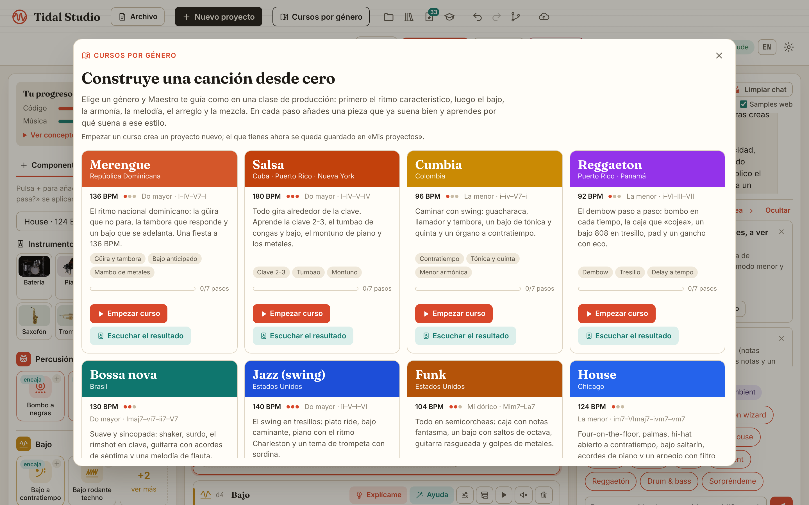 | 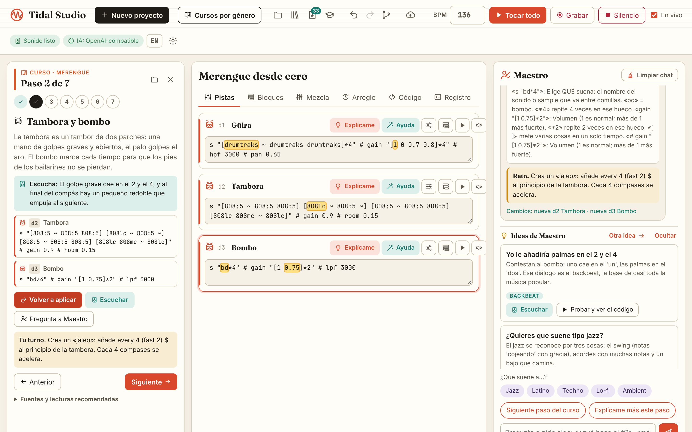 |

| Paso de arreglo: intro, grupo, mambo | Paso de mezcla y curso completado |
|---|---|
| 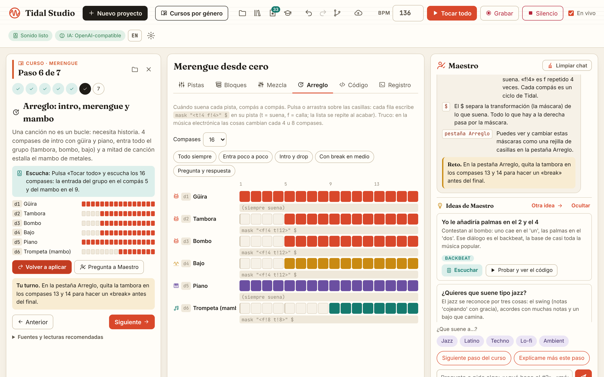 |  |

| Nuevo proyecto: en blanco, con wizard o lluvia de ideas | Receta «tipo jazz»: antes y después, explicado |
|---|---|
|  |  |

### Wizard de proyecto base, paso a paso

Pulsas opciones y lo vas oyendo en vivo. Las recomendadas para tu estilo vienen marcadas con «encaja».

| 1. Estilo | 2. Velocidad |
|---|---|
|  |  |
| **3. Ritmo (hasta 3 capas)** | **4. Bajo, acordes, melodía y textura** |
| 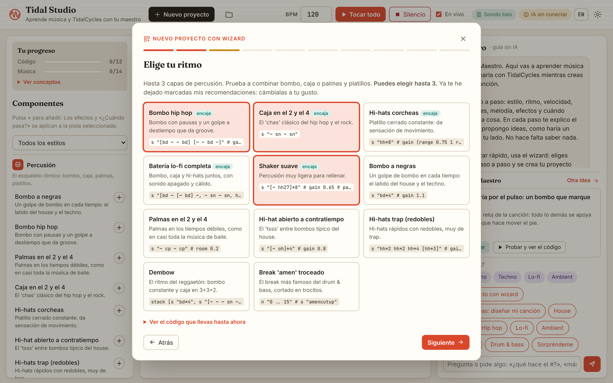 | 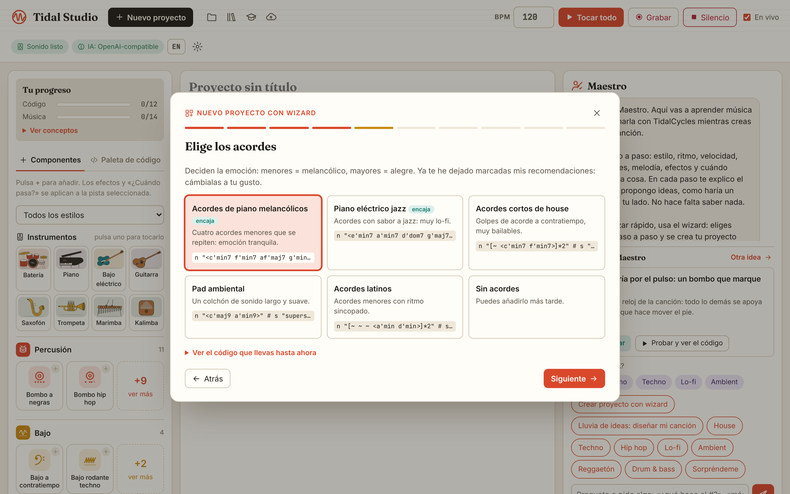 |
| **5. Efectos** | **6. Estructura en el tiempo** |
|  |  |
| **7. Resumen con todo el código explicado** | |
| 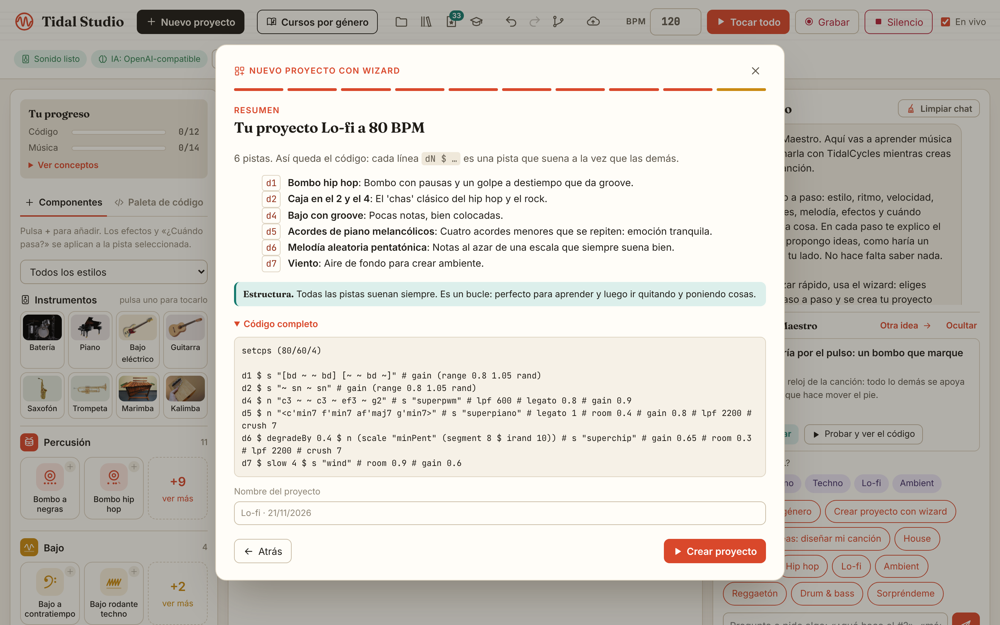 | |

### Ayuda con tu código y paleta de código

| Ayuda: Maestro encuentra el problema y propone el arreglo | Paleta de código por objetivo y nivel |
|---|---|
|  |  |

### Editar desde los bloques, tarjeta configuradora, mezcla e historial

| Pulsa un bloque: tooltip para editarlo | Tarjeta configuradora en el chat de Maestro |
|---|---|
| 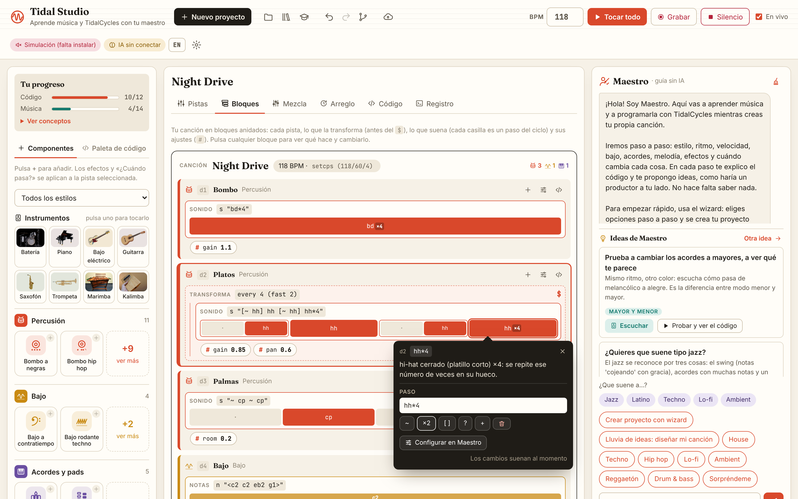 |  |

| Pestaña Mezcla: volumen y ecualizador por pista y master | Historial de la canción (rollback) |
|---|---|
| 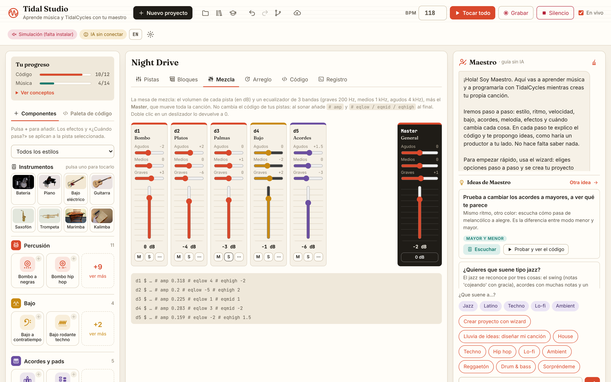 |  |

### Vista de bloques y biblioteca de samples

| Tu canción en bloques anidados | Biblioteca de samples por tipo |
|---|---|
| 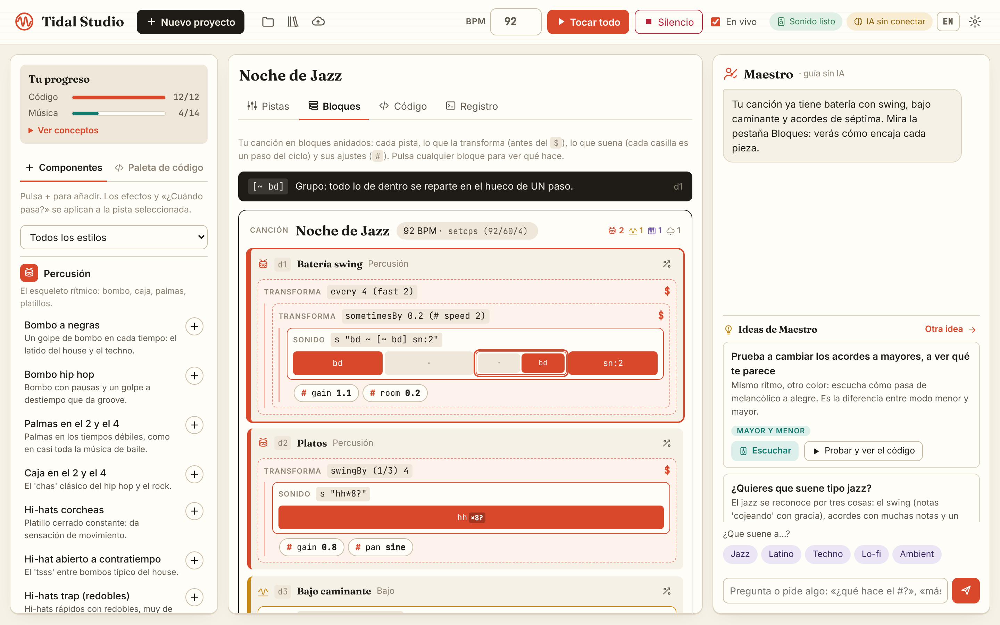 |  |

| Controles en el chat | Packs online: cajas de ritmos enteras |
|---|---|
|  | 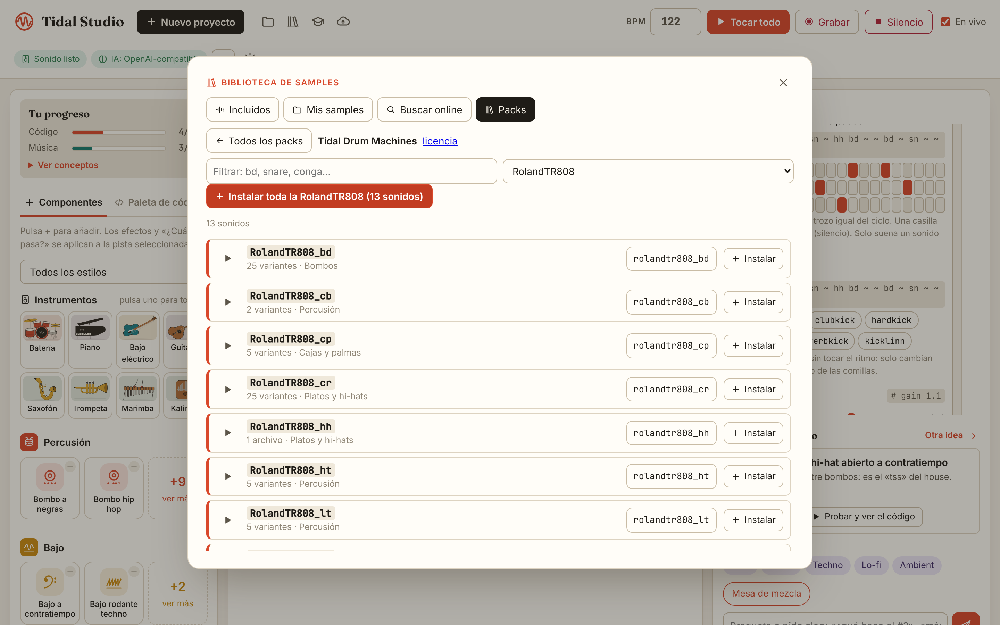 |

| Batería: pulsa una pieza y aprende su nombre | Instrumentos con teclado |
|---|---|
| 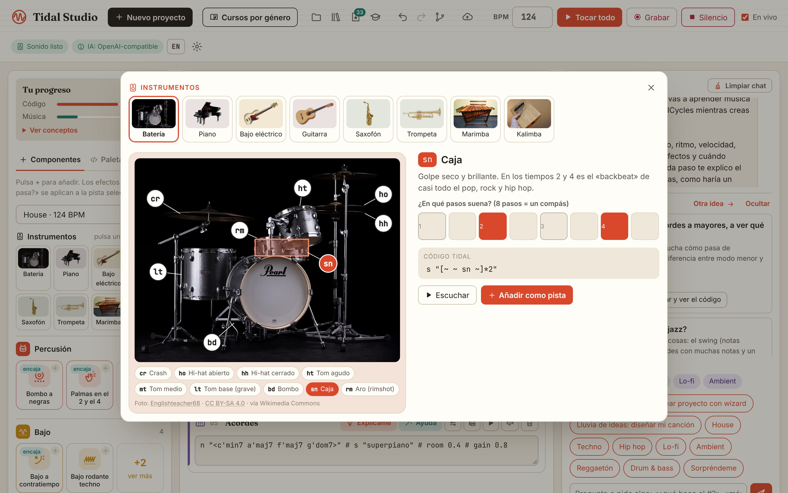 |  |

| Tutorial interactivo | |
|---|---|
|  | |

| Arreglo: pinta los compases o usa un preset | Forma de onda y recorte |
|---|---|
|  | 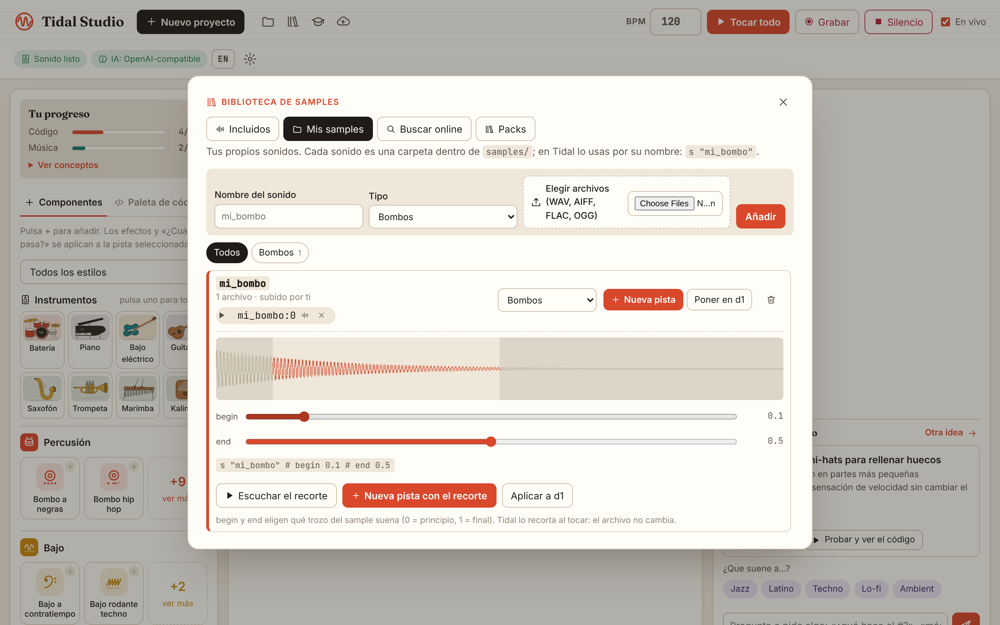 |

| Buscar en Freesound por licencia | GitHub: cada guardado es una versión |
|---|---|
|  | 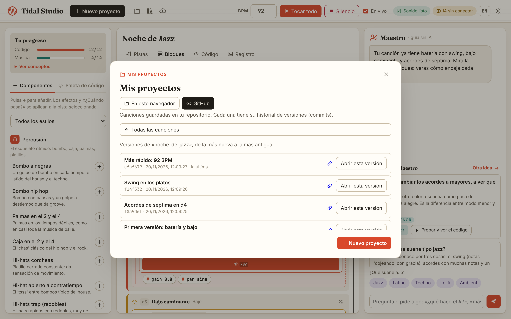 |

### Lluvia de ideas

| Preguntas con ejemplos | El plan de tu canción |
|---|---|
| 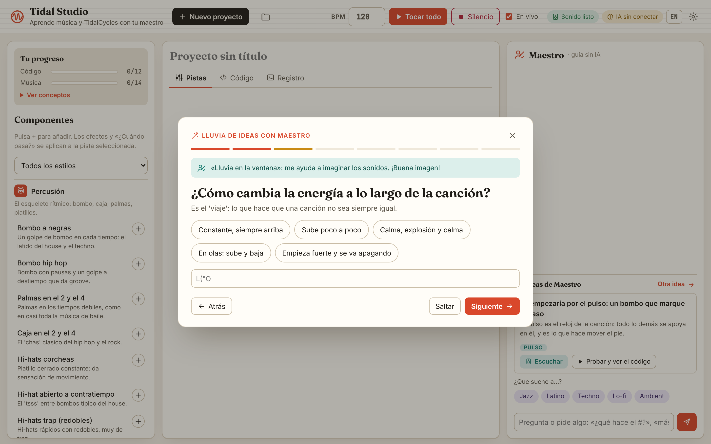 | 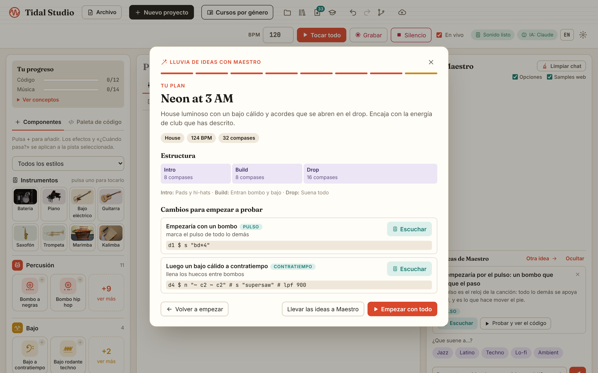 |

## Instalación (una sola vez)

### Lo más fácil: el instalador para Mac con todo dentro

Descarga `TidalStudio-…-macOS-AppleSilicon.pkg` de la
[última versión](https://github.com/vsalesa/tidal-studio/releases/latest) y haz doble clic. Lleva todo dentro
(TidalCycles con su propio Haskell, SuperCollider, SuperDirt y sus sonidos, Python) y **no descarga nada** al instalar.
Después abre **Tidal Studio** desde Aplicaciones.

Aún no está firmado por Apple, así que la primera vez macOS lo bloquea: ve a
**Ajustes del Sistema → Privacidad y seguridad**, pulsa **Abrir igualmente** y vuelve a abrir el `.pkg`.
Instala el motor en `/Users/Shared/TidalStudio` (unos 3 GB) y no toca el SuperCollider, Haskell o Python que ya tengas.
Cómo se construye: [packaging/README.md](packaging/README.md).

### Desde la carpeta del código (Windows, Linux o Mac)

Descarga o clona esta carpeta y:

| Sistema | Qué hacer |
|---|---|
| **Windows 10/11** | Doble clic en `install.bat` |
| **macOS** | Abre Terminal en la carpeta y ejecuta `./install.sh` |
| **Linux** (Debian/Ubuntu, Fedora, Arch, openSUSE) | `./install.sh` |

El instalador habla español o inglés según el idioma de tu sistema (puedes forzarlo con `./install.sh --lang es` o
`install.ps1 -Lang es`). Pone, si faltan: Python 3, Git, SuperCollider, SuperDirt (sonidos), Haskell (vía ghcup) y TidalCycles.
Tarda 15–40 minutos la primera vez (descarga ~1 GB). Puedes ejecutarlo otra vez sin miedo: se salta lo que ya está.

## Uso

| Sistema | Abrir el estudio |
|---|---|
| Windows | Doble clic en `start.bat` |
| macOS / Linux | `./start.sh` |

Se abre el navegador en <http://localhost:8765>. Después:

1. Pulsa **Nuevo proyecto** y elige en blanco, con wizard o lluvia de ideas.
2. Si quieres, abre los **Ajustes** (rueda dentada) y conecta tu IA; sin ella funciona la guía con botones.
3. Habla con **Maestro** a la derecha, o añade componentes desde la izquierda.
4. Mira y edita el código en la pestaña **Código** (`Ctrl+Enter` aplica).
5. **Silencio** para parar todo al instante.

### Configurar la IA

| Servicio | URL base | Modelo de ejemplo |
|---|---|---|
| OpenAI | `https://api.openai.com/v1` | `gpt-4o-mini` |
| OpenRouter | `https://openrouter.ai/api/v1` | `openai/gpt-4o-mini` |
| Groq | `https://api.groq.com/openai/v1` | `llama-3.3-70b-versatile` |
| Ollama (local, gratis) | `http://localhost:11434/v1` | `llama3.1` |
| LM Studio (local, gratis) | `http://localhost:1234/v1` | el que tengas cargado |
| Claude (clave API de Anthropic) | — | `claude-opus-5-5` |
| **Claude con tu suscripción** (Claude Code, Pro/Max) | — | el de tu plan |

**¿Sin clave de API? Usa tu suscripción de Claude:** instala [Claude Code](https://claude.com/claude-code), ejecuta `claude`
una vez en una terminal e inicia sesión con tu plan Pro o Max, y elige «Claude con tu suscripción» en Ajustes. Maestro habla
con Claude a través del comando `claude` de tu ordenador. Cuenta en los límites de uso de tu plan y responde algo más
lento que la API (unos 10–20 s).

Las claves se guardan solo en `config.json`, en tu ordenador (no se sube a git). También puedes usar las variables
de entorno `OPENAI_API_KEY` o `ANTHROPIC_API_KEY`.

### Samples

Tus sonidos viven en `samples/<nombre>/` (cada carpeta es un sonido de Tidal: `s "nombre"`, `s "nombre:1"` para el segundo
archivo). SuperDirt los carga al arrancar y los recarga cuando añades o borras algo. Para Freesound, pide una clave API
gratuita en [freesound.org/apiv2/apply](https://freesound.org/apiv2/apply) y pégala en la biblioteca (pestaña Buscar
online). Tidal Studio descarga la vista previa OGG de alta calidad de Freesound, que SuperCollider lee directamente.

Cajas de ritmos opcionales: `git clone https://github.com/geikha/tidal-drum-machines samples/packs/tidal-drum-machines`
(se cargan solas en el siguiente arranque).

### GitHub

Abre ⚙ Ajustes → GitHub. Crea un **token fine-grained** en GitHub (Settings → Developer settings → Personal access tokens)
con acceso al repositorio de tus canciones y el permiso **Contents: Read and write**. Escribe el repositorio como
`usuario/nombre`; si aún no existe, «Crear repositorio privado» lo crea (para eso el token necesita permiso para crear
repositorios). Después usa el botón de la nube de la barra superior para guardar una versión con un mensaje. El token se
guarda solo en `config.json`.

## Cómo funciona

```
 Navegador (web/)  ──HTTP──▶  server/app.py  ──stdin──▶  GHCi + TidalCycles ──OSC──▶ SuperCollider + SuperDirt ──▶ altavoces
     │                            │
     └── chat ───────────────────▶ server/llm.py ──▶ OpenAI-compatible / Claude
```

- `server/app.py`: servidor local (solo biblioteca estándar de Python, sin `pip install`). Escucha solo en `127.0.0.1`.
- `server/engine.py`: busca y arranca `sclang` (con `supercollider/start_superdirt.scd`) y `ghci` (con `tidal/BootTidal.hs`).
  Si falta algo, trabaja en **modo simulación**: la interfaz funciona pero no suena.
- `server/assistant.py`: las instrucciones de "Maestro" y la lectura de sus respuestas (JSON con mensaje, opciones y cambios de pistas).
- `web/catalog.js`: el catálogo de componentes. Añadir uno nuevo es añadir un objeto a la lista.
- `web/explain.js`: explicador local del código (sin IA). `web/suggest.js`: ideas de productor sin IA y conceptos del progreso.
- `web/builder.js`: wizard de proyecto base. `web/wizard.js`: preguntas de la lluvia de ideas y plan sin IA. `web/flavors.js`: recetas de estilo (jazz, latino, techno, lo-fi, ambient).
- `web/doctor.js`: revisión y arreglos sin IA del panel Ayuda (`/api/fix` con IA). `web/palette.js`: bloques de la paleta.
- `web/i18n.js`: cambio de idioma. `web/icons.js`: iconos propios en SVG. `web/style.css`: tema claro «Partitura».

Cada pista es un `dN` de Tidal (d1…d12) con su propio canal de efectos (orbit).

## Problemas frecuentes

- **No suena nada**: mira la pestaña **Registro**. Ejecuta `python3 server/app.py --check` para ver qué falta.
- **Linux sin sonido**: SuperCollider usa JACK. Con PipeWire se arranca solo con `pw-jack`; si usas JACK clásico, arráncalo antes.
- **macOS pide permiso de micrófono** a SuperCollider: acéptalo (lo necesita para abrir el audio).
- **Windows: "Haskell se está terminando de instalar en otra ventana"**: espera a que acabe y vuelve a ejecutar `install.bat`.
- **Puerto ocupado**: `./start.sh --port 9000`.

## Opciones del servidor

```
python3 server/app.py [--port 8765] [--no-browser] [--no-engine] [--check]
```
