# Tidal Studio · learn music with your teacher

**English** · [Español](README.es.md) · [Website](https://vsalesa.github.io/tidal-studio/) · [Roadmap](ROADMAP.md)

A platform to **learn music and [TidalCycles](https://tidalcycles.org) at the same time**, building your own song live
with an AI teacher ("Maestro") who supports you at every step, even if you know nothing about music or programming.

**Website: [vsalesa.github.io/tidal-studio](https://vsalesa.github.io/tidal-studio/)** (overview, screenshots and install steps).

**Latest version: 0.13.1** · [download for Mac, Windows or Linux](#a-real-app-on-your-computer) · [what's new](#whats-new-version-by-version) · [all releases](https://github.com/vsalesa/tidal-studio/releases)


**Contents:** [Start a song](#start-a-song) · [Genre courses](#genre-courses) · [Maestro, your teacher](#maestro-your-teacher) · [Maestro's options](#hear-maestros-options-and-pick-one) ·
[Help with your code](#help-with-your-code-and-code-palette) · [Blocks and live highlighting](#blocks-view-and-live-highlighting) ·
[Controls in the chat](#controls-and-cards-in-the-chat) · [Mix](#mix-tab) · [Timeline](#timeline-when-each-sound-plays) · [Arrangement](#arrangement) ·
[Undo and a tidy chat](#undo-history-and-a-tidy-chat) · [Instruments](#instruments) · [One library for every sound](#one-library-for-every-sound) · [Replace a sound](#replace-a-sound-by-selecting-its-name) · [Sample library](#sample-library) · [Maestro downloads sounds](#maestro-downloads-the-sounds-it-needs) · [Long loops](#long-loops-a-library-that-knows-what-to-do-with-them) ·
[Skills and plugins](#skills-and-plugins) · [How Maestro decides](#how-maestro-decides-and-its-reasoning) ·
[AI detection and Diagnostics](#connect-your-ai-with-automatic-detection-and-diagnostics) · [Native app](#a-real-app-on-your-computer) · [Tutorial](#interactive-tutorial) · [Open and save files](#open-and-save-tidal-files) · [Songs in tabs](#several-songs-open-at-once-in-tabs) · [Import a song](#import-a-song-as-a-starting-point) · [Generate from my MIDI](#generate-from-your-midi-in-any-style) · [MIDI both ways](#your-keyboard-both-ways-the-song-plays-on-your-piano) · [Audio that recovers](#plug-in-unplug-the-audio-recovers) · [Save and share](#save-export-and-share) ·
[What's new](#whats-new-version-by-version) · [Installation](#installation-once)

## What you can do

### Start a song

**New project: blank, with a wizard or with a brainstorm.** Your current project is saved automatically in My projects.


The **wizard** lets you pick style, tempo, beat, bass, chords, melody, texture, effects and structure by clicking options
(the ones recommended for your style are marked «fits») and you hear it live while you choose. It ends with a summary
where every line of code is explained.

| 1. Style | 2. Tempo |
|---|---|
| 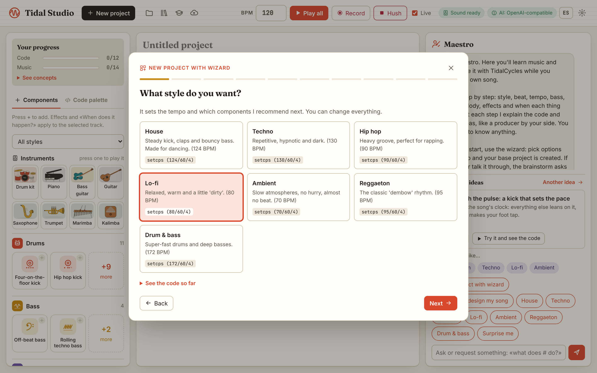 |  |
| **3. Beat (up to 3 layers)** | **4. Bass, chords, melody and texture** |
|  |  |
| **5. Effects** | **6. Structure over time** |
|  |  |
| **7. Summary with all the code explained** | |
| 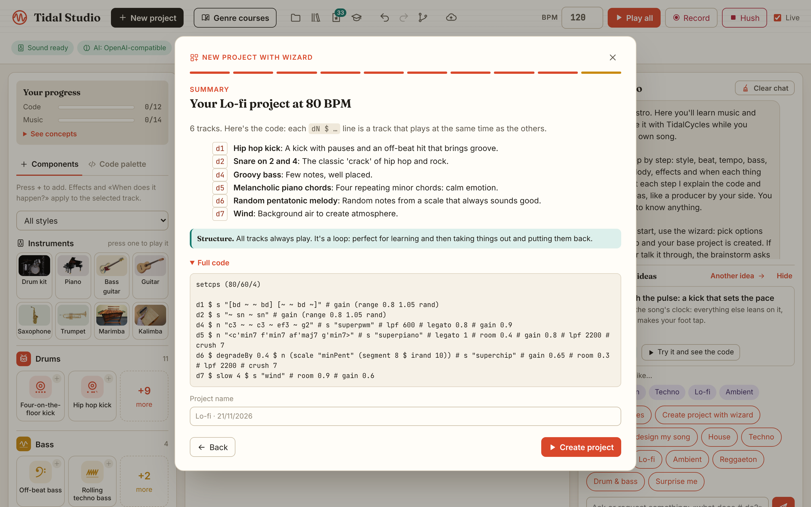 | |

The **brainstorm** asks open questions (what do you want to feel? what place do you imagine? how does the energy
change?…) with clickable examples, and ends in a **plan for your song**: style, tempo, sections and concrete changes to try.

| Questions with examples | Your song plan |
|---|---|
| 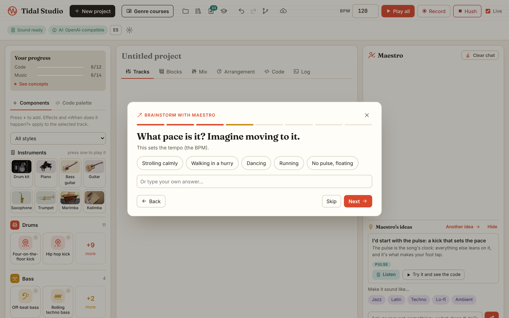 |  |

### Genre courses

**Build a song from scratch.** Eleven courses (merengue, salsa, cumbia, reggaeton, bossa nova, jazz, funk, house, techno,
drum & bass, lo-fi), each one a full production class: the signature rhythm (güira and tambora, clave and tumbao, dembow,
two-step…), then bass, harmony, melody, arrangement and mix. Every step adds tracks that already sound good, Maestro
explains the musical *why* and the code piece by piece, and gives you a challenge. See [docs/COURSES.md](docs/COURSES.md)
for the full list and sources.

| Pick a genre | Each step: why it sounds like that, the code, and Maestro explaining |
|---|---|
| 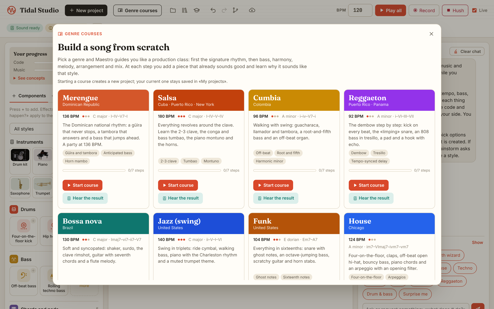 | 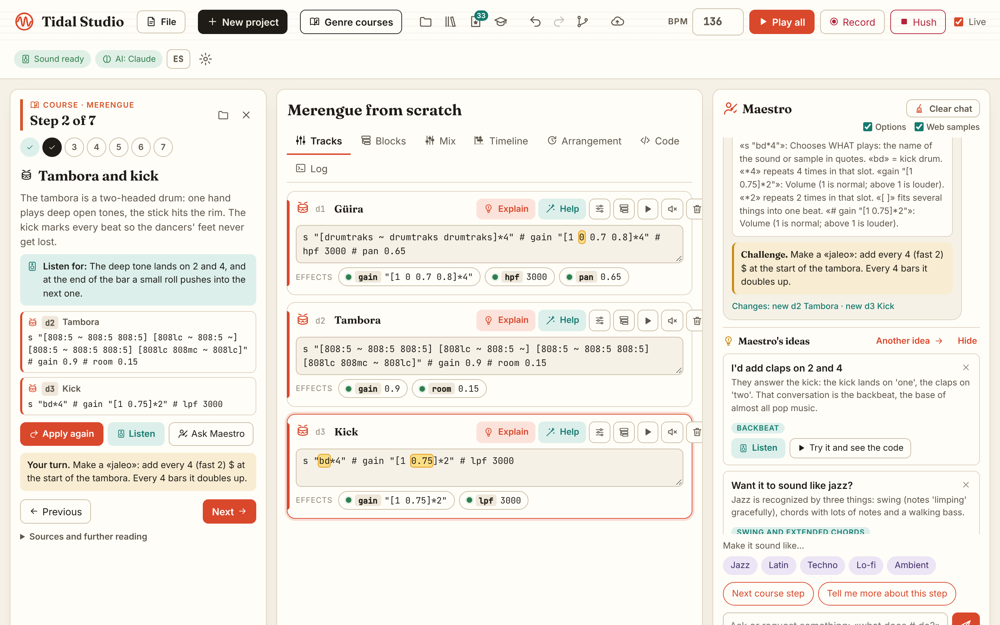 |
| **Arrangement step: intro, band, mambo** | **Mix step and course complete** |
|  |  |

**Latin courses that follow your composition plugin.** Merengue, salsa, cumbia, reggaeton and bossa nova follow the Latin
style skills of the [music-composition plugin](https://github.com/vsalesa/music-composition-skills): each course names
the tradition it plays (for example 1970s New York salsa dura on a 2-3 son clave), each step shows «What the skill says»,
and Maestro loads that skill when you ask about the step. The parts are played by real instruments from the library
(güiro, congas, bongos, claves, upright bass, trombones, accordion, nylon guitar, flute…), which download by themselves
when you start the course.

| Each Latin course names its tradition and its skill | The tradition and the artist lens, before the first step |
|---|---|
| 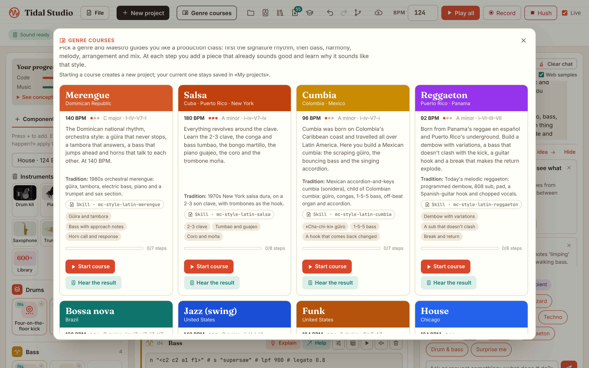 | 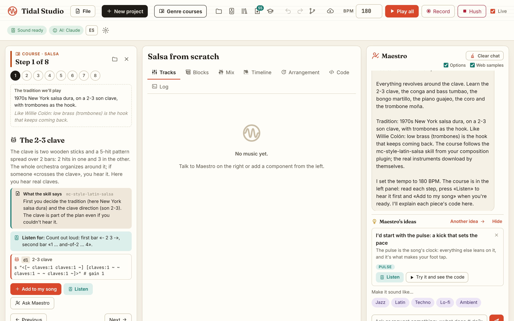 |
| **«What the skill says» on every step, played by real instruments** | |
| 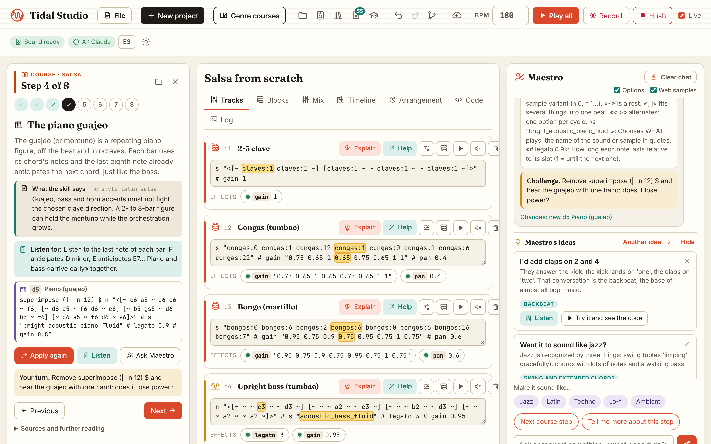 | |

**Hear a real drummer play the style.** Nine courses (merengue, salsa, reggaeton, bossa nova, jazz, funk, house,
drum & bass and lo-fi) come with a real performance in MIDI from the [Groove MIDI Dataset](https://magenta.tensorflow.org/datasets/groove)
(Google Magenta, CC BY 4.0): professional drummers recorded playing Dominican merengue, reggaeton, bossa nova, Cuban
songo, swing, funk, disco, breakbeat and hip hop. The first time you press **Listen** the studio downloads the MIDI pack
(3 MB) and turns four bars into Tidal tracks that keep what makes it human: the strength of every hit (`# gain`) and how
early or late it lands (`# nudge`, in seconds), on a triplet grid for swing. The merengue drummer plays the course's wood
block and congas, the reggaeton one an 808 kick. Each course explains what to listen for, and **Add it to my song** puts
the drummer on tracks d9 to d12 so you can mute yours and compare. The reggaeton course now accents its hi-hats and pushes
its dembow the way this drummer does. Cumbia and techno have no openly licensed MIDI yet, so they keep their written patterns.

| The courses that have a real drummer say so | What to listen for, with Listen and Add it to my song |
|---|---|
| 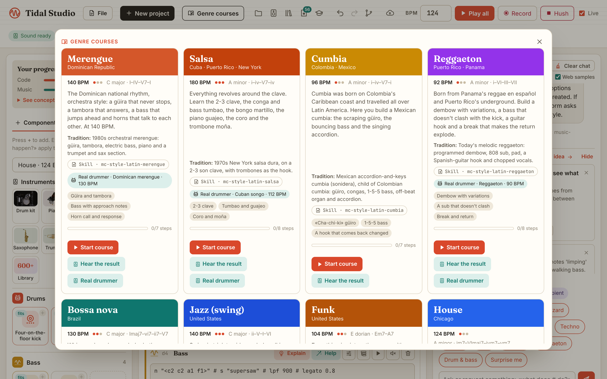 | 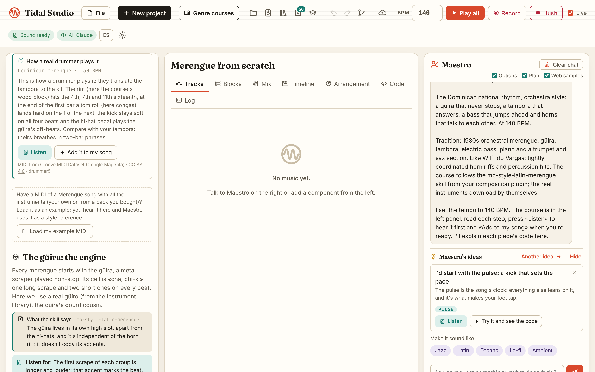 |
| **The drummer in your song: every hit's strength and timing as code** | |
| 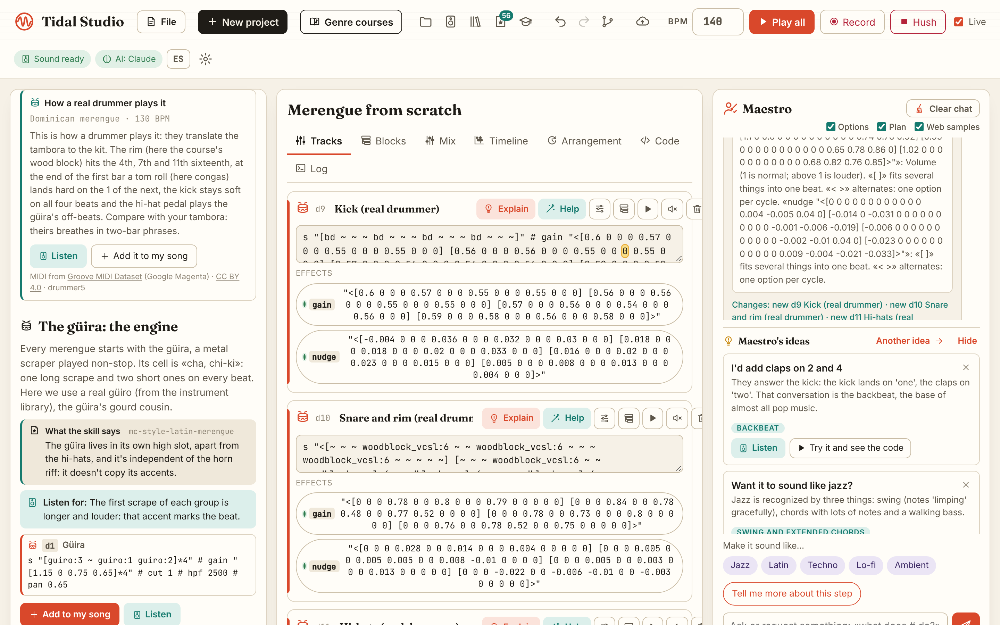 | |

**Styles learned from real songs, not just written rules.** Written style rules alone didn't make the Latin courses sound
right, so the studio now also learns from real music. `tools/learn_style.py` measured 31 Latin songs in MIDI (3 merengue,
7 salsa, 9 cumbia, 12 bossa nova, from the Lakh MIDI Dataset and PDMX) on a grid of 16 sixteenths per bar:
when the bass, piano, guitar and horns play, which chord note the bass picks at each spot, what every percussion
instrument does, and the chord progressions that repeat. Only these statistics are kept
(`server/data/style_profiles.json`). No song is copied or included. Maestro reads the profile of the course's genre
(or your project's style), so its parts follow how real songs are played. The merengue course was rewritten from the data:
the bass plays on 1, the «and» of 2, 3, 4 and the «and» of 4, the piano never stops on eighth notes with sixteenth
pickups, and the tambora's low tone falls on the «and» of 2 and 4. The salsa, cumbia and bossa bass lines already
matched what the songs do. To teach it a genre from your own MIDI files:
`python3 tools/learn_style.py merengue ~/my-midi/merengue/`.

**Your own example.** Each course has **Load my example MIDI**: load a song of that style that you own or bought,
listen to four bars with all its instruments, and Maestro compares each step with it.

| Your example in the course, next to the real drummer | |
|---|---|
| 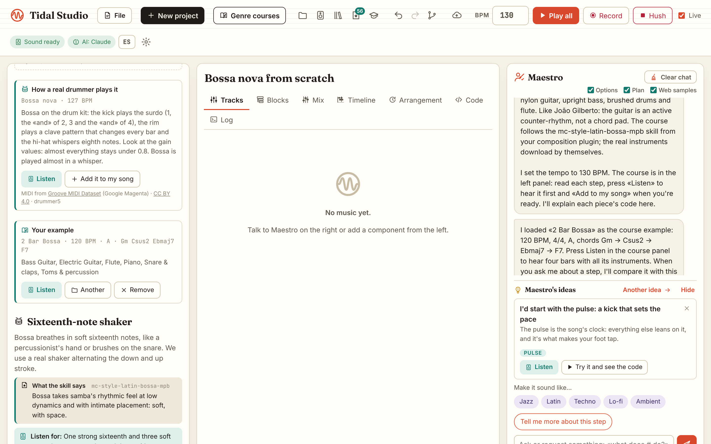 | |

### Maestro, your teacher

- **Maestro guides you** step by step: style, beat, tempo, bass, chords, melody, effects, and when each thing changes.
- **It explains the code**: an «Explain» button on every track and «Explain all the code». Every change comes with a
  piece-by-piece explanation and, sometimes, a small **challenge** so you edit it yourself.
- **It suggests ideas like a producer**: «I'd add claps on 2 and 4… try it and see what you think». Each idea teaches a
  musical concept (backbeat, contrast, call and response, major and minor…). Press **Try**, listen and decide:
  **Keep it** or **Undo**.
- **Pre-listen**: a «Listen» button on every idea and recipe plays it for a few bars and then returns to your version.
- **Style recipes**: «Want it to sound like jazz?» (also Latin, techno, lo-fi, ambient). It transforms your song and
  shows you **how it did it**: the code before and after, with what's new highlighted and explained.


### Hear Maestro's options and pick one

Ask Maestro for something creative («add a bass», «darker», «more energy», «surprise me») and, like a brainstorming
session with a producer, it doesn't just change your song: it offers **3 or 4 different options made for your request
and your song**, each with a title, the musical idea it teaches and its code. If your request is too vague, it first
asks you **one** question with answers to click.

- **Listen** plays an option **live over your song**, for as long as you want. Press another option's Listen (or the
  keys **1-4**) and it switches instantly; **A/B** jumps between the last two you heard; **Stop** (or **Esc**) goes back
  to your version.
- **See the code** shows what each option would change, before and after.
- **Pick this one** adds it to your song and explains how the code changed; the others are discarded.
  **Undo the pick** brings the options back.
- **Other options**, **Refine…** («B but softer») or **None** ask Maestro for new ones.

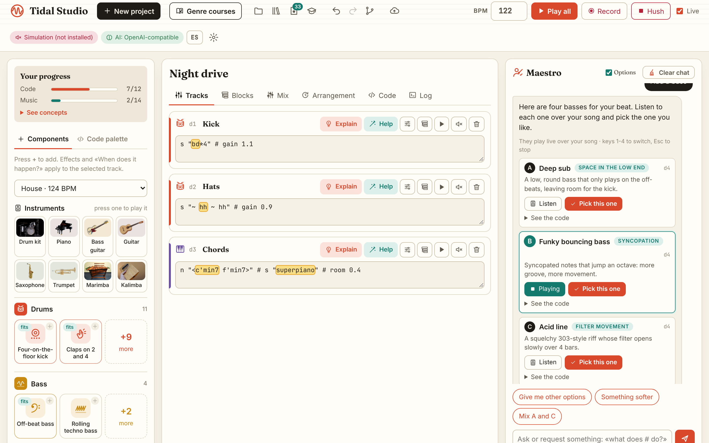

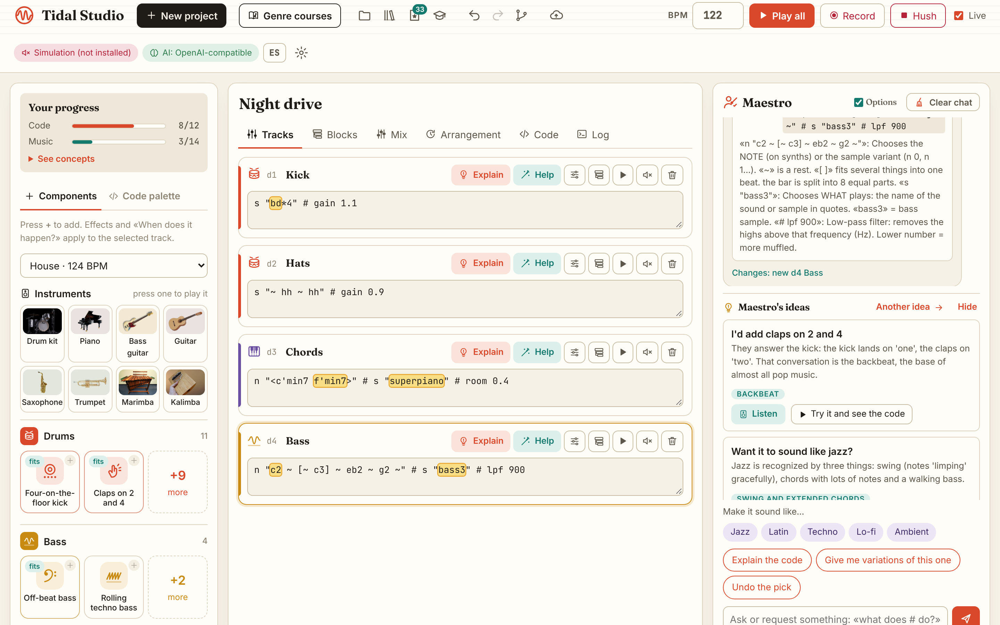

It works with every AI provider, and without AI too (type «give me options» and it builds them from its own ideas and
style recipes). Turn it off with the **Options** switch at the top of the chat to have Maestro apply changes directly.

### Big requests: Maestro makes a plan and goes step by step

Ask for something big («make me a whole salsa song with piano, bass and trumpets», «turn the song into jazz») and
Maestro works like a brainstorming session with a producer: instead of composing everything in one go, it first
**designs a plan of 3 to 6 steps** (rhythm, bass, harmony, melody, effects, structure) and **shows it to you before
touching your song**. If it's missing something important (style, mood…) it asks you one question first.

- **Review the plan**: remove the steps you don't want (×), or **Change the plan…** («add a bridge, no trumpet») and it
  sends you a new one. **All at once** skips the plan.
- **Start** does every step in a row; **Step by step** stops after each one so you can listen and **Continue** when you
  like. Every step is applied to your song, explained like any other answer and **saved as soon as it's done**.
- A bar at the top of the chat shows where you are (2/5, the step it's working on) while the plan runs.

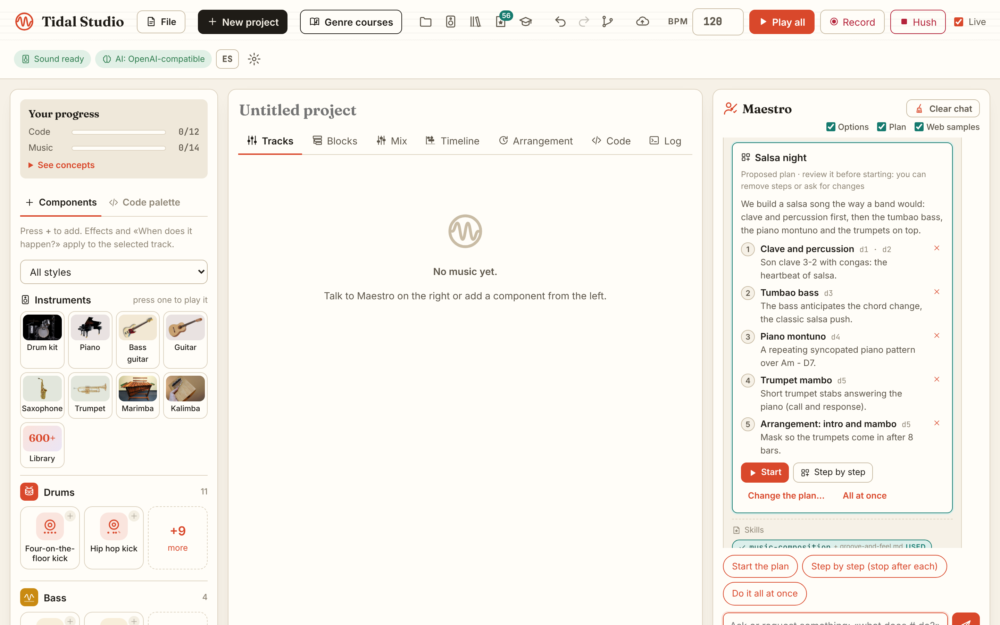

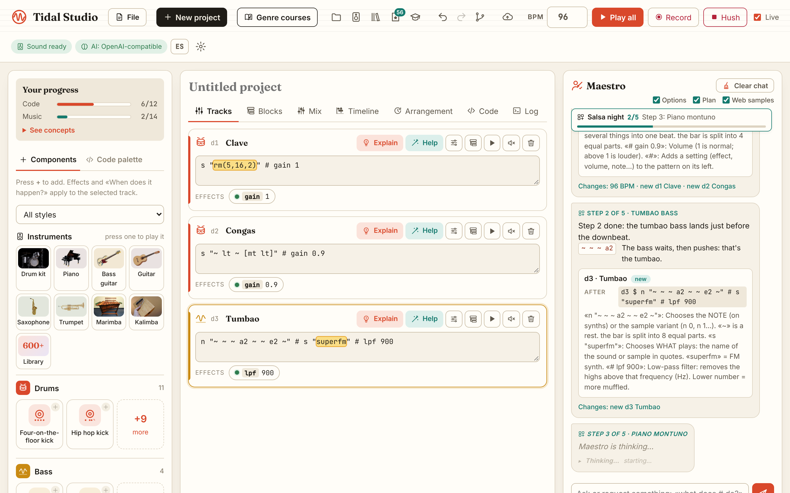

**No more lost work when the AI takes too long.** If a step times out, the steps already done stay in your song (even
if you close the studio) and the plan pauses on that step: **Retry step 3** repeats only that one, or **Skip** it.
And if a normal request is too big and times out, Maestro offers **Do it in steps** to turn it into a plan.

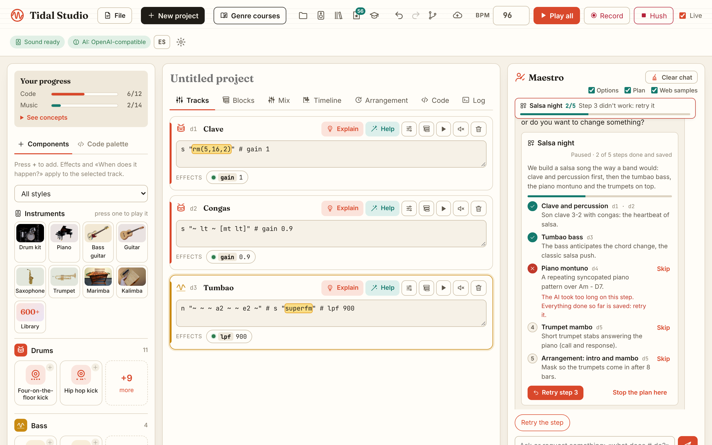

Faster answers, too:

- The AI is only cut off after it **stops sending anything** for 5 minutes (`"ai_timeout"` in `config.json`), not
  while it's still thinking or writing a long answer (before, Claude with your subscription was cut at 3 minutes).
- **Maestro caches what it already loaded or found**: its instructions and the plan's skills are identical in every
  step, so Claude (API key or subscription) and OpenAI-compatible providers reuse them from their prompt cache instead
  of reprocessing them; the Reasoning panel says «Reusing N tokens…». Skills are not re-read from disk on every
  message, and sound searches on the internet (pack indexes, Freesound results, file sizes) are kept in a `cache/`
  folder for a day or a week, so a step or a later session doesn't search again.

Turn it off with the **Plan** switch at the top of the chat. Plans are not used inside genre courses, which already go
step by step.

**Cancel what you sent.** Changed your mind, or it's taking too long? While Maestro is thinking, press **Cancel** in its
message, the send button (it turns into a square) or **Esc**. The AI call stops right away (with Claude on your
subscription, the `claude` process is closed), nothing is applied or downloaded, and your message goes back into the box
so you can change it. Cancelling a plan step pauses the plan with every finished step kept.

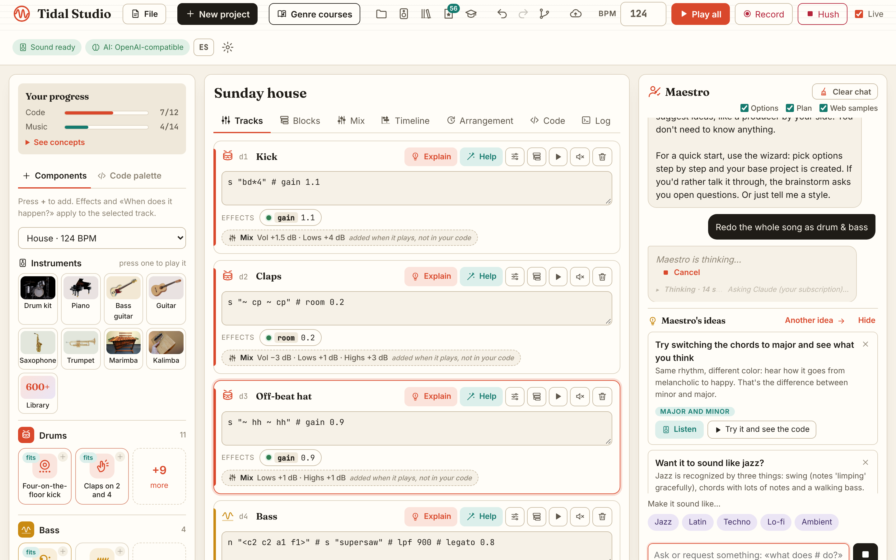

### Help with your code and code palette

**Help**: edited a track and it errors or doesn't sound how you wanted? Press **Help** (it also opens by itself when Tidal
returns an error). Pick what you wanted (no sound, louder, slower, darker…) or describe it, and Maestro finds the problem
(missing `$`, unclosed quotes or brackets, misspelled sounds or effects, things that make it silent), proposes the fix with
before/after, lets you **Listen** before applying, and can go **back to the version that worked**.

**Code palette**: 39 Tidal blocks organized by what you want to do (rhythm, sound, notes and harmony, effects, time and
structure, chance) and by level (first steps, intermediate, advanced). Click one to apply it to the selected track;
Maestro shows and explains the change, and you can undo it.

| Help: Maestro finds the problem and proposes the fix | Code palette by goal and level |
|---|---|
|  |  |

**Old errors go away**: a track's error clears by itself as soon as that track (or «Play all») plays without errors, and
so does the help box Maestro opened for it. If you change the code after an error, the error turns grey and says it is
from an earlier version; the × on the error box clears it at any time.

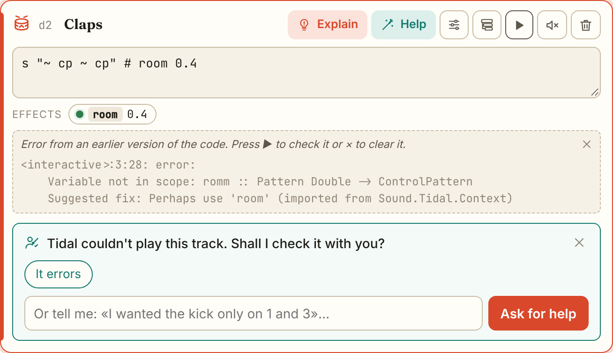

### Blocks view and live highlighting

**Blocks view**: your song as nested visual blocks. Each track shows what transforms it (before the `$`), what it plays
(every step of the cycle as a box, with groups `[ ]`, alternations `< >`, rests `~` and repeats `*`) and its settings
(`#`). Click any block and a **tooltip** tells you what it does and lets you **edit it right there**: change a step (rest,
×2, split, sometimes, add, delete), the mini-notation, a setting's value with a slider, the numbers of a transformation
(`every 4 (fast 2)`), add settings or transformations, or change the tempo. It plays as you edit.

| Your song as nested blocks | Click a block: tooltip to edit it |
|---|---|
|  |  |

**Turn each effect on and off**: every effect (`# room`, `# delay`, `# lpf`, `# crush`…) has its own switch, per track,
in the Blocks view, under each track's code in the Tracks view, and on Maestro's configurator card. Switching one off
bypasses just that effect and keeps its value, so switching it back on restores it exactly. In the code it becomes a
Haskell comment, `{- # room 0.4 -}`, which Tidal ignores; it plays right away (with Live on) and Undo brings it back.

| Blocks: one switch per effect | Tracks: the effects row under the code |
|---|---|
| 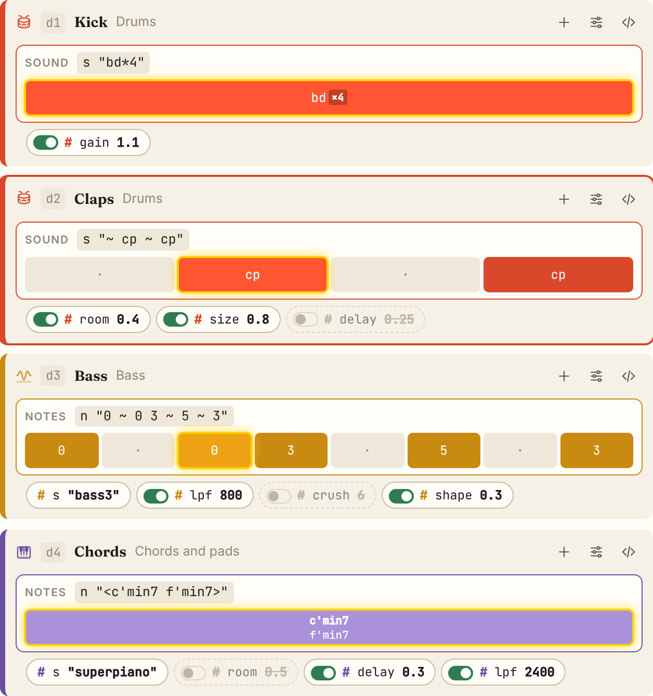 | 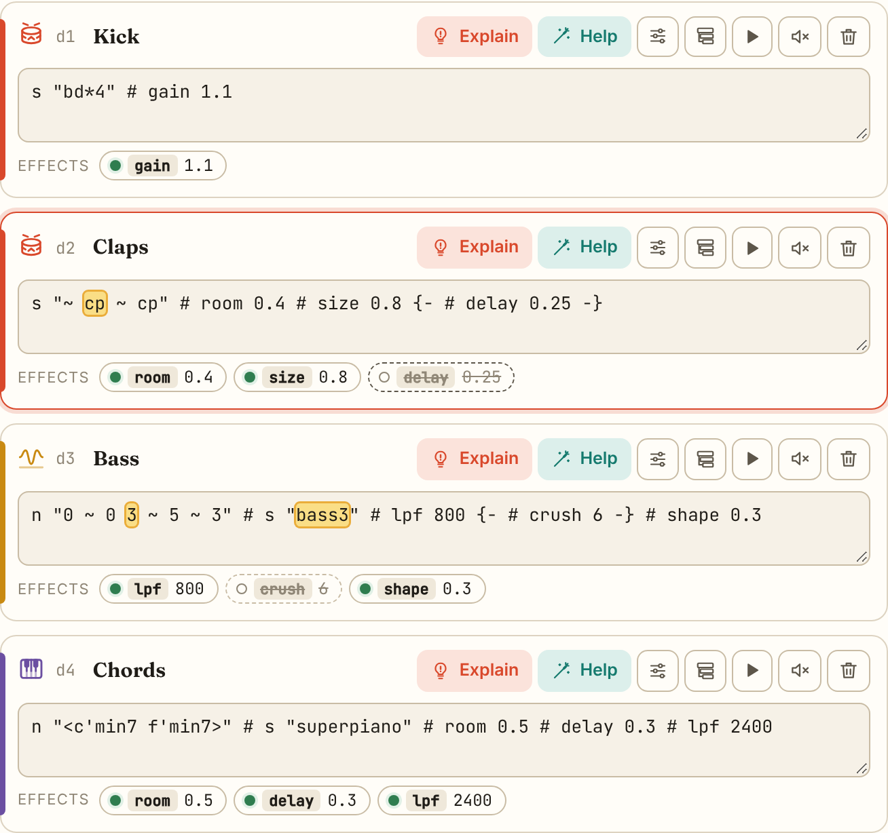 |

**See what is sounding**: while the music plays, the part of each track's code that is sounding right now lights up, step
by step, in the Tracks, Blocks and Code views (like Strudel). SuperDirt tells the app every note it plays.

| In the Tracks view | In the Blocks view |
|---|---|
|  | 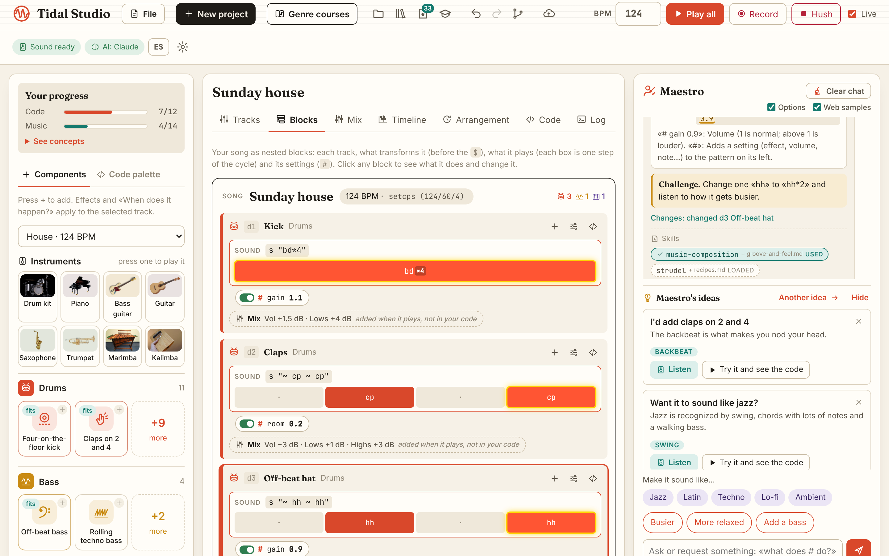 |
| **In the Code tab** | |
| 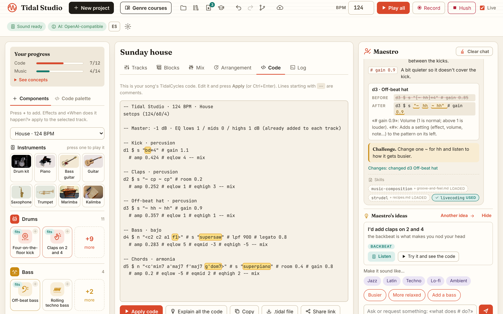 | |

### Controls and cards in the chat

**Controls in the chat (agentic UI)**: Maestro puts sliders, a tempo control, a sound selector and a step sequencer right
inside its messages. Moving them writes the Tidal code live, so you see which word changes. Use the sliders button on any
track, the «Tweak with controls» chip, or just ask for controls. There are more: `every` (do something every N cycles),
chance (`degradeBy`, `sometimesBy`), swing, Euclidean rhythms (`bd(3,8)`), a moving filter
(`# lpf (range … $ slow n sine)`), scale and octave, chords, and a **mix desk** with volume, pan and mute for every track
at once. Each one shows the code it writes.

**Configurator card**: ask Maestro for «a card for the bass» (or press the card button on a track, a block or a mixer
strip) and you get a card in the chat with **every value** of that element: what plays, transformations and their numbers,
each `#` setting, plus the track's volume and EQ. The «song card» has tempo, master and every track's volume. Cards always
act on the **current** version of the song and refresh themselves when you change things elsewhere.

| Controls in the chat | Configurator card for the bass |
|---|---|
| 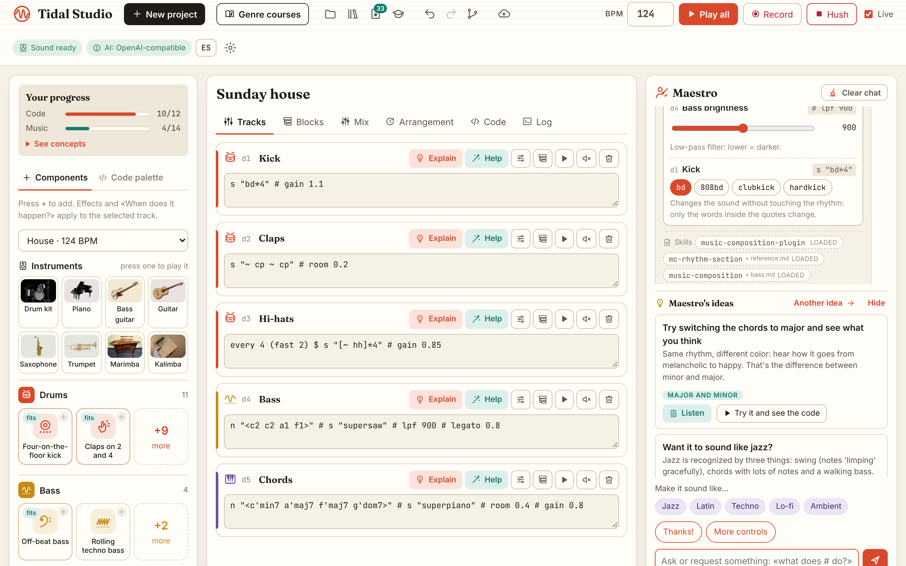 |  |

### Mix tab

A mixing desk with a volume fader (dB) and a 3-band **equalizer** (lows 200 Hz, mids 1 kHz, highs 4 kHz) for every track,
mute and solo, and a **Master** strip for the whole song. It doesn't touch your track code: when playing it adds `# amp`
and `# eqlow / eqmid / eqhigh` (shown as a `-- mix` line in the Code tab).


So you never lose track of it, every track with a mix shows a small **Mix** tag in **Tracks** and **Blocks** (for
example «Mix · Lows −3 dB», plus Master or Solo when they apply). It reminds you that this is added when the track plays
and isn't in its code; click it to jump to that track's strip in the Mix tab. Negative values are written with brackets,
`# eqlow (-3)`, because Tidal reads `eqlow -3` as a subtraction.

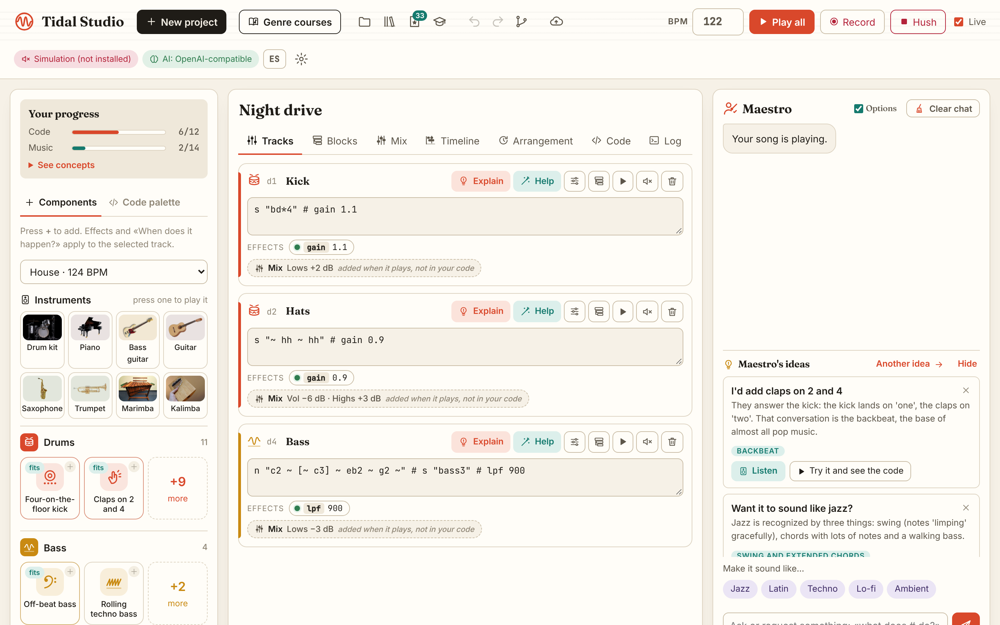

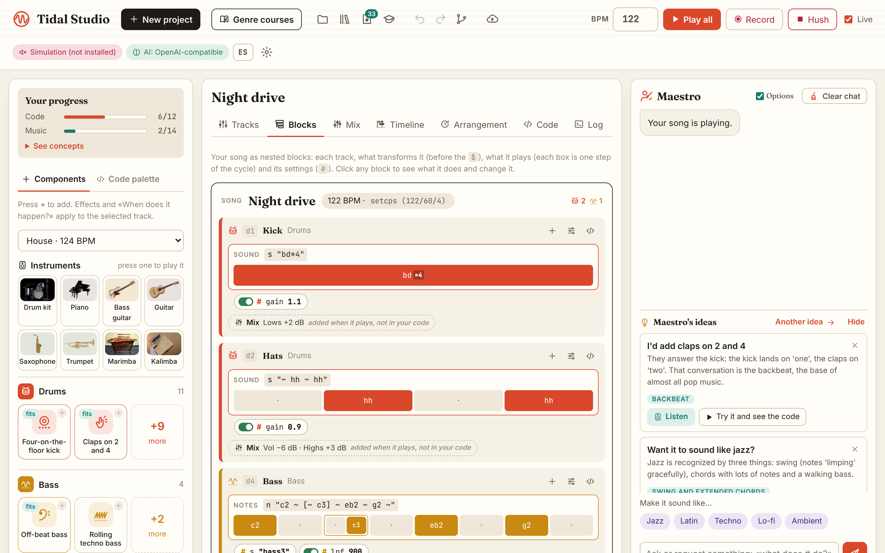

### Timeline: when each sound plays

Tidal tells you *how often* things happen (`"bd*2 [~ sn]"`, `every 4 (fast 2)`, `(3,8)`…), which is hard to picture.
The **Timeline** tab draws *where* every hit falls: time runs left to right (each big column is a cycle, one bar of
4 beats, with lines for beats and sixteenths), one row per sound, and for melodic tracks one row per note, like a
piano roll. Each block is one hit and its length is how long it lasts.

- **Exact, calculated by Tidal itself.** The studio asks TidalCycles (`queryArc`, in a separate GHCi that makes no
  sound) for the events of each track, so polymeters, `euclid`, `every`, `off`, `jux`, arrangement masks… are drawn
  as they will really play. Tracks show a **Tidal** badge. Without the engine it uses an approximate calculator in the
  browser (badge **≈ approx.**).
- **Every hit points to its code.** Hover a block and the piece of the code that makes it lights up (in the track's
  code and in a tooltip, with the bar and beat it falls on and how long it lasts), and the other hits made by the same
  piece light up too. Hover a piece of the code and you see all its hits. Click to pin, and **Go to this piece in
  Tracks** selects it so you can change it.
- **Chance** (`sometimes`, `?`, `degradeBy`…) is marked: Tidal's dice are fixed per cycle, so what you see is what
  will play in those bars.
- Choose 1 to 16 cycles, zoom, move bar by bar, and **Follow the playhead**: while it plays, a line moves across and
  the hits that are sounding glow.

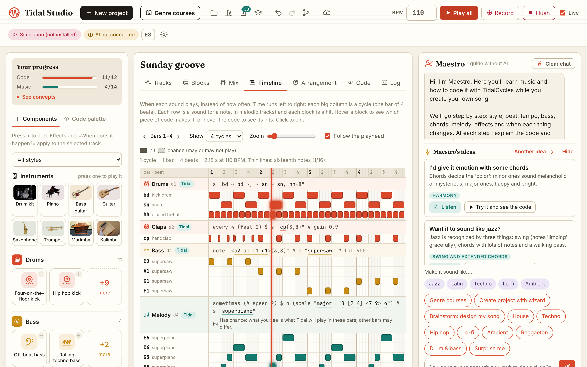

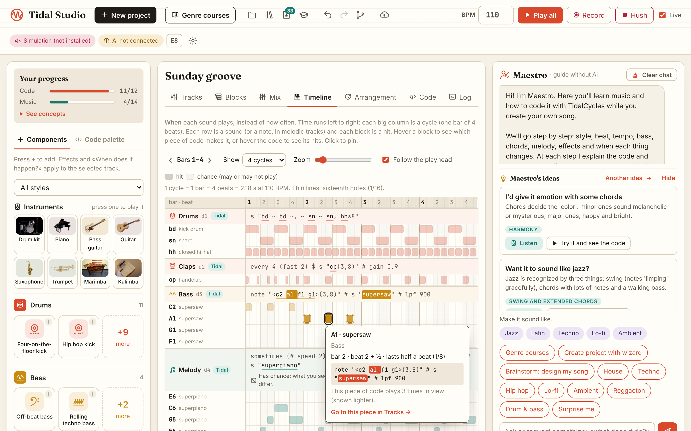

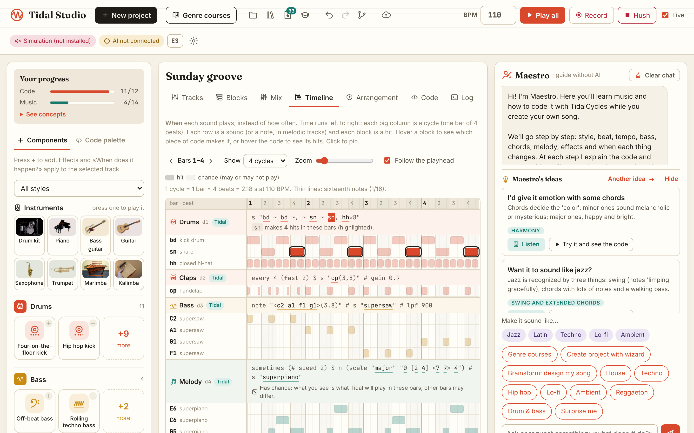

### Arrangement

The Arrangement tab shows every track across 8, 16 or 32 bars. Paint which bars each track plays (it writes
`mask "<…>"`) or start from a preset: build up in layers, drop, break, call and response.

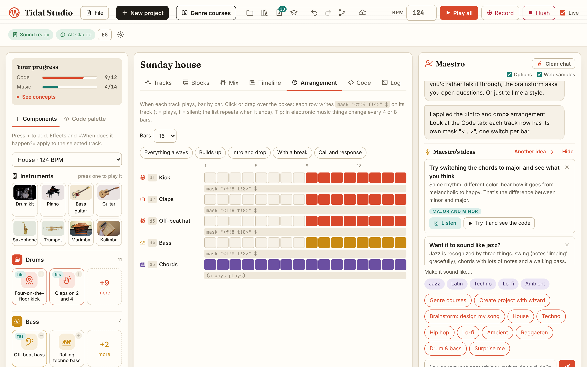

### Undo, history and a tidy chat

**Undo, redo and history (rollback)**: every change to the song is saved. Undo/redo buttons (Ctrl/Cmd+Z,
Ctrl/Cmd+Shift+Z) and a **History** list to go back to any earlier version.


**A tidy chat**: the «Clear chat» button (top right of Maestro's panel) empties the conversation without touching your
song, and a «Bring the chat back» chip restores it. «Hide» folds Maestro's ideas away to give the chat more room (the
browser remembers your choice; «Show» brings them back).

| «Hide» Maestro's ideas for a bigger chat | «Clear chat»: the song stays, the chat can come back |
|---|---|
| 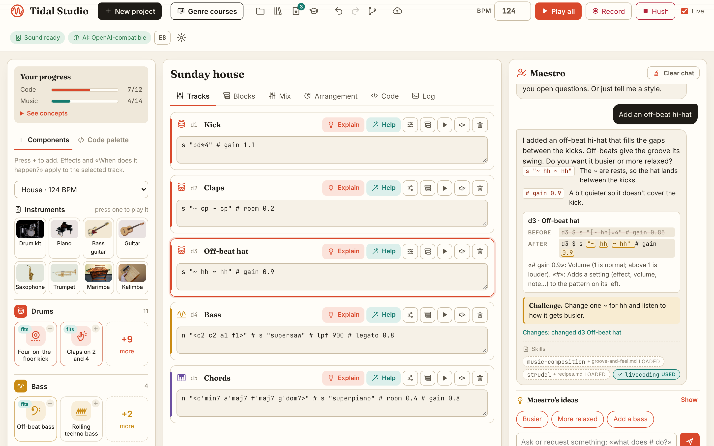 | 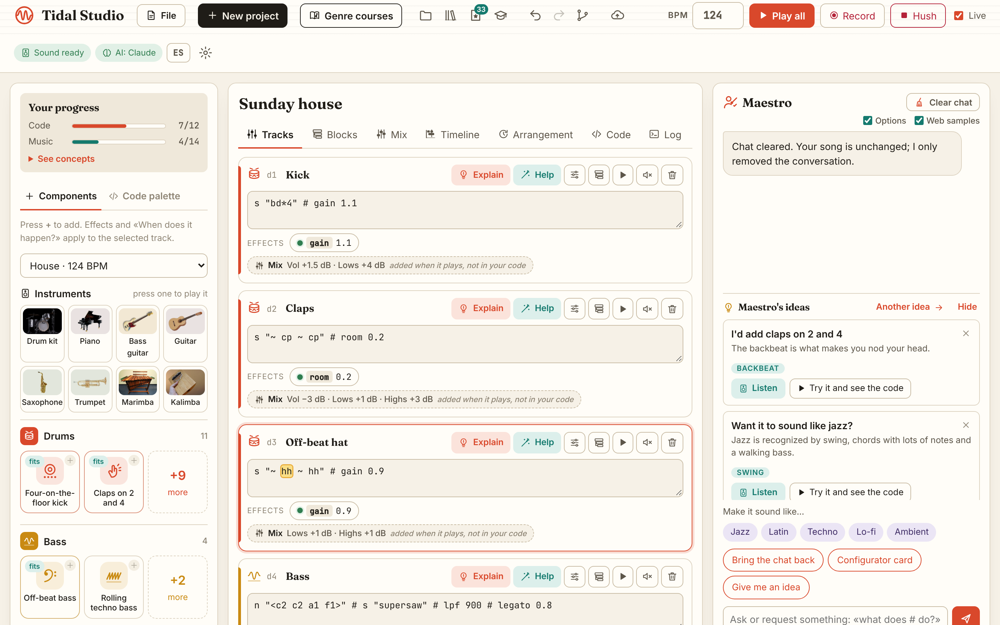 |

**Dismiss ideas you don't like**: the × on each of Maestro's ideas removes it. The browser remembers it (also after a
reload), the next idea takes its place, and Maestro is told which ideas you dismissed so it won't suggest them, or near
copies, again. «Bring them back» undoes it.

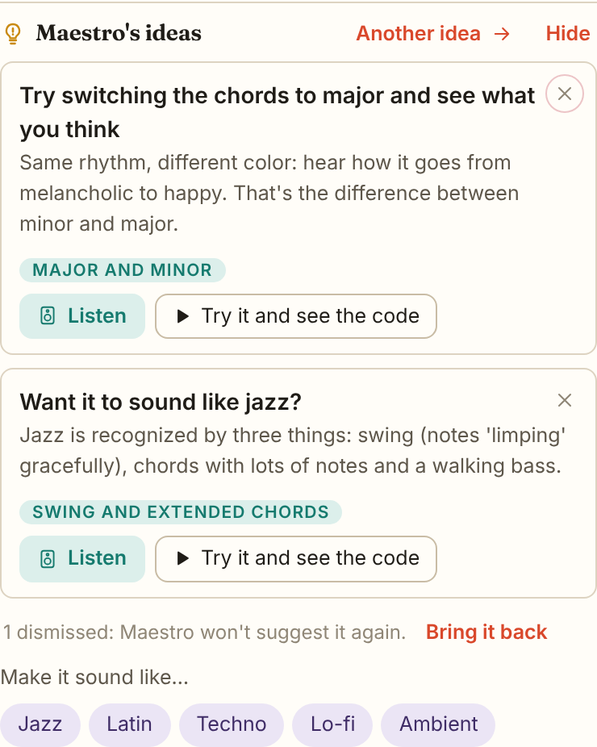

### Instruments

**Real instrument photos** (openly licensed, from Wikimedia Commons, see [CREDITS.md](CREDITS.md)): a drum kit where you
press each piece (bd, sn, hh, ho, toms, crash, rimshot) to hear it and learn its Tidal name, then choose its steps and add
it; piano, bass, guitar, sax, trumpet, marimba and kalimba with an on-screen keyboard that writes your melody as code.
Every component in the catalog also has its own icon.

| Drum kit: press a piece, learn its name | Instruments with a keyboard |
|---|---|
| 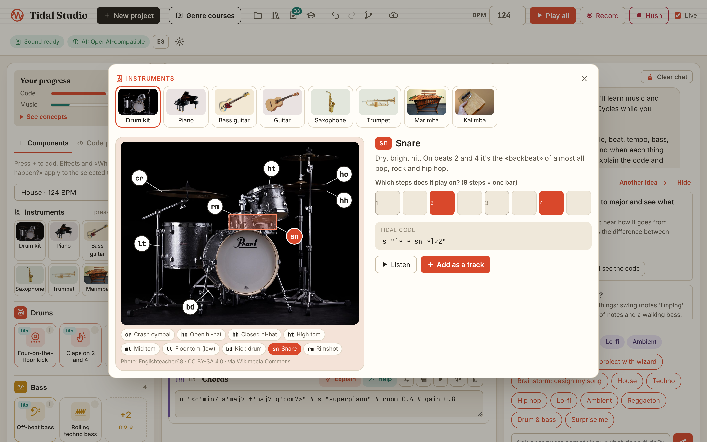 | 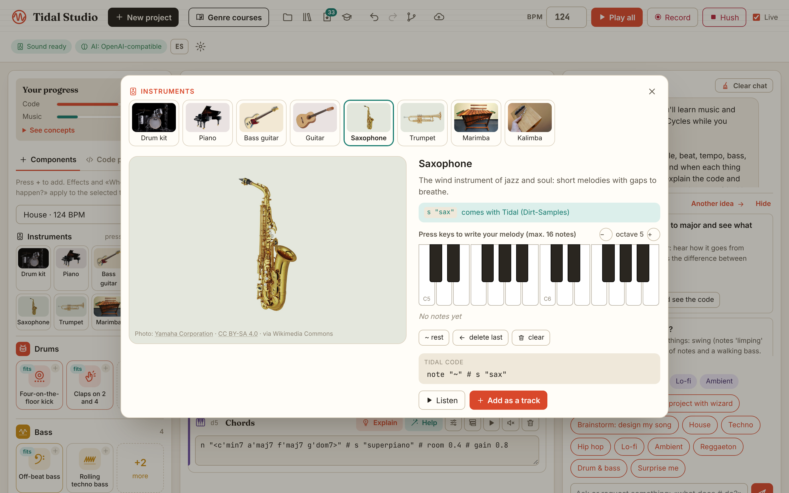 |

### Instrument library: 600+ specific instruments

Like GarageBand, but for Tidal: a harpsichord, a double bass played pizzicato, a Steinway B, a celesta, a sitar, a
theremin, a church organ, a koto… **634 specific instruments** in 21 categories (pianos, keys, organs, early music,
mallets, guitars, basses, strings, brass, woodwinds, voices, world, percussion, synth leads/pads/basses/keys/FX, synth
engines, sound FX and your own). Open it with the speaker button at the top or the **600+ Library** card. Search in
English or Spanish («clavecín» finds the harpsichord), filter by downloaded or by source, and press any card to **hear
the real recordings** before downloading anything. Each instrument is a few MB and is only downloaded when you ask for it.

Pick a version (the same instrument from different sound sets, or articulations like arco and pizzicato), play the
keyboard to write a melody, and **Add as a track**: you get the Tidal code (`n "c5 e5 g5" # s "harpsichord_fluid"`), and
it plays with notes just like a synth, because each note is mapped to the nearest real recording. Recordings come only
from freely licensed sets: VSCO 2 Community Edition and VCSL (CC0), Salamander grand piano (CC BY), and the FluidR3,
MusyngKite and FatBoy General MIDI sound sets (CC BY / CC BY-SA). Credits go to `samples/CREDITS.md` on download.

| Browse by category, hear it, add it | Search in your own words |
|---|---|
| 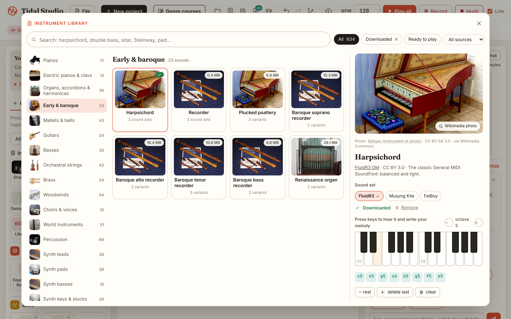 | 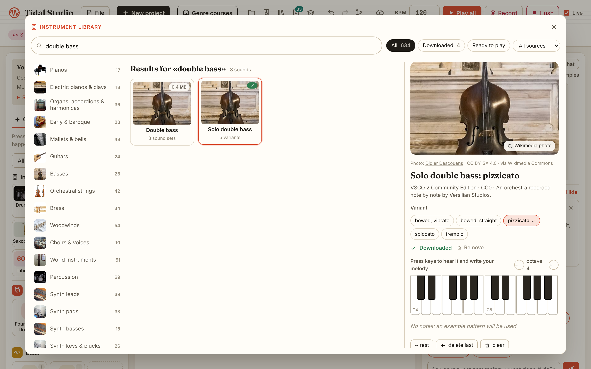 |

**Your own instruments.** Drop a **SoundFont (.sf2)** and pick which of its sounds to import (looped notes are unrolled
so they last), a **.zip with an SFZ**, a folder of **recordings with the note in the name** (`Violin_C4.wav`, `060.wav`),
or **a single sound** tuned from the note you choose. They show up in **My instruments** and play with notes too.

**Synth engines.** Besides 15 new built-in synths (Rhodes, organ, strings, pad, brass, choir, Juno, acid, wobble…), the
**Synth engines** page installs free plugins with one button: **sc3-plugins**, **Mi-UGens** (Mutable Instruments
Plaits, Braids and Rings: 16 + 16 + 6 models in the library) and **VSTPlugin**, which lets SuperDirt play **Surge XT**
(its factory sounds appear in the library) and **Vital**. Tidal gets the parameters it needs:
`d1 $ n "c e g" # s "plaits" # engine 5 # timbre 0.3 # harm 0.5 # morph 0.6`.

| Add your own: SoundFont, SFZ, recordings | Synth engines with one button |
|---|---|
| 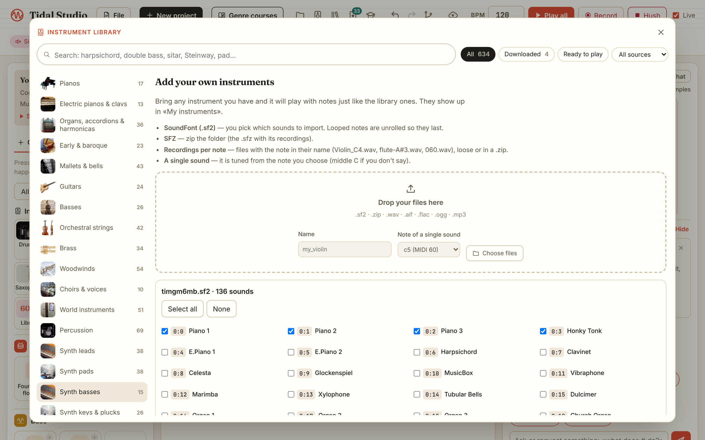 | 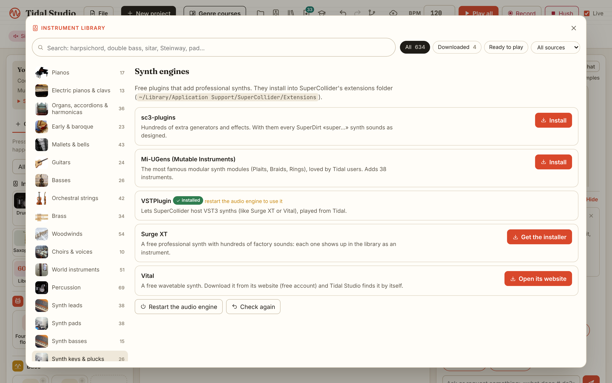 |

**A photo for every instrument, and pin it as a component.** Every instrument shows a real photo from Wikimedia
Commons. Press **Wikimedia photo** to search Commons for another one: only freely licensed photos (CC0, public domain,
CC BY, CC BY-SA) are shown, and the one you pick is saved with its author and license, which are always shown under it.
Press **★ Pin** and the instrument becomes a card in the studio's instrument row, next to the piano and drums, ready
to open with one click.

| Pick a photo from Wikimedia Commons | Pinned as a card in the studio |
|---|---|
| 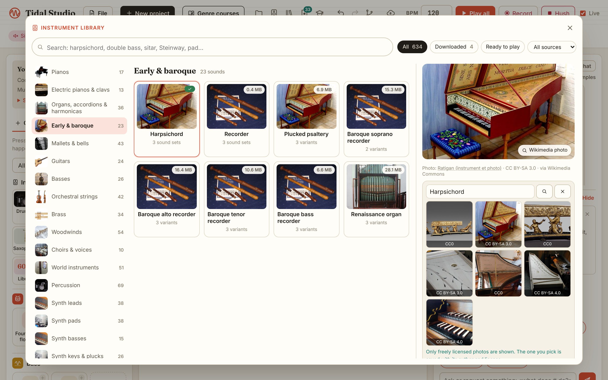 | 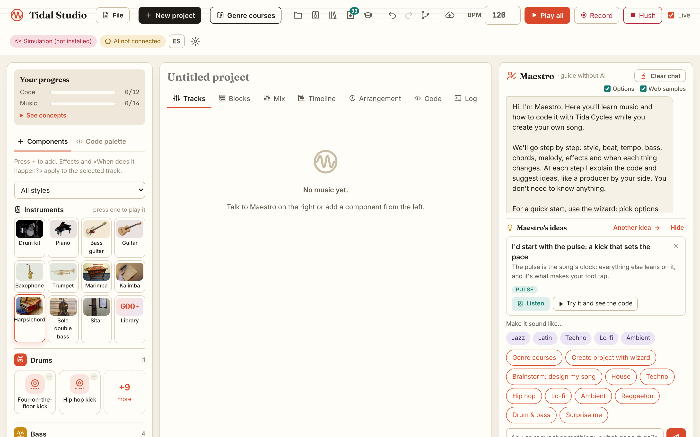 |

**Maestro knows them too.** Ask for «a harpsichord on the chords» or «a double bass in pizzicato» and Maestro uses the
exact instrument from the library. If it is small it is downloaded right away; if it is big, Maestro asks first.

### One library for every sound

There is no difference any more between the sounds that come with Tidal Studio and the ones you downloaded:
**everything is in one Library** (the books and speaker buttons in the top bar open it). Dirt-Samples, the SuperDirt
synths, the 600+ instruments of the instrument library, your uploads, Freesound, packs, what Maestro downloaded,
your long loops and even your MIDI keyboard show up in the same list, with the same search (Spanish or English, with or
without accents: «organo» finds every organ) and the same buttons: **listen**, **download** (one click, with its size)
and **add** to your song. Filter by kind (hits, instruments, synths, loops, engines), by family or by what is ready to use,
still to download or yours. Where it came from is just a small tag. If a sound of yours has the same name as a built-in
one, yours plays and the Library says so. The files stay where they were; only the way you see them changed.

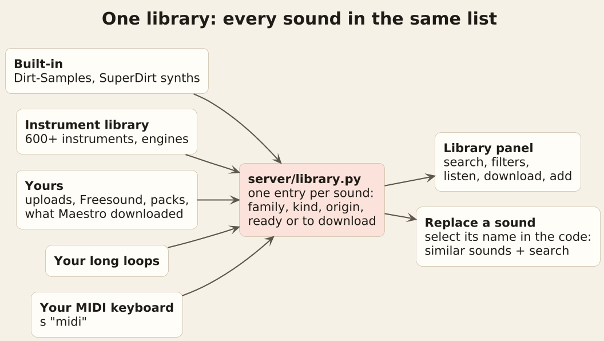

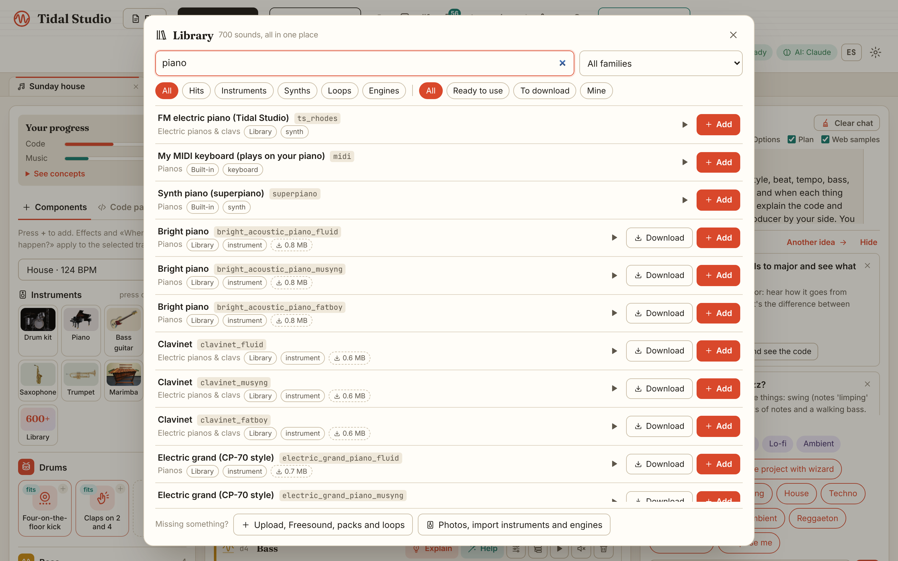

### Replace a sound by selecting its name

Double-click (or select) the name of a sound in your code, like `superpiano` or `bd`, in a track or in the Code tab. A
card appears: **«Replace superpiano with…»**, with similar sounds from your library (same family, same role, similar
tags and range): first the ones you already have, then ones that download in one click. If none fits, **search**. Press ▶
to listen to each option, then pick one: **just here**, **in this track** or **in the whole song**. If it needs
downloading, it downloads first, and **Undo** takes it back. Sample numbers like `bd:3` stay when you swap one hit for
another, and the card warns you when a hit becomes a tuned instrument (or the other way round). **More ideas from
Maestro** asks your AI for three alternatives and why.

| Similar sounds, the ones you have first | Or search the whole library |
|---|---|
| 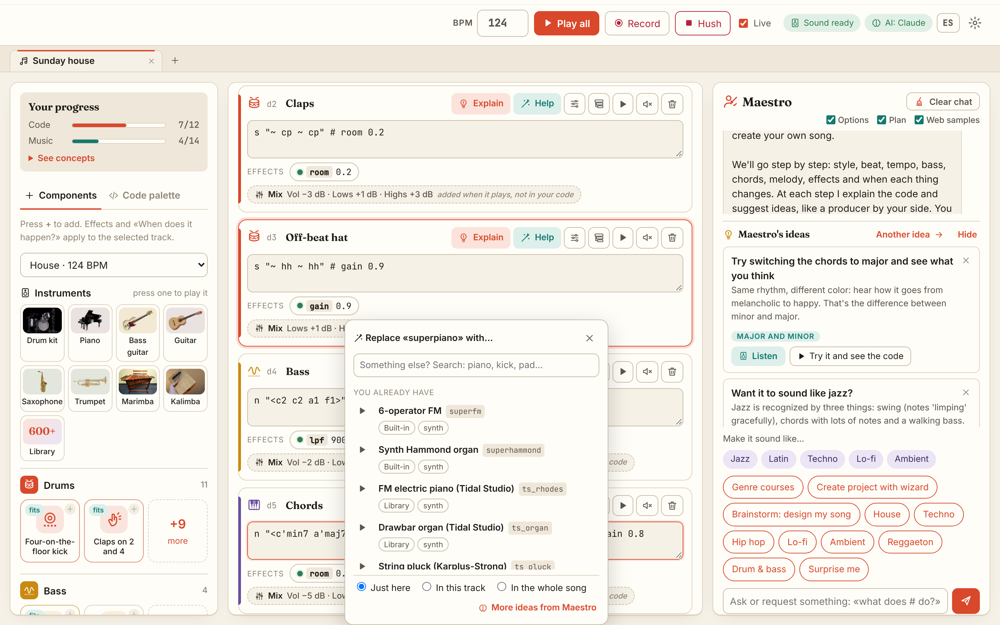 | 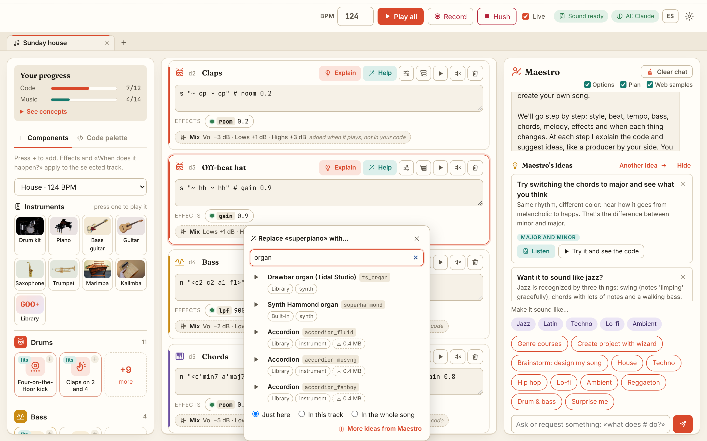 |

### Sample library

Sounds by type (kicks, snares, hats, percussion, breaks, basses, melodic, pads, voices, FX, synths). Listen to them, use
one on a new track, or put it on the selected track keeping the same rhythm. Upload your own files (WAV, AIFF, FLAC, OGG)
or **search Freesound** (free API key) filtering by license; downloads are ready for Tidal and credits for CC BY sounds are
written to `samples/CREDITS.md`. The **Packs** tab browses community packs on GitHub (about 70 drum machines, Uzu drumkit,
VCSL, a grand piano, SP-12, mridangam, or any `github:user/repo` with a `strudel.json`): listen, install one sound or a
whole drum machine. **Installed packs and Freesound sounds load into SuperDirt right away**, without restarting the
engine. In your own samples you see the **waveform**, drag to choose a piece, listen to it and use it
(`# begin … # end …`). Maestro knows your library and can use it.

| Built-in sounds by type | Online packs: whole drum machines |
|---|---|
|  |  |
| **Search Freesound by license** | **Waveform and trimming** |
|  |  |

### Maestro downloads the sounds it needs

If your song would sound better with something you don't have yet (a real cowbell, a vinyl crackle, a marimba, a grand
piano…), **Maestro looks it up on the internet by itself**. It only picks sounds with free licenses: community packs
(VCSL CC0, Uzu drumkit public domain, Salamander piano CC BY, mridangam CC BY-SA, no key needed) and, if you added a free
key, Freesound (CC0 and CC BY). It downloads the sound, writes the credits to `samples/CREDITS.md`, loads it into
SuperDirt and uses it in the code, all before the answer reaches you. The chat shows what it downloaded: its name in
Tidal, where it comes from, the license, a **Listen** button and **Another sound** to swap it for the next result.

Big packs (many files or several MB, like a whole piano) are not downloaded without asking: press **Download** or just
answer «download it». If nothing with a free license turns up, Maestro uses a similar sound you already have so the song
keeps playing. It works with every AI provider (it is part of Maestro's answer, not a feature of one AI) and inside the
options to audition. Turn it off with **Web samples** above the chat. Without AI, write «download a marimba sample».

| Downloaded and already playing | Big pack: Maestro asks first |
|---|---|
| 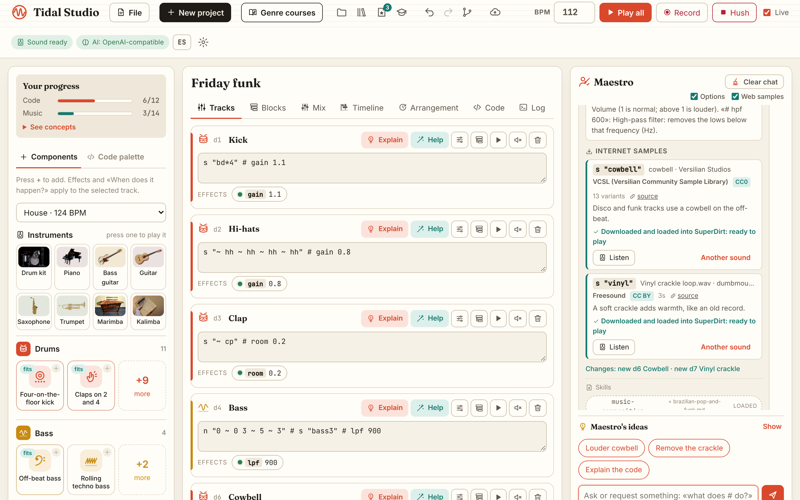 | 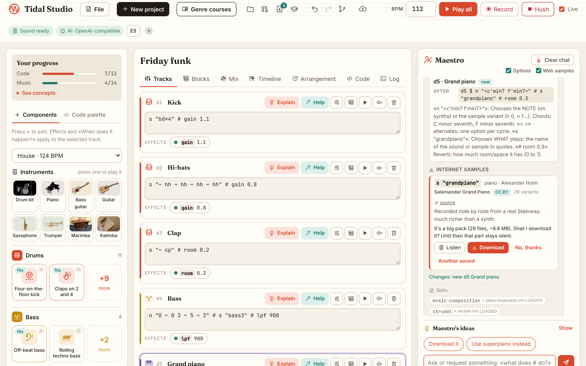 |

### Long loops: a library that knows what to do with them

Downloaded full loops (a 4-bar reggaeton beat, a bassline, a piano riff) are not hits: in Tidal they have to be stretched
to your tempo or they drift and overlap. Open the library on **Long loops** and **drop your loops anywhere in the studio**:
single files, **whole folders** or a **.zip** with a pack (WAV, AIFF, FLAC, OGG, MP3), with a progress bar. Each loop
becomes its own sound, is loaded into SuperDirt right away and is **analysed**: tempo (from the file name, «95BPM», or by
listening to the beats), number of bars, key (for tonal loops), type (drums, bass, melody, chords, vocals, texture) and
where each hit lands (kick, snare or hats). If something is detected wrong, fix the BPM, bars, key or type by hand.

Every loop shows its waveform, its tags and how it fits your song («already at your tempo», «+6% speed, +0.9 semitones»
or «half-time»), and is sorted by how close it is to your tempo. **Listen** plays it in the browser at your song's tempo.
**Add as track** writes the right code for you, and the scissors open four ways to use it, each with its explanation:

- **At tempo**: `loopAt 4 $ chop 32 $ s "dembow" # cut 1`. `loopAt` makes it last exactly 4 cycles (bars) of your song,
  `chop` keeps it in sync even if you start halfway, and `# cut 1` stops one pass from overlapping the next.
- **Variations** so it doesn't repeat: `splice 16 "<[0 1 … 15]!2 [… [12 12] [13 13] …] […]>"` plays the original twice,
  then a fill and a version with swapped slices.
- **A section**: pick bars and get `# begin 0.25 # end 0.5`.
- **Slices**: click the slices (coloured by what they hold: kick, snare, hats) to hear them and build your own order.

**Maestro knows your loops** with their tempo, bars, key and hits, and gets the code ready to use. If it ever writes a loop
«bare» (`s "dembow"`), the studio adds `loopAt` and `# cut 1` for it. When it downloads a loop from the internet it asks
for one at your song's tempo (and key), analyses it as soon as it lands and fits it to the tempo. «Find loops in my
library» analyses long sounds you already had. Without ffmpeg, MP3/OGG files are decoded by the browser for the analysis.

| Drop loops, files, folders or a zip | Variations so it doesn't repeat |
|---|---|
| 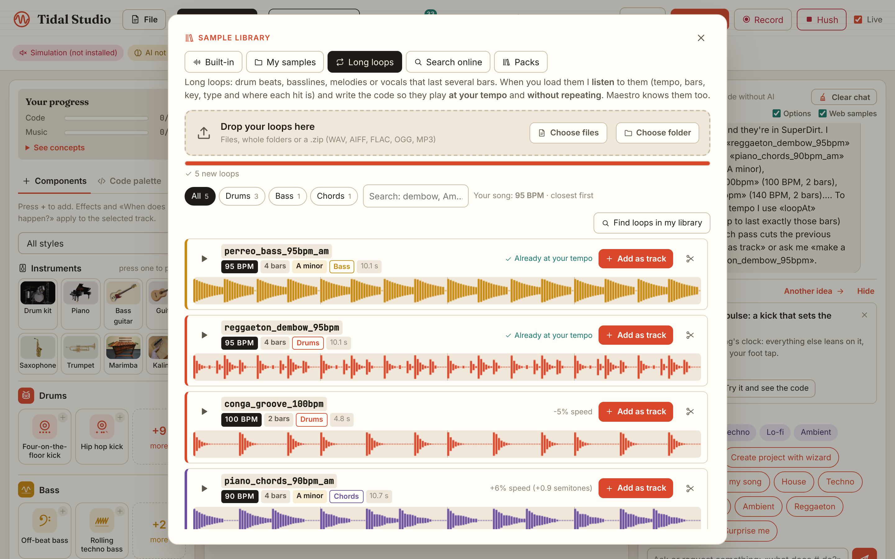 | 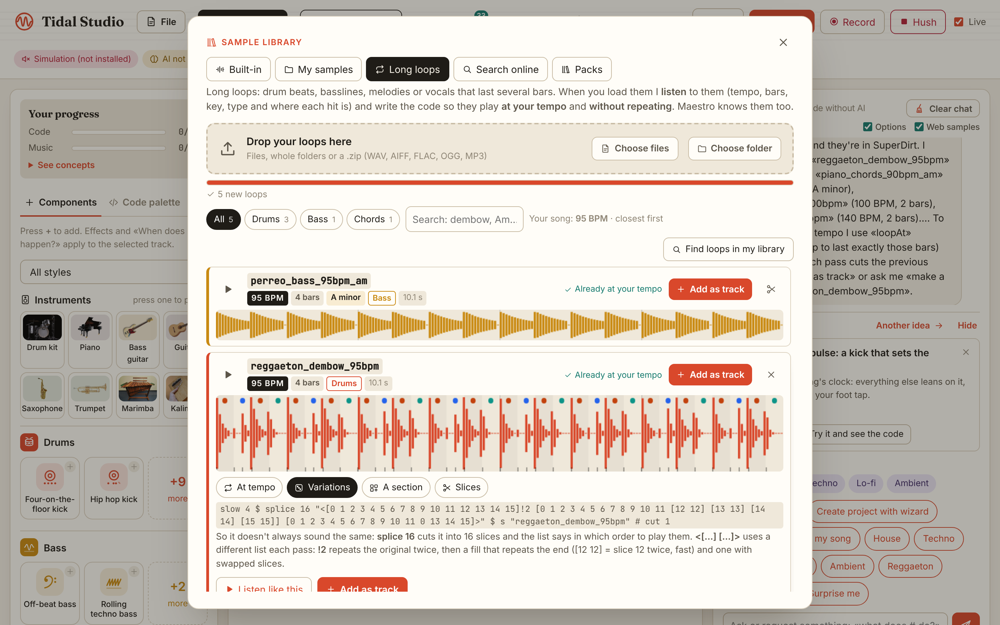 |
| **Build your own order with the slices** | **In the song, at your tempo** |
| 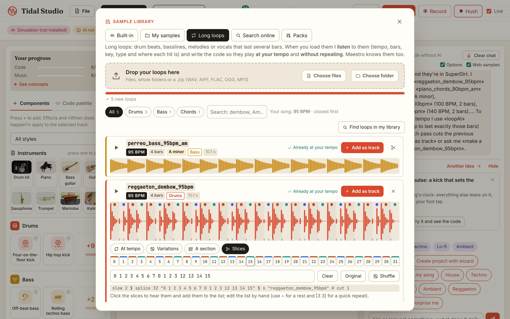 |  |

### Skills and plugins

Maestro loads music **skills** (`SKILL.md`, the same format as Claude's Agent Skills) and shows under each answer which
ones it loaded and used. Install more skills, or whole **Claude Code plugins and marketplaces**, by pasting a GitHub link
in the Skills panel: their skills join Maestro's and their commands work in the chat as `/name`. Details in
[Skills](#skills) and [Plugins](#plugins) below.

| Under every answer: which skills were loaded and used | The Skills panel: turn on, always load, view, install |
|---|---|
|  |  |
| **Plugins: a whole Claude Code plugin from a GitHub link** | |
|  | |

### How Maestro decides, and its reasoning

Every answer that relied on a skill opens with **How I decided**: one row per musical decision (style, rhythm,
tempo, bass, harmony, melody, instruments, effects, mix, structure) with the skill it consulted, the rule or advice
it took from it, and what it did with it (track, value, code). Only skills whose content was actually loaded for that
message can appear there, so a rule can't be made up from a skill's name. Click a skill to open it.

While **Maestro is thinking…**, a faint grey **Thinking** line shows what it is doing, like a typical coding harness:
reading your song, which skills it picked and why, who it is asking, and Claude's own reasoning as it streams.
Click it to unfold; after the answer it stays under the message as **Reasoning**. With an Anthropic API key it uses
adaptive thinking with summarized display; with your Claude subscription it reads the `claude` CLI's `stream-json`
output; OpenAI-compatible models show `reasoning_content` when they return it. Providers that don't share their
reasoning show only the steps.

| How I decided | Reasoning |
|---|---|
|  |  |

### Connect your AI, with automatic detection and Diagnostics

Choose an OpenAI-compatible endpoint, an Anthropic API key or **Claude with your subscription** in **Settings**. With your
subscription, the studio finds the `claude` command your terminal uses and shows what it detected: path, version, whether
you are signed in, default model, endpoint and API key. **Automatic** picks the right connection for you (your plan if you
are signed in, otherwise the same setup as your terminal). If Maestro doesn't answer, press **Diagnostics**: it checks
your terminal environment, the `claude` command, sign-in, connection mode, model and a live test step by step, tells you
how to fix what fails, and **Test models** tries each model so you can **Use** one that works. **Copy report** gives you
a text summary with keys masked. Details in [Setting up the AI](#setting-up-the-ai).

| Detected on this computer | Diagnostics and Test models |
|---|---|
|  |  |

### A real app on your computer

Tidal Studio installs as a **native app** with everything inside (TidalCycles, SuperCollider, the sounds, Python): it
opens in its own window with no Terminal, starts the sound engine in the background and stops it when you close it.
Download the installer for your system (version 0.13.1; newer ones appear on the [latest release](https://github.com/vsalesa/tidal-studio/releases/latest)):

| System | Download | Then |
|---|---|---|
| **Mac** (Apple Silicon) | [TidalStudio-0.13.1-macOS-AppleSilicon.pkg](https://github.com/vsalesa/tidal-studio/releases/download/v0.13.1/TidalStudio-0.13.1-macOS-AppleSilicon.pkg) | [Mac steps](#easiest-the-all-in-one-mac-installer) |
| **Windows** 10/11 (x64) | [TidalStudio-0.13.1-Windows-x64-Setup.exe](https://github.com/vsalesa/tidal-studio/releases/download/v0.13.1/TidalStudio-0.13.1-Windows-x64-Setup.exe) | [Windows steps](#windows-the-all-in-one-installer) |
| **Linux** (Ubuntu 22.04+, Debian 12+) | [tidal-studio_0.13.1_amd64.deb](https://github.com/vsalesa/tidal-studio/releases/download/v0.13.1/tidal-studio_0.13.1_amd64.deb) | [Linux steps](#linux-ubuntu-2204-debian-12-the-deb-package) |

### Tidal Studio updates itself

When a new version comes out, the app tells you: at startup and every 12 hours it checks the
[releases on GitHub](https://github.com/vsalesa/tidal-studio/releases) and shows a card with what's new. **Update now**
downloads the installer for your computer (the Apple Silicon `.pkg` on a Mac, `Setup.exe` on Windows, the `.deb` on
Linux) with a progress bar and checks it against the SHA-256 that GitHub publishes. **Install and restart** closes
Tidal Studio, runs the installer (your Mac asks for your password, Windows for permission) and opens the new version.
Your songs, samples, plugins and settings are left alone. **Later** hides the card until tomorrow and **Skip this
version** until the next one.

| A new version is out | Downloading, with progress |
|---|---|
|  |  |

| Ready: one click installs and reopens | Settings › Updates |
|---|---|
|  |  |

In **Settings › Updates** you see your version, can **Check for updates** by hand (on the Mac also from the menu
**Tidal Studio › Check for Updates…**) and untick **Check for new versions automatically** so it never looks by itself.
If you run Tidal Studio from the source folder, it only tells you about the new version: update with `git pull`.

### Interactive tutorial

The first time you open the studio, Maestro walks you through everything in 22 short steps (play the drums, add tracks,
effects, chat controls, ideas, recipes, blocks, arrangement, code, library…). Each step waits for you to do it, and you
can repeat it from the cap button.


### Open and save Tidal files

The **File** menu opens and saves ordinary TidalCycles files (`.tidal`, `.hs`), wherever they are on your computer, so
you can move songs between Tidal Studio and any Tidal editor (Pulsar, VS Code, Vim…).

- **Open…** (`Ctrl/⌘+O`) reads the file and turns every `d1 $ …` … `d12 $ …` and every `p "name" $ …` into a track. A
  short comment just above a pattern becomes the track's name, `setcps` becomes the BPM, and patterns inside a `do` block
  are split into tracks too. Anything that isn't a track (`let` definitions, `once`, imports, block comments…) is kept
  **intact** in an **Extra code** card above the tracks, which is evaluated before the tracks when you press Play all.
  `hush` lines are left out (here the Hush button does that).
- **Save** (`Ctrl/⌘+S`) and **Save as…** (`Ctrl/⌘+Shift+S`) write a clean `.tidal` that plays in any Tidal editor: the
  mix is written as `# amp … # eqlow …` lines, muted tracks are commented out, and one comment line
  (`-- tidal-studio: {…}`) remembers the name, track types, solo and master, so reopening the file loses nothing.
- **Recent files**, a **saved / unsaved changes** indicator above the song name (and a dot on the File button), and a
  **Save changes?** prompt before you close a file with changes.
- It uses your system's own dialogs: the native panels in the Mac app, the Windows file dialog, and zenity/kdialog on
  Linux. In a plain browser it falls back to the browser's file picker, or lets you type the path to save to.

| File menu with recent files | Unsaved changes? |
|---|---|
|  |  |


### Several songs open at once, in tabs

Each song you open gets its **own tab**, like in a browser or a code editor, so you can keep a work in progress, a
`.tidal` file from your disk and a version from GitHub open side by side and jump between them.

- **Everything opens in a new tab**: File → **Open file…** (from your disk), **Open from GitHub…**, a recent file,
  **My projects**, **New project**, a genre course or an imported song. Your current song stays open in its own tab.
  Opening something that is already open (the same file, the same GitHub song) just takes you to its tab.
- **Each tab keeps its own song**: tracks, code, Blocks, Mix, arrangement, Maestro's chat, undo history and the file it
  belongs to. Only the tab in front plays: switching tabs stops the old song and, with Live on, plays the new one.
- **Close** a tab with its **×** (or the middle mouse button, or File → **Close file / Close tab**). If its file has
  unsaved changes, the tab shows a dot and asks **Save / Don't save / Cancel** first. The song is still kept in
  My projects, so closing a tab never loses work.
- Tab icons tell you where each song lives: a page for a file on your disk, a cloud for GitHub, a note for a song kept in
  this browser. Hover a tab to see its full path. The **+** at the end starts a new song.
- Shortcuts: `Alt+1…9` jumps to a tab and `Ctrl+Alt+←/→` to the previous or next one. In the Mac app, `⌘T` new tab,
  `⌘W` close tab and `⌘⇧[` / `⌘⇧]` to move between tabs.
- Your open tabs come back the next time you open the studio.


| File menu: open from disk or GitHub, close the file | Closing a tab with unsaved changes |
|---|---|
|  |  |

### Import a song as a starting point

**New project → From a song** (or **File → Import a song**) takes a song you like and turns it into a base for a
**new** song of your own.

- **MIDI (`.mid`)**, fast and exact: every MIDI track becomes a Tidal track. Drums (General MIDI channel 10) are split
  into kick, snare & claps, hats & cymbals and toms; bass, chords and melody become `note "…" # s "…"` patterns with
  real note names (`a3`, `[f5,a5,c6]`). Notes are snapped to the simplest grid that fits, so the code stays readable
  (`s "bd*2"`, `s "[~ sn]*2"`), and each bar becomes one cycle (`<bar1 bar2 …>`).
- **The song's recipe**: tempo, meter, key, chord progression with Roman numerals (`i bVI bIII bVII`), groove (straight
  or swung, how many kicks) and structure (repeated 4-bar blocks: `A B A B`). Click a part of the structure, or pick a
  start bar and 1-16 bars, to load another section.
- **Create a new song inspired by it**: Maestro gets the recipe and is told to *transform, not copy*: keep the tempo,
  groove, kind of progression and energy, write a new melody, change chords, instruments or key, and explain what it
  borrowed and what it changed. Without AI you get a step-by-step list of ways to make it yours. **Study it as is**
  just loads the tracks so you can press Explain on each one.
- **Audio (mp3, wav, flac, ogg, m4a, aiff)**, approximate: the first time it offers to install free offline tools
  (~1-2 GB, in `~/.tidal-studio/audio-tools`). First it separates drums, bass, vocals and the rest, then **basic-pitch**
  (Spotify) turns each one into notes and **librosa** finds the beat. The result is aligned to the bars, and chords are
  written as Tidal chord names (`a4'minor f4'major`). It's a skeleton to study and reinvent, not an exact copy.
- **Two separators, you pick per song:**
  - **Quality: MSST** ([Music-Source-Separation-Training](https://github.com/ZFTurbo/Music-Source-Separation-Training)
    by ZFTurbo, MIT) with its **SCNet XL** model for drums, vocals and the rest, plus Demucs for the bass. The model
    (214 MB) downloads the first time you use it. Recommended on Apple Silicon (it runs on the GPU through MPS) and on
    computers with an NVIDIA card.
  - **Fast: Demucs** (Meta) for everything. Recommended on computers without a graphics card, where MSST takes about 6×
    the song's length.
  - If MSST fails on your computer, it falls back to Demucs on its own. If you already had the audio tools installed, Tidal Studio offers to update them.

  How we chose: on 8 songs from the MUSDB18 test set (median SDR in dB, higher is better), compared with Demucs, SCNet XL
  separated drums better (9.0 vs 6.8), as well as vocals (11.9 vs 9.5) and the rest (5.5 vs 4.8), but the bass worse
  (6.2 vs 8.8). That's why the bass comes from Demucs. BS-RoFormer scored a little higher (avg 8.5 vs 8.1), but its
  model is 527 MB and it's 40% slower.

  | Pick the separator | Separating with MSST |
  |---|---|
  |  |  |
- Everything stays on your computer. If the song isn't yours, use it to study and publish what you create, not the copy.

| The song's recipe and its Tidal tracks | From an mp3 or wav |
|---|---|
|  |  |


### Generate from your MIDI, in any style

**New project → Generate from my MIDI** (or **File → Generate from my MIDI**) takes a MIDI of yours, keeps the parts
you choose and writes the rest in the style you pick. It works offline, without AI, and Maestro can vary it afterwards.

1. **Upload your MIDI** (export it from GarageBand, Logic, MuseScore or Ableton) and pick the bars to use (1-16).
2. **Pick a style**: merengue, salsa, cumbia, reggaeton, bossa nova, jazz, funk, house, techno, drum & bass or lo-fi.
3. **Choose what to keep**: your **melody** (note for note, played on one of the style's instruments), your **chords**
   (played the way the style plays them, with sevenths in jazz, bossa, funk, house and lo-fi), your **bass** line, your
   **drums** and your **tempo**. Parts your MIDI doesn't have in that section are greyed out.
4. **Generate**: the drums come from the genre course, the bass and the accompaniment use the rhythms measured in real
   songs played over your chords (the merengue bass jumps root-fifth and leads into the next chord, the salsa bass
   plays the tumbao and anticipates the next chord…), and a new melody, if you don't keep yours, is written as
   call and response: bar 1 asks, bar 2 answers, bar 3 repeats the question over its chord and bar 4 closes.
   If you don't keep your chords, you get the style's typical progression in your key (relative minor or major when
   the style needs it).
5. Each track says where it comes from (**from your MIDI**, **style**, **new**) and why. **Listen**, try **Another
   version** (a new melody and pattern variation) or **Change style**, and **Use this version** when you like it.
   Maestro then lists what it did with each track and offers **Turn it into a whole song** (intro, verse, chorus,
   bridge and ending with a plan) or **Generate another version**.

In the genre courses, **Make my MIDI Merengue** (or the course's style) does the same from your example MIDI.
The song import's result has **Generate in a style…** too.

| 1. Upload your MIDI | 2. Style and what to keep |
|---|---|
|  |  |
| **3. Your version, track by track** | **4. In the studio, with Maestro** |
|  |  |
| **From a genre course** | |
|  | |

### Play your MIDI keyboard: it sounds and turns into Tidal code

Plug in your piano or MIDI keyboard (USB; a class-compliant one with a USB-B to USB-C cable needs no driver) and
press **MIDI keyboard** in the top bar. A panel opens at the bottom of the studio:

- **It sounds right away** with the sound you pick (superpiano, Rhodes, organ, pads, synths, the instruments you
  pinned in the library or any sound your song already uses). SuperCollider listens to the keyboard and plays each
  note through SuperDirt, so it works in the Mac app too. Choose the **keyboard**, the **channel**, the **octave**
  (− / +, or Z and X) and turn **Play sound** off if your piano already makes its own sound.
- **No keyboard at hand?** Click the keys on screen or play with your computer keys (A W S E D F T G Y H U J K = C to C).
- **Record**: with a count-in and metronome, or, if your song is playing, from its next bar and at its tempo, so what
  you play fits right in. **While you play, the Tidal code is written live** under the keyboard.
- **Stop and translate**: your take becomes Tidal tracks, one per hand (**Left hand** and **Right hand**, or
  everything in one track), snapped to the simplest grid that fits (quarters, eighths, sixteenths or triplets; you
  can change it, and the BPM), with the key and the chords it found. The sustain pedal holds notes like a real piano.
- **Turn what I just played into code**: no need to have pressed Record. It takes your last phrase.
- Then: **Listen**, **Add to my song**, **Ask Maestro** (it adds the tracks and Maestro explains what you played,
  in music and in code, and suggests how to continue), **Generate in a style…** (your take goes into
  [Generate from your MIDI](#generate-from-your-midi-in-any-style)), **New song from this**, or download it as **.mid**.

No piano yet? `python3 tools/virtual_midi.py` plays a phrase on a virtual keyboard (add `--fake-song` to also
simulate a song playing, `--port` for a real virtual MIDI port with `pip install mido python-rtmidi`).

| 1. Your keyboard, live | 2. Recording, code as you play |
|---|---|
|  |  |
| **3. Translated into Tidal, hand by hand** | **4. Maestro explains it and suggests what's next** |
|  |  |

### Your keyboard both ways: the song plays on your piano

MIDI now goes both ways. In the MIDI keyboard panel, open **Send to my keyboard** and pick the **output** (your piano),
the **channel** and, if you like, the **keyboard sound** (piano, electric piano, organ, strings… from the General MIDI
list). Then:

- **Click a track** to play it with your keyboard's own sound (its code becomes `# s "midi" # midichan 0`); click it again
  to go back to the studio sound. Maestro knows `s "midi"` too.
- **Clock and start/stop**: your keyboard's arpeggiator, drums or sequencer follow the song's tempo (24 pulses per beat)
  and start with **Play all** and stop with **Hush**.
- **Hush** also sends *All Notes Off*, so nothing keeps ringing on your piano. If you hear every note twice, turn off
  *Local Control* on your keyboard.


### Plug in, unplug: the audio recovers

Plugging in a keyboard, headphones or a USB audio device used to leave the studio silent. Now:

- The keyboard is **found by itself** when you plug it in (checked every 2 s) and you get a notice; when you unplug it,
  **the notes and the pedal you were holding are released** and the recording doesn't stretch them.
- Turning **Play sound** off, or switching keyboard or channel, stops what was ringing.
- Your keyboard plays on **its own channel in SuperDirt**, so it no longer changes the reverb or delay of `d12`.
- On a Mac the engine **no longer opens an audio input** (Tidal Studio doesn't record from the microphone), which was
  the usual cause of «Mismatched sample rates» when macOS switched the input to a new device.
- If the sound outputs change or the audio engine stops, a bar offers **Reconnect audio**, with the **output** you want
  (it is remembered). Only SuperCollider restarts: Tidal keeps your song and it plays again by itself.


### Save, export and share

- **GitHub**: save each version of your song as a commit in a repository of yours (`song.tidal`, `song.json`,
  `README.md`), browse the history and open any old version from My projects → GitHub.
- **Export**: download the song as a `.tidal` file, copy a **share link** (the whole song in the URL; opening it loads it
  as a new project), or **record** what you hear to a WAV file in `recordings/` with the record button.
- **My projects**: your songs are saved automatically; open or delete them from the folder button.


### Your songs on GitHub: remote paths, upload in bulk, start new songs there

- **A song opened from GitHub shows where it lives on GitHub**, `user/repo/songs/name`, in its tab and above the
  title, never a path on your computer, even if you also have a `.tidal` file with the same name. If that file is open
  too, it stays in its own tab. `Ctrl+S` / `⌘S` on a GitHub song saves a new version to GitHub.


- **Settings → GitHub** has two new things: «Create new songs directly on GitHub» and «Upload songs from my computer…».


- **Upload songs from my computer**: choose a folder, tick the `.tidal` / `.hs` files you want and upload them all at
  once. Each file becomes a song in `songs/<name>/` with its own commit (with its extra code, `let` and definitions).
  If the repository already has a song with that name, it is uploaded as `<name>-2`, so nothing gets overwritten.


- **Delete the local files after uploading them**: a file is only removed after GitHub confirmed the upload *and* the
  song read back from GitHub is identical, and only if you didn't change the file meanwhile. It goes to the Trash
  (Recycle Bin on Windows), so you can get it back. A tab that had that file open becomes the GitHub song.


- **Create new songs directly on GitHub**: with this ticked, every new song, whatever you start from (blank, wizard,
  brainstorm, a course, a MIDI or audio file…), is created in your repository as soon as it has its first track.


### And also

- **Your progress**: the code and music concepts you have already used.
- **Components to add** and **code always visible and editable**.
- **English and Spanish**: switch with the EN/ES button in the top bar. Maestro answers in the chosen language.
- **Any AI**: an OpenAI-compatible endpoint (OpenAI, OpenRouter, Groq, DeepSeek, Mistral, Ollama, LM Studio…)
  or Claude (Anthropic). It also works without AI: button-guided flow, explanations and local ideas.
- **macOS, Windows and Linux**: the installer detects your system.

## What's new, version by version

Each version has its installers for Mac, Windows and Linux on the [releases page](https://github.com/vsalesa/tidal-studio/releases).

| Version | What's new |
|---|---|
| **0.13.1** | [Your songs on GitHub](#your-songs-on-github-remote-paths-upload-in-bulk-start-new-songs-there): a song opened from GitHub shows its GitHub path, never a local one; upload many `.tidal` files at once from Settings, optionally deleting the local copies (to the Trash, only after a verified upload); and an option to create every new song directly on GitHub. |
| **0.13.0** | [MIDI both ways](#your-keyboard-both-ways-the-song-plays-on-your-piano): tracks play on your keyboard, clock and start/stop, keyboard sound, All Notes Off. [Audio that recovers](#plug-in-unplug-the-audio-recovers): keyboards found when plugged in, held notes released when unplugged, Reconnect audio with your output, no audio input on Mac. [One library for every sound](#one-library-for-every-sound): built-in and downloaded sounds in one list. [Replace a sound](#replace-a-sound-by-selecting-its-name) by selecting its name: similar sounds, search, listen first. |
| **0.12.1** | Fix: saving songs to a [GitHub](#github) repository you just created empty (no README) no longer fails with «409: the repository is empty»; the repository field also accepts a pasted GitHub URL. |
| **0.12.0** | [Play your MIDI keyboard](#play-your-midi-keyboard-it-sounds-and-turns-into-tidal-code): your USB piano sounds with any instrument and what you play becomes Tidal tracks (left and right hand), recorded in time with your song; Maestro explains it and suggests how to continue. |
| **0.11.0** | [Tidal Studio updates itself](#tidal-studio-updates-itself): it tells you about new versions, downloads and verifies the installer for your computer and installs it with one click. |
| **0.10.0** | [Plan step by step](#big-requests-maestro-makes-a-plan-and-goes-step-by-step): for big requests Maestro shows a plan first and does it step by step, saving each step, so a timeout no longer loses work; a Cancel button (or Esc) stops what you sent; the AI is only cut off when it goes silent, and Maestro caches its instructions, skills and sound searches. [Generate from your MIDI](#generate-from-your-midi-in-any-style) in 11 styles, keeping your melody, chords, bass or drums. [Songs in tabs](#several-songs-open-at-once-in-tabs), opening and closing `.tidal` files from your disk next to GitHub. [Genre courses](#genre-courses) with a real drummer to hear in nine styles and Latin styles learned from real songs. [Audio import](#import-a-song-as-a-starting-point) separates instruments with MSST (SCNet XL) plus Demucs for the bass. [Maestro sees new downloads](#maestro-downloads-the-sounds-it-needs) right away: your library is read from disk with every message. |
| **0.9.1** | [Tidal Studio route](#plugins): Maestro loads `mc-tidal-studio`, the skills route of your composition plugin made for this app, with every message, plus the genre skill that best fits. |
| **0.9.0** | [Instrument library](#instrument-library-600-specific-instruments): 600+ specific instruments with photos, pre-listen and your own SoundFonts, new synth engines (Mi-UGens, Surge XT, Vital), Latin courses that follow your composition plugin with real instruments, and plugins that update themselves. |
| **0.8.0** | [Long loops library](#long-loops-a-library-that-knows-what-to-do-with-them): drop loops, folders or a zip; tempo, bars, key and hits are detected and you get code that fits your song, with variations. |
| **0.7.0** | [Import a song](#import-a-song-as-a-starting-point) (MIDI, or audio with optional tools) as the starting point for a new one. |
| **0.6.0** | [Maestro downloads the sounds it needs](#maestro-downloads-the-sounds-it-needs) from free sample packs and Freesound. |
| **0.5.0** | [Open and save Tidal files](#open-and-save-tidal-files): a File menu for any `.tidal` / `.hs`, with native dialogs. |
| **0.4.1** | [Each track shows its mix](#mix-tab) (volume and EQ) in Tracks and Blocks. |
| **0.4.0** | [Hear Maestro's options and pick one](#hear-maestros-options-and-pick-one), the [Timeline](#timeline-when-each-sound-plays), [effects on/off](#blocks-view-and-live-highlighting) and old errors that clear by themselves. |
| **0.3.0** | [A real app](#a-real-app-on-your-computer) for Mac, Windows and Linux; [AI detection and Diagnostics](#connect-your-ai-with-automatic-detection-and-diagnostics); [how Maestro decides and its reasoning](#how-maestro-decides-and-its-reasoning); [plugins](#skills-and-plugins). |
| **0.2.0 and before** | Wizard, brainstorm, genre courses, Blocks, Mix, instruments, sample library, skills, GitHub versions and the tutorial. |

## Installation (once)

### Easiest: the all-in-one Mac installer

Download `TidalStudio-…-macOS-AppleSilicon.pkg` from the
[latest release](https://github.com/vsalesa/tidal-studio/releases/latest) and double-click it. It contains
everything (TidalCycles with its own Haskell, SuperCollider, SuperDirt and its sounds, Python) and **downloads nothing**
while installing. Then open **Tidal Studio** from Applications.

Tidal Studio is a real Mac app: it opens in its own window (with its Dock icon and menu bar), starts SuperCollider,
SuperDirt and Tidal in the background with **no Terminal window**, and stops all of them when you quit (⌘Q or close
the window). If something goes wrong it shows the log, which is also in `~/Library/Logs/Tidal Studio/studio.log`.
**View → Open in Web Browser** opens the same studio in your browser.

It is not signed with an Apple Developer ID yet, so the first time macOS blocks it: open
**System Settings → Privacy & Security**, press **Open Anyway** and run the `.pkg` again.
It installs the engine in `/Users/Shared/TidalStudio` (about 3 GB) and leaves any SuperCollider, Haskell or Python you
already have untouched. How it is built: [packaging/README.md](packaging/README.md).

### Windows: the all-in-one installer

Download `TidalStudio-…-Windows-x64-Setup.exe` from the
[latest release](https://github.com/vsalesa/tidal-studio/releases/latest) and run it. It also has everything inside and
installs to `C:\TidalStudio`. Open **Tidal Studio** from the Start menu or the desktop: the studio opens in its own
window (Microsoft Edge in app mode, with no tabs or address bar) and **no console**, and closing that window stops
SuperCollider and Tidal. It is not signed yet, so SmartScreen may say "Windows protected your PC": press
**More info → Run anyway**. Log: `%LOCALAPPDATA%\Tidal Studio\logs\studio.log`.

### Linux (Ubuntu 22.04+, Debian 12+): the .deb package

Download `tidal-studio_…_amd64.deb` from the [latest release](https://github.com/vsalesa/tidal-studio/releases/latest)
and install it with `sudo apt install ./tidal-studio_*_amd64.deb` (apt also installs SuperCollider from your
distribution). Open **Tidal Studio** from your applications menu: it opens in its own GTK window, and closing it stops
everything. With PipeWire, install `pipewire-jack` so SuperCollider can play sound. Log:
`~/.local/share/tidal-studio/logs/studio.log`.

### From the source folder (Windows, Linux, or Mac)

Download or clone this folder and:

| System | What to do |
|---|---|
| **Windows 10/11** | Double-click `install.bat` |
| **macOS** | Open Terminal in the folder and run `./install.sh` |
| **Linux** (Debian/Ubuntu, Fedora, Arch, openSUSE) | `./install.sh` |

The installer speaks English or Spanish depending on your system language (force it with `./install.sh --lang en` or
`install.ps1 -Lang es`). It adds, if missing: Python 3, Git, SuperCollider, SuperDirt (sounds), Haskell (via ghcup) and TidalCycles.
It takes 15–40 minutes the first time (~1 GB download). You can run it again safely: it skips what's already there.

## Usage

| System | Open the studio |
|---|---|
| Windows | Double-click `start.bat` |
| macOS / Linux | `./start.sh` |

Your browser opens at <http://localhost:8765>. Then:

1. Press **New project** and choose blank, wizard or brainstorm.
2. Optionally open **Settings** (gear icon) and connect your AI; without it, the button guide still works.
3. Talk to **Maestro** on the right, try its ideas, or add components from the left.
4. See and edit the code in the **Code** tab (`Ctrl+Enter` applies it).
5. **Hush** stops everything instantly.

### Setting up the AI

| Service | Base URL | Example model |
|---|---|---|
| OpenAI | `https://api.openai.com/v1` | `gpt-4o-mini` |
| OpenRouter | `https://openrouter.ai/api/v1` | `openai/gpt-4o-mini` |
| Groq | `https://api.groq.com/openai/v1` | `llama-3.3-70b-versatile` |
| Ollama (local, free) | `http://localhost:11434/v1` | `llama3.1` |
| LM Studio (local, free) | `http://localhost:1234/v1` | whichever you have loaded |
| Claude (Anthropic API key) | — | `claude-opus-5-5` |
| **Claude with your subscription** (Claude Code, Pro/Max) | — | your plan's default |

**No API key? Use your Claude subscription:** install [Claude Code](https://claude.com/claude-code), run `claude` once in a
terminal and sign in with your Pro or Max plan, then choose «Claude with your subscription» in Settings. Maestro talks to
Claude through the `claude` command on your computer. It counts towards your plan's usage limits and answers a bit
slower than the API (about 10–20 s).

Keys are stored only in `config.json`, on your computer (it is not committed to git). You can also use the
`OPENAI_API_KEY` or `ANTHROPIC_API_KEY` environment variables.

If it doesn't connect, open **Settings → Diagnostics** ([what it checks](#connect-your-ai-with-automatic-detection-and-diagnostics)).

### Skills

Maestro can load **skills** (folders with a `SKILL.md`, the same format as Claude's Agent Skills). Three open-license
music skills come included (Tidal live coding, Strudel recipes and general music composition); open the skills button in the top bar to turn them on or off, mark one «Always load», read it,
or install another one by pasting its GitHub link. Under each of Maestro's answers you see which skills were loaded for
that message and which it actually used. Details and sources: [skills/README.md](skills/README.md).


### Plugins

The same box also installs **Claude Code plugins** (a repo with `.claude-plugin/plugin.json`) and **marketplaces**
(`.claude-plugin/marketplace.json`, which lists several plugins: you pick which ones). Paste the repository link, for
example `https://github.com/jtydhr88/music-composition-skills`. Tidal Studio downloads it with `git` (or GitHub's
`.tar.gz` if you don't have git), copies **only text files** into `my-plugins/<plugin>/` on your computer (never into
this repository) and then:

- its **skills** are used by Maestro like any other (they appear grouped under the plugin in the panel);
- its **commands** (`commands/*.md`) can be typed in Maestro's chat: `/name` or `/plugin:name`, with arguments;
- agents, hooks, MCP and LSP servers are for Claude Code: they are listed but not used.

Each plugin can be turned off (its skills and commands disappear) or removed. Check its license and any `NOTICE` before
sharing its content.

**Included by default: music composition.** The first time Tidal Studio starts with internet, it downloads
[vsalesa/music-composition-skills](https://github.com/vsalesa/music-composition-skills) (the English translation of
jtydhr88's 30-skill composition plugin, MIT) into `my-plugins/`. It is marked **Always use**: Maestro loads its main
`music-composition` skill with every message and always gives one slot to its best-matching skill (harmony, jazz,
groove, form…). It is downloaded instead of shipped in the installer because its reference files quote copyrighted
books (see its `NOTICE`). If you remove it, it doesn't come back; untick «Always use» to make it an ordinary plugin.

**Tidal Studio route.** From v1.2.0 the plugin brings `mc-tidal-studio`, a skills route written for this app
(compose first, choose the sound second, plus Maestro's JSON, `variantes`, `descargar` and the real synths and samples).
When an «Always use» plugin has it, Maestro loads `mc-tidal-studio` with every message **instead of** the plugin's
generic `music-composition` index, and the guaranteed slot still goes to the genre or craft skill that best fits your
request (for example `mc-style-latin-bachata` for «a modern bachata with R&B»). The plugin card says
**Tidal Studio route: mc-tidal-studio** and the skill shows first with a **Tidal Studio route** tag. With an older copy
of the plugin nothing changes: the main skill keeps loading until the plugin updates.


**Plugins stay up to date.** Every time Tidal Studio starts it asks GitHub whether each plugin you installed from a link
has changed (the last commit that touched the plugin's folder, so a fix counts even if `version` in `plugin.json` wasn't
bumped) and, with **Update plugins automatically at startup** on (the default), downloads the new version and tells you
with a message. Your «On» and «Always use» choices are kept. Untick it to decide yourself: the plugin then shows
**A new version is on GitHub** with an **Update** button, and **Check for updates** looks again without restarting.
Without internet nothing changes and it tries again next time. So when you push a change to
`vsalesa/music-composition-skills`, every Tidal Studio picks it up on its next start. Files you edit by hand inside
`my-plugins/<plugin>/` are replaced by an update.

| A new version on GitHub: one click on Update | Updated (or automatically at startup) |
|---|---|
|  |  |

### Samples

Your sounds live in `samples/<name>/` (each folder is a Tidal sound: `s "name"`, `s "name:1"` for the second file).
SuperDirt loads them on start and reloads them when you add or delete something. For Freesound, get a free API key at
[freesound.org/apiv2/apply](https://freesound.org/apiv2/apply) and paste it in the library (Search online tab). Tidal
Studio downloads Freesound's high-quality OGG preview, which SuperCollider reads directly.

Maestro can also download sounds by itself while you chat ([see above](#maestro-downloads-the-sounds-it-needs)). Small ones
download straight away; packs over 16 files or about 8 MB wait for your OK. Turn it off with **Web samples** above the chat.

Long loops ([see above](#long-loops-a-library-that-knows-what-to-do-with-them)) are analysed when they arrive and their
tempo, bars, key, type and hits are saved in `samples/library.json`. Analysis uses only Python's standard library for WAV
and AIFF; MP3, OGG, FLAC and M4A use `ffmpeg` if it is installed, otherwise the browser decodes them.

Optional drum machines: `git clone https://github.com/geikha/tidal-drum-machines samples/packs/tidal-drum-machines`
(loaded automatically on the next start).

### GitHub

Open ⚙ Settings → GitHub. Create a **fine-grained token** on GitHub (Settings → Developer settings → Personal access
tokens) with access to your songs repository and the permission **Contents: Read and write**. Type the repository as
`user/name` (or paste its GitHub URL, `https://github.com/user/name` or `…/name.git`; both work). If it doesn't exist yet, «Create private repository» makes it (that needs a token with permission to create
repositories). Then use the cloud button in the top bar to save a version with a message. The token is stored only in
`config.json`.

A repository you just created on GitHub with no files at all (no README) works too: on the first save Tidal Studio makes
an initial commit with a small `README.md` and then saves your song on top of it. Before, that gave the error
«GitHub 409: the repository is empty».

## How it works

[](docs/diagrams/architecture.svg)

Diagram source: [docs/diagrams/architecture.puml](docs/diagrams/architecture.puml) (PlantUML), rendered to [SVG](docs/diagrams/architecture.svg) and PNG with `docs/diagrams/render.sh`.

- `server/app.py`: local server (Python standard library only, no `pip install`). Listens only on `127.0.0.1`.
- `server/engine.py`: finds and starts `sclang` (with `supercollider/start_superdirt.scd`) and `ghci` (with `tidal/BootTidal.hs`).
  If something is missing it runs in **simulation mode**: the interface works but there is no sound.
- `server/assistant.py`: Maestro's instructions and parsing of its replies (JSON with message, options and track changes).
- `web/catalog.js`: the component catalog. Adding one means adding an object to the list.
- `web/builder.js`: the base-project wizard. `web/wizard.js`: brainstorm questions and offline plan.
- `web/explain.js`: offline code explainer. `web/suggest.js`: offline producer ideas and progress concepts.
- `web/flavors.js`: style recipes (jazz, Latin, techno, lo-fi, ambient).
- `web/doctor.js`: offline code checks and fixes for the Help panel (`/api/fix` with AI). `web/palette.js`: code palette blocks.
- `web/controls.js`: controls in the chat (agentic UI). `web/blocks.js` + `web/edit.js`: blocks view and its editing. `web/card.js`: configurator card. `web/mixer.js`: mix tab. `web/history.js`: undo and history. `web/samples.js` + `server/samples.py`: sample library and Freesound. `server/github.py`: GitHub versions.
- `server/plugins.py`: Claude Code plugins and marketplaces (`my-plugins/`): download, manifests, skills and `/commands`.
- `server/skills.py` + `web/skills.js`: Maestro's skills (`skills/` included, `my-skills/` yours): choosing which to load, install from GitHub, the panel and the chips in the chat.
- `web/timeline.js` + `server/timeline.py` + `tidal/Timeline.ghci`: the Timeline tab. The server asks Tidal (`queryArc`) in its own GHCi; `web/tpat.js` is the approximate in-browser calculator used without the engine.
- `server/instcatalog.py` + `server/instlib.py` + `web/instlib.js`: the instrument library (catalog, downloads, SoundFont/SFZ import, pre-listen). `supercollider/studio-instruments.scd` plays multisampled instruments with notes; `studio-synthlib.scd` holds the built-in synths; `server/engines.py` + `studio-engines.scd` install and load Mi-UGens and VSTPlugin (Surge XT, Vital); `server/photos.py` finds photos on Wikimedia Commons.
- `server/midilive.py` + `supercollider/studio-midi.scd` + `web/midikeys.js`: MIDI keyboard in and out (`s "midi"`, clock, plug/unplug watch). `server/engine.py` audio state + `web/audiostatus.js`: Reconnect audio (`/api/audio`, `/api/audio/restart`). `server/library.py` + `web/library.js`: one library for every sound (`/api/library`, `/search`, `/similar`). `web/replace.js`: replace a sound by selecting its name.
- `server/files.py` + `web/tidalfile.js`: open and save `.tidal` / `.hs` files (File menu). `server/songimport.py` + `server/audioimport.py` + `web/importsong.js`: import a song (MIDI or audio). `server/midigen.py`: generate from your MIDI in a style (`POST /api/import/generate`); `tools/make_example_midi.py` writes the test song `examples/little-tune.mid`.
- `server/fetcher.py` + `web/fetchcard.js`: Maestro finds and downloads missing sounds. `web/variants.js`: Maestro's audible options (live A/B).
- `server/loops.py` + `web/loops.js`: long-loops library (analysis of tempo, bars, key and hits, and the code that fits your song).
- `server/ccdetect.py` + `server/llmdiag.py`: Claude Code detection and the Diagnostics panel. `web/courses.js`: genre courses. `web/instruments.js`: instruments. `web/tour.js`: tutorial.
- `web/i18n.js`: language switch. `web/icons.js`: custom SVG icons. `web/style.css`: light «Partitura» theme.

Each track is a Tidal `dN` (d1…d12) with its own effects channel (orbit).

## Troubleshooting

- **No sound**: check the **Log** tab. Run `python3 server/app.py --check` to see what's missing.
- **Linux without sound**: SuperCollider uses JACK. With PipeWire it starts with `pw-jack`; with classic JACK, start it first.
- **macOS asks for microphone permission** for SuperCollider: accept it (it needs it to open audio).
- **Windows: "Haskell se está terminando de instalar en otra ventana"** (Haskell is finishing installing in another window): wait until it finishes and run `install.bat` again.
- **Maestro doesn't answer with Claude**: open **Settings → Diagnostics**. It tells you which step fails (command not found,
  not signed in, model not accepted…) and how to fix it; **Test models** shows which models work.
- **Port in use**: `./start.sh --port 9000`.

## Server options

```
python3 server/app.py [--port 8765] [--no-browser] [--no-engine] [--check]
```
