# Tidal Studio · learn music with your teacher

**English** · [Español](README.es.md) · [Website](https://vsalesa.github.io/tidal-studio/) · [Roadmap](ROADMAP.md)

A platform to **learn music and [TidalCycles](https://tidalcycles.org) at the same time**, building your own song live
with an AI teacher ("Maestro") who supports you at every step, even if you know nothing about music or programming.

**Website: [vsalesa.github.io/tidal-studio](https://vsalesa.github.io/tidal-studio/)** (overview, screenshots and install steps).


- **Interactive tutorial**: the first time you open the studio, Maestro walks you through everything in 22 short steps
  (play the drums, add tracks, effects, chat controls, ideas, recipes, blocks, arrangement, code, library…). Each step
  waits for you to do it, and you can repeat it from the cap button.
- **Genre courses: build a song from scratch.** Eleven courses (merengue, salsa, cumbia, reggaeton, bossa nova, jazz,
  funk, house, techno, drum & bass, lo-fi), each one a full production class: the signature rhythm (güira and tambora,
  clave and tumbao, dembow, two-step…), then bass, harmony, melody, arrangement and mix. Every step adds tracks that
  already sound good, Maestro explains the musical *why* and the code piece by piece, and gives you a challenge.
  See [docs/COURSES.md](docs/COURSES.md) for the full list and sources.
- **Real instrument photos** (openly licensed, from Wikimedia Commons, see [CREDITS.md](CREDITS.md)): a drum kit where you press each piece (bd, sn, hh, ho, toms, crash, rimshot) to hear it
  and learn its Tidal name, then choose its steps and add it; piano, bass, guitar, sax, trumpet, marimba and kalimba
  with an on-screen keyboard that writes your melody as code. Every component also has its own icon.
- **Maestro guides you** step by step: style, beat, tempo, bass, chords, melody, effects, and when each thing changes.
- **It explains the code**: an «Explain» button on every track and «Explain all the code». Every change comes with a
  piece-by-piece explanation and, sometimes, a small **challenge** so you edit it yourself.
- **It suggests ideas like a producer**: «I'd add claps on 2 and 4… try it and see what you think». Each idea teaches a
  musical concept (backbeat, contrast, call and response, major and minor…). Press **Try**, listen and decide:
  **Keep it** or **Undo**.
- **Pre-listen**: a «Listen» button on every idea and recipe plays it for a few bars and then returns to your version.
- **New project: blank, with a wizard or with a brainstorm.** The wizard lets you pick style, tempo, beat, bass, chords,
  melody, texture, effects and structure by clicking options (recommended ones are marked) and you hear it live while you choose.
- **Brainstorm**: open questions (what do you want to feel? what place do you imagine? how does the energy change?…)
  with clickable examples, ending in a **plan for your song**: style, tempo, sections and concrete changes to try.
- **Style recipes**: «Want it to sound like jazz?» (also Latin, techno, lo-fi, ambient). It transforms your song and
  shows you **how it did it**: the code before and after, with what's new highlighted and explained.
- **Help with your own code**: edited a track and it errors or doesn't sound how you wanted? Press **Help** (it also
  opens by itself when Tidal returns an error). Pick what you wanted (no sound, louder, slower, darker…) or describe it,
  and Maestro finds the problem (missing `$`, unclosed quotes or brackets, misspelled sounds or effects, things that make it
  silent), proposes the fix with before/after, lets you **Listen** before applying, and can go **back to the version that worked**.
- **Code palette**: 39 Tidal blocks organized by what you want to do (rhythm, sound, notes and harmony, effects, time and
  structure, chance) and by level (first steps, intermediate, advanced). Click one to apply it to the selected track;
  Maestro shows and explains the change, and you can undo it.
- **Blocks view**: your song as nested visual blocks. Each track shows what transforms it (before the `$`), what it plays
  (every step of the cycle as a box, with groups `[ ]`, alternations `< >`, rests `~` and repeats `*`) and its settings
  (`#`). Click any block and a **tooltip** tells you what it does and lets you **edit it right there**: change a step
  (rest, ×2, split, sometimes, add, delete), the mini-notation, a setting's value with a slider, the numbers of a
  transformation (`every 4 (fast 2)`), add settings or transformations, or change the tempo. It plays as you edit.
- **Configurator card**: ask Maestro for «a card for the bass» (or press the card button on a track, a block or a mixer
  strip) and you get a card in the chat with **every value** of that element: what plays, transformations and their
  numbers, each `#` setting, plus the track's volume and EQ. The «song card» has tempo, master and every track's volume.
  Cards always act on the **current** version of the song and refresh themselves when you change things elsewhere.
- **Mix tab**: a mixing desk with a volume fader (dB) and a 3-band **equalizer** (lows 200 Hz, mids 1 kHz, highs 4 kHz)
  for every track, mute and solo, and a **Master** strip for the whole song. It doesn't touch your track code: when
  playing it adds `# amp` and `# eqlow / eqmid / eqhigh` (shown as a `-- mix` line in the Code tab).
- **Undo, redo and history (rollback)**: every change to the song is saved. Undo/redo buttons (Ctrl/Cmd+Z,
  Ctrl/Cmd+Shift+Z) and a **History** list to go back to any earlier version.
- **A tidy chat**: the «Clear chat» button (top right of Maestro's panel) empties the conversation without touching your
  song, and a «Bring the chat back» chip restores it. «Hide» folds Maestro's ideas away to give the chat more room
  (the browser remembers your choice; «Show» brings them back).
- **See what is sounding**: while the music plays, the part of each track's code that is sounding right now lights up,
  step by step, in the Tracks, Blocks and Code views (like Strudel). SuperDirt tells the app every note it plays.
- **Sample library**: sounds by type (kicks, snares, hats, percussion, breaks, basses, melodic, pads, voices, FX, synths).
  Listen to them, use one on a new track, or put it on the selected track keeping the same rhythm. Upload your own files
  (WAV, AIFF, FLAC, OGG) or **search Freesound** (free API key) filtering by license; downloads are ready for Tidal and
  credits for CC BY sounds are written to `samples/CREDITS.md`. The **Packs** tab browses community packs on GitHub
  (about 70 drum machines, Uzu drumkit, VCSL, a grand piano, SP-12, mridangam, or any `github:user/repo` with a
  `strudel.json`): listen, install one sound or a whole drum machine. **Installed packs and Freesound sounds load into
  SuperDirt right away**, without restarting the engine. Maestro knows your library and can use it.
- **Controls in the chat (agentic UI)**: Maestro puts sliders, a tempo control, a sound selector and a step sequencer
  right inside its messages. Moving them writes the Tidal code live, so you see which word changes. Use the sliders button
  on any track, the «Tweak with controls» chip, or just ask for controls.
- **More controls in the chat**: `every` (do something every N cycles), chance (`degradeBy`, `sometimesBy`), swing,
  Euclidean rhythms (`bd(3,8)`), a moving filter (`# lpf (range … $ slow n sine)`), scale and octave, chords, and a
  **mix desk** with volume, pan and mute for every track at once. Each one shows the code it writes.
- **Arrangement**: the Arrangement tab shows every track across 8, 16 or 32 bars. Paint which bars each track plays
  (it writes `mask "<…>"`) or start from a preset: build up in layers, drop, break, call and response.
- **Export**: download the song as a `.tidal` file, copy a **share link** (the whole song in the URL; opening it loads
  it as a new project), or **record** what you hear to a WAV file in `recordings/` with the record button.
- **Waveform and trimming**: in the library, see the waveform of any sound, drag to choose a piece, listen to it and
  use it (`# begin … # end …`).
- **GitHub**: save each version of your song as a commit in a repository of yours (`song.tidal`, `song.json`, `README.md`),
  browse the history and open any old version from My projects → GitHub.
- **Your progress**: the code and music concepts you have already used.
- **My projects**: your songs are saved automatically; open or delete them from the folder button.
- **Components to add** and **code always visible and editable**.
- **English and Spanish**: switch with the EN/ES button in the top bar. Maestro answers in the chosen language.
- **Skills and Claude plugins**: Maestro loads music **skills** (`SKILL.md`) and shows under each answer which ones it
  loaded and used. Install more skills, or whole **Claude Code plugins and marketplaces**, by pasting a GitHub link in the
  Skills panel: their skills join Maestro's and their commands work in the chat as `/name`. See [Skills](#skills).
- **Any AI**: an OpenAI-compatible endpoint (OpenAI, OpenRouter, Groq, DeepSeek, Mistral, Ollama, LM Studio…)
  or Claude (Anthropic). It also works without AI: button-guided flow, explanations and local ideas.
- **macOS, Windows and Linux**: the installer detects your system.

## Screenshots

### What's new

| See what is sounding: the playing step lights up in every track | …and in the Blocks view, step by step |
|---|---|
| 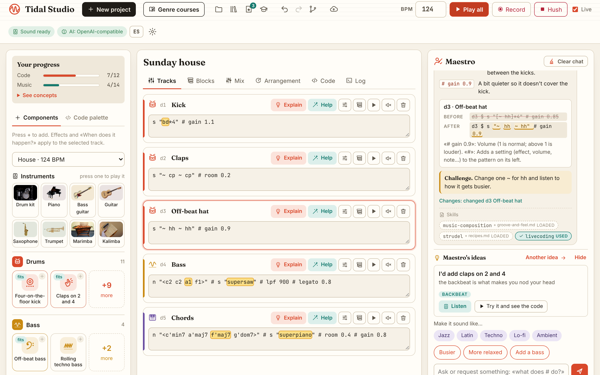 |  |

| …and in the Code tab | Mix tab: volume, 3-band EQ, mute and solo per track, plus Master |
|---|---|
|  | 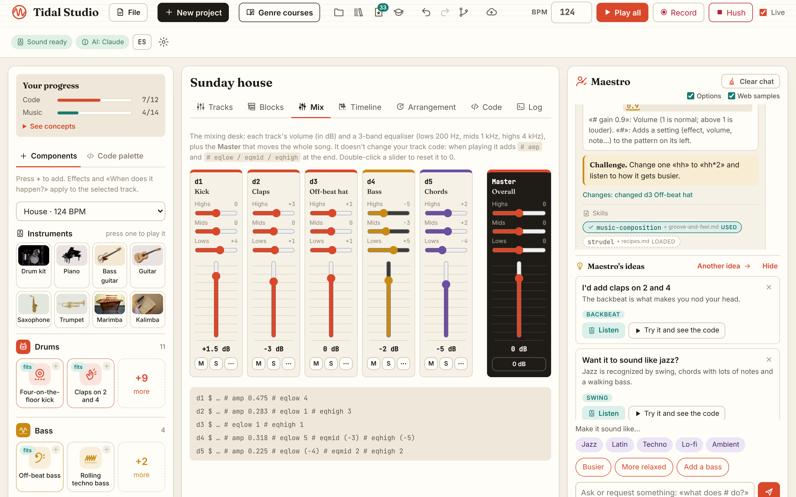 |

| «Hide» Maestro's ideas for a bigger chat | «Clear chat»: the song stays, the chat can come back |
|---|---|
|  |  |

### Maestro's skills

| Under every answer: which skills were loaded and which Maestro used | The Skills panel: turn on, always load, view, install from GitHub |
|---|---|
|  | 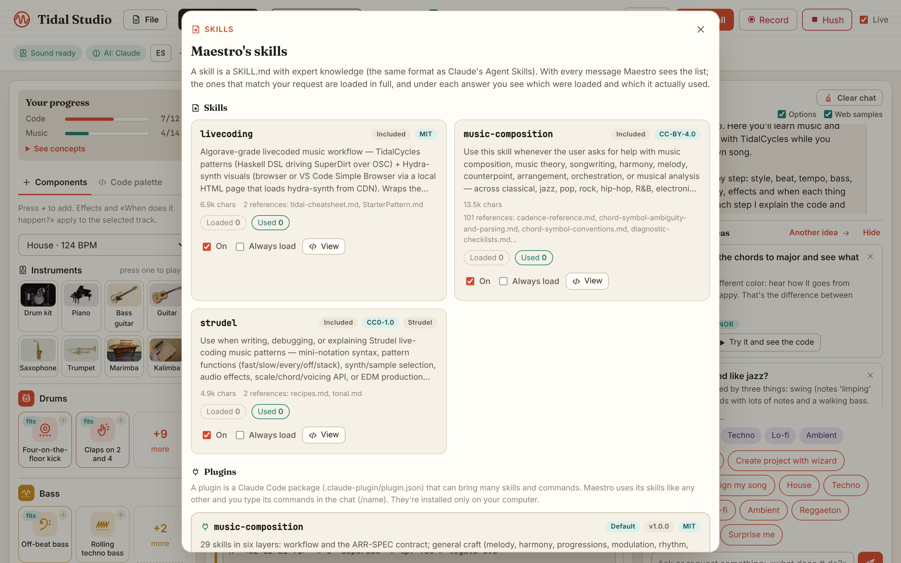 |

**Plugins**: install a Claude Code plugin or marketplace by pasting its GitHub link; its skills join Maestro's and its commands work in the chat (`/name`).


### Genre courses

| Pick a genre | Each step: why it sounds like that, the code, and Maestro explaining |
|---|---|
|  |  |

| Arrangement step: intro, band, mambo | Mix step and course complete |
|---|---|
| 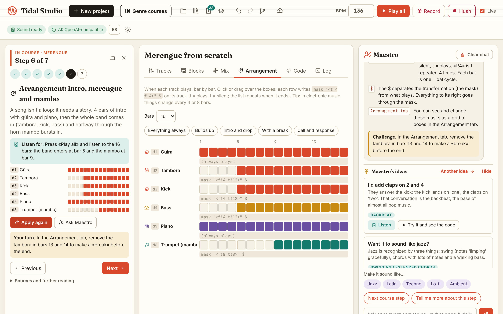 | 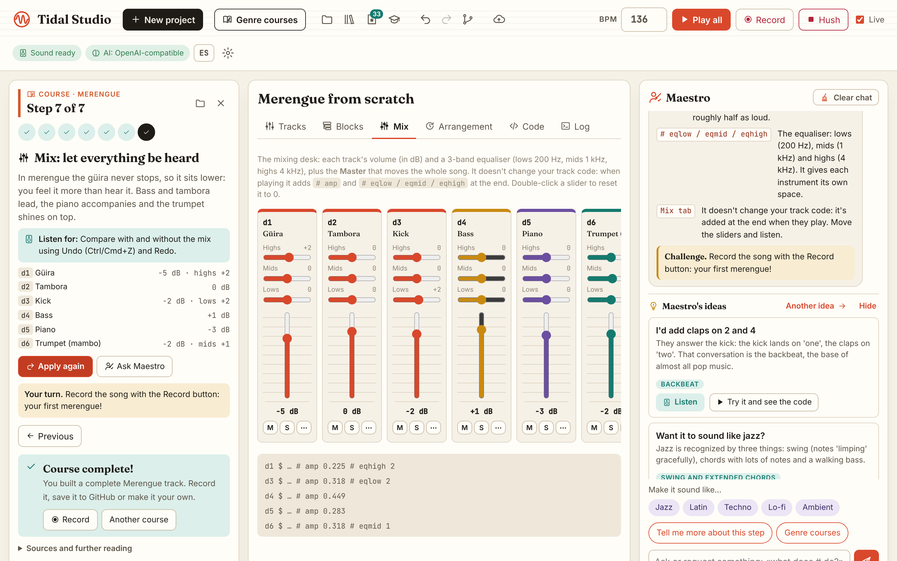 |

| New project: blank, wizard or brainstorm | Style recipe «like jazz»: before and after, explained |
|---|---|
|  |  |

### Base-project wizard, step by step

Click options and hear the result live. The ones recommended for your style are marked «fits».

| 1. Style | 2. Tempo |
|---|---|
|  |  |
| **3. Beat (up to 3 layers)** | **4. Bass, chords, melody and texture** |
|  |  |
| **5. Effects** | **6. Structure over time** |
| 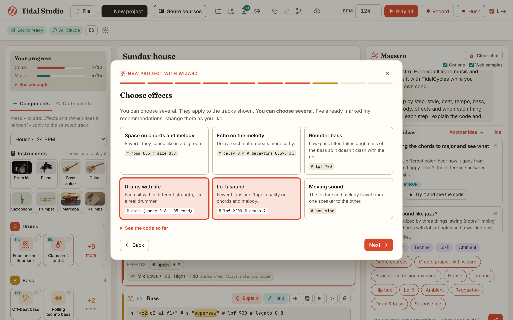 | 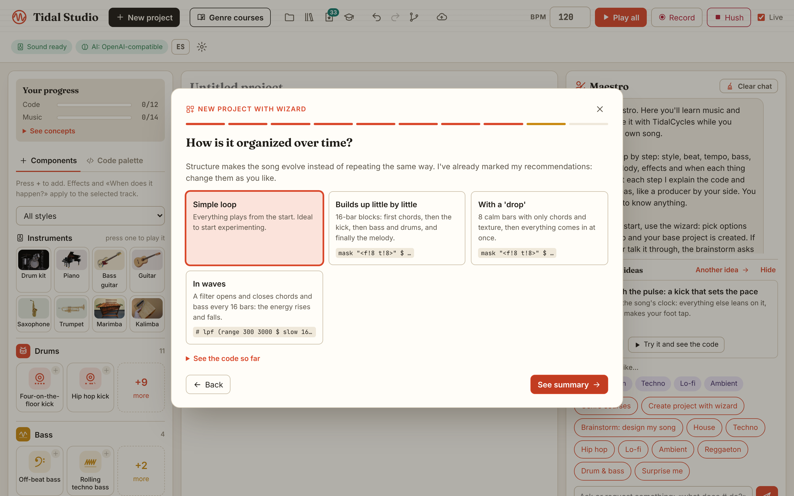 |
| **7. Summary with all the code explained** | |
|  | |

### Help with your code and code palette

| Help: Maestro finds the problem and proposes the fix | Code palette by goal and level |
|---|---|
| 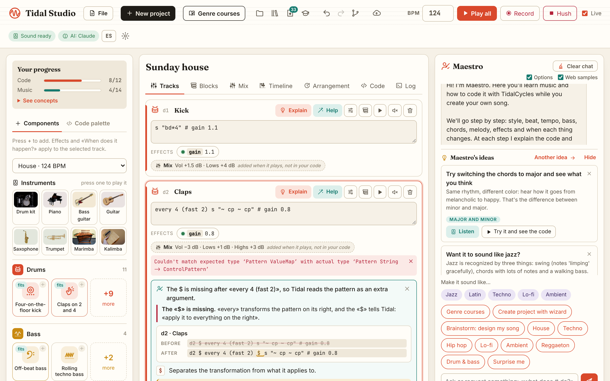 | 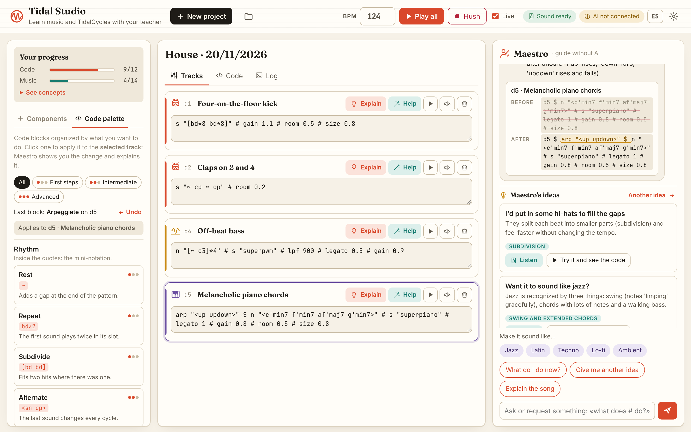 |

### Edit from the blocks, configurator card, mixer and history

| Click a block: tooltip to edit it | Configurator card in Maestro's chat |
|---|---|
| 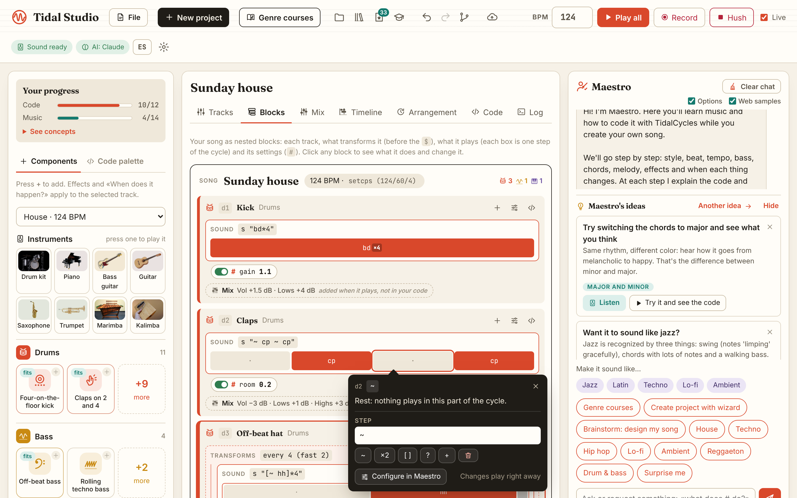 | 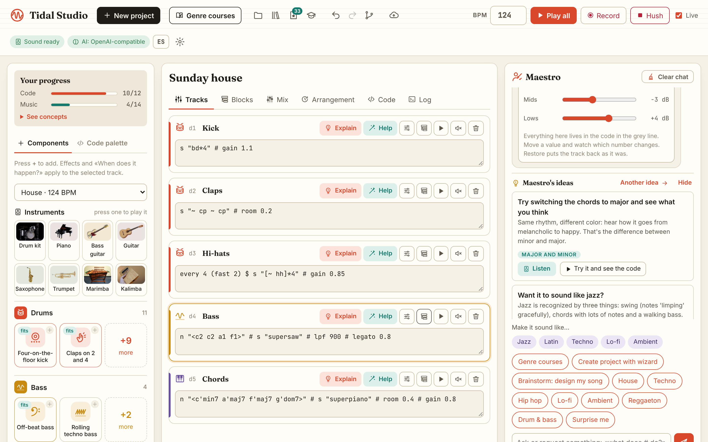 |

| Song history (rollback) | |
|---|---|
| 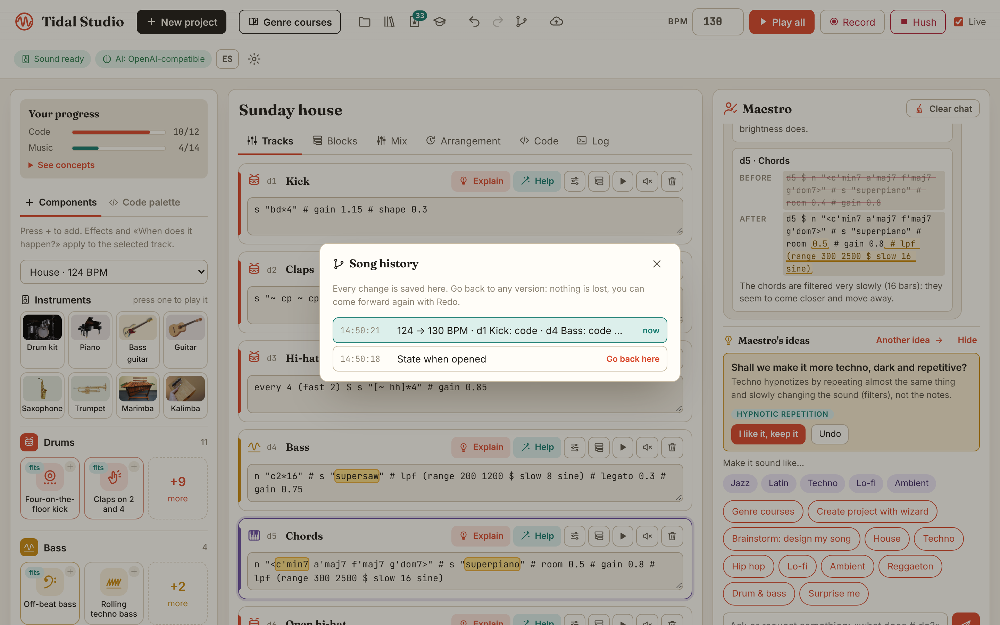 | |

### Blocks view and sample library

| Your song as nested blocks | Sample library by type |
|---|---|
| 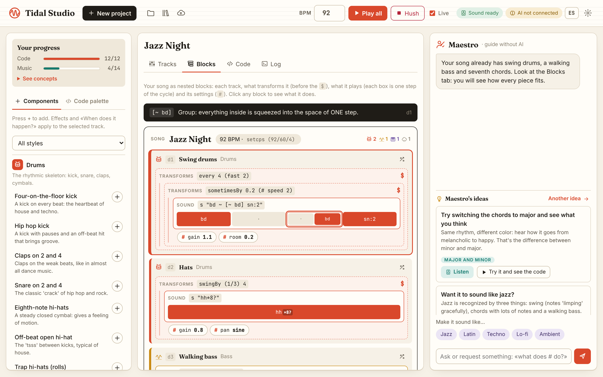 | 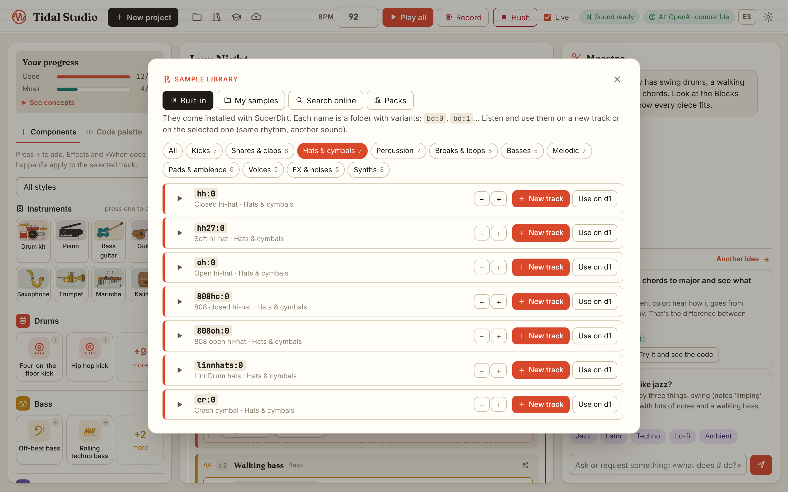 |

| Controls in the chat | Online packs: whole drum machines |
|---|---|
|  |  |

| Drum kit: press a piece, learn its name | Instruments with a keyboard |
|---|---|
|  |  |

| Interactive tutorial | |
|---|---|
|  | |

| Arrangement: paint the bars, or use a preset | Waveform and trimming |
|---|---|
|  | 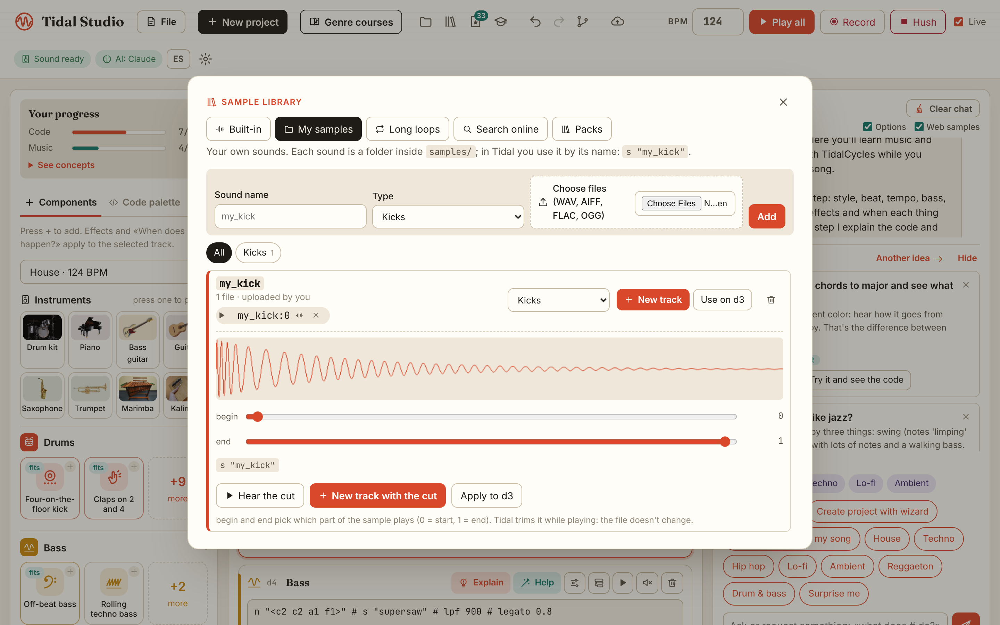 |

| Search Freesound by license | GitHub: every save is a version |
|---|---|
|  |  |

### Brainstorm

| Questions with examples | Your song plan |
|---|---|
|  | 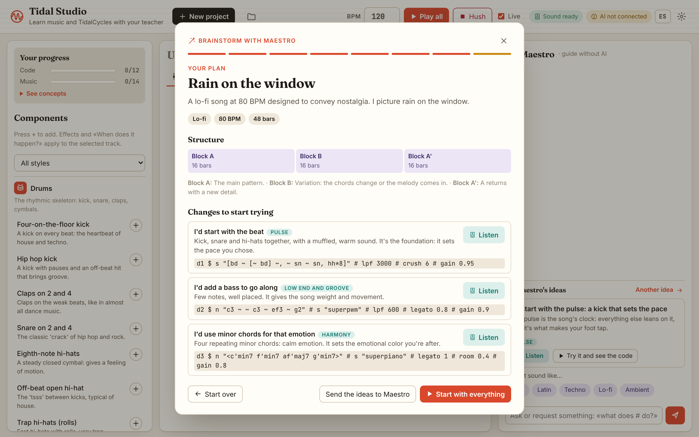 |

## Installation (once)

### Easiest: the all-in-one Mac installer

Download `TidalStudio-…-macOS-AppleSilicon.pkg` from the
[latest release](https://github.com/vsalesa/tidal-studio/releases/latest) and double-click it. It contains
everything (TidalCycles with its own Haskell, SuperCollider, SuperDirt and its sounds, Python) and **downloads nothing**
while installing. Then open **Tidal Studio** from Applications.

It is not signed with an Apple Developer ID yet, so the first time macOS blocks it: open
**System Settings → Privacy & Security**, press **Open Anyway** and run the `.pkg` again.
It installs the engine in `/Users/Shared/TidalStudio` (about 3 GB) and leaves any SuperCollider, Haskell or Python you
already have untouched. How it is built: [packaging/README.md](packaging/README.md).

### From the source folder (Windows, Linux, or Mac)

Download or clone this folder and:

| System | What to do |
|---|---|
| **Windows 10/11** | Double-click `install.bat` |
| **macOS** | Open Terminal in the folder and run `./install.sh` |
| **Linux** (Debian/Ubuntu, Fedora, Arch, openSUSE) | `./install.sh` |

The installer speaks English or Spanish depending on your system language (force it with `./install.sh --lang en` or
`install.ps1 -Lang es`). It adds, if missing: Python 3, Git, SuperCollider, SuperDirt (sounds), Haskell (via ghcup) and TidalCycles.
It takes 15–40 minutes the first time (~1 GB download). You can run it again safely: it skips what's already there.

## Usage

| System | Open the studio |
|---|---|
| Windows | Double-click `start.bat` |
| macOS / Linux | `./start.sh` |

Your browser opens at <http://localhost:8765>. Then:

1. Press **New project** and choose blank, wizard or brainstorm.
2. Optionally open **Settings** (gear icon) and connect your AI; without it, the button guide still works.
3. Talk to **Maestro** on the right, try its ideas, or add components from the left.
4. See and edit the code in the **Code** tab (`Ctrl+Enter` applies it).
5. **Hush** stops everything instantly.

### Setting up the AI

| Service | Base URL | Example model |
|---|---|---|
| OpenAI | `https://api.openai.com/v1` | `gpt-4o-mini` |
| OpenRouter | `https://openrouter.ai/api/v1` | `openai/gpt-4o-mini` |
| Groq | `https://api.groq.com/openai/v1` | `llama-3.3-70b-versatile` |
| Ollama (local, free) | `http://localhost:11434/v1` | `llama3.1` |
| LM Studio (local, free) | `http://localhost:1234/v1` | whichever you have loaded |
| Claude (Anthropic API key) | — | `claude-opus-5-5` |
| **Claude with your subscription** (Claude Code, Pro/Max) | — | your plan's default |

**No API key? Use your Claude subscription:** install [Claude Code](https://claude.com/claude-code), run `claude` once in a
terminal and sign in with your Pro or Max plan, then choose «Claude with your subscription» in Settings. Maestro talks to
Claude through the `claude` command on your computer. It counts towards your plan's usage limits and answers a bit
slower than the API (about 10–20 s).

Keys are stored only in `config.json`, on your computer (it is not committed to git). You can also use the
`OPENAI_API_KEY` or `ANTHROPIC_API_KEY` environment variables.

### Skills

Maestro can load **skills** (folders with a `SKILL.md`, the same format as Claude's Agent Skills). Three open-license
music skills come included (Tidal live coding, Strudel recipes and general music composition); open the skills button in the top bar to turn them on or off, mark one «Always load», read it,
or install another one by pasting its GitHub link. Under each of Maestro's answers you see which skills were loaded for
that message and which it actually used. Details and sources: [skills/README.md](skills/README.md).

### Plugins

The same box also installs **Claude Code plugins** (a repo with `.claude-plugin/plugin.json`) and **marketplaces**
(`.claude-plugin/marketplace.json`, which lists several plugins: you pick which ones). Paste the repository link, for
example `https://github.com/jtydhr88/music-composition-skills`. Tidal Studio downloads it with `git` (or GitHub's
`.tar.gz` if you don't have git), copies **only text files** into `my-plugins/<plugin>/` on your computer (never into
this repository) and then:

- its **skills** are used by Maestro like any other (they appear grouped under the plugin in the panel);
- its **commands** (`commands/*.md`) can be typed in Maestro's chat: `/name` or `/plugin:name`, with arguments;
- agents, hooks, MCP and LSP servers are for Claude Code: they are listed but not used.

Each plugin can be turned off (its skills and commands disappear) or removed. Check its license and any `NOTICE` before
sharing its content.

### Samples

Your sounds live in `samples/<name>/` (each folder is a Tidal sound: `s "name"`, `s "name:1"` for the second file).
SuperDirt loads them on start and reloads them when you add or delete something. For Freesound, get a free API key at
[freesound.org/apiv2/apply](https://freesound.org/apiv2/apply) and paste it in the library (Search online tab). Tidal
Studio downloads Freesound's high-quality OGG preview, which SuperCollider reads directly.

Optional drum machines: `git clone https://github.com/geikha/tidal-drum-machines samples/packs/tidal-drum-machines`
(loaded automatically on the next start).

### GitHub

Open ⚙ Settings → GitHub. Create a **fine-grained token** on GitHub (Settings → Developer settings → Personal access
tokens) with access to your songs repository and the permission **Contents: Read and write**. Type the repository as
`user/name`; if it doesn't exist yet, «Create private repository» makes it (that needs a token with permission to create
repositories). Then use the cloud button in the top bar to save a version with a message. The token is stored only in
`config.json`.

## How it works

```
 Browser (web/)  ──HTTP──▶  server/app.py  ──stdin──▶  GHCi + TidalCycles ──OSC──▶ SuperCollider + SuperDirt ──▶ speakers
     │                          │
     └── chat ─────────────────▶ server/llm.py ──▶ OpenAI-compatible / Claude
```

- `server/app.py`: local server (Python standard library only, no `pip install`). Listens only on `127.0.0.1`.
- `server/engine.py`: finds and starts `sclang` (with `supercollider/start_superdirt.scd`) and `ghci` (with `tidal/BootTidal.hs`).
  If something is missing it runs in **simulation mode**: the interface works but there is no sound.
- `server/assistant.py`: Maestro's instructions and parsing of its replies (JSON with message, options and track changes).
- `web/catalog.js`: the component catalog. Adding one means adding an object to the list.
- `web/builder.js`: the base-project wizard. `web/wizard.js`: brainstorm questions and offline plan.
- `web/explain.js`: offline code explainer. `web/suggest.js`: offline producer ideas and progress concepts.
- `web/flavors.js`: style recipes (jazz, Latin, techno, lo-fi, ambient).
- `web/doctor.js`: offline code checks and fixes for the Help panel (`/api/fix` with AI). `web/palette.js`: code palette blocks.
- `web/controls.js`: controls in the chat (agentic UI). `web/blocks.js` + `web/edit.js`: blocks view and its editing. `web/card.js`: configurator card. `web/mixer.js`: mix tab. `web/history.js`: undo and history. `web/samples.js` + `server/samples.py`: sample library and Freesound. `server/github.py`: GitHub versions.
- `server/plugins.py`: Claude Code plugins and marketplaces (`my-plugins/`): download, manifests, skills and `/commands`.
- `server/skills.py` + `web/skills.js`: Maestro's skills (`skills/` included, `my-skills/` yours): choosing which to load, install from GitHub, the panel and the chips in the chat.
- `web/i18n.js`: language switch. `web/icons.js`: custom SVG icons. `web/style.css`: light «Partitura» theme.

Each track is a Tidal `dN` (d1…d12) with its own effects channel (orbit).

## Troubleshooting

- **No sound**: check the **Log** tab. Run `python3 server/app.py --check` to see what's missing.
- **Linux without sound**: SuperCollider uses JACK. With PipeWire it starts with `pw-jack`; with classic JACK, start it first.
- **macOS asks for microphone permission** for SuperCollider: accept it (it needs it to open audio).
- **Windows: "Haskell se está terminando de instalar en otra ventana"** (Haskell is finishing installing in another window): wait until it finishes and run `install.bat` again.
- **Port in use**: `./start.sh --port 9000`.

## Server options

```
python3 server/app.py [--port 8765] [--no-browser] [--no-engine] [--check]
```
