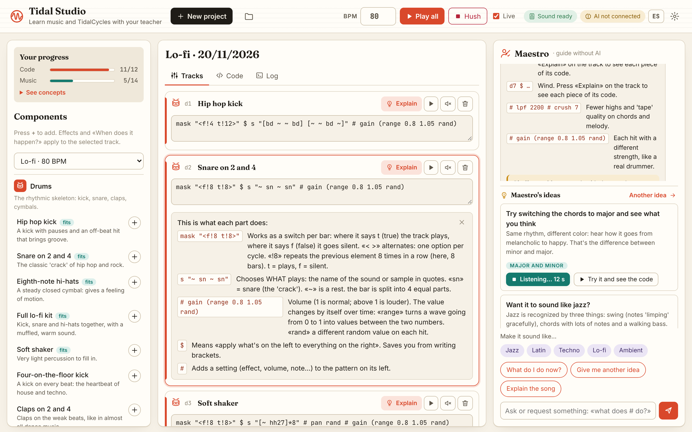
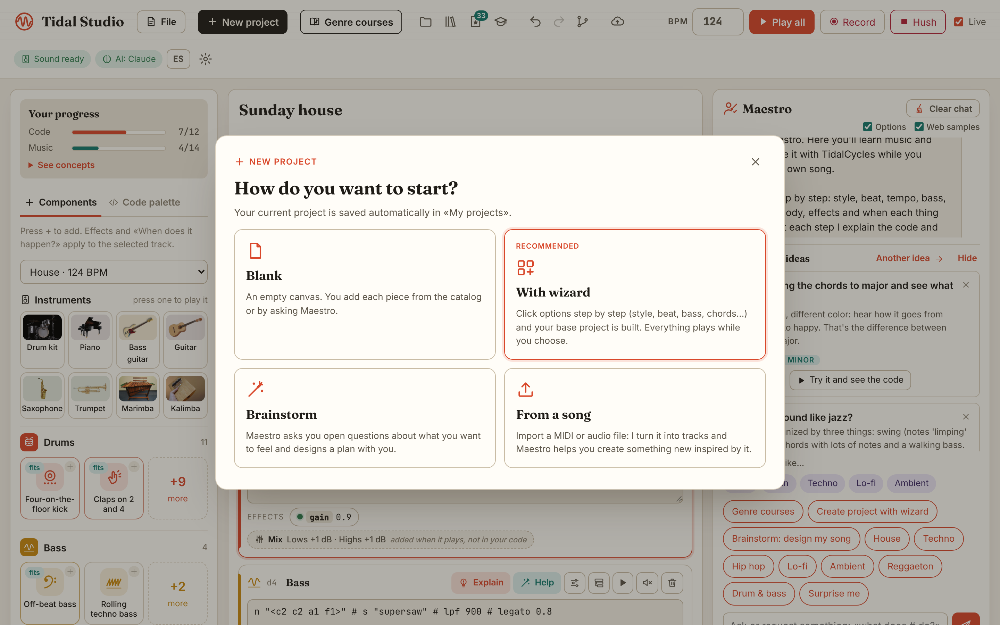
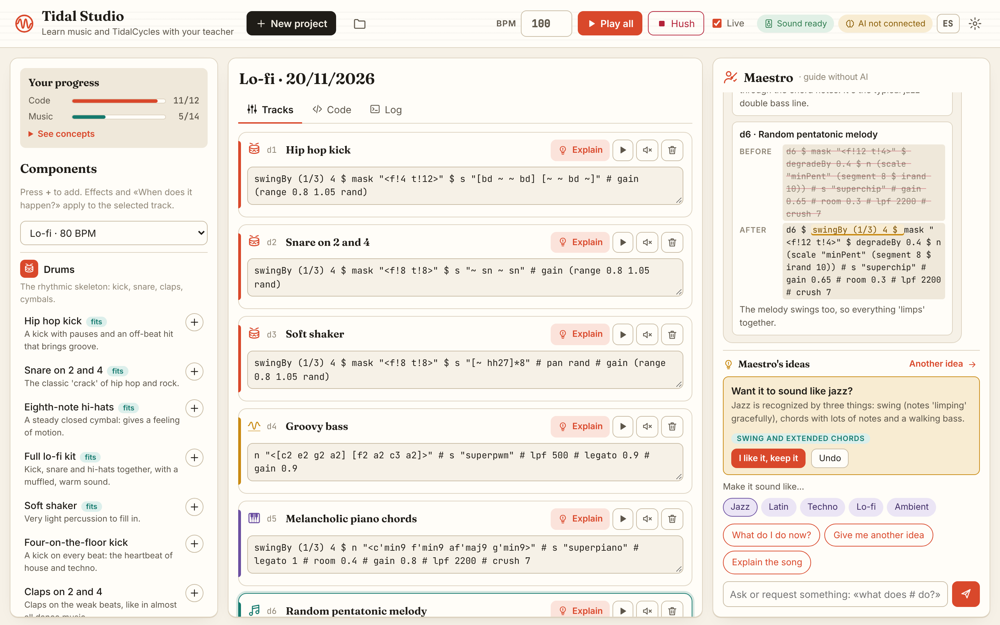
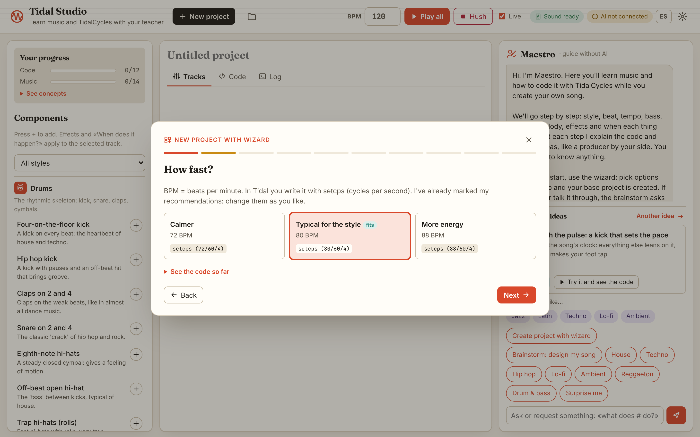
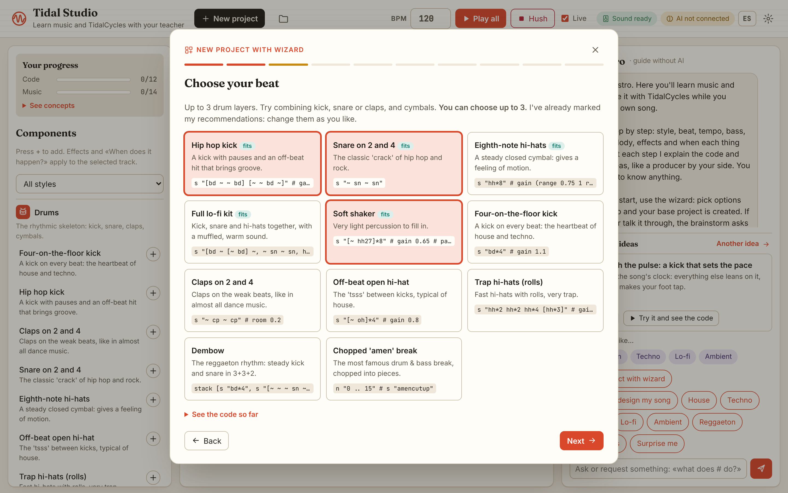
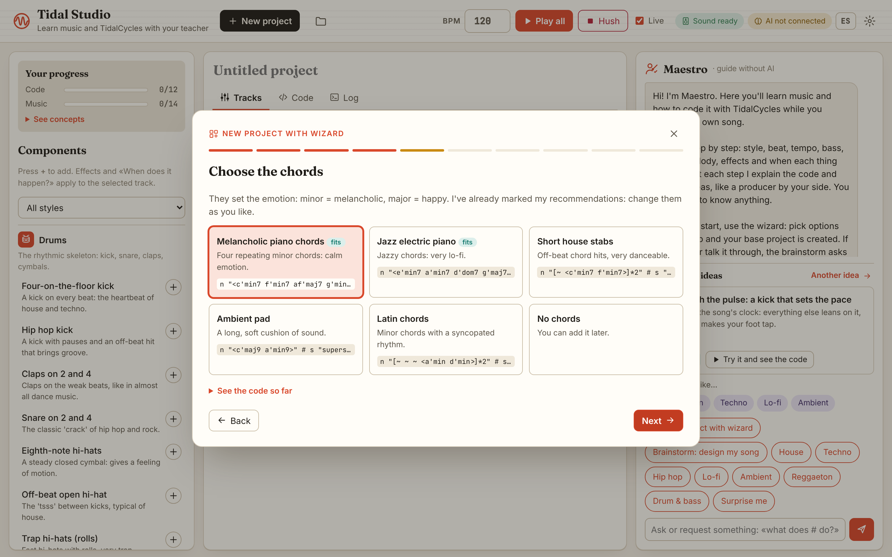
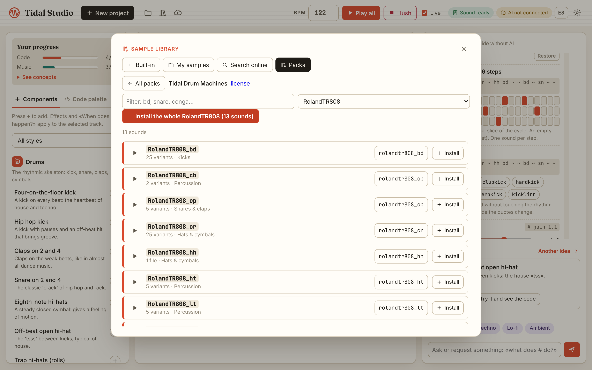
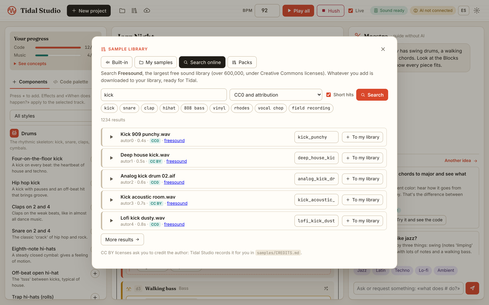

# Tidal Studio · learn music with your teacher

**English** · [Español](README.es.md) · [Website](https://vsalesa.github.io/tidal-studio/) · [Roadmap](ROADMAP.md)

A platform to **learn music and [TidalCycles](https://tidalcycles.org) at the same time**, building your own song live
with an AI teacher ("Maestro") who supports you at every step, even if you know nothing about music or programming.



- **Maestro guides you** step by step: style, beat, tempo, bass, chords, melody, effects, and when each thing changes.
- **It explains the code**: an «Explain» button on every track and «Explain all the code». Every change comes with a
  piece-by-piece explanation and, sometimes, a small **challenge** so you edit it yourself.
- **It suggests ideas like a producer**: «I'd add claps on 2 and 4… try it and see what you think». Each idea teaches a
  musical concept (backbeat, contrast, call and response, major and minor…). Press **Try**, listen and decide:
  **Keep it** or **Undo**.
- **Pre-listen**: a «Listen» button on every idea and recipe plays it for a few bars and then returns to your version.
- **New project: blank, with a wizard or with a brainstorm.** The wizard lets you pick style, tempo, beat, bass, chords,
  melody, texture, effects and structure by clicking options (recommended ones are marked) and you hear it live while you choose.
- **Brainstorm**: open questions (what do you want to feel? what place do you imagine? how does the energy change?…)
  with clickable examples, ending in a **plan for your song**: style, tempo, sections and concrete changes to try.
- **Style recipes**: «Want it to sound like jazz?» (also Latin, techno, lo-fi, ambient). It transforms your song and
  shows you **how it did it**: the code before and after, with what's new highlighted and explained.
- **Help with your own code**: edited a track and it errors or doesn't sound how you wanted? Press **Help** (it also
  opens by itself when Tidal returns an error). Pick what you wanted (no sound, louder, slower, darker…) or describe it,
  and Maestro finds the problem (missing `$`, unclosed quotes or brackets, misspelled sounds or effects, things that make it
  silent), proposes the fix with before/after, lets you **Listen** before applying, and can go **back to the version that worked**.
- **Code palette**: 39 Tidal blocks organized by what you want to do (rhythm, sound, notes and harmony, effects, time and
  structure, chance) and by level (first steps, intermediate, advanced). Click one to apply it to the selected track;
  Maestro shows and explains the change, and you can undo it.
- **Blocks view**: your song as nested visual blocks. Each track shows what transforms it (before the `$`), what it plays
  (every step of the cycle as a box, with groups `[ ]`, alternations `< >`, rests `~` and repeats `*`) and its settings
  (`#`). Click any block and Maestro tells you what it does.
- **Sample library**: sounds by type (kicks, snares, hats, percussion, breaks, basses, melodic, pads, voices, FX, synths).
  Listen to them, use one on a new track, or put it on the selected track keeping the same rhythm. Upload your own files
  (WAV, AIFF, FLAC, OGG) or **search Freesound** (free API key) filtering by license; downloads are ready for Tidal and
  credits for CC BY sounds are written to `samples/CREDITS.md`. The **Packs** tab browses community packs on GitHub
  (about 70 drum machines, Uzu drumkit, VCSL, a grand piano, SP-12, mridangam, or any `github:user/repo` with a
  `strudel.json`): listen, install one sound or a whole drum machine. Maestro knows your library and can use it.
- **Controls in the chat (agentic UI)**: Maestro puts sliders, a tempo control, a sound selector and a step sequencer
  right inside its messages. Moving them writes the Tidal code live, so you see which word changes. Use the sliders button
  on any track, the «Tweak with controls» chip, or just ask for controls.
- **GitHub**: save each version of your song as a commit in a repository of yours (`song.tidal`, `song.json`, `README.md`),
  browse the history and open any old version from My projects → GitHub.
- **Your progress**: the code and music concepts you have already used.
- **My projects**: your songs are saved automatically; open or delete them from the folder button.
- **Components to add** and **code always visible and editable**.
- **English and Spanish**: switch with the EN/ES button in the top bar. Maestro answers in the chosen language.
- **Any AI**: an OpenAI-compatible endpoint (OpenAI, OpenRouter, Groq, DeepSeek, Mistral, Ollama, LM Studio…)
  or Claude (Anthropic). It also works without AI: button-guided flow, explanations and local ideas.
- **macOS, Windows and Linux**: the installer detects your system.

## Screenshots

| New project: blank, wizard or brainstorm | Style recipe «like jazz»: before and after, explained |
|---|---|
|  |  |

### Base-project wizard, step by step

Click options and hear the result live. The ones recommended for your style are marked «fits».

| 1. Style | 2. Tempo |
|---|---|
|  |  |
| **3. Beat (up to 3 layers)** | **4. Bass, chords, melody and texture** |
|  |  |
| **5. Effects** | **6. Structure over time** |
|  |  |
| **7. Summary with all the code explained** | |
|  | |

### Help with your code and code palette

| Help: Maestro finds the problem and proposes the fix | Code palette by goal and level |
|---|---|
|  |  |

### Blocks view and sample library

| Your song as nested blocks | Sample library by type |
|---|---|
|  |  |

| Controls in the chat | Online packs: whole drum machines |
|---|---|
|  |  |

| Search Freesound by license | GitHub: every save is a version |
|---|---|
|  |  |

### Brainstorm

| Questions with examples | Your song plan |
|---|---|
|  |  |

## Installation (once)

Download or clone this folder and:

| System | What to do |
|---|---|
| **Windows 10/11** | Double-click `install.bat` |
| **macOS** | Open Terminal in the folder and run `./install.sh` |
| **Linux** (Debian/Ubuntu, Fedora, Arch, openSUSE) | `./install.sh` |

The installer adds, if missing: Python 3, Git, SuperCollider, SuperDirt (sounds), Haskell (via ghcup) and TidalCycles.
It takes 15–40 minutes the first time (~1 GB download). You can run it again safely: it skips what's already there.

## Usage

| System | Open the studio |
|---|---|
| Windows | Double-click `start.bat` |
| macOS / Linux | `./start.sh` |

Your browser opens at <http://localhost:8765>. Then:

1. Press **New project** and choose blank, wizard or brainstorm.
2. Optionally open **Settings** (gear icon) and connect your AI; without it, the button guide still works.
3. Talk to **Maestro** on the right, try its ideas, or add components from the left.
4. See and edit the code in the **Code** tab (`Ctrl+Enter` applies it).
5. **Hush** stops everything instantly.

### Setting up the AI

| Service | Base URL | Example model |
|---|---|---|
| OpenAI | `https://api.openai.com/v1` | `gpt-4o-mini` |
| OpenRouter | `https://openrouter.ai/api/v1` | `openai/gpt-4o-mini` |
| Groq | `https://api.groq.com/openai/v1` | `llama-3.3-70b-versatile` |
| Ollama (local, free) | `http://localhost:11434/v1` | `llama3.1` |
| LM Studio (local, free) | `http://localhost:1234/v1` | whichever you have loaded |
| Claude (Anthropic) | — | `claude-opus-5-5` |

Keys are stored only in `config.json`, on your computer (it is not committed to git). You can also use the
`OPENAI_API_KEY` or `ANTHROPIC_API_KEY` environment variables.

### Samples

Your sounds live in `samples/<name>/` (each folder is a Tidal sound: `s "name"`, `s "name:1"` for the second file).
SuperDirt loads them on start and reloads them when you add or delete something. For Freesound, get a free API key at
[freesound.org/apiv2/apply](https://freesound.org/apiv2/apply) and paste it in the library (Search online tab). Tidal
Studio downloads Freesound's high-quality OGG preview, which SuperCollider reads directly.

Optional drum machines: `git clone https://github.com/geikha/tidal-drum-machines samples/packs/tidal-drum-machines`
(loaded automatically on the next start).

### GitHub

Open ⚙ Settings → GitHub. Create a **fine-grained token** on GitHub (Settings → Developer settings → Personal access
tokens) with access to your songs repository and the permission **Contents: Read and write**. Type the repository as
`user/name`; if it doesn't exist yet, «Create private repository» makes it (that needs a token with permission to create
repositories). Then use the cloud button in the top bar to save a version with a message. The token is stored only in
`config.json`.

## How it works

```
 Browser (web/)  ──HTTP──▶  server/app.py  ──stdin──▶  GHCi + TidalCycles ──OSC──▶ SuperCollider + SuperDirt ──▶ speakers
     │                          │
     └── chat ─────────────────▶ server/llm.py ──▶ OpenAI-compatible / Claude
```

- `server/app.py`: local server (Python standard library only, no `pip install`). Listens only on `127.0.0.1`.
- `server/engine.py`: finds and starts `sclang` (with `supercollider/start_superdirt.scd`) and `ghci` (with `tidal/BootTidal.hs`).
  If something is missing it runs in **simulation mode**: the interface works but there is no sound.
- `server/assistant.py`: Maestro's instructions and parsing of its replies (JSON with message, options and track changes).
- `web/catalog.js`: the component catalog. Adding one means adding an object to the list.
- `web/builder.js`: the base-project wizard. `web/wizard.js`: brainstorm questions and offline plan.
- `web/explain.js`: offline code explainer. `web/suggest.js`: offline producer ideas and progress concepts.
- `web/flavors.js`: style recipes (jazz, Latin, techno, lo-fi, ambient).
- `web/doctor.js`: offline code checks and fixes for the Help panel (`/api/fix` with AI). `web/palette.js`: code palette blocks.
- `web/controls.js`: controls in the chat (agentic UI). `web/blocks.js`: blocks view. `web/samples.js` + `server/samples.py`: sample library and Freesound. `server/github.py`: GitHub versions.
- `web/i18n.js`: language switch. `web/icons.js`: custom SVG icons. `web/style.css`: light «Partitura» theme.

Each track is a Tidal `dN` (d1…d12) with its own effects channel (orbit).

## Troubleshooting

- **No sound**: check the **Log** tab. Run `python3 server/app.py --check` to see what's missing.
- **Linux without sound**: SuperCollider uses JACK. With PipeWire it starts with `pw-jack`; with classic JACK, start it first.
- **macOS asks for microphone permission** for SuperCollider: accept it (it needs it to open audio).
- **Windows: "Haskell se está terminando de instalar en otra ventana"** (Haskell is finishing installing in another window): wait until it finishes and run `install.bat` again.
- **Port in use**: `./start.sh --port 9000`.

## Server options

```
python3 server/app.py [--port 8765] [--no-browser] [--no-engine] [--check]
```
