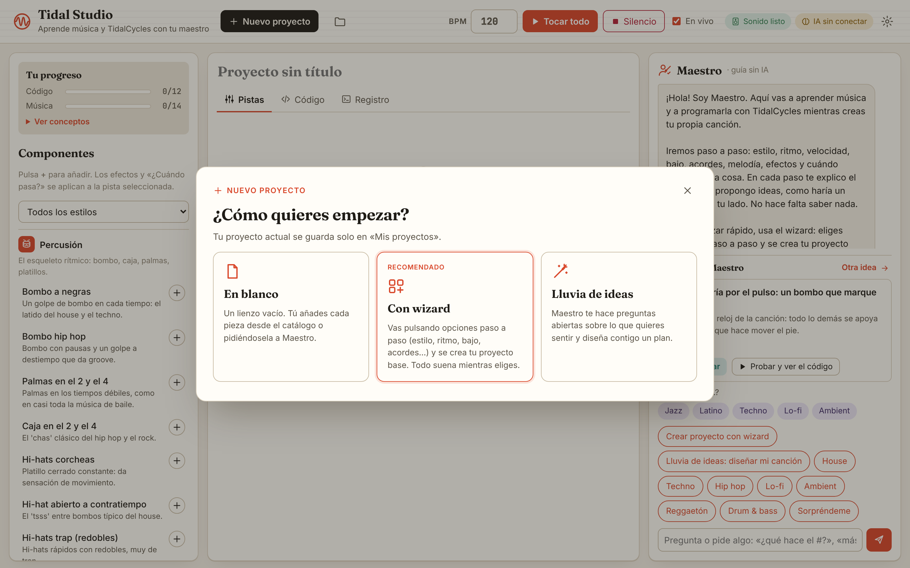
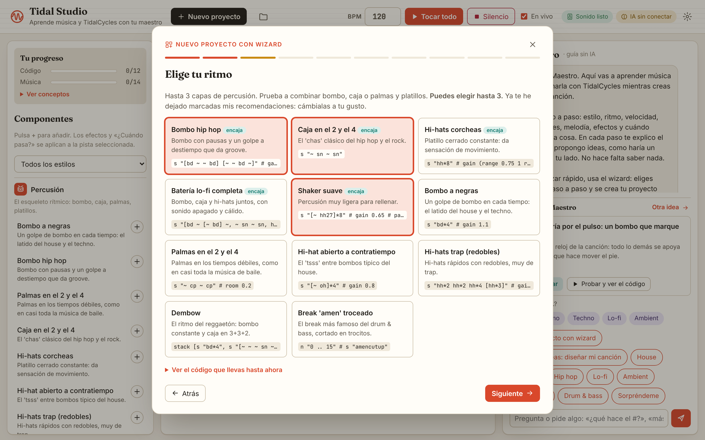
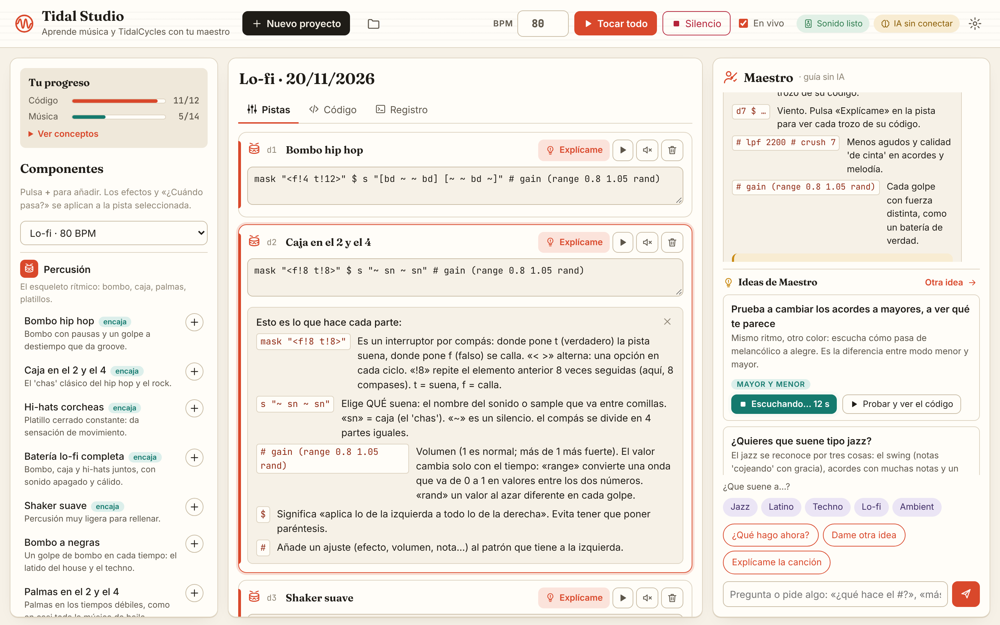
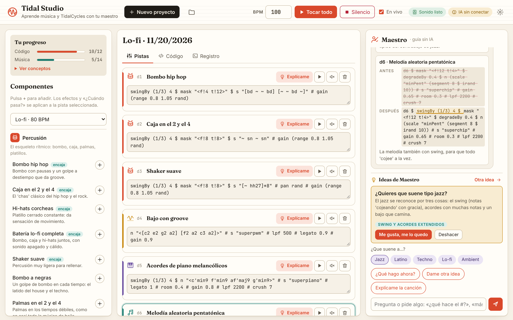
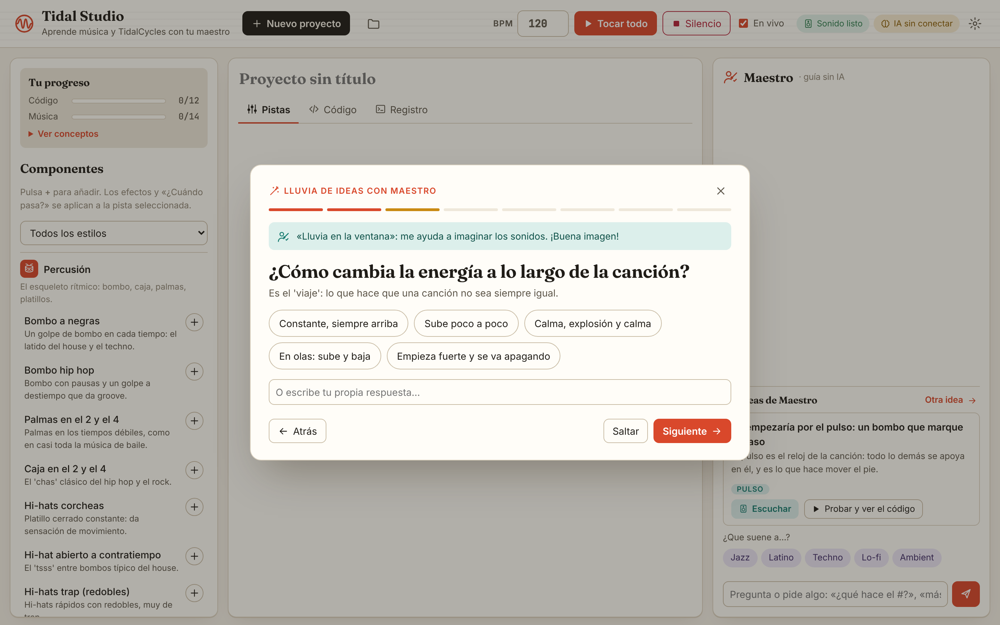
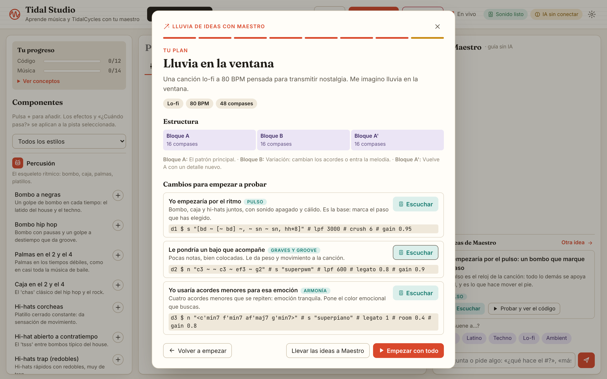

# Tidal Studio · aprende música con tu maestro

Plataforma para **aprender música y [TidalCycles](https://tidalcycles.org) a la vez**, creando tu propia canción
en vivo con un profesor de IA ("Maestro") que te acompaña en cada paso, aunque no sepas nada de música ni de programación.

- **Maestro te guía** paso a paso: estilo → ritmo → velocidad → bajo → acordes → melodía → efectos → cuándo cambia cada cosa.
- **Te explica el código**: botón «Explícame» en cada pista y «Explícame todo el código»; cada cambio llega con su
  explicación trozo a trozo y, a veces, un pequeño **reto** para que edites tú.
- **Te sugiere ideas como un productor**: «Yo le añadiría palmas en el 2 y el 4… pruébalo a ver qué te parece».
  Cada idea enseña un concepto musical (backbeat, contraste, pregunta y respuesta, mayor y menor…). Pulsas **Probar**,
  escuchas y decides: **Me lo quedo** o **Deshacer**.
- **Lluvia de ideas**: un wizard te hace preguntas abiertas (¿qué quieres sentir?, ¿qué lugar imaginas?, ¿cómo cambia la
  energía?…) con ejemplos para pulsar, y al final diseña contigo el **plan de tu canción**: estilo, tempo, estructura por
  partes y cambios concretos para empezar a probar.
- **Recetas de estilo**: «¿Quieres que suene tipo jazz?» (también latino, techno, lo-fi, ambient). Transforma tu canción y
  te enseña **cómo lo ha hecho**: el código de antes y de después con lo nuevo resaltado y explicado, para que aprendas a
  hacerlo tú solo.
- **Nuevo proyecto en blanco o con wizard**: eliges estilo, tempo, ritmo, bajo, acordes, melodía, textura, efectos y
  estructura pulsando opciones (las recomendadas vienen marcadas) y lo oyes en vivo mientras eliges.
- **Pre-escucha**: botón «Escuchar» en cada idea o receta: suena unos compases y vuelve sola a tu versión.
- **Mis proyectos**: tus canciones se guardan solas y puedes abrirlas o borrarlas desde la carpeta.
- **Tu progreso**: conceptos de código y de música que ya has usado.
- **Componentes para añadir** y **código siempre visible y editable**.
- **Cualquier IA**: endpoint compatible con OpenAI (OpenAI, OpenRouter, Groq, DeepSeek, Mistral, Ollama, LM Studio…)
  o Claude (Anthropic). Sin IA también funciona: guía con botones, explicaciones e ideas locales.
- **macOS, Windows y Linux**: el instalador detecta tu sistema.

## Capturas

| Nuevo proyecto | Wizard de proyecto base |
|---|---|
|  |  |
| **El estudio: pistas, «Explícame» e ideas con pre-escucha** | **Receta «tipo jazz»: antes y después, explicado** |
|  |  |
| **Lluvia de ideas: preguntas con ejemplos** | **El plan de tu canción** |
|  |  |

## Instalación (una sola vez)

Descarga o clona esta carpeta y:

| Sistema | Qué hacer |
|---|---|
| **Windows 10/11** | Doble clic en `install.bat` |
| **macOS** | Abre Terminal en la carpeta y ejecuta `./install.sh` |
| **Linux** (Debian/Ubuntu, Fedora, Arch, openSUSE) | `./install.sh` |

El instalador pone, si faltan: Python 3, Git, SuperCollider, SuperDirt (sonidos), Haskell (vía ghcup) y TidalCycles.
Tarda 15–40 minutos la primera vez (descarga ~1 GB). Puedes ejecutarlo otra vez sin miedo: se salta lo que ya está.

## Uso

| Sistema | Abrir el estudio |
|---|---|
| Windows | Doble clic en `start.bat` |
| macOS / Linux | `./start.sh` |

Se abre el navegador en <http://localhost:8765>. Después:

1. Pulsa **⚙️** y conecta tu IA (o sigue sin IA con la guía de botones).
2. Habla con **Maestro** a la derecha, o añade componentes desde la izquierda.
3. Mira y edita el código en la pestaña **⌨️ Código** (`Ctrl+Enter` aplica).
4. **■ Silencio** para parar todo al instante.

### Configurar la IA

| Servicio | URL base | Modelo de ejemplo |
|---|---|---|
| OpenAI | `https://api.openai.com/v1` | `gpt-4o-mini` |
| OpenRouter | `https://openrouter.ai/api/v1` | `openai/gpt-4o-mini` |
| Groq | `https://api.groq.com/openai/v1` | `llama-3.3-70b-versatile` |
| Ollama (local, gratis) | `http://localhost:11434/v1` | `llama3.1` |
| LM Studio (local, gratis) | `http://localhost:1234/v1` | el que tengas cargado |
| Claude (Anthropic) | — | `claude-opus-5-5` |

Las claves se guardan solo en `config.json`, en tu ordenador (no se sube a git). También puedes usar las variables
de entorno `OPENAI_API_KEY` o `ANTHROPIC_API_KEY`.

## Cómo funciona

```
 Navegador (web/)  ──HTTP──▶  server/app.py  ──stdin──▶  GHCi + TidalCycles ──OSC──▶ SuperCollider + SuperDirt ──▶ 🔊
     │                            │
     └── chat ───────────────────▶ server/llm.py ──▶ OpenAI-compatible / Claude
```

- `server/app.py`: servidor local (solo biblioteca estándar de Python, sin `pip install`). Escucha solo en `127.0.0.1`.
- `server/engine.py`: busca y arranca `sclang` (con `supercollider/start_superdirt.scd`) y `ghci` (con `tidal/BootTidal.hs`).
  Si falta algo, trabaja en **modo simulación**: la interfaz funciona pero no suena.
- `server/assistant.py`: las instrucciones de "Maestro" y la lectura de sus respuestas (JSON con mensaje, opciones y cambios de pistas).
- `web/catalog.js`: el catálogo de componentes. Añadir uno nuevo es añadir un objeto a la lista.
- `web/explain.js`: explicador local del código (sin IA). `web/suggest.js`: ideas de productor sin IA y conceptos del progreso.
- `web/wizard.js`: preguntas de la lluvia de ideas y plan sin IA. `web/flavors.js`: recetas de estilo (jazz, latino, techno, lo-fi, ambient).
- `web/icons.js`: iconos propios en SVG. `web/style.css`: tema claro «Partitura».

Cada pista es un `dN` de Tidal (d1…d12) con su propio canal de efectos (orbit).

## Problemas frecuentes

- **No suena nada**: mira la pestaña 📜 Registro. Ejecuta `python3 server/app.py --check` para ver qué falta.
- **Linux sin sonido**: SuperCollider usa JACK. Con PipeWire se arranca solo con `pw-jack`; si usas JACK clásico, arráncalo antes.
- **macOS pide permiso de micrófono** a SuperCollider: acéptalo (lo necesita para abrir el audio).
- **Windows: "Haskell se está terminando de instalar en otra ventana"**: espera a que acabe y vuelve a ejecutar `install.bat`.
- **Puerto ocupado**: `./start.sh --port 9000`.

## Opciones del servidor

```
python3 server/app.py [--port 8765] [--no-browser] [--no-engine] [--check]
```
