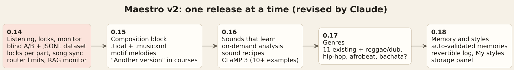
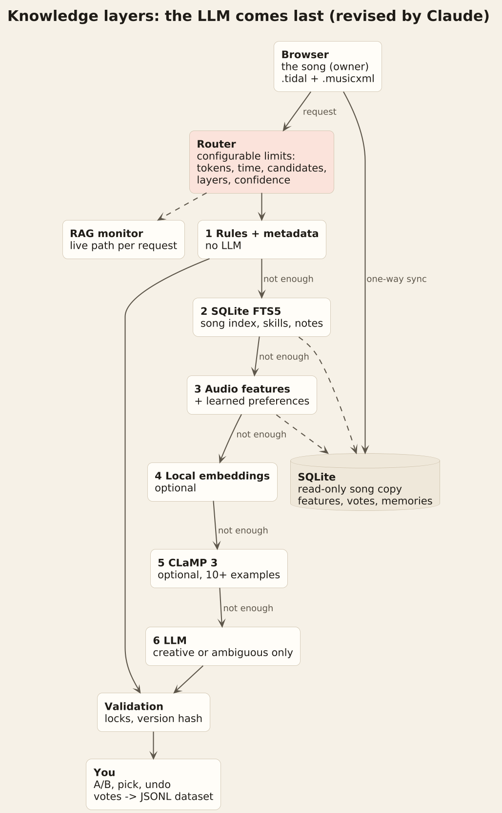

# Maestro v2 — Approved plan (revised by Claude)

> **Revised by Claude, 2026-11-24.** This file is Claude's review of the ChatGPT blueprint in this folder, checked against the code of v0.13.1 (`main@2689135`) and then agreed with Victor point by point in the project thread. **Where this file and the original blueprint disagree, this file wins.** The original ChatGPT files are kept unchanged below a banner so both versions stay distinguishable.
>
> Spanish version: [APPROVED_PLAN.es.md](APPROVED_PLAN.es.md)

## 1. What the review confirmed in the code

| Blueprint hypothesis | Found in v0.13.1 |
| --- | --- |
| Generated melodies are valid but flat | `server/midigen.py`: `_phrase()` takes the nearest chord tone on strong beats and scale steps in between; `new_melody()` always uses the same 4-bar A-B-A'-B shape. No motif development, rests or climax. |
| Too few style examples | `server/data/style_profiles.json`: merengue 3 songs, salsa 7, cumbia 9, reggaeton 1. |
| Skill context is truncated | `server/skills.py`: `MAX_LOADED=2`, `BUDGET=24000`, `MAX_FILE=9000`. |
| Candidate audition exists | `web/variants.js` (3-4 audible options, A/B, pick), `web/history.js` (undo/redo, 80 snapshots), `courseAsk()` in `web/app.js`. |
| Token/time control exists in part | Plan mode, idle timeout, cancel and prompt caching (PR #51). |

## 2. Decisions that change the original blueprint

| Topic | Original blueprint | Approved (Victor + Claude) |
| --- | --- | --- |
| Release cadence | One slice per PR, approval each time (D08) | One release at a time, 0.14 → 0.18; each release merged and published when green. |
| Song storage (D05) | Canonical `SongState` in SQLite on the server | **The song stays in the browser** (and in `.tidal`/GitHub). A **one-way read-only sync** copies each saved song to a SQLite index so Maestro and searches can query it. The server never writes the song back. |
| What SQLite holds | Runtime source of truth | Only the "learning": song index, sound features, votes, memories, full-text search (FTS5). Rebuildable from the browser/GitHub. |
| `MusicalIR` (custom format) | New intermediate format for all songs | **Dropped.** Standard **MusicXML** instead (see 0.15). |
| Expert panel, 60-65 % blind threshold (D07) | Release gate | Victor's own blind A/B votes are the judge. Automatic analysis filters, the human ear tunes. |
| Graphiti | Optional temporal graph | **Parked** (needs a graph server and calls the LLM). Relations go in SQLite tables. |
| CLaMP 3 | Optional, evidence-gated | **In 0.16**, installed in the existing audio-tools env (PyTorch + GPU/MPS, already used by MSST/Demucs). It auto-activates per genre only with **10+ examples** (configurable), otherwise FTS5 + audio features. |
| Data Git repo with semantic merge (D14) | Separate repo, semantic conflict resolution | Reuse the existing GitHub saving; on conflict keep both versions and let Victor choose. |
| Retention (D15) | Configurable expiry | A storage panel to choose what to delete by size and performance impact; no automatic expiry by default. |
| Genres (D03) | Merengue típico/orquesta, salsa, timba, bachata, cumbia | The 11 existing genres first, plus reggae/dub, hip-hop boom bap, afrobeat and (if the library guitar works as requinto) bachata. Timba and merengue típico later. |
| Level 7 (training) | Out of scope | Still out of scope, but every vote and choice is stored as a clean exportable dataset so a dedicated model can be trained later. |

## 3. Knowledge layers (cheapest first)

1. Rules and metadata (no LLM).
2. SQLite FTS5 text search over the song index, skills and notes.
3. Audio features and learned preferences.
4. Small local text embeddings (optional add-on).
5. CLaMP 3 (optional add-on, active per genre with 10+ examples).
6. LLM, only for creative or ambiguous work.

The router only goes down a layer when the one above has no answer with enough confidence. All limits (tokens, time, candidates, active layers, confidence threshold) are configurable. A **RAG monitor** shows the layers as a live diagram: each request lights up its path and shows, per layer, what answered, latency, tokens, search hits and cache.

## 4. Releases

### 0.14 — Listening, locks and monitor
- Baseline: a ~40 min test session by Victor on 0.13.1 (rating 1-5 per genre plus what is missing).
- Blind A/B page: the human ear tunes what the analysis proposes. **Every vote and choice is stored as clean, exportable JSONL** (context, candidates, choice, reason, licence) for future training.
- Locks at every level: whole track and each part (rhythm, notes, sound, effects, mix, BPM, key), plus a song version hash so a stale proposal is never applied silently.
- One-way read-only sync of songs to the SQLite index.
- Configurable router limits and the RAG monitor.

### 0.15 — Unified composition block and motif melodies
- Each song = `song.tidal` + `song.musicxml`, always together: in the app, on disk, on GitHub and in SQLite.
- The MusicXML holds the melodic part (melody, harmony, bass) and is **Maestro's composition notebook**: it composes by sections, phrases and motif variations, then translates to Tidal (`cat`/`ur`/`seqP`). Rhythm, groove and effects stay pure Tidal.
- Editable in MuseScore; the app regenerates the derived tracks. If a derived track is edited by hand in Tidal, the app asks whether to push the change to the score or mark it "free code". Tidal tricks that do not fit a score (`every`, `sometimes`, `jux`) stay free code.
- SQLite stores both: the Tidal code (sounds, effects, mix) and a full-song MusicXML (groove unrolled from Tidal) for analysis and CLaMP 3.
- midigen v2: motif, transformations (repeat, sequence, inversion, rhythmic displacement), question/answer phrases with rests, climax and cadence; bass that anticipates, piano that leaves room.
- "Another version" button on each course step: 3 candidates over the frozen rest of the song.
- Basic MusicXML read/write with the Python standard library; music21 in the audio-tools env for deep analysis.
- *(Added 2026-11-24, Victor)* Per-track hashes: each proposal says which tracks it expects unchanged; if one of them changed, the proposal becomes an option instead of being applied.

### 0.16 — Sounds that learn
- Deep sound analysis **on demand**, choosing what to include (library, downloads, bought packs, MSST/Demucs stems). Features (attack, decay, brightness, pitch, noise) go to SQLite, using librosa from the audio-tools env.
- Sound recipes: a sample plus processing, or a SuperCollider synth with parameters. Maestro can **combine recipes** to create new sounds.
- Candidates are heard over Victor's song by default (solo optional). Maestro asks concrete questions when unsure (frequency configurable). The ranking learns from choices without the LLM.
- CLaMP 3 add-on as described in section 2.
- *(Added 2026-11-24, Victor)* Optional automatic critic (off by default): scores groove, harmony and form of each candidate as a hint next to it. It is an extra; your ear stays the judge.

### 0.17 — Genres
- Bring the 11 existing genres (merengue orquesta, salsa, cumbia, reggaeton, bossa, jazz, funk, house, techno, drum & bass, lo-fi) to the new level: section composition in the score, learned sound selector, warning when a licensed sound is missing, reference examples.
- New: reggae/dub, hip-hop boom bap, afrobeat (real grooves in the Groove MIDI Dataset, CC BY 4.0) and bachata if the guitar sounds right.
- *(Added 2026-11-24, Victor)* Cumbia variants chosen before the rhythm and instruments: Colombian, sonidera, villera, chicha.

### 0.18 — Memory and styles
- Memory scopes: song, project/course, genre, global.
- Validation layer: very clear memories (many consistent choices, no conflict with genre rules) are approved automatically; doubtful ones go to a pending inbox; optional A/B with and without the memory.
- A log of everything added, each entry revertible.
- "My styles" (groove, roles, instruments, BPM — not the notes), shareable through GitHub.
- Storage panel to decide what to delete by size and performance impact.
- *(Added 2026-11-24, Victor)* Three ways to use a template or style: **inspiration** (new material from its relations), **transformation** (remap structure, groove and parts to another key, tempo or ensemble, with preview) and **literal copy** (only when you pick it, logged). Plus "musical cases": a problem, the before/after and why you accepted it.
- *(Added 2026-11-24, Victor)* When GitHub is connected, approved styles and memories are committed automatically as a backup (never auditions or pending items).

## 5. Parked

- *(Added 2026-11-24, Victor: optional, later)* External composition providers (specialised MIDI models, generative audio such as MusicGen or Stable Audio) behind the same interface as the built-in generator, off unless switched on.
- *(Added 2026-11-24, Victor: optional, later)* A licence sheet for each knowledge resource (origin, licence, restrictions, where it may be used).
- Moving the song to SQLite on the server.
- Any custom note format (`MusicalIR`).
- Graphiti and a separate data repo with semantic merge.
- Expert review panel and statistical thresholds.
- Level 7 model training (the JSONL dataset keeps the door open).
- Timba and merengue típico (no licensed sounds/examples yet).

## 6. Main risks and mitigations

| Risk | Mitigation |
| --- | --- |
| No reliable ear in the loop | Blind A/B page first (0.14); a release counts as better only if it wins there. |
| Missing licensed Dominican sounds (tambora, güira) | Warn instead of using a wrong sound; Victor provides or buys samples; every example carries origin, licence and a "local only" flag. |
| Tidal ↔ MusicXML round trip | Only melodic tracks are derived; anything that does not fit stays free code; the app asks before overwriting. |
| Heavy ML add-ons | Installed in the existing audio-tools env; active only above the example threshold and only if they win the A/B. |
| Token cost | Layered router with configurable limits; the monitor tracks the share of requests answered without the LLM. |
| Untested on a real Mac | Victor's 0.13.1 test session before building on top. |
