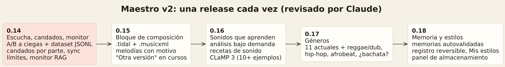
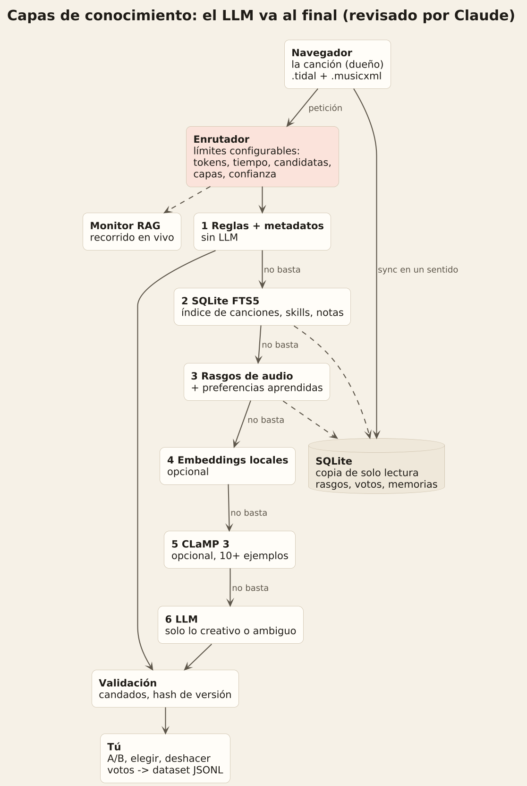

# Maestro v2 — Plan aprobado (revisado por Claude)

> **Revisado por Claude, 24-11-2026.** Este archivo es la revisión de Claude del blueprint de ChatGPT de esta carpeta, contrastada con el código de la v0.13.1 (`main@2689135`) y acordada después punto por punto con Victor en el hilo del proyecto. **Donde este archivo y el blueprint original no coincidan, manda este archivo.** Los archivos originales de ChatGPT se conservan sin cambios, bajo un aviso, para que las dos versiones se distingan.
>
> English version: [APPROVED_PLAN.en.md](APPROVED_PLAN.en.md)

## 1. Qué confirmó la revisión en el código

| Hipótesis del blueprint | Encontrado en v0.13.1 |
| --- | --- |
| Las melodías generadas son válidas pero planas | `server/midigen.py`: `_phrase()` toma la nota del acorde más cercana en tiempos fuertes y pasos de escala en medio; `new_melody()` usa siempre la misma forma A-B-A'-B de 4 compases. Sin desarrollo de motivo, silencios ni clímax. |
| Muy pocos ejemplos de estilo | `server/data/style_profiles.json`: merengue 3 canciones, salsa 7, cumbia 9, reggaeton 1. |
| El contexto de skills se recorta | `server/skills.py`: `MAX_LOADED=2`, `BUDGET=24000`, `MAX_FILE=9000`. |
| Ya existe la escucha de candidatas | `web/variants.js` (3-4 opciones audibles, A/B, elegir), `web/history.js` (deshacer/rehacer, 80 fotos), `courseAsk()` en `web/app.js`. |
| El control de tokens y tiempo existe en parte | Modo plan, timeout por inactividad, cancelar y caché de prompt (PR #51). |

## 2. Decisiones que cambian el blueprint original

| Tema | Blueprint original | Aprobado (Victor + Claude) |
| --- | --- | --- |
| Ritmo de releases | Una rebanada por PR, aprobación cada vez (D08) | Una release cada vez, de la 0.14 a la 0.18; cada una se fusiona y publica cuando está en verde. |
| Dónde vive la canción (D05) | `SongState` canónico en SQLite en el servidor | **La canción sigue en el navegador** (y en `.tidal`/GitHub). Un **sync de solo lectura, en un solo sentido** copia cada canción guardada a un índice SQLite para que Maestro y las búsquedas la consulten. El servidor nunca escribe la canción. |
| Qué guarda SQLite | La fuente de verdad | Solo el "aprendizaje": índice de canciones, rasgos de sonido, votos, memorias, búsqueda de texto (FTS5). Se puede reconstruir desde el navegador o GitHub. |
| `MusicalIR` (formato propio) | Formato intermedio nuevo para todas las canciones | **Abandonado.** En su lugar, **MusicXML** estándar (ver 0.15). |
| Panel de expertos, umbral ciego del 60-65 % (D07) | Puerta de release | El juez son los votos A/B a ciegas de Victor. El análisis automático filtra; el oído humano ajusta. |
| Graphiti | Grafo temporal opcional | **Aparcado** (necesita un servidor de grafos y llama al LLM). Las relaciones van en tablas de SQLite. |
| CLaMP 3 | Opcional, según pruebas | **En la 0.16**, instalado en el entorno de audio que ya existe (PyTorch + GPU/MPS, el de MSST/Demucs). Se activa solo por género con **10 ejemplos o más** (configurable); si no, FTS5 + rasgos de audio. |
| Repo Git de datos con fusión semántica (D14) | Repo aparte, resolución semántica de conflictos | Se reutiliza el guardado en GitHub; ante un conflicto se guardan las dos versiones y elige Victor. |
| Retención (D15) | Caducidad configurable | Un panel de almacenamiento para decidir qué borrar según tamaño e impacto en rendimiento; sin caducidad automática por defecto. |
| Géneros (D03) | Merengue típico/orquesta, salsa, timba, bachata, cumbia | Primero los 11 que ya existen, más reggae/dub, hip-hop boom bap, afrobeat y (si la guitarra de la biblioteca sirve como requinto) bachata. Timba y merengue típico, más adelante. |
| Nivel 7 (entrenar) | Fuera de alcance | Sigue fuera, pero cada voto y elección se guarda como dataset limpio y exportable para poder entrenar un modelo propio más adelante. |

## 3. Capas de conocimiento (de la más barata a la más cara)

1. Reglas y metadatos (sin LLM).
2. Búsqueda de texto SQLite FTS5 sobre el índice de canciones, skills y notas.
3. Rasgos de audio y preferencias aprendidas.
4. Embeddings de texto locales pequeños (complemento opcional).
5. CLaMP 3 (complemento opcional, activo por género con 10+ ejemplos).
6. LLM, solo para lo creativo o ambiguo.

El enrutador solo baja de capa cuando la anterior no tiene una respuesta con suficiente confianza. Todos los límites (tokens, tiempo, candidatas, capas activas, umbral de confianza) son configurables. Un **monitor RAG** muestra las capas como un diagrama en vivo: cada petición ilumina su recorrido y enseña, por capa, quién respondió, la latencia, los tokens, los aciertos de búsqueda y la caché.

## 4. Releases

### 0.14 — Escucha, candados y monitor
- Línea base: una sesión de prueba de unos 40 minutos de Victor con la 0.13.1 (nota del 1 al 5 por género y qué le falta).
- Página de A/B a ciegas: el oído humano ajusta lo que propone el análisis. **Cada voto y elección se guarda como JSONL limpio y exportable** (contexto, candidatas, elección, motivo, licencia) para entrenar en el futuro.
- Candados a todos los niveles: pista entera y cada parte (ritmo, notas, sonido, efectos, mezcla, BPM, tonalidad), más un hash de versión de la canción para no aplicar nunca en silencio una propuesta vieja.
- Sync de solo lectura de las canciones al índice SQLite.
- Límites del enrutador configurables y monitor RAG.

### 0.15 — Bloque de composición unificado y melodías con motivo
- Cada canción = `cancion.tidal` + `cancion.musicxml`, siempre juntos: en la app, en disco, en GitHub y en SQLite.
- El MusicXML guarda la parte melódica (melodía, armonía, bajo) y es **el cuaderno de composición de Maestro**: compone por secciones, frases y variaciones del motivo, y lo traduce a Tidal (`cat`/`ur`/`seqP`). Ritmo, groove y efectos siguen en Tidal puro.
- Editable en MuseScore; la app regenera las pistas derivadas. Si una pista derivada se edita a mano en Tidal, la app pregunta si llevar el cambio a la partitura o marcarla como "código libre". Los trucos de Tidal que no caben en una partitura (`every`, `sometimes`, `jux`) quedan como código libre.
- SQLite guarda ambos: el código Tidal (sonidos, efectos, mezcla) y un MusicXML de la canción completa (con el groove desplegado desde Tidal) para el análisis y CLaMP 3.
- midigen v2: motivo, transformaciones (repetir, secuencia, inversión, desplazamiento rítmico), frases pregunta-respuesta con silencios, clímax y cadencia; bajo que anticipa y piano que deja hueco.
- Botón "Otra versión" en cada paso del curso: 3 candidatas sobre el resto de la canción congelado.
- Lectura y escritura básicas de MusicXML con Python estándar; music21 en el entorno de audio para el análisis profundo.
- *(Añadido 24-11-2026, Victor)* Hash por pista: cada propuesta dice qué pistas espera sin cambios; si alguna cambió, la propuesta llega como opción en vez de aplicarse.

### 0.16 — Sonidos que aprenden
- Análisis profundo de sonidos **bajo demanda**, eligiendo qué incluir (biblioteca, descargas, packs comprados, stems de MSST/Demucs). Los rasgos (ataque, caída, brillo, tono, ruido) van a SQLite, con librosa del entorno de audio.
- Recetas de sonido: una muestra más su procesado, o un synth de SuperCollider con parámetros. Maestro puede **combinar recetas** para crear sonidos nuevos.
- Las candidatas suenan sobre la canción de Victor por defecto (solas, opcional). Maestro hace preguntas concretas cuando duda (frecuencia configurable). El ranking aprende de las elecciones sin LLM.
- Complemento CLaMP 3 como se describe en la sección 2.
- *(Añadido 24-11-2026, Victor)* Selector de instrumentos con cuatro estados separados: en el catálogo, descargado, cargado en SuperDirt y que suena de verdad. Maestro solo propone lo que suena y ordena los 2-3 mejores escuchándolos con la misma frase.
- *(Añadido 24-11-2026, Victor)* Crítico automático opcional (apagado por defecto): puntúa groove, armonía y forma de cada candidata como pista a su lado. Es un extra; el juez sigue siendo tu oído.

### 0.17 — Géneros
- Subir al nuevo nivel los 11 géneros que ya existen (merengue orquesta, salsa, cumbia, reggaeton, bossa, jazz, funk, house, techno, drum & bass, lo-fi): composición por secciones en la partitura, selector de sonidos aprendido, aviso cuando falta un sonido con licencia, ejemplos de referencia.
- Nuevos: reggae/dub, hip-hop boom bap, afrobeat (grooves reales en el Groove MIDI Dataset, CC BY 4.0) y bachata si la guitarra suena bien.
- *(Añadido 24-11-2026, Victor)* Variantes de cumbia elegidas antes del ritmo y los instrumentos: colombiana, sonidera, villera, chicha.

### 0.18 — Memoria y estilos
- Alcances de memoria: canción, proyecto/curso, género, global.
- Capa de validación: las memorias muy claras (muchas elecciones coherentes, sin chocar con las reglas del género) se aprueban solas; las dudosas van a una bandeja de pendientes; A/B opcional con y sin la memoria.
- Un registro de todo lo añadido, con cada entrada reversible.
- "Mis estilos" (groove, roles, instrumentos, BPM; no las notas), compartibles por GitHub.
- Panel de almacenamiento para decidir qué borrar según tamaño e impacto en rendimiento.
- *(Añadido 24-11-2026, Victor)* Tres formas de usar una plantilla o estilo: **inspiración** (material nuevo a partir de sus relaciones), **transformación** (adaptar estructura, groove y partes a otra tonalidad, tempo o formación, con vista previa) y **copia literal** (solo si la eliges, queda registrada). Más los "casos musicales": un problema, el antes/después y por qué lo aceptaste.
- *(Añadido 24-11-2026, Victor)* Con GitHub conectado, los estilos y memorias aprobados se guardan solos como copia de seguridad (nunca las escuchas ni lo pendiente).

## 5. Aparcado

- *(Añadido 24-11-2026, Victor: opcional, más adelante)* Proveedores de composición externos (modelos MIDI especializados, audio generativo como MusicGen o Stable Audio) con la misma interfaz que el generador propio, apagados salvo que los actives.
- *(Añadido 24-11-2026, Victor: opcional, más adelante)* Ficha de licencia por cada recurso de conocimiento (origen, licencia, restricciones, dónde se puede usar).
- Mover la canción a SQLite en el servidor.
- Cualquier formato de notas propio (`MusicalIR`).
- Graphiti y un repo de datos aparte con fusión semántica.
- Panel de expertos y umbrales estadísticos.
- Entrenar modelos (nivel 7); el dataset JSONL deja la puerta abierta.
- Timba y merengue típico (todavía sin sonidos ni ejemplos con licencia).

## 6. Riesgos principales y cómo se mitigan

| Riesgo | Mitigación |
| --- | --- |
| No hay un oído fiable en el circuito | Primero la página de A/B a ciegas (0.14); una release solo cuenta como mejor si gana ahí. |
| Faltan sonidos dominicanos con licencia (tambora, güira) | Avisar en vez de usar un sonido equivocado; Victor aporta o compra muestras; cada ejemplo lleva origen, licencia y marca de "solo local". |
| Ida y vuelta Tidal ↔ MusicXML | Solo se derivan las pistas melódicas; lo que no encaja queda como código libre; la app pregunta antes de sobrescribir. |
| Complementos de ML pesados | Instalados en el entorno de audio que ya existe; activos solo por encima del umbral de ejemplos y solo si ganan el A/B. |
| Coste de tokens | Enrutador por capas con límites configurables; el monitor mide el porcentaje de peticiones resueltas sin LLM. |
| Sin probar en un Mac real | La sesión de prueba de Victor con la 0.13.1 antes de construir encima. |
