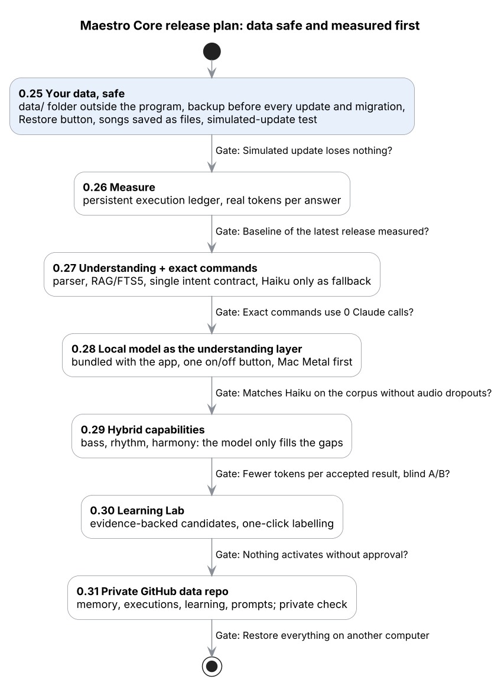

# Maestro Core — architecture decisions (2026-11-25)

**Status:** approved by Victor on 2026-11-25, one decision at a time. **Authoritative:** where [EXECUTION_STUDIO_LEARNING_V24.en.md](EXECUTION_STUDIO_LEARNING_V24.en.md) disagrees with this file, this file wins. Spanish version: [DECISIONS_2026-11-25.es.md](DECISIONS_2026-11-25.es.md).

The architecture document was written over several iterations on the same day and kept parts of older ones. A review found 13 contradictions between iterations and one missing layer (user data persistence). This file records how each was resolved.

## 1. The 13 decisions

| # | Topic | Decision |
|---|---|---|
| 1 | Role of the local model | The local SLM is the **official understanding layer** of the Semantic Gateway, ahead of the Conductor. It returns the same intent contract as Haiku. 0.8's "deferred until evidence" is withdrawn. |
| 2 | Intent contract | **One** contract: the Gateway's (speech-act types, several intents per message, evidence spans). The old `IntentTask`/`RoutingResult` of `intent_resolver` is replaced; Haiku and the local model both return the Gateway contract. |
| 3 | Call budget | **Always spend the minimum.** Understanding: parser, RAG/FTS5 and local model first (0 Claude calls). Haiku is **only a fallback** when no local model or RAG answer is available. Then at most **1 musical call**; when the creative request is already clear, 1 call in total (fused). The local model does not count as a provider call. Examples A, B and C must show the Gateway step. |
| 4 | Naming | No "agent", "worker" or "specialist" in prose. A **capability** is the higher-level unit and may be fully deterministic; a **profile** is its optional generative part. The base prompt's first line must not say "You are a specialist in an ensemble". Schema identifiers (`WorkerResult`, …) may stay until the schemas are revised. |
| 5 | Code layout | One layout, merging 0.13.2 (approved engine) with 0.16.8 (NLU). See section 3. `nlu/` uses `knowledge/` and `providers/` instead of its own retrieval and backends. The layouts in 0.12 and Part I §10 are withdrawn. |
| 6 | Delivery order | **One plan**, 0.25 → 0.31 (section 6). Slices A–G, V24.0–V24.5, Part II §22 and 0.17.3 are withdrawn as ordering. |
| 7 | Baseline | Always compare against **the latest published release** (today 0.24.0). No fixed version number in the spec. |
| 8 | Phase names | Phases are named after the **app version** that ships them (0.25, 0.26…). No V24.x labels. |
| 9 | Prompt capture | Full application-supplied prompts and responses are stored locally. **Configurable; by default anything older than 90 days is deleted.** Basic metadata (timings, tokens, outcome) is always kept. |
| 10 | Data folder names | Folders are named **by what they hold, not by where they live**, and are identical locally (inside `data/`) and on GitHub. See section 4. The GitHub export is no longer called `maestro-data/`. |
| 11 | JSONL | What is already JSONL stays JSONL (the A/B vote dataset download). The "JSON only" rule applies to new runtime exports. |
| 12 | Local model install | The local model **ships with the app** (not an optional later download). Turning it on or off is **one button** in Settings. Installer size grows by roughly 0.5–1.5 GB (the macOS .pkg is ~608 MB today). |
| 13 | GitHub and privacy | **Two GitHub configurations.** *Shareable* (may be public): `songs/` and styles the user chooses to share. *Private*: `memory/`, `executions/`, `learning/`, `prompts/`. Before any upload to the private one the app checks via the GitHub API that the repo is private; if it is not, nothing is uploaded and the user is warned. When it is configured, the app offers to copy the memory already backed up in the current repo, and warns that the old copies remain in that repo's history. |

## 2. New layer: user data persistence (ships in 0.25)

Today (0.24) the installed app runs from a copy of the program in the user folder, and `maestro-data/` (memory, sounds, song index, knowledge index), `cache/` and `references/` live **inside that program copy**. They survive updates only because installers don't ship those folders. Songs ("My projects") live in the webview's localStorage. Nothing is backed up before a database migration. Every new Maestro Core store (execution ledger, prompt blobs, learning candidates, local model) would land in the same place.

Requirements:

- A `data/` folder **next to, not inside,** the program copy: `~/Library/Application Support/Tidal Studio/data`, `%LOCALAPPDATA%\Tidal Studio\data`, `~/.local/share/tidal-studio/data`. Launchers pass it to the server. A one-time migration moves existing data (move, verify, then delete the old copy).
- A **backup before every update** (the updater calls it before running the installer) and **before every schema migration**: SQLite online backup API + config + songs, kept in `data/backups/`, last 5 kept. **Restore** button in Settings → Storage.
- **Songs saved as files** in `data/songs/<name>/` in the same format as on GitHub (`song.tidal`, `song.json`, `song.musicxml`). The browser keeps editing; the file copy makes songs survive a lost webview profile or a port change.
- **Simulated-update test** in CI: install version N, create data, run version N+1's launcher and migrations, assert every user file is byte-identical or correctly migrated.
- Large re-creatable files (`models/`, `knowledge/` index) are excluded from backups.

## 3. Code layout (decision 5)

```text
server/maestro/
  core/           conductor, executor, scheduler, policy/budget, registry, state, events, contracts, cancellation
  nlu/            Semantic Gateway: normalizer, parser, binder, sufficiency gate, validator, inference router, resources
  capabilities/   Python plans + YAML metadata per capability (bass, rhythm, harmony…)
  tools/          deterministic operations
  profiles/       Markdown inference modules (generative gaps only)
  knowledge/      adapters to the existing SQLite/FTS5 and memory (used by nlu/ too)
  observability/  execution ledger
  learning/       evidence and reviewed promotions
  persistence/    export/restore to the private GitHub configuration
  formats/        Tidal and MusicXML adapters
  providers/      Claude CLI/API and local model adapters (used by nlu/ too)
  tests/
server/integrations/maestro/   Tidal Studio-specific glue
```

## 4. Data folders (decisions 10 and 13)

| Folder | Holds | Local (`data/`) | GitHub |
|---|---|---|---|
| `songs/` | one folder per song: `song.tidal`, `song.json`, `song.musicxml` | yes | shareable configuration (exists since 0.13) |
| `memory/` | memories, cases, styles (0.19 JSON format unchanged) | yes (`memory.db`) | private configuration |
| `executions/` | execution ledger, events, usage | yes | private configuration (opt-in, sanitized) |
| `learning/` | approved learning candidates, evaluations | yes | private configuration |
| `prompts/` | versioned prompt modules and snapshots | yes | private configuration |
| `sounds/` | sound measurements, recipes, choices (`sounds.db`) | yes | no |
| `knowledge/` | FTS5 knowledge index (rebuildable) | yes | no |
| `models/` | bundled local model (GGUF, pinned hash) | yes | no |
| `backups/` | automatic backups before updates and migrations | yes | no |

The app keeps reading the 0.19 memory backup path so existing backups are not lost. Settings (`config.json`) stay local and are never uploaded (they hold tokens).

## 5. Changes to apply in the main document

These edits make the main document consistent with this file:

- **0.8:** the "deferred" paragraph on the local decision backend → the local model is the Gateway's understanding layer (decision 1).
- **0.9:** each example starts with the Gateway step; the acceptance "0/1/1" becomes "0 / 1 / 1 Claude calls, plus at most 1 Haiku call only when neither the local model nor retrieval resolves the request" (decision 3).
- **0.12:** the layout and slices table → sections 3 and 6 here.
- **0.13.5:** `max_provider_attempts` covers musical calls; understanding has its own budget of at most one Haiku fallback.
- **0.15.3:** `capture_prompts` defaults to `true` with `retention_days: 90` (decision 9).
- **0.15.5:** the export tree uses the folder names in section 4, under the private configuration.
- **0.16.7:** `local.enabled` is a user setting (one button); the model is bundled, `model_id` is set at build time (decision 12).
- **Part I §2, §12.15, Part II §22:** baseline = latest published release (decision 7).
- **Part I §3, §4.4, Part II §15–16, Part III §24:** worker/specialist → profile/capability in prose (decision 4).
- **Part I §9.1:** two GitHub configurations with the private check (decision 13).
- **Part I §11, Part II §22, 0.17.3:** ordering → section 6.

## 6. Release plan (decision 6)



Source: [diagrams/release-plan.puml](diagrams/release-plan.puml). Each release starts only when the previous one passes its gate. Parked until 0.26 measurements say otherwise: TOON, embeddings, MCP/OpenAPI, the parallel DAG and the batch Learning Analyst.

## 7. Track count is a setting (0.25.1)

Since 0.25.1 the number of tracks is `config.json → tracks.count` (12 by default, 12–32, `server/tracklimit.py`). Every later release must read it instead of assuming 12: generated tracks, templates, imports and anything that picks free `dN` ids use `max_tracks` (in `/api/status` and in the session Maestro receives); SuperDirt orbits are `N + 1` (the last one is the MIDI keyboard); the reference drummer stays on `d9..d12`. It is a user setting, so it lives in the user data folder and is covered by backups, like the rest of `config.json`.

The same goes for every other cap: they are `config.json → limits` (`server/limits.py`, Settings → Limits). A new cap in 0.26+ is added to `limits.DEFS` with its default and safe range, never hardcoded.
