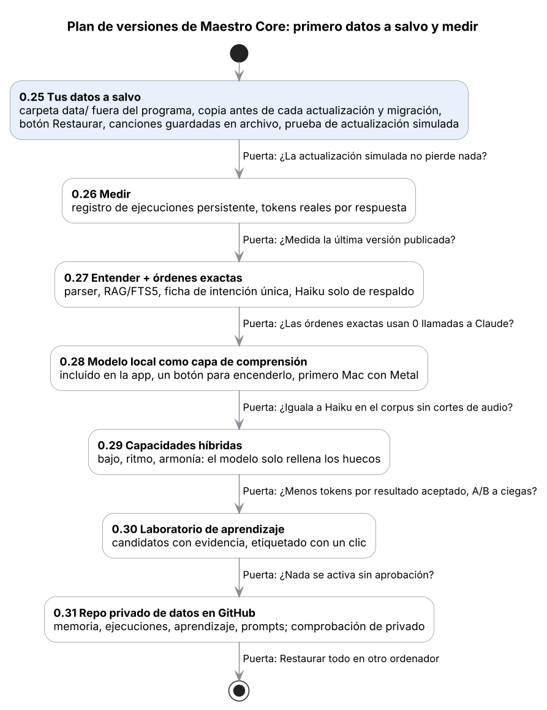

# Maestro Core — decisiones de arquitectura (25-11-2026)

**Estado:** aprobadas por Victor el 25-11-2026, una a una. **Mandan:** donde [EXECUTION_STUDIO_LEARNING_V24.en.md](EXECUTION_STUDIO_LEARNING_V24.en.md) no coincida con este archivo, gana este archivo. Versión en inglés: [DECISIONS_2026-11-25.en.md](DECISIONS_2026-11-25.en.md).

El documento de arquitectura se escribió en varias iteraciones el mismo día y conservaba partes de las anteriores. La revisión encontró 13 contradicciones entre iteraciones y una capa que faltaba: la de guardar los datos del usuario. Aquí se anota cómo se resolvió cada una.

## 1. Las 13 decisiones

| # | Tema | Decisión |
|---|---|---|
| 1 | Papel del modelo local | El modelo local es la **capa oficial de comprensión** del Gateway, antes del Conductor, y devuelve la misma ficha de intención que Haiku. Se retira el "diferido hasta tener evidencia" de la 0.8. |
| 2 | Ficha de intención | **Una sola** ficha, la del Gateway: tipos de mensaje, varias peticiones por mensaje y las palabras que lo justifican. Sustituye a `IntentTask`/`RoutingResult` del `intent_resolver`. |
| 3 | Llamadas a Claude | **Gastar siempre lo mínimo.** Para entender se usan primero el parser, RAG/FTS5 y el modelo local, sin llamar a Claude. Haiku es **solo un respaldo** para cuando no hay modelo local ni respuesta del RAG. Después hay como mucho **1 llamada musical**; si la petición creativa ya está clara, 1 llamada en total. El modelo local no cuenta como llamada. Los ejemplos A, B y C deben mostrar el paso del Gateway. |
| 4 | Nombres | En el texto no se usa "agente", "worker" ni "especialista". Una **capacidad** es la unidad de nivel superior y puede ser totalmente determinista; un **perfil** es su parte generativa opcional. Los nombres de los esquemas pueden quedarse hasta que se revisen. |
| 5 | Carpetas del código | Una sola organización, que une la 0.13.2 (motor aprobado) con la 0.16.8 (NLU). Ver la sección 3. `nlu/` usa `knowledge/` y `providers/`. Se retiran las de la 0.12 y la Parte I §10. |
| 6 | Orden de trabajo | **Un solo plan**, de la 0.25 a la 0.31 (sección 6). |
| 7 | Comparación | Siempre contra **la última versión publicada** (hoy la 0.24.0). |
| 8 | Nombres de fase | Cada fase lleva **la versión de la app** en la que sale (0.25, 0.26…). Sin etiquetas V24.x. |
| 9 | Guardar prompts | Se guarda en local el texto completo enviado a Claude y su respuesta. **Es configurable y por defecto se borra lo que tenga más de 90 días.** Los datos básicos (tiempos, tokens, resultado) se guardan siempre. |
| 10 | Nombres de carpetas de datos | **Por lo que guardan, no por dónde están**, y con los mismos nombres en local (dentro de `data/`) y en GitHub. Ver la sección 4. |
| 11 | JSONL | Lo que ya está en JSONL sigue igual (la descarga de votos A/B). La regla de "solo JSON" vale para lo nuevo. |
| 12 | Instalación del modelo local | El modelo **viene instalado con la app** y se enciende o apaga con **un botón** en Ajustes. El instalador crece unos 0,5 a 1,5 GB (hoy el .pkg de Mac pesa unos 608 MB). |
| 13 | GitHub y privacidad | **Dos configuraciones de GitHub.** *Compartible* (puede ser pública): `songs/` y los estilos que decidas compartir. *Privada*: `memory/`, `executions/`, `learning/` y `prompts/`. Antes de subir, la app comprueba que el repo privado lo es; si no, no sube y avisa. Al configurarlo, ofrece copiar la memoria ya guardada en el repo actual y avisa de que las copias antiguas siguen en su historial. |

## 2. Capa nueva: tus datos a salvo (sale en la 0.25)

Hoy (0.24) la app instalada funciona desde una copia del programa en tu carpeta de usuario. `maestro-data/` (memoria, sonidos, índice de canciones e índice de conocimiento), `cache/` y `references/` viven **dentro de esa copia**. Sobreviven a las actualizaciones solo porque los instaladores no traen esas carpetas. Las canciones ("Mis proyectos") viven en el almacenamiento del navegador de la ventana, y no se hace ninguna copia antes de migrar una base de datos.

Qué hay que hacer:

- Una carpeta `data/` **al lado** de la copia del programa, no dentro, con una migración única de lo que ya existe.
- Una **copia antes de cada actualización** y **antes de cada migración**, guardando las 5 últimas en `data/backups/`, con un botón **Restaurar** en Ajustes → Almacenamiento.
- **Canciones guardadas en archivo** en `data/songs/<nombre>/`, con el mismo formato que en GitHub.
- Una **prueba automática** que simula pasar de una versión a la siguiente y comprueba que no se pierde nada.
- Los archivos grandes que se pueden volver a crear (`models/` y el índice `knowledge/`) no entran en las copias.

## 3. Carpetas del código (decisión 5)

Igual que en la versión en inglés: `server/maestro/` con `core/`, `nlu/`, `capabilities/`, `tools/`, `profiles/`, `knowledge/`, `observability/`, `learning/`, `persistence/`, `formats/`, `providers/` y `tests/`, más `server/integrations/maestro/`.

## 4. Carpetas de datos (decisiones 10 y 13)

| Carpeta | Qué guarda | En local (`data/`) | En GitHub |
|---|---|---|---|
| `songs/` | una carpeta por canción: `song.tidal`, `song.json`, `song.musicxml` | sí | configuración compartible (existe desde la 0.13) |
| `memory/` | memorias, casos y estilos (formato de la 0.19 sin cambios) | sí | configuración privada |
| `executions/` | registro de ejecuciones | sí | configuración privada (opcional, sin datos sensibles) |
| `learning/` | aprendizaje aprobado y evaluaciones | sí | configuración privada |
| `prompts/` | versiones de los prompts | sí | configuración privada |
| `sounds/` | medidas de sonido, recetas y elecciones | sí | no |
| `knowledge/` | índice FTS5 (se puede reconstruir) | sí | no |
| `models/` | modelo local incluido | sí | no |
| `backups/` | copias automáticas | sí | no |

Los ajustes (`config.json`) se quedan en local y nunca se suben, porque guardan los tokens.

## 5. Plan de versiones (decisión 6)

Fuente: [diagrams/release-plan.es.puml](diagrams/release-plan.es.puml). Cada versión empieza solo cuando la anterior pasa su puerta. Quedan aparcados, hasta que las mediciones de la 0.26 digan otra cosa: TOON, embeddings, MCP/OpenAPI, el grafo paralelo y el analista por lotes.
