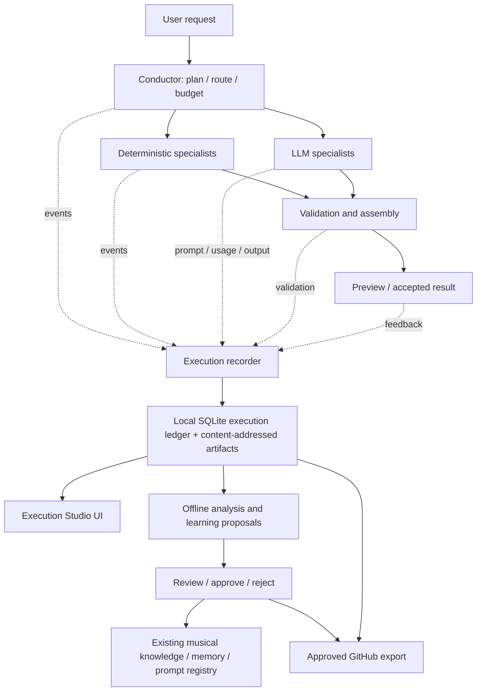

# Maestro V24 — Execution Studio, Prompt Observatory and Learning Repository

**Status:** proposed release specification, not implemented. 2026-11-25.
**Target:** 0.24.0, subject to release approval.
**Baseline:** application 0.23.0 at [f256b6b](https://github.com/vsalesa/tidal-studio/commit/f256b6ba9e2eca39205ba603e7147f16fcc99c69); documentation HEAD d54a53b2c4f2b62f683b1ccecb5363d1097fc4ec.
**Companions:** [Specialized Agent Architecture](SPECIALIZED_AGENT_ARCHITECTURE_V23.en.md), [MultiProfile execution](MULTIPROFILE_EXECUTION_V23.en.md), [approved Maestro v2 plan](https://github.com/vsalesa/tidal-studio/blob/feature/maestro-v2-blueprint/docs/maestro-v2/APPROVED_PLAN.en.md).

## 1. Product objective

V24 should combine the Conductor/specialist execution engine with an integrated Execution Studio. The user must be able to inspect every execution, reconstruct exactly what application-controlled context a worker received, understand musical decisions and outcomes, measure total inference usage, compare prompt versions, derive reusable knowledge, and persist approved artifacts to GitHub.

The system must learn from evidence, not treat every model statement as a new musical fact. Observability and learning are off the interactive inference critical path. No extra LLM call is required to record, inspect, aggregate or export an execution. No raw execution archive is automatically fed into future prompts.

## 2. Verified V23 baseline

| Source | Current behavior | V24 extension |
|---|---|---|
| [router.py:144–240](https://github.com/vsalesa/tidal-studio/blob/f256b6ba9e2eca39205ba603e7147f16fcc99c69/server/router.py#L144-L240) | Monitor keeps 60 requests by default in process memory; stores layer status, latency, hits and aggregate token fields. Request text is truncated to 160 characters. | Persistent run/node/attempt records and detailed event timeline; retain live monitor as projection. |
| [app.py:323–358](https://github.com/vsalesa/tidal-studio/blob/f256b6ba9e2eca39205ba603e7147f16fcc99c69/server/app.py#L323-L358) | Trace is in memory; old traces removed when new traces are created after 900 seconds; adjacent thinking events coalesced and limited to 20,000 characters. | Durable execution events, optional local diagnostic payload capture, no dependence on truncated UI events. |
| [app.py:1630–1640](https://github.com/vsalesa/tidal-studio/blob/f256b6ba9e2eca39205ba603e7147f16fcc99c69/server/app.py#L1630-L1640) | /api/monitor provides live requests, summary, router config and knowledge/index state. | Backward-compatible execution endpoints, pagination and live updates. |
| [llm.py:66–118](https://github.com/vsalesa/tidal-studio/blob/f256b6ba9e2eca39205ba603e7147f16fcc99c69/server/llm.py#L66-L118) | join_system joins system blocks; _cache_note calls note_usage; thread-local counter sums input/output/cache-read. take_usage resets the counter. | Attribute usage directly to an attempt; retain raw provider counters, cache-write, missing-value semantics and normalized totals. Do not double-count cache-read. |
| [llm.py:510–555](https://github.com/vsalesa/tidal-studio/blob/f256b6ba9e2eca39205ba603e7147f16fcc99c69/server/llm.py#L510-L555) | Claude CLI writes system prompt to temporary file and extracts result usage/modelUsage. | Capture exact application-supplied system/prompt before invocation, provider/model/flags and result before temp cleanup. Never archive credentials. |
| [app.py:492–595](https://github.com/vsalesa/tidal-studio/blob/f256b6ba9e2eca39205ba603e7147f16fcc99c69/server/app.py#L492-L595) | Existing GitHub bidirectional memory/style sync, preview, retry scheduling; does not sync pending memories, votes or auditions. | Separate execution/knowledge export policy using existing GitHub adapter and conflict safeguards. Do not silently expand current backup permissions. |

The current repository is public. Execution archives may contain private songs, user instructions, copyrighted source excerpts, and personal preferences. Never default runtime export to the public application repository. The source documentation belongs on main; user data belongs in an explicitly selected private data repository. No actual runtime records have been collected for this specification.

## 3. Execution Studio architecture



The final S-to-G path is an explicitly authorized, sanitized execution export, not unconditional sync. L1 Conductor orchestrates L2A deterministic and L2B generative peers. L3 infrastructure stores knowledge and artifacts. Recorder is a cross-cutting concern, not an additional agent in the musical graph.

## 4. User experience: replace the limited diagram with a full Execution Studio

Keep existing menu and add tabs. All UI labels bilingual ES/EN.

### 4.1 Live graph

Show one node per logical task and nested attempts. Edges distinguish prerequisite data, control dependencies and validation. Display node role, operation, state, duration, token counts, effort, source IDs, attempt count and cache status. Deterministic nodes are labeled 0 LLM calls. Planned but skipped nodes are grey, never reported as executed. Concurrent nodes have overlapping time bars; do not add their durations to claim elapsed latency.

States: queued, running, succeeded, blocked, failed, cancelled, skipped, stale. Click a node for exact details. Show critical path, elapsed time, total calls, actual/estimated tokens and pending actions. Provide collapse to the existing layer overview.

### 4.2 Execution history

Persistent searchable table across restarts; filters for project, genre, operation, profile, provider/model, prompt version, time, outcome, accepted/rejected, skill, error and Git sync state. Pagination. Show complete runs including local, failed and cancelled calls. Link a chat response and plan step to its run ID; optionally correlate all steps of a plan using parent run ID.

### 4.3 Timeline and call inspector

For each run, list routing decisions, local operations, retrieval queries and selected excerpts, prompt assembly, each provider attempt, tool/action proposals, validation, repairs, preview, selection, actual action and final status.

For each inference attempt expose:
- exact application-supplied system prompt and user/message payload, with copy/export;
- assembled context blocks separately: base, role, capabilities, schema, user request, musical snapshot projection, dependencies, selected skills, memory;
- version/hash, character length and token estimate per block; provider token count if available;
- model requested and actual, effort requested/effective, timeout, output target, safe flags, isolation diagnostics;
- raw application-received final answer, parsed worker artifact, accepted/rejected fields, validation errors;
- provider-exposed thinking summary/events only when available and capture enabled; do not claim access to hidden chain of thought or complete provider-internal system instructions;
- actual normalized usage, cache-read/write, output length, time to first event, time to first visible answer, wall time, retry reason and error status;
- concise musical evidence and downstream consumer IDs.

Inspect all transmitted application prompt content, not inferred provider-internal context. Redacted exports and local full payloads must be visibly distinguished. Never reconstruct missing content and label it exact.

### 4.4 Prompt Observatory

Versioned catalogue of shared base, 18 specialist role modules, capability modules, schemas, and policy. View effective prompt for any attempt and compare two versions line-by-line. Store immutable content hash, parent version, author/source, date, release, enabled status, tests and rollback reference. Edit draft prompts without replacing history. Activate after review and test; no LLM may silently rewrite the active registry. Compare effective prompts, not just role text.

Provide a local prompt playground: pick an existing task fixture, choose profile/prompt/model/effort, inspect estimated payload, explicitly run A/B. Never automatically apply replayed musical changes.

### 4.5 Learning Lab

Show candidates grouped into musical knowledge, prompt improvements, routing/efficiency, validation rules, retrieval quality and user preferences. Each card has evidence, affected scope, source permissions, counterexamples, confidence basis and proposed change. Actions: accept, edit, reject, defer, test, compare and rollback. Approved musical memories integrate with existing memory store; approved prompt changes integrate with registry; do not create a competing canonical preference store.

### 4.6 Storage and GitHub

Show bytes by run/artifact type, retained vs exportable, pending Git commits, last synchronization, errors, diff preview, remote repository visibility, exclusions and delete controls. Full prompt capture local by default when Execution Studio recording is enabled; show this clearly and allow metadata-only and pause modes. Private GitHub export is separate opt-in. Provide export selection by run/project/date/type, safe review and restore/import.

## 5. Execution ledger: data design

Use SQLite with migrations and transaction boundaries. Prefer a dedicated rebuildable/backup-able execution database under existing DATA_DIR rather than bloating musical knowledge FTS; reuse existing connection/storage conventions. Store large payloads in content-addressed blobs (SHA-256 of canonical bytes, compression optional), with references. Hashes alone are not anonymization. Do not index confidential raw prompts into normal skill FTS.

| Entity | Core fields |
|---|---|
| runs | run_id, parent_run_id, trace_id, song_id, revision, intent, language, started_at, ended_at, status, policy_version, app_commit |
| nodes | node_id, run_id, profile, operation, scope, state, start/end, skip_reason |
| edges | run_id, source_node, target_node, dependency_kind, artifact_id |
| attempts | attempt_id, node_id, ordinal, provider, actual_model, requested_model, effort_requested/effective, timings, status, error, retry_reason |
| prompt_versions | prompt_id, module_type, semantic_version, content_hash, parent_hash, provenance, status |
| prompt_blocks | attempt_id, ordinal, kind, blob_hash, char_count, token_estimate, sensitivity |
| artifacts | artifact_id, run/node/attempt IDs, kind, schema_version, blob_hash, source_revision, sensitivity, retention_class |
| retrieval_hits | attempt/node ID, source/version/section ID, rank, score, loaded, claimed_used, validated_reference, excerpt_hash |
| usage | attempt_id, provider raw counters, normalized counters, source, availability, estimate flag |
| events | monotonic sequence, run/node/attempt IDs, UTC timestamp, relative monotonic timing, event type, payload reference |
| feedback | run/artifact/candidate ID, previewed, picked/rejected, undo, explicit rating, reason, timestamp |
| learning_candidates | candidate_id, class, scope, proposal, evidence IDs, counterevidence, status, review/approval, version |
| export_ledger | export_id, manifest hash, target repo/ref, policy, status, commit SHA, conflicts, deletion markers |

Store actual application-supplied messages and exact system content as bytes after final serialization. For API preserve roles and block ordering; for CLI preserve joined system file and flattened stdin text. Capture raw final response and parsed normalized result. Store only permitted provider-returned diagnostic text; do not attempt to extract undisclosed reasoning. Separate raw and sanitized artifacts. Use reference counting or mark/sweep for deletion; retain deduplicated blobs while other approved records reference them.

## 6. Event protocol and instrumentation

Example:

```json
{"v":1,"run":"r1","node":"bass","attempt":"a1","seq":17,"type":"provider.completed","data":{"model":"actual-provider-model","effort_requested":"low","usage_ref":"u1","response_ref":"sha256:..."}}
```

Events: run.started, routing.selected, node.queued, node.started, retrieval.completed, prompt.assembled, provider.started, provider.first_event, provider.completed, provider.failed, validation.completed, repair.requested, node.completed, node.skipped, run.cancelled, run.completed, preview.started, candidate.picked, candidate.rejected, change.applied, change.undone, learning.proposed, learning.reviewed, export.completed.

Integrate at existing router.Request and Trace, _chat and all other inference routes (explain, fix, brainstorm, diagnostics, plan, optional critic), and deterministic actions. Diagnostics may use a distinct run category but still appear in history. Prefer explicit execution context IDs over global mutable/thread-local counters. Capture exactly one terminal event per attempt; ensure exceptions, timeout and cancellation are recorded. On startup mark interrupted runs, never infer success. Record unknown values as null. Recording failure must not corrupt song or block basic composition indefinitely; surface visible recording failure and avoid silently claiming full coverage.

Use bounded local writes/batched events; never stream a write or Git commit for every thinking token. Capture final payloads atomically. Redact secrets before any durable write, including credentials, authorization headers, environment variables, local private paths where feasible. Preserve user-visible distinction when exact capture was altered for safety.

## 7. Token accounting and efficiency analytics

Provider schemas differ. Anthropic input_tokens may exclude cache creation/read; OpenAI-compatible prompt_tokens may include cached tokens. Store raw counters and normalize with provider-specific rules, document units and inclusion. Do not sum cached counts twice or assume reasoning tokens are available. CLI reported modelUsage may overlap aggregate usage; choose a single authoritative total and preserve both for diagnosis. Unknown is N/A, never zero; deterministic calls genuinely have zero inference usage.

Dashboards: total tokens per accepted result, calls per run, cache hit share, prompt block contribution, latency P50/P95, first-attempt validity, repair/knowledge-expansion rate, cost if observable and pricing basis known, acceptance/undo rate, profile/genre trends. Show sample sizes, time range, model and prompt versions. Separate cold/warm caches, local/LLM runs, cancelled/failed calls and successful calls. Claude subscription quota is not equivalent to estimated API dollar cost.

Illustrative run: rhythm and harmony parallel only when shared constraints fixed; Bass receives projection of both, Melody receives relevant chord and groove data; every attempt visible. Aggregate total tokens across workers; wall time from actual run clock. A long thinking display alone is not proof of cost.

## 8. Learning pipeline: from executions to evidence

### 8.1 Collect without extra model calls

Persist selected and loaded knowledge, exact versioned prompts, actual outputs, structured musical facts, validation, repairs, user A/B selections, rejects and undo. Mere preview/listen is weaker evidence than selection. Absence of rejection is not acceptance. No automated claim that a skill was correct merely because the model cited it.

### 8.2 Deterministic analysis first

- Deduplicate equivalent prompt blocks and outputs by hash.
- Detect repeated validation errors by profile/model/prompt version.
- Find unnecessary loaded chunks, repeated retrieval expansion, oversized history and repeated prompt instructions using statistics.
- Compare actual token/latency and acceptance by prompt version and task type.
- Extract structured, explicitly accepted musical patterns or preference signals using existing metadata and approved memory mechanisms.
- Identify repeatable successful deterministic transformations and propose fast paths.
- Detect contradictory knowledge and contextual exceptions; do not merge genres indiscriminately.

### 8.3 Optional bounded Learning Analyst

Only on explicit review or configured batch budget, never once per chat message. This is an offline/analysis profile, not a required 19th interactive worker. Use compact summaries, evidence IDs and selected excerpts. Prefer local analysis where possible. No unconstrained access to archives and no automatic prompt rewriting.

Proposed analyst system prompt:

```text
You are Maestro's offline execution-learning analyst.
The host supplies a bounded evidence batch containing execution metadata,
prompt versions, selected musical artifacts, validation outcomes and explicit feedback.
Identify reusable improvements supported by this evidence.
Separate expert musical facts, genre-specific patterns, user preferences,
prompt defects, routing inefficiencies and validation opportunities.
Do not treat generated text, repeated claims, listening events or unverified
model reasoning as proof. Distinguish observed outcomes from hypotheses.
Preserve source scope, licenses, consent, contradictions and counterexamples.
Prefer small testable changes over broad rewrites.
Do not modify active prompts, knowledge, songs, settings or repositories.
Return only structured learning candidates with evidence IDs, proposed change,
scope, uncertainty, counterevidence, test plan and approval requirement.
If evidence is insufficient, return an empty candidate list. Stop after the batch.
```

Example:
```json
{"candidates":[{"kind":"prompt_change","scope":"bass","evidence":["r12:a1","r19:a1"],"proposal":"Make chord timing an explicit required input","counterevidence":[],"confidence":"hypothesis","test":"Replay affected fixtures and compare errors and acceptance","approval_required":true}]}
```

Confidence must be tied to evidence, not invented numerical probabilities. No online self-training or weight updates in V24. Approved, licensed, sanitized examples can later form a clean evaluation/training export; training is out of scope.

### 8.4 Approval and activation

Use existing memory scopes and approval policies. New expert facts and prompt changes require review and tests; do not silently elevate model output into expert knowledge. Respect existing approved memory auto-approval rules only within their original authorized preference scope. Promote approved changes into appropriate store with provenance and rollback. Keep raw archive and approved retrieval corpus separate; FTS indexes only approved reusable knowledge, not every prompt. Track which new version was used in later executions and compare outcome.

## 9. GitHub persistence

### 9.1 Two distinct repositories/namespaces

Application source repo: public code, reviewed architecture docs, generic prompt templates, schemas and synthetic test fixtures. Runtime data repo: explicitly selected private repository, user-controlled branch/folder. Existing GitHub configuration may be reused only after preview and permission verification. Do not assume private status from a repository name; fail closed if visibility is unknown for sensitive exports.

Default policy:
- Local full application-controlled prompt/result capture when enabled, with clear storage controls.
- No automatic remote raw export.
- Approved generic prompt versions, approved learning and sanitized execution manifests may sync after explicit configuration.
- Full raw prompts/results, user song excerpts, diagnostic thinking, votes, licensed material and private memory excluded unless separately selected, rights verified and private target explicitly approved. Secrets never exported.
- Do not alter existing styles/memory backup semantics or auto-sync pending data just because this feature exists.

### 9.2 Git-friendly format

```text
maestro-data/
  manifest.json
  prompts/
    base/<version>.md
    roles/bass/<version>.md
    capabilities/<name>/<version>.md
    registry.json
  executions/
    2026/11/<run-id>/manifest.json
    2026/11/<run-id>/events.jsonl
    2026/11/<run-id>/usage.json
    2026/11/<run-id>/outcome.json
  artifacts/<hash-prefix>/<sha256>.json
  learning/
    approved/<candidate-id>.json
  evaluations/<suite-id>/<report-id>.json
  tombstones/<id>.json
```

Export only selected artifact kinds and sanitize before serialization. Use deterministic canonical JSON, schema versions, manifests and integrity checks. Avoid committing live SQLite binary, temp files, audio or large raw logs by default. Deduplicate content; batch commits at explicit milestones or approved sync interval. Use existing github.commit_files and sync locking where appropriate, with separate policy. Commit message includes run count, prompt versions and export ID, not private user request text.

### 9.3 Sync lifecycle

Preview export: repository visibility, selected runs, files, estimated bytes, redaction/exclusion reasons, license risks. Confirm first setup and changed scope. Commit with concurrency/conflict checks. Store exact returned SHA and export manifest hash. Retry transient failures with bounded backoff, idempotency, and visible status. Never overwrite a divergent prompt version; preserve both and ask user to resolve. Restore validates schema, hashes, scope and content; import into local archive/draft registry, never auto-activate imported prompts. No credentials in exports.

Deletion: remove local records and unreferenced blobs, update indexes, optionally commit remote tombstone/remove current files. Git history and other clones may retain earlier content; explain before export and provide separate history-removal guidance. Respect existing no automatic expiration by default; offer configurable retention and storage dashboard.

## 10. Proposed API and implementation

Extend existing /api/monitor without breaking old UI. Proposed endpoints:
- GET /api/executions?cursor=&filters= — paginated summaries.
- GET /api/executions/{id} — graph, attempts, events and artifact metadata.
- GET /api/executions/{id}/artifacts/{artifact_id} — local authorized inspector payload.
- GET /api/prompts and /api/prompts/{id}/versions — version registry.
- POST /api/prompts/draft, /api/prompts/activate — explicit editing/activation.
- POST /api/executions/replay — user-confirmed test, no live apply.
- GET /api/learning and POST /api/learning/review — candidates and decisions.
- POST /api/execution-export/preview, /commit, /restore — separate export authorization.

Names illustrative, adapt to existing Handler conventions. Require current local-only/same-origin controls, validate path identifiers, no arbitrary file reads, HTML-escape all prompt content, reject unauthorized mutation. Bound page size and artifact size. Expose full content only through deliberate inspector actions, not live graph polling.

Suggested modules: server/maestro/execution_store.py, recorder.py, prompt_registry.py, learning.py, export.py; extend router.py, app.py and llm.py; reuse existing storage/memory/github modules. Frontend Execution Studio component should extend the current monitor rather than duplicate menu. Use existing stdlib/local SQLite approach. Instrument all workers before adding advanced graph execution.

## 11. V24 delivery slices

| Slice | Work | Acceptance |
|---|---|---|
| V24.0 | Baseline + schema + recorder + actual usage normalization | every invocation, local action, failure and cancellation recorded |
| V24.1 | Prompt registry and full effective-prompt inspector; narrow specialized workers and effort policy | immutable version IDs, exact captured payloads, existing contracts unchanged |
| V24.2 | Conductor graph/timeline, run history, dependency and call detail | all attempts and skipped nodes visible, parallel timing accurate |
| V24.3 | Learning Lab deterministic analysis, feedback joins and candidate review | evidence-linked candidates, no extra routine inference |
| V24.4 | Private GitHub export/import, storage controls and redaction | preview, commit SHA, restore, conflict, deletion and secret tests |
| V24.5 | Optional batch analyst, prompt A/B and release evaluation | bounded explicit budget, no autonomous activation, measured efficiency and musical quality |

These are implementation slices, not mandated separate release numbers. Keep feature flags and rollback. Release depends on user approval and tests. Do not claim all 18 workers are live until tested.

## 12. Acceptance test matrix

1. Reopen app after restart; inspect historical run with every node/attempt and exact application prompt version.
2. Exact local action produces zero LLM calls and complete trace.
3. One bass request produces one worker call; no hidden planner/tutor/critic.
4. Parallel graph has correct edges, wall time and no overlapping unauthorized patches.
5. Missing usage displays N/A; Anthropic/OpenAI cache accounting tests avoid double counting.
6. Failed/timeout/cancelled/repair calls all appear and count toward total.
7. Prompt editing creates new version; prior run remains reproducible from captured application input; replay does not apply to live song.
8. Selected skill citations resolve to actual captured excerpts; unknown citations flagged.
9. Accepted/rejected/undone feedback links to candidate and prompt version.
10. Learning candidate includes evidence and counterevidence; no auto-activation of expert fact/prompt.
11. Public/unknown GitHub target rejects sensitive export; secrets absent in any export; license restrictions enforced.
12. Private authorized export can be restored on another installation, with matching manifests and no silent activation.
13. Divergent edits preserve both versions; retry idempotent; deletion limitations explicit.
14. Capture/monitor overhead benchmarked; propose <5% median added wall time for ordinary calls as target, not verified result. No additional routine inference.
15. Compare V23 baseline vs V24 on >=50 representative musical fixtures, including blind A/B, tokens per accepted result, P50/P95 and protected-track correctness.

## 13. Handoff to Claude

> Implement the V24 Execution Studio as a first-class companion to the specialized Conductor architecture, not as an extra reasoning agent. Recheck current main. Capture all actual application-controlled prompts, versioned modules, selected knowledge, dependencies, responses, validation, user outcomes and provider usage per execution. Keep raw archives out of ordinary inference. Build persistent local observability first, then evidence-based learning and explicitly authorized private GitHub persistence. Reuse the existing router, FTS5, memory and GitHub adapters. Never export private song data or raw diagnostics to the public app repository by default. Implement only authorized slices; report actual tests and measurements, not assumed gains.

**Limitations:** This document describes a proposed V24 feature set. No application code, database, runtime archive or GitHub data repository was created or modified. Actual CLI telemetry availability, storage overhead, learning quality and export permissions remain to be verified. The private export default and optional batch analyst are proposed design choices requiring implementation review.
